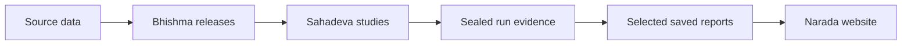

# Abacus


A research workspace for trusted market data, reproducible studies, and selected
web reports. Abacus keeps data preparation, research evidence, and publication
separate so that every result can be traced to its inputs and saved run.

**[Explore the live research journal ↗](https://abacus-narada.vercel.app/)** ·
[GitHub repository](https://github.com/pruthvireddy/abacus) ·
[Architecture](ARCHITECTURE.md) · [Contributing](CONTRIBUTING.md) ·
[Documentation](docs/README.md)

## Explore the research

The [Narada website](https://abacus-narada.vercel.app/) presents selected studies,
figures, evidence qualifications, and summary downloads. Examples include
[session-anchored VWAP](https://abacus-narada.vercel.app/studies/session-vwap/),
[GC overnight breakout](https://abacus-narada.vercel.app/studies/gc-overnight-breakout-15m/),
and [Forex News across six futures](https://abacus-narada.vercel.app/studies/forex-news-ema/).

For the broader workspace, browse the [Markdown research index](reports/index.md)
or open `reports/index.html` locally. GitHub displays HTML source rather than the
interactive library. Some local report links require separately retained evidence.
The deployed collection can differ from current local publication selections.

Research includes negative and inconclusive results. Proposed strategies,
descriptive price paths, and assumed-fill simulations have different evidence
limits; the linked reports retain those qualifications. Repository checks do not
establish profitability or reproduce every historical calculation.

## How the workspace fits together

| Component | Responsibility | Start here |
|---|---|---|
| **Bhishma — Data & Features** | Ingestion, validation, calendars, public loaders, immutable feature releases | [Package guide](packages/bhishma/README.md) |
| **Sahadeva — Research & Analysis** | Study protocols, shared methods, saved results, interpretation | [Package guide](packages/sahadeva/README.md), [studies](studies/README.md) |
| **Narada — Publishing** | Validate and render explicitly selected saved report bundles | [App guide](apps/narada/README.md), [publication contract](docs/narada.md) |



Narada builds independently from its saved public inputs. Website builds do not
import Python research code or calculate study results. The
[architecture](ARCHITECTURE.md) defines the authoritative ownership map, dependency
boundaries, and artifact lifecycle; the [agent task map](AGENTS.md) routes maintenance.

## Quick start

A clone contains source, contracts, documentation, selected reports, and retained
small evidence. Market data, bulk ledgers, local configuration, environments, and
release payloads are excluded. GitHub is not a backup of the complete research
workspace; see [storage and restoration](docs/github.md#what-belongs-in-git).

### Documentation and workspace tooling

These checks use system Python's standard library and do not need market data:

```sh
python3 scripts/check-agent-docs.py
./scripts/check-workspace --profile tooling --profile metadata
```

### Website

Use Node 24 and npm. Narada has its own lockfile and needs no Python setup:

```sh
cd apps/narada
npm ci
npm run verify
npm test
npm run lint
npm run build
npm run preview
```

Open `http://127.0.0.1:4173`. See the [app guide](apps/narada/README.md) for preview
smoke checks and browser verification. Hosting uses the existing
[static release workflow](apps/narada/releases/README.md); pushing to GitHub does
not deploy the site or connect Vercel to this repository.

### Python research workspace

Use Python 3.11 and the committed uv lockfile:

```sh
./scripts/bootstrap
./scripts/check-workspace --list
./scripts/check-workspace --context study-12
```

`bootstrap` uses an installed uv or installs uv 0.12.18 under ignored `.tools/`,
then synchronizes the locked environment. Later package/study commands use
`./scripts/uv run --locked --no-sync ...`.

Restore exact pinned data separately before running data-backed checks or studies.
The default storage roots are `.` for publication and `legacy/sahadeva` for legacy
research. Copy [the path example](config/paths.example.toml) to
`config/paths.local.toml` only for machine-specific overrides. See
[Contributing](CONTRIBUTING.md) for setup and owner-specific prerequisites.

## Repository map

| Path | Contents |
|---|---|
| `packages/` | Bhishma and Sahadeva Python packages and their tests |
| `studies/` | Study protocols, settings, input pins, local code and tests |
| `runs/` | Immutable completed evidence; bulk artifacts may be retained separately |
| `strategies/` | Dated interpretations linked to specific saved evidence |
| `apps/narada/` | Independent website source, contracts, selected bundles and release receipts |
| `catalog/`, `requests/` | Pinned data contracts, manifests and reusable dataset requests |
| `reports/` | Generated local research index, quality records and presentation revisions |
| `scripts/`, `config/` | Setup, verification, navigation and workspace configuration |
| `docs/`, `templates/` | Current workflow references and artifact conventions |
| `legacy/` | Preserved historical source and compatibility links |
| `data/`, `work/` | Separately retained data/evidence and new execution staging |

## Data and preservation

Published datasets, catalog snapshots, sealed runs, and historical migration
records are immutable. Stage new work under `work/`; seal verified evidence under
a unique run ID. Changes to numbers, methods, or interpretation require a new run.
Later presentation revisions belong under `reports/exports/`.

The VWAP `session_anchored_vwap` release remains pinned to version `1.0.0`.
Range XV derived timestamps were
[normalized to inferred New York wall time](docs/migration/range-xv-clock-normalization-20260924.json)
on September 24, 2026; old sealed runs retain their original input identities.
Do not rebuild releases or rerun archived scripts into historical output locations.

Read the [data guide](data/README.md), [run guide](runs/README.md),
[artifact conventions](templates/README.md), and
[storage relocation record](docs/migration/storage-relocation-20260922.md)
before restoring data or executing research. Bulk files and ignored release
reconstruction snapshots need a separate backup.

## Reproducibility checks

Choose the narrow gate for the affected owner. Documentation uses
`python3 scripts/check-agent-docs.py`; study calculations use their declared
numerical tests; Narada changes use its four app gates and browser checks when
the UI changes. The [verification reference](docs/verification.md) explains each
check's actual scope and prerequisites.

## Workspace check harness

The [single registry](config/workspace-checks.json) owns check selection.
`./scripts/check-workspace` preserves the compatibility six-step gate:
documentation, Bhishma, Sahadeva, legacy studies 01 and 02, then VWAP input doctor.
It requires the prepared environment and configured inputs and is not complete
repository coverage. Planning with `--list`, `--dry-run`, and `--context` is read-only.

The [GitHub workflow](.github/workflows/ci.yml) runs source-only documentation,
tooling and metadata checks plus independent Narada checks. It does not run
data-backed research or deploy. See [detailed harness behavior](docs/verification.md#workspace-check-harness).

## Evidence and navigation checks

[Evidence contracts](docs/evidence-contract.md) distinguish metadata validity,
exact saved-row references, declared artifact integrity, and research validity.
Use explicit bundle targets and retain negative and inconclusive outcomes.
Regenerate research navigation only when its inputs change; freshness also
depends on which optional local artifacts are restored.
See [verification commands and limits](docs/verification.md#evidence-and-navigation-checks).

## GitHub repository

Source and selected saved artifacts are hosted at
[pruthvireddy/abacus](https://github.com/pruthvireddy/abacus). The
[GitHub guide](docs/github.md) records upload scope, the repeatable readiness
audit, clean-clone checks, and recovery of the previous repository contents.
The repository has no blanket reuse license. Vercel hosting follows its separate
static release workflow.
