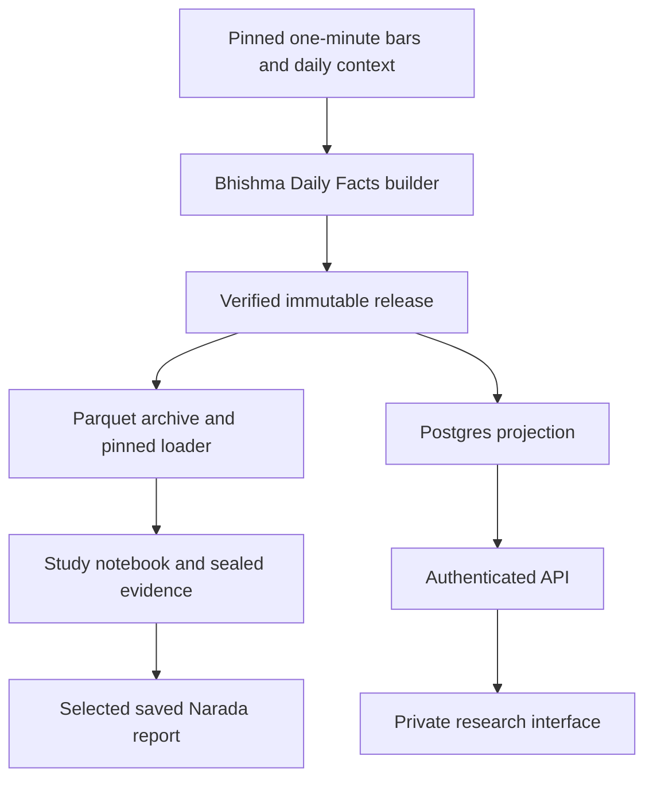

# Daily Facts v1 design and implementation plan

Daily Facts is a reusable Bhishma data product for ES, NQ and GC, with one logical
row per asset and trading-session date. Studies consume pinned releases; a private
API and research interface can query the same verified rows from Postgres.

The local 1.0.0 pilot was completed on November 8, 2026 using asset-specific
daytime windows and the audited retained inputs. The
[fulfilled request](../requests/fulfilled/daily_market_facts__1.0.0.yaml)
freezes the exact local definitions. The [release quality record](../reports/quality/daily_market_facts__1.0.0.md)
and [notebook pilot](../studies/31_daily_facts_volume_pilot/README.md) record the
results. The future database and application plan uses private personal access.

The [current architecture](../ARCHITECTURE.md), [Bhishma guide](../packages/bhishma/AGENTS.md),
[data layers](../data/README.md), [request workflow](../requests/README.md), and
[notebook study guide](../templates/notebook-study/README.md) remain authoritative.
This plan introduces no active application or change to Narada's publication boundary.

## Ownership and delivery

Bhishma owns input selection, session-aware aggregation, fact definitions,
quality rules, public loaders and immutable releases. Sahadeva owns study
questions, comparisons, outcomes, statistics and interpretation. A future private
research application owns authentication, bounded queries and presentation.

One Bhishma implementation produces a portable Parquet release and imports the
same verified rows into Postgres. The database is a queryable projection of the
release; the API selects saved facts without recomputing research. Local notebooks
remain usable without a hosted database. Input and evidence retention require
separate backups from a free hosted service.

The logical key is `(release_id, asset, session_date)`. A release fixes the source
manifest, selected-contract methodology, price basis, calendar and definition
version. Multiple price-series variants require explicit distinct identities.
Release IDs identify snapshots; definition versions identify semantics. A mutable
current-release pointer is a browsing convenience, never an implicit study input.

## Pinned inputs and history

The price source is [volume_lead_unadjusted_v1](../catalog/datasets/volume_lead_unadjusted_v1.json),
whose manifest SHA-256 is
`00757f5fc8278e75744d7adfaddc688be588d619d82b1dc1811aa60f21b7e5d4`.
It selects one outright contract per Globex mapping interval and retains exact
fixed-point OHLC prices, volume and contract identities. Choosing unadjusted
prices here is deliberate: v1 describes same-contract observed session prices
and movements. It does not infer fill-level P&L or splice roll gaps into returns.

The retained minute publication records June 7, 2010 through September 18, 2026
session coverage. The common supported-calendar pilot is June 28, 2021 through
September 18, 2026. Audit all retained history as well as that common period;
do not equate the pilot boundary with absence of older data.

The [calendar contract](../catalog/calendars/cme_fixed_clock_session_v1.json)
marks earlier ES/NQ sessions unsupported because of the historical 16:15–16:30
pause, and GC sessions before September 21, 2015 unsupported because of the
historical 17:15 close. Those are qualifications of that existing fixed-clock
feature contract. A one-minute Daily Facts calendar could support unaffected
windows after separate review; this audit must not silently adopt that change.

Volatility context uses [tradingview_daily_context 1.0.0](../docs/daily-context-20260924.md),
with exact source identities from its [manifest](../catalog/datasets/tradingview_daily_context__1.0.0.json).
Its confirmed daily coverage ends September 23, 2026. A later context date does
not extend the underlying minute history.

Resolve storage with Bhishma's configured publication root and documented
overrides. Use its public pinned loaders for retained data; select only
manifest-listed partitions. Never rebuild or repair a source release during an audit.

## Session windows

Use `America/New_York` for calendar construction and UTC for stored timestamps.
Intervals are `[start, end)`, based on one-minute bar opens. D denotes the trading
session date; the evening open is on D minus one calendar day, including Sunday
for a normal Monday session. Daylight-saving conversion uses timezone rules.

| Prefix | ES and NQ | GC | Expected minutes on a normal session | Aggregate available |
|---|---|---|---|---|
| `globex` | D−1 18:00 to D 17:00 | Same | 1380 / 1380 | 17:00 |
| `overnight` | D−1 18:00 to D 09:30 | D−1 18:00 to D 08:20 | 930 / 860 | 09:30 / 08:20 |
| `rth` | 09:30 to 16:00 | 08:20 to 13:30 | 390 / 310 | 16:00 / 13:30 |
| `or15` | 09:30 to 09:45 | 08:20 to 08:35 | 15 / 15 | 09:45 / 08:35 |
| `first60` | 09:30 to 10:30 | 08:20 to 09:20 | 60 / 60 | 10:30 / 09:20 |
| `last60` | 15:00 to 16:00 | 12:30 to 13:30 | 60 / 60 | 16:00 / 13:30 |

These analytical windows overlap. Overnight means the pre-RTH segment for the
asset; Globex includes RTH and post-RTH trading. Volumes across these six windows
are not additive components of a whole day. GC RTH is deliberately different from
the common US cash window used by some historical studies.

## Base facts

Instantiate each of the following eight columns for all six prefixes: 48 base
columns. OHLC comes from the same selected contract and source resolution.

| Suffix | Calculation | Logical availability |
|---|---|---|
| `_open` | Open of the minute beginning exactly at window start | End of the first minute |
| `_high` | Maximum minute high over the complete window | Window end |
| `_low` | Minimum minute low over the complete window | Window end |
| `_close` | Close of the minute ending exactly at window end | Window end |
| `_volume` | Sum of minute volume, in contracts | Window end |
| `_range_points` | High minus low | Window end |
| `_net_change_points` | Close minus open | Window end |
| `_return_fraction` | Close divided by open, minus one | Window end |

Store fractions as fractions: `0.01` means 1%. Preserve exact source-price
precision; round only for display. Division by zero is undefined. Points are
instrument price units, not dollar P&L. A window close is not an exchange
settlement price.

Opening prices use completed-minute inputs: ES/NQ `rth_open` is logically
available at 09:31; GC at 08:21. Opening-price readiness depends on the first
minute independently of later window completeness.

## Opening references and volume comparisons

| Column | Calculation | Logical availability |
|---|---|---|
| `prior_rth_close` | Immediately preceding weekday's valid RTH close, with unchanged selected contract | Current Globex start |
| `rth_gap_points` | Current RTH open minus prior RTH close | First RTH minute end |
| `rth_gap_fraction` | RTH gap divided by prior RTH close | First RTH minute end |
| `first60_volume_share` | First-hour volume divided by complete RTH volume | RTH end |
| `last60_volume_share` | Last-hour volume divided by complete RTH volume | RTH end |
| `first60_to_last60_volume_ratio` | First-hour volume divided by last-hour volume | RTH end |

Retain the immediately preceding weekday and both contract identities. On a
selected-contract transition, the prior-price reference and gap fields are null
with a roll reason. The reference also stays null after an excluded weekday,
when its RTH close is incomplete, or at the pilot boundary. The current Globex
start is the reference availability time because the current mapping is then
effective.

## VWAP facts

Use completed one-minute bars, `p_i = (high_i + low_i + close_i) / 3`, weighted
by minute volume: `VWAP = sum(p_i * volume_i) / sum(volume_i)`. A zero cumulative
denominator or incomplete required minute grid produces null with a reason.

| Column | Calculation interval or expression | Logical availability |
|---|---|---|
| `globex_vwap_at_rth_open` | Globex start up to, excluding, RTH start | RTH start |
| `globex_vwap_at_rth_close` | Globex start through RTH end | RTH end |
| `globex_vwap_at_globex_close` | Full Globex | Globex end |
| `rth_vwap` | RTH only | RTH end |
| `rth_close_minus_globex_vwap_points` | RTH close minus Globex VWAP at RTH close | RTH end |
| `rth_close_minus_rth_vwap_points` | RTH close minus RTH VWAP | RTH end |
| `globex_close_minus_globex_vwap_points` | Globex close minus final Globex VWAP | Globex end |

This is a minute-bar HLC3 approximation, not exact trade-price VWAP. It has a
different definition identity from existing output-bar HLC3 VWAP publications.
Do not rewrite those releases or claim numerical parity across resolutions.

Defer crossing/touch counts and time above VWAP until equality, sampling and gap
rules are independently specified. ATR, rolling percentiles, regime bins,
strategy outcomes and trade P&L are outside v1.

## Preopen volatility context

ES uses VIX; NQ uses VXN; GC uses GVZ. GVZ is gold ETF volatility context rather
than a claim of GC-option implied volatility; retain the source symbol and
definition. See [Cboe's index reference](https://www.cboe.com/us/indices/benchmark_indices/).

| Column | Definition |
|---|---|
| `vol_index_symbol` | VIX, VXN or GVZ |
| `vol_index_close_preopen` | Latest completed source close with `available_at <= rth_start` |
| `vol_index_source_day` | Selected source trading day |
| `vol_index_source_available_at` | Source's recorded availability timestamp |
| `vol_index_age_hours` | `(rth_start - source_available_at)` in hours |
| `vol_index_status` | Valid, missing or stale |

The preopen snapshot is available at RTH start. Source observations older than
seven elapsed days are stale; expose a null context value and retain the reason
and source timing. Do not join daily values on calendar date alone.

These historical chart snapshots are not certified point-in-time vintages.
Logical completed-bar availability does not prove which provider revision or
contract mapping was actually accessible historically. Keep modeled information
availability separate from acquisition, computation, release and serving times.

## Metadata and quality

Retain release/definition IDs, asset/session date, source contract and series IDs,
calendar ID, UTC window boundaries, roll flag, prior-session identity, and input
manifest hashes. Per-window metadata includes expected, observed, unique and
missing minute counts; duplicate/off-grid/invalid-row counts; opening-price
readiness; aggregate readiness; and explicit reason codes.

Complete-window aggregates require every expected minute exactly once and valid
OHLCV rows from one selected contract. Missing minutes are never filled; their
absence is not asserted to be corruption. A missing boundary minute is not
replaced with the nearest observed bar. Preserve null, zero and false distinctly.

Assess each window independently. A later gap must not retrospectively remove an
earlier opening range or preopen context. Whole-day completeness is not a causal
eligibility condition for an earlier fact. Unsupported calendars, holidays and
shortened sessions remain in coverage records; v1 does not silently truncate the
nominal windows. A stricter whole-day sample is an explicitly retrospective study
choice and must report its exclusions.

Availability is per fact or dependency group, not one timestamp for the whole
daily row. A future `known_by` query masks later facts and distinguishes
`not_yet_available` from `missing_input`, `unsupported_calendar`, `roll_reference`
and `stale_context`. It is not a historical provider-vintage reconstruction.

## Database and private API

| Table or view | Contents |
|---|---|
| `dataset_releases` | Release identity, manifest hash, definitions and import readiness |
| `daily_sessions` | Asset/date, contract, calendar, roll state, gaps and volume comparisons |
| `daily_window_facts` | One row per release/asset/date/window, with typed base values and quality |
| `daily_vwap_facts` | Typed checkpoint values, distances and availability |
| `daily_context_facts` | Preopen context, source timing and status |
| `daily_facts_v1` | Wide view joining those families |

The local projection uses typed columns and keys. Prices retain their nine-place
decimal representation and volume retains its full unsigned integer range.
VWAP, returns and ratios round-trip through Postgres `double precision` and must
match the source float64 bits. The import compares all view columns and window
keys with the portable release before readiness becomes visible at commit. A
repeat import with the same pin verifies the existing rows. Publish a new release
identity to change values or definitions. See the
[local Postgres parity report](../reports/quality/daily_market_facts__1.0.0__postgres_parity.md).

The proposed stack is Neon Postgres with a small Vercel Node API. On November 8,
2026, [Neon pricing](https://neon.com/pricing) lists 1 GB of Postgres storage,
100 CU-hours and 5 GB network transfer per project/month on Free.
[Vercel Hobby](https://vercel.com/docs/plans/hobby) lists 1 million function
invocations, 4 active CPU-hours and 360 GB-hours of provisioned memory. Recheck
the actual integration plan and quotas before provisioning. Hobby is for personal,
noncommercial use; commercialization requires a hosting-plan reassessment.

The proposed `apps/research/` application would contain the private interface and
same-origin API, with its own Node environment. This path is proposed, not an
active owner. Establish its component guide, registry owner and checks only when
implementation is authorized. Bhishma continues to own fact semantics.

Require a real authenticated session and the user's allowlisted account for data
access, a read-only request database role, server-held credentials, parameterized
queries, allowlisted columns, bounded date ranges and pagination. Exclude private
responses from shared public caches and public static build output. No additional
cache service is required for the first version. Choose the concrete login
integration during the authorized application phase.

Keep bulk minute data, raw exports and event evidence in retained bulk storage.
The serving database initially holds compact daily facts. Later migrations of
saved study tables must preserve source-run identities, exact saved values and
explicit access selection. Static prose and figures can continue in Narada;
an API does not automatically improve every static page or authorize publication.

## Implementation sequence and acceptance

1. Save this design and audit the retained inputs. Review window coverage and
   calendar restrictions before selecting the final history and quality contract.
2. After implementation is authorized, create the agreed Bhishma request with
   exact inputs, definitions, output schema, timing and acceptance criteria.
3. Implement focused synthetic checks for boundaries, DST, missing minutes,
   independent window readiness, roll references, null denominators and as-of
   context. Build in fresh staging, then independently reconcile selected source
   sessions and generated facts before creating a new release.
4. Produce the portable release, loader, schema, manifest and quality report.
   Verify source hashes, unique keys, exact price/volume values and declared
   VWAP/ratio tolerances. Preserve all existing releases.
5. Execute one consuming study notebook and verify its saved denominators and
   estimates from the pinned release. Retain its executed notebook and evidence.
6. Import the pinned release into local Postgres and save full field and window
   parity, a repeat import check and the measured storage footprint.
7. Implement the authenticated API and one private facts view. Verify anonymous
   refusal, account authorization, paging/field limits, private caching and
   `known_by` masking against the same pinned release. Compare API values with
   the local notebook's pinned inputs and retain the comparison record.
8. Add future fact families through new definitions and releases after concrete
   reuse is demonstrated. Preserve negative findings and historical identities.

Steps 1–6 are complete. Before provisioning hosted Postgres for step 7, check
the measured storage footprint and expected query usage against the selected plan.

## Input audit protocol

Audit the 51 manifest-listed unadjusted minute partitions for ES/NQ/GC, their
manifest and applicable schemas/calendar, plus the relevant retained daily-context
files. Verify selected byte hashes and inspect timestamp grids, OHLCV validity,
contract consistency, session assignments and boundary presence. This is bounded
selected-file verification, not discovery of every artifact or a source-vendor
reconciliation.

Use the full weekday calendar from June 7, 2010 through September 18, 2026 as an
inventory denominator, including dates without rows. Report separately:

- All retained nominal windows, without claiming calendar eligibility.
- Product-specific supported normal sessions under the pinned calendar.
- The common June 28, 2021 onward supported normal-session period.
- Annual coverage, missing-minute distributions, and common-asset intersections.
- Preopen VIX/VXN/GVZ lookup coverage and context staleness.

Keep holidays and unsupported regimes as explicit exclusions, not unexplained
missing days. Measure each window independently; also report how many complete
daytime windows a full-Globex completeness requirement would discard. Retain an
audit script, exact commands, environment/source identities, input verification
records, per-session diagnostics and compact summary artifacts. Large diagnostic
files may stay under `work/` with their locator and checksum recorded in the saved
quality snapshot. Integrity and coverage do not establish research validity.

## Completed input audit

The [November 8 input audit](../reports/quality/daily-facts-v1-input-audit-20261108/README.md)
contains complete/candidate counts for all six windows, annual detail, older
nominal history, product-specific calendar exclusions, joint asset coverage,
preopen volatility lookup coverage and full-day gate losses. Its selected input
hashes match the retained publications. Daytime coverage is substantially higher
than full-Globex coverage, especially for GC, supporting independent window
readiness. Some severe GC gaps occur near month-end; their cause and any change
to source/contract selection remain separate review work.

The audit also records two missing source-integration prerequisites encountered
by the default workspace gate. The local release uses the verified retained
publications and has separate Daily Facts checks.
