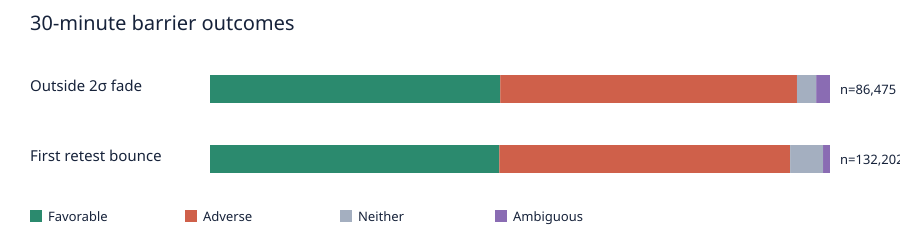

# Three session VWAP statistical studies

Price-path evidence from the pinned Session-Anchored VWAP 1.0.0 release. Commission, slippage, latency, order type, and position sizing are unspecified. These are conditional movement observations, not net profitability.

## Three-candidate scorecard

| Candidate | Evaluable / events | Distinct product-sessions | Primary outcome | 95% session bootstrap interval |
|---|---:|---:|---:|---:|
| Return after departure | 42,487 / 42,487 | 3,039 | 33,327/42,487 (78.4%) | 77.7%–79.2% |
| First outside-2σ fade | 86,475 / 90,938 | 3,039 | 40,480/86,475 (46.8%) | 46.2%–47.4% |
| First VWAP retest bounce | 132,202 / 138,674 | 3,039 | 61,689/132,202 (46.7%) | 46.2%–47.2% |

The scorecard pools seven overlapping anchor/window views and two correlated timeframes. Counts are events within those views; the session column deduplicates product × date. The bootstrap resamples shared session dates, retaining the correlated views and products together.

## Coverage and sample construction

The saved windows table contains 42,546 product × date × timeframe × anchor/window views. The pinned publication includes 3,039 eligible product-days. Its retrospective eligibility audit excludes incomplete product-days; this cannot be used as an entry-time filter. `tables/eligibility.csv` has year-by-year candidate, included, excluded, and overlapping reason counts. See `tables/cycles.csv` for mature windows, already-away/fresh departures, no-departure windows, unqualified first touches, gaps, and cycles.

Source reconciliation verified 2,935,674 published feature bars and 701,488 evaluable event reference opens against the pinned unadjusted one-minute data. The source audit also checked exclusive-close availability and adjustment constancy by session.

## Exact setup definitions

See `protocol-1.0.0.md`. Features are known at exclusive bar close; paths begin at the following unadjusted one-minute open as an idealized observation, not a guaranteed fill. B is the first close at least 1σ and four ticks away in each view. A uses the first published close exit outside 2σ per rearmed excursion. C requires a meaningful departure, ten elapsed minutes of completed same-side closes, and the first causal VWAP-zone touch. No C touch-bar extreme counts as post-signal movement.

## Frequency and denominators

`tables/scorecards.csv`, `tables/breakdowns.csv`, and `tables/cycles.csv` give event, evaluable, eligible-window, mature-window, departure-window, and distinct-session denominators. `tables/departure_classes.csv` separates already-away and fresh B departures. `tables/window_populations.csv` retains no-departure windows by product, year, split, timeframe, anchor, and observation window. `tables/exclusions.csv` counts zero-follow-up, discontinuity, late, and already-at-target cases; the event evidence retains their individual flags.

Meaningful first departures occurred in 42,487 of 42,546 eligible views; these views share dates and price paths. The remaining views had no qualifying departure.

## Return time and movement

`tables/horizons.csv` shows 10/30/60-minute return or barrier curves, signed movement, and full-horizon MFE/MAE; it also provides a common 60-minute-capable cohort. B nonreturners remain in window-end denominators and are censored in time-to-return summaries. Departures already at the frozen target on the reference open remain visible and receive no fresh-return credit. `tables/return_survival.csv` retains returners and censored nonreturners in descriptive survival curves; interpreting those curves as population return times would require independent administrative censoring conditional on departure time and other context, which this study does not establish. Conditional median return time among successes is not an expected waiting time for all departures. Saved event times are zero-based one-minute bar offsets; intraminute contact times are unknown. Frozen and evolving VWAP contacts are independent observations; saved events include actual price retracement and VWAP movement. Pre-return adverse extension has lower/upper bounds because the order of extremes inside the one-minute contact bar is unknown.

For B, 18,757 of 42,466 30-minute-capable departures returned to frozen VWAP within 30 minutes; 38,325 had evolving-VWAP contact by window end. The median observed wait among frozen returners was 22.0 minutes. Globex full-session outcomes allow much longer follow-up than local-window outcomes, so the window-end return rate is strongly horizon dependent.

## Favorable, adverse, timeout, and ambiguous outcomes

A and C use equal 0.5σ barriers rounded up to whole ticks. The four outcomes are exhaustive among evaluable events. Ambiguity remains in the denominator, with optimistic success bounds reported. An open beyond a barrier is flagged as an open-gap first passage. Full-horizon excursions can occur after the first barrier and should not be read as capturable under a stopped policy. `tables/paths.csv` contrasts full-horizon and pre-barrier excursions plus window-end outcomes. `tables/sensitivity.csv` contains the one-at-a-time barrier and fixed-tick grids; `tables/threshold_times.csv` records descriptive full-window movement-threshold times without a stop; `tables/warmup_sensitivity.csv` compares the 20-, 30-, and 40-minute full reruns.

A and C both have more adverse-first than favorable-first outcomes at the primary barrier. For C, the approach-side close confirmation subset is in `tables/subsets.csv`; it does not replace the all-touch primary population. The warm-up and barrier grids are sensitivity descriptions, not optimized settings.

## Baseline comparisons

- ALL — A versus A_control: 86452 matched treated events; observed difference 1.1%; shared-date bootstrap interval 0.3%–2.0%. exploratory; no simultaneous familywise interval.
- ALL — C versus C_near: 129650 matched treated events; observed difference 0.2%; shared-date bootstrap interval -1.3%–1.6%. exploratory; no simultaneous familywise interval.
- ALL — C_first versus C_later: 35871 matched treated events; observed difference -1.5%; shared-date bootstrap interval -3.6%–0.5%. exploratory; no simultaneous familywise interval.
- development — A versus A_control: 45778 matched treated events; observed difference 1.3%; shared-date bootstrap interval -0.0%–2.6%. exploratory; no simultaneous familywise interval.
- development — C versus C_near: 69838 matched treated events; observed difference 0.6%; shared-date bootstrap interval -1.3%–2.3%. exploratory; no simultaneous familywise interval.
- development — C_first versus C_later: 18983 matched treated events; observed difference -0.2%; shared-date bootstrap interval -3.2%–2.7%. exploratory; no simultaneous familywise interval.
- validation — A versus A_control: 12928 matched treated events; observed difference 0.3%; shared-date bootstrap interval -2.0%–2.5%. exploratory; no simultaneous familywise interval.
- validation — C versus C_near: 18576 matched treated events; observed difference -0.5%; shared-date bootstrap interval -4.5%–3.0%. exploratory; no simultaneous familywise interval.
- validation — C_first versus C_later: 4952 matched treated events; observed difference -1.2%; shared-date bootstrap interval -6.1%–3.8%. exploratory; no simultaneous familywise interval.
- final — A versus A_control: 27746 matched treated events; observed difference 1.2%; shared-date bootstrap interval -0.3%–2.6%. exploratory; no simultaneous familywise interval.
- final — C versus C_near: 41236 matched treated events; observed difference -0.2%; shared-date bootstrap interval -3.2%–2.9%. exploratory; no simultaneous familywise interval.
- final — C_first versus C_later: 11936 matched treated events; observed difference -3.8%; shared-date bootstrap interval -7.9%–-0.2%. exploratory; no simultaneous familywise interval.

Matching bins for hour, anchor age, and sigma are learned from development data. The A extreme and 1–2σ controls have disjoint distance support by design; remaining distance differences, unmatched counts, and a common fixed 8-tick barrier comparison are in `tables/baselines.csv`. These observational contrasts have session bootstrap intervals conditional on the observed matching overlap and weights. They do not establish a familywise-adjusted advantage.

The pooled A half-sigma contrast is small and its 2024 and final-period intervals include zero. With a common fixed 8-tick barrier, A trails its control in the final period. C has no stable advantage over near approaches; first C retests do not outperform later ones in the final period. Neither candidate has a demonstrated incremental edge.

## Calendar and chronological stability

`tables/breakdowns.csv` separates product, timeframe, anchor/window, direction, development, validation, final evaluation, and calendar year. `tables/stability.csv` aligns the three splits in one row per product/timeframe/anchor/window. Sparse and degenerate intervals are flagged. The final period is chronological, but prior unseen status is not certified. Two agreeing timeframes are correlated observations.

Pooled view-level primary rates by period:

| Candidate | Development | 2024 validation | 2025–2026 final |
|---|---:|---:|---:|
| Return after departure | 79.9% | 79.2% | 75.9% |
| First outside-2σ fade | 47.7% | 46.9% | 45.3% |
| First VWAP retest bounce | 47.0% | 46.7% | 46.1% |

## Representative examples

`tables/examples.csv` selects the earliest timestamp in each product × candidate × outcome class. Each row links to the stable event ID in retained Parquet evidence. These are deterministic illustrations, not hand-picked successes.

| Product | Candidate | Class | Signal (UTC) | Event ID |
|---|---|---|---|---|
| ES | A | adverse | 2021-06-28T05:58:00+00:00 | `A:ES:2021-06-28:2m:asia:asia:2` |
| ES | A | ambiguous | 2021-06-29T14:35:00+00:00 | `A:ES:2021-06-29:5m:ny:ny:1` |
| ES | A | excluded | 2021-06-28T13:00:00+00:00 | `A:ES:2021-06-28:2m:globex:london:3` |
| ES | A | favorable | 2021-06-28T00:04:00+00:00 | `A:ES:2021-06-28:2m:globex:globex:1` |
| ES | A | late | 2021-06-28T12:58:00+00:00 | `A:ES:2021-06-28:2m:london:london:4` |
| ES | A | neither | 2021-07-12T03:42:00+00:00 | `A:ES:2021-07-12:2m:asia:asia:2` |
| ES | B | nonreturn | 2021-06-30T00:34:00+00:00 | `B:ES:2021-06-30:2m:asia:asia:1` |
| ES | B | return | 2021-06-27T22:30:00+00:00 | `B:ES:2021-06-28:2m:globex:globex:1` |
| ES | C | adverse | 2021-06-27T22:38:00+00:00 | `C:ES:2021-06-28:2m:globex:globex:1` |
| ES | C | ambiguous | 2021-06-29T14:46:00+00:00 | `C:ES:2021-06-29:2m:ny:ny:1` |
| ES | C | excluded | 2021-06-29T07:00:00+00:00 | `C:ES:2021-06-29:2m:asia:asia:5` |
| ES | C | favorable | 2021-06-27T22:40:00+00:00 | `C:ES:2021-06-28:5m:globex:globex:1` |
| ES | C | late | 2021-06-28T06:40:00+00:00 | `C:ES:2021-06-28:2m:globex:asia:3` |
| ES | C | neither | 2021-06-29T15:50:00+00:00 | `C:ES:2021-06-29:2m:globex:globex:8` |
| GC | A | adverse | 2016-02-11T08:34:00+00:00 | `A:GC:2016-02-11:2m:globex:globex:1` |
| GC | A | ambiguous | 2016-05-09T01:32:00+00:00 | `A:GC:2016-05-09:2m:asia:asia:1` |
| GC | A | excluded | 2016-11-17T08:00:00+00:00 | `A:GC:2016-11-17:2m:asia:asia:3` |
| GC | A | favorable | 2016-02-11T01:35:00+00:00 | `A:GC:2016-02-11:5m:asia:asia:1` |
| GC | A | late | 2016-05-09T06:54:00+00:00 | `A:GC:2016-05-09:2m:asia:asia:3` |
| GC | A | neither | 2016-02-11T08:35:00+00:00 | `A:GC:2016-02-11:5m:globex:globex:1` |
| GC | B | nonreturn | 2016-02-11T08:08:00+00:00 | `B:GC:2016-02-11:2m:globex:london:1` |
| GC | B | return | 2016-02-10T23:30:00+00:00 | `B:GC:2016-02-11:2m:globex:globex:1` |
| GC | C | adverse | 2016-02-11T01:44:00+00:00 | `C:GC:2016-02-11:2m:asia:asia:1` |
| GC | C | ambiguous | 2016-06-17T01:10:00+00:00 | `C:GC:2016-06-17:5m:globex:globex:4` |
| GC | C | excluded | 2016-12-15T14:00:00+00:00 | `C:GC:2016-12-15:5m:london:london:4` |
| GC | C | favorable | 2016-02-10T23:34:00+00:00 | `C:GC:2016-02-11:2m:globex:globex:1` |
| GC | C | late | 2016-02-11T07:40:00+00:00 | `C:GC:2016-02-11:2m:asia:asia:7` |
| GC | C | neither | 2016-02-11T02:12:00+00:00 | `C:GC:2016-02-11:2m:globex:globex:2` |
| NQ | A | adverse | 2021-06-28T01:24:00+00:00 | `A:NQ:2021-06-28:2m:asia:asia:1` |
| NQ | A | ambiguous | 2021-06-29T07:15:00+00:00 | `A:NQ:2021-06-29:5m:globex:london:1` |
| NQ | A | excluded | 2021-06-28T13:00:00+00:00 | `A:NQ:2021-06-28:2m:london:london:2` |
| NQ | A | favorable | 2021-06-28T01:26:00+00:00 | `A:NQ:2021-06-28:2m:globex:globex:1` |
| NQ | A | late | 2021-06-29T06:48:00+00:00 | `A:NQ:2021-06-29:2m:asia:asia:4` |
| NQ | A | neither | 2021-07-12T20:05:00+00:00 | `A:NQ:2021-07-12:5m:globex:globex:7` |
| NQ | B | nonreturn | 2021-06-28T07:02:00+00:00 | `B:NQ:2021-06-28:2m:globex:london:1` |
| NQ | B | return | 2021-06-27T22:30:00+00:00 | `B:NQ:2021-06-28:2m:globex:globex:1` |
| NQ | C | adverse | 2021-06-28T00:35:00+00:00 | `C:NQ:2021-06-28:5m:asia:asia:1` |
| NQ | C | ambiguous | 2021-06-29T13:32:00+00:00 | `C:NQ:2021-06-29:2m:globex:globex:11` |
| NQ | C | excluded | 2021-07-02T07:00:00+00:00 | `C:NQ:2021-07-02:5m:globex:asia:3` |
| NQ | C | favorable | 2021-06-27T23:38:00+00:00 | `C:NQ:2021-06-28:2m:globex:globex:1` |
| NQ | C | late | 2021-06-28T06:34:00+00:00 | `C:NQ:2021-06-28:2m:globex:asia:2` |
| NQ | C | neither | 2021-06-28T17:12:00+00:00 | `C:NQ:2021-06-28:2m:ny:ny:2` |

## Limitations and research advice

No net trading conclusion follows from a return rate or movement barrier rate. Execution research still needs order type, spread/slippage, commission, latency, position size, overlap handling, and fill behavior at gaps and touched levels. Broad segment grids and controls are exploratory. The eligibility audit selects complete days retrospectively. See `advice.md` for candidate-specific dated interpretation.

## Reproduce

From the workspace root with the locked environment installed, choose a new unique ID and run `.venv/bin/python studies/05_session_vwap/run.py --run-id <id> --workers 3`, `.venv/bin/python studies/05_session_vwap/enrich.py --run-id <id> --workers 3`, `.venv/bin/python studies/05_session_vwap/audit.py --run-id <id>`, and `.venv/bin/python studies/05_session_vwap/summarize.py --run-id <id>`. Reproduce warm-up sensitivities with fresh IDs and `--warmup 20` or `--warmup 40`, then run `warmup_sensitivity.py` with those IDs. Review checks before sealing; never reuse a completed ID. The manifest records exact code and input hashes.

## Saved evidence

[Scorecards](tables/scorecards.csv) · [All tables](tables/) · [Metrics](metrics.json) · [Event evidence manifest](events.manifest.json) · [Input verification](input-verification.json) · [Source audit](source-audit.json) · [Denominator audit](denominator-audit.json) · [Run manifest](manifest.json)
