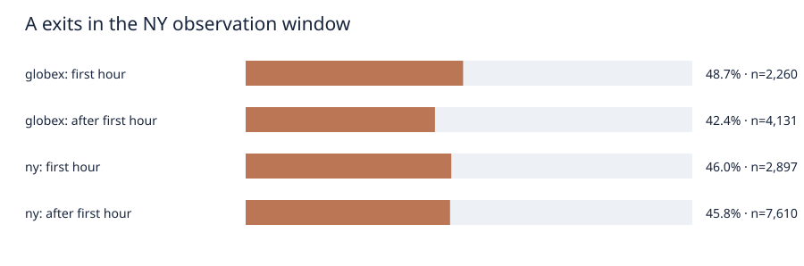
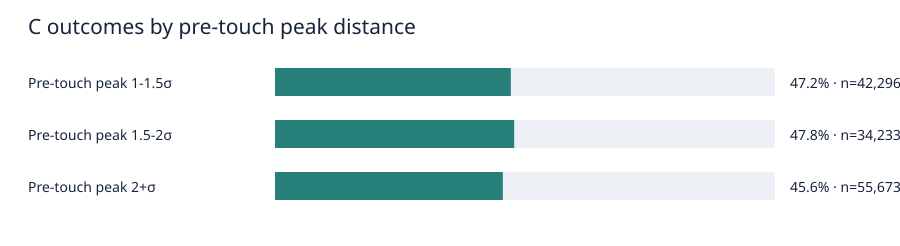

# VWAP A/C conditional-context study

Exploratory price-path cuts on sealed parent run `20260923T015900Z_vwap3`, with new causal context from the same pinned Bhishma 1.0.0 release. The parent A/C outcomes and excluded-event identities are unchanged. Earlier aggregate and final-period outcomes were already viewed; newly selected segments are discovery evidence, not independent confirmation or net trading performance.

## Scorecard and populations

| Candidate | Full 30m events | Favorable first | Adverse first | Neither | Ambiguous | 95% shared-date interval |
|---|---:|---:|---:|---:|---:|---:|
| A: first outside-2σ fade | 86,475 | 40,480 (46.8%) | 41,390 | 2,677 | 1,928 | 46.2%–47.4% |
| C: first causal VWAP retest | 132,202 | 61,689 (46.7%) | 62,010 | 7,017 | 1,486 | 46.2%–47.1% |

These are correlated anchor/timeframe views across product-sessions. See `tables/cuts.csv` for every inspected cut, four barrier classes, common 8-tick results, coverage, distinct dates, and chronological rates. `context/` retains event-linked evidence. The 0.5σ and 8-tick outcomes are measured after signal availability from the following unadjusted one-minute open. Costs and fills are unspecified.

## A: NY early 2σ exits

The NY observation window starts at 09:30 America/New_York. Columns below compare the first 30 minutes, minutes 30–59, and later exits on a fixed 30-minute-capable cohort. The NY local anchor is structurally ineligible during the first 30 minutes because the original protocol requires 30 elapsed minutes of accumulation. Globex VWAP in the NY window can signal immediately.

| Product | Anchor | NY clock | Events | Favorable first | 95% interval | 8-tick rate | Coverage within anchor |
|---|---|---|---:|---:|---:|---:|---:|
| ALL | globex | 00-29 | 1,205 | 49.5% | 46.3%–53.1% | 27.3% | 18.9% |
| ALL | globex | 30-59 | 1,055 | 47.8% | 44.1%–51.1% | 29.9% | 16.5% |
| ALL | globex | 60-119 | 1,432 | 46.2% | 42.5%–49.4% | 34.4% | 22.4% |
| ALL | globex | 120+ | 2,699 | 40.4% | 38.0%–43.0% | 35.5% | 42.2% |
| ALL | ny | 00-29 | 0 | n/a | n/a–n/a | n/a | 0.0% |
| ALL | ny | 30-59 | 2,897 | 46.0% | 43.8%–48.3% | 32.9% | 27.6% |
| ALL | ny | 60-119 | 3,048 | 47.7% | 45.5%–49.9% | 35.9% | 29.0% |
| ALL | ny | 120+ | 4,562 | 44.4% | 42.6%–46.3% | 35.1% | 43.4% |
| ES | globex | 00-29 | 350 | 47.4% | 41.1%–53.4% | 42.9% | 14.1% |
| ES | globex | 30-59 | 403 | 51.6% | 46.1%–57.6% | 47.1% | 16.3% |
| ES | globex | 60-119 | 552 | 50.7% | 45.7%–55.8% | 50.7% | 22.3% |
| ES | globex | 120+ | 1,173 | 42.3% | 38.8%–45.7% | 46.5% | 47.3% |
| ES | ny | 00-29 | 0 | n/a | n/a–n/a | n/a | 0.0% |
| ES | ny | 30-59 | 1,082 | 46.5% | 43.3%–50.0% | 46.1% | 27.7% |
| ES | ny | 60-119 | 1,076 | 48.9% | 45.7%–52.2% | 47.7% | 27.6% |
| ES | ny | 120+ | 1,747 | 44.4% | 41.8%–46.8% | 44.6% | 44.7% |
| NQ | globex | 00-29 | 617 | 50.4% | 46.4%–55.1% | 13.0% | 21.7% |
| NQ | globex | 30-59 | 492 | 46.1% | 41.2%–50.9% | 14.2% | 17.3% |
| NQ | globex | 60-119 | 642 | 44.5% | 39.2%–49.2% | 19.0% | 22.5% |
| NQ | globex | 120+ | 1,097 | 40.8% | 37.3%–44.5% | 22.2% | 38.5% |
| NQ | ny | 00-29 | 0 | n/a | n/a–n/a | n/a | 0.0% |
| NQ | ny | 30-59 | 1,119 | 45.8% | 42.2%–49.2% | 14.6% | 28.5% |
| NQ | ny | 60-119 | 1,097 | 45.0% | 41.8%–48.3% | 16.2% | 27.9% |
| NQ | ny | 120+ | 1,709 | 44.2% | 41.4%–47.0% | 21.2% | 43.5% |
| GC | globex | 00-29 | 238 | 50.0% | 42.3%–57.8% | 41.6% | 22.3% |
| GC | globex | 30-59 | 160 | 43.1% | 33.8%–51.7% | 34.4% | 15.0% |
| GC | globex | 60-119 | 238 | 39.9% | 32.6%–48.1% | 38.2% | 22.3% |
| GC | globex | 120+ | 429 | 34.0% | 27.9%–39.5% | 39.4% | 40.3% |
| GC | ny | 00-29 | 0 | n/a | n/a–n/a | n/a | 0.0% |
| GC | ny | 30-59 | 696 | 45.8% | 42.0%–49.6% | 41.7% | 26.0% |
| GC | ny | 60-119 | 875 | 49.7% | 46.3%–53.4% | 46.1% | 32.7% |
| GC | ny | 120+ | 1,106 | 44.9% | 41.7%–48.1% | 41.3% | 41.3% |

The proposed early-NY weakness is not present in the primary 0.5σ result for Globex: first-hour exits are 48.7% favorable first (2,260 events), versus 42.4% after the first hour (4,131). The fixed 8-tick result reverses that ordering (28.5% versus 35.2%). NY-local exits first become eligible at minute 30; their first-hour primary rate is 46.0% versus 45.8% later. These are descriptive probabilities, not an early-session trading rule.

`tables/ny_early.csv` also compares the first hour with the later session. `tables/control_comparisons.csv` matches A's 1–2σ control within product, timeframe, anchor/window, direction, window-clock bin, ATR regime, and chronological split. A and its lesser-departure control still have disjoint starting-distance support. A higher conditional fade rate alone is not an incremental edge.

## C: distance before first touch and return shape

Peak excursion uses completed closes from departure through the bar before touch opens; the touching bar's extremes are excluded. The peak bins are 1–1.5σ, 1.5–2σ, and 2σ+. The prespecified interaction compares peak-to-touch time ≤15 versus >15 minutes within the 2σ+ peak group. Each outcome starts after the touch bar closes.

| Product | Pre-touch peak | Events | Favorable first | 95% interval | 8-tick rate |
|---|---|---:|---:|---:|---:|
| ALL | 1-1.5 | 42,296 | 47.2% | 46.5%–47.9% | 40.5% |
| ALL | 1.5-2 | 34,233 | 47.8% | 47.1%–48.7% | 41.1% |
| ALL | 2+ | 55,673 | 45.6% | 44.8%–46.3% | 40.0% |
| ES | 1-1.5 | 15,489 | 47.4% | 46.3%–48.5% | 44.3% |
| ES | 1.5-2 | 12,478 | 48.9% | 47.5%–50.2% | 45.4% |
| ES | 2+ | 20,108 | 45.7% | 44.7%–46.7% | 44.4% |
| NQ | 1-1.5 | 15,924 | 48.0% | 46.9%–49.2% | 34.7% |
| NQ | 1.5-2 | 12,757 | 47.8% | 46.6%–49.1% | 34.9% |
| NQ | 2+ | 21,931 | 45.4% | 44.4%–46.5% | 33.1% |
| GC | 1-1.5 | 10,883 | 45.6% | 44.1%–47.1% | 43.6% |
| GC | 1.5-2 | 8,998 | 46.3% | 45.1%–47.8% | 44.0% |
| GC | 2+ | 13,634 | 45.6% | 44.5%–46.9% | 44.5% |

A prior peak of 2σ+ is associated with a 45.6% primary bounce rate, versus 47.2% at 1–1.5σ and 47.8% at 1.5–2σ. All three fixed 8-tick rates cluster near 40–41%. Within the 2σ+ group, a return from the peak in ≤15 minutes has a 47.6% primary rate versus 45.0% for slower returns; the fixed 8-tick rates are 39.0% and 40.2%. Neither dimension yields a stable improvement across barrier definitions.

`tables/interactions.csv` gives the peak-distance × return-time cells; `tables/cuts.csv` also shows departure strength, sustained away closes, time to touch, touch close class, local/Globex geometry, ATR, opening balance, and session clocks. The C near-approach baseline lacks the same saved departure link, so those peak/shape cuts are within-C associations; they do not yet prove that touching VWAP adds information over a comparable near approach.

## A: exit strength, prior trend, and regime

`tables/cuts.csv` includes signal-close distance past 2σ, prior 30-minute side-signed price trend, outward signal-bar close location, prior VWAP slope and sigma expansion, time since a near-VWAP close, prior ATR regime, opening-balance width/location, and local/Globex VWAP geometry. `tables/interactions.csv` records the prespecified exit-strength × prior-trend cells. Exits farther than 2.75σ are 46.7% favorable at the primary barrier and 36.6% at 8 ticks; the 2–2.25σ group is 46.3% and 40.3%. Stronger exit distance is not a consistent improvement. The outward frozen 3σ-before-return evidence remains in the event ledger, with already-passed and same-minute order bounds retained.

## Re-entry is a later signal

The first published close back inside the same 2σ band is evaluated from its own following open. Confirmed and never-confirmed original A episodes stay in the denominator. `tables/reentry.csv` separates conversion, full-follow-up eligibility, remaining VWAP distance, and conditional post-confirmation outcomes. Of 90,938 original A episodes, 89,475 (98.4%) confirm re-entry, but only 84,997 have a full 30-minute follow-up. Their conditional favorable-first rate is 45.8%. A selected post-confirmation rate is not a paired trading-policy result: entry time, barrier size, and missed opportunities differ from immediate A.

## Validation and limitations

Development ends in 2023, validation is 2024, and final chronological evaluation is 2025–2026. The final period was already viewed in the parent study, so every new cut is exploratory. Whole shared dates are resampled for intervals; multiple anchor/timeframe views are correlated. Small cells are flagged. Do not rank a sparse cell as a discovery, and do not infer net profitability from a barrier rate. The complete-day eligibility filter is retrospective. Source checks, parent hashes, exact commands, and artifact hashes are in the manifest and audit files.

## Evidence and reproduction

[All cuts](tables/cuts.csv) · [NY early exits](tables/ny_early.csv) · [Interactions](tables/interactions.csv) · [Control comparisons](tables/control_comparisons.csv) · [Re-entry](tables/reentry.csv) · [Examples](tables/examples.csv) · [Metrics](metrics.json) · [Event manifest](events.manifest.json) · [Run manifest](manifest.json)

From the workspace root, with the locked environment installed: `.venv/bin/python studies/05_session_vwap/conditional_run.py --run-id <new-id> --workers 3`, then `.venv/bin/python studies/05_session_vwap/conditional_summarize.py --run-id <same-id>`. Review audits before sealing a new unique ID.
