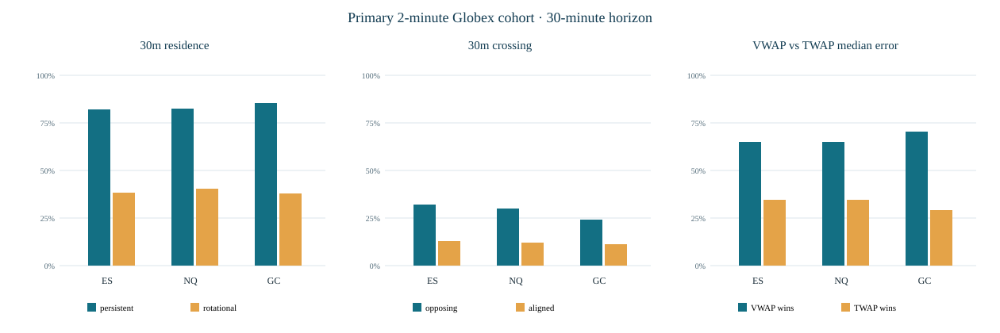
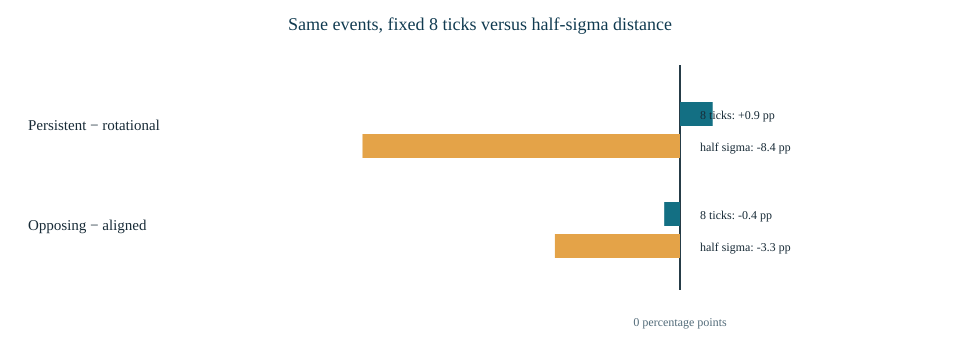

# VWAP state dynamics: three frozen probability questions

Run 20260923T180000Z_state06c · Protocol 1.0.0 · pinned Bhishma session_anchored_vwap 1.0.0 · ES, NQ, GC. All dates, including the 2024 and 2025–2026 chronological labels, are exploratory because earlier VWAP outcomes had already been viewed. These are future price-path and reference-accuracy probabilities, not trading win rates.

## Probability atlas

| Question | Observable X → future Y by 30m | Numerator / full denominator | P(Y \| X) | 95% shared-date CI | Comparable baseline P | Product-sessions |
| --- | --- | --- | --- | --- | --- | --- |
| Q1 | Persistent side → no opposite causal-VWAP close | 87,122/104,577 | 83.3% | 83.0%–83.7% | 39.2% | 3,039 |
| Q1 | Rotational side → no opposite causal-VWAP close | 1,662/4,236 | 39.2% | 37.7%–40.7% | 39.2% | 2,207 |
| Q2 | Opposing slopes → opposite causal-VWAP close | 8,411/28,602 | 29.4% | 28.7%–30.1% | 12.4% | 2,997 |
| Q2 | Aligned slopes → opposite causal-VWAP close | 6,265/50,676 | 12.4% | 12.0%–12.8% | 12.4% | 2,997 |
| Q3 | VWAP beats paired TWAP on future 1m-close median | 89,056/133,716 | 66.6% | 65.9%–67.2% | 33.4% | 3,039 |
| Q3 | VWAP beats TWAP; material reference separation | 71,941/100,406 | 71.7% | 70.8%–72.5% | 28.3% | 3,038 |
| Q3 | VWAP beats TWAP; near-identical references | 17,115/33,310 | 51.4% | 50.5%–52.1% | 48.6% | 2,893 |

Q1 baseline is rotational state; Q2 baseline is aligned slopes; Q3 baseline is paired TWAP wins at identical landmarks. Q3 ties remain in the denominator (zero observed exact error ties). State `other`, slope `flat_or_unavailable`, and near-identical references remain in the saved tables. The outcome horizon includes its closing boundary. Equality at VWAP is neutral, not an opposite close.

## Q1 — residence and crossing state

Persistent landmarks had 83.3% residence (87,122/104,577); rotational landmarks had 39.2% (1,662/4,236). The raw difference was +44.1 pp (95% CI +42.4 pp to +45.6 pp). Within fixed product, side, distance, clock, prior ATR and age strata, the treated-weighted common-support difference was +18.7 pp (95% CI +15.5 pp to +22.0 pp). This is an observational contrast with coarse distance bins, not causal lift or a trading edge.

Matching retained 96,078 of 104,577 persistent and 4,173 of 4,236 rotational landmarks in 256 common strata. It excluded 1,445 persistent and 63 rotational landmarks without matching context, then left 7,054 and 0 unmatched. Against the frozen landmark VWAP, persistent residence was 84.3%, versus 83.3% against causal VWAP; the frozen sensitivity is in its own table.

## Q2 — price/VWAP slope disagreement

Opposing slopes crossed the causal VWAP in 29.4% (8,411/28,602) versus 12.4% (6,265/50,676) for aligned slopes. The raw gap was +17.0 pp; after also matching residence state and the same context, the difference was only +2.1 pp (95% CI +1.0 pp to +3.2 pp). Product-specific NQ and GC adjusted intervals nearly touch zero; the 2024 adjusted interval includes zero. The prior 30-minute slope signs do not proxy for order flow.

Y1 and Y2 were checked as exact complements for all 367,719 fully observed nonzero-side landmark views. A crossing by the 30-minute boundary counts as crossing. The fixed 0.016 price/ATR and 0.0023 VWAP/ATR cuts came only from development-period features.

## Q1/Q2 secondary directional paths: barrier definition changes the answer

| Question | Barrier | Favorable / all X | P(favorable \| X) | Baseline P | Difference | 95% CI | Adverse / neither / ambiguous in X |
| --- | --- | --- | --- | --- | --- | --- | --- |
| Q1 | fixed 8tick | 41,610/104,577 | 39.8% | 38.9% | +0.9 pp | -0.6 pp to +2.3 pp | 40,407 / 4,026 / 18,534 |
| Q1 | half sigma | 36,514/104,577 | 34.9% | 43.3% | -8.4 pp | -9.8 pp to -6.7 pp | 36,440 / 31,224 / 399 |
| Q2 | fixed 8tick | 11,003/28,602 | 38.5% | 38.9% | -0.4 pp | -1.2 pp to +0.4 pp | 10,603 / 613 / 6,383 |
| Q2 | half sigma | 9,799/28,602 | 34.3% | 37.6% | -3.3 pp | -4.2 pp to -2.6 pp | 9,758 / 8,881 / 164 |

The persistent-versus-rotational fixed 8-tick favorable-first gap is small and its interval crosses zero, while the half-sigma gap is negative. For opposing versus aligned slopes, fixed 8 ticks is also inconclusive and half-sigma is negative. Fixed 8-tick paths have many same-minute ambiguous first passages; those remain in every denominator. Neither barrier was selected after inspecting the outcome.

## Q3 — paired volume weighting versus equal weighting

| Product | VWAP wins / paired landmarks | P(VWAP wins) | 95% CI | P(TWAP wins) | VWAP MAE, pts | TWAP MAE, pts | Last price MAE, pts | Mean paired error Δ, pts |
| --- | --- | --- | --- | --- | --- | --- | --- | --- |
| ES | 29,735/45,628 | 65.2% | 64.3%–66.1% | 34.8% | 10.68 | 14.03 | 3.25 | -3.35 |
| NQ | 33,673/51,788 | 65.0% | 64.2%–65.9% | 35.0% | 49.87 | 63.96 | 14.54 | -14.10 |
| GC | 25,648/36,300 | 70.7% | 69.6%–71.9% | 29.3% | 8.11 | 9.70 | 2.04 | -1.59 |

On the primary common timestamps, frozen VWAP won 89,056/133,716 pairs (66.6%; shared-date 95% CI 65.9%–67.3%). Materially separated references won 71.7%, while near-identical references won 51.4%. No exact error ties were observed, but all pairs and tie checks are retained. VWAP's paired mean absolute-error advantage over TWAP was -7.04 points (95% CI -7.52 to -6.53); product-specific point errors above avoid interpreting a pooled futures-point unit. The last known price had far smaller mean absolute error than either anchor reference for each product, so a VWAP-versus-TWAP win is not a general forecasting or execution advantage.

The primary target is the median of 30 future unadjusted one-minute closes. Future volume-weighted price and horizon-end close are saved in event evidence as separate descriptive targets; neither entered landmark features. TWAP is the cumulative equal-weighted completed-bar HLC3 from the same anchor, and the full-series VWAP identity audit checked 8.36 million active output-anchor bars.

## Product, chronology, and independent views

| Product | Q1 matched Δ | Q1 95% CI | Q2 matched Δ | Q2 95% CI | Q3 VWAP wins |
| --- | --- | --- | --- | --- | --- |
| ES | +20.7 pp | +15.1 pp to +26.4 pp | +2.9 pp | +1.0 pp to +4.8 pp | 65.2% |
| NQ | +16.8 pp | +11.4 pp to +21.6 pp | +1.5 pp | +0.0 pp to +3.0 pp | 65.0% |
| GC | +18.7 pp | +14.6 pp to +24.9 pp | +1.9 pp | +0.1 pp to +3.7 pp | 70.7% |

| Chronological label | Q1 matched Δ | Q1 95% CI | Q2 matched Δ | Q2 95% CI | Q3 VWAP wins |
| --- | --- | --- | --- | --- | --- |
| development | +21.4 pp | +16.0 pp to +24.6 pp | +1.9 pp | +0.3 pp to +3.2 pp | 69.0% |
| validation | +23.8 pp | +14.7 pp to +29.5 pp | +1.2 pp | -1.7 pp to +3.9 pp | 65.0% |
| final | +12.8 pp | +9.7 pp to +17.7 pp | +2.4 pp | +0.8 pp to +3.8 pp | 63.5% |

These dates are chronological diagnostics, not protected confirmation. `breakdowns.csv` gives product, year, NY clock window including membership gaps, side, and anchor-age rates with denominators and shared-date intervals. `primary_probabilities.csv` also reports product-session-weighted probabilities and intervals. Products have discontinuous date coverage; no artificial common-day denominator was imposed.

| Separate replication | Persistent n | Q1 persistent | Q1 rotational | Q2 opposing | Q2 aligned | Q3 VWAP wins |
| --- | --- | --- | --- | --- | --- | --- |
| 2m/asia | 26,168 | 78.5% | 39.8% | 39.4% | 16.2% | 46.4% |
| 2m/london | 20,099 | 72.9% | 37.2% | 50.5% | 21.8% | 52.7% |
| 2m/ny | 24,885 | 82.5% | 39.6% | 38.5% | 15.3% | 29.8% |
| 5m/globex | 110,755 | 83.5% | 43.4% | 26.5% | 11.0% | 66.5% |

The independently calculated 5-minute Globex view agrees directionally with the 2-minute primary summary but is correlated with it. Local-anchor Q3 wins vary sharply: Asia and NY favor TWAP in this fixed comparison, London is near even. Those anchors have different ages, membership windows, and populations, so they are sensitivities, not pooled independent votes.

## Coverage, verification, and limits

The pinned retrospective publication supplies 3,039 eligible product-days; all have at least one primary landmark. For the primary cohort, 139,794 regular clock candidates yielded 133,716 landmarks after 3,039 immature and 3,039 insufficient-window-horizon exclusions. ES/NQ/GC contributed 45,628 / 51,788 / 36,300 primary landmarks. All 133,716 primary and 367,719 total separate-view landmark keys had complete 30-minute one-minute source joins; all extracted paths were outcome-capable. There were 0 undefined current sides. `funnel.csv`, `feature-coverage.csv`, and `exclusions.csv` keep the full denominators and missing categories.

Every source interval was reconciled with adjusted feature OHLC, volume, contract ID, raw symbol, exclusive-close availability, and fixed session adjustment. Recomputed completed-bar volume-weighted HLC3 matched the pinned VWAP across 8,360,289 active anchor-bar positions (maximum absolute error 5.8e-11 points). 20 distinct real event paths cover each observed outcome class and product; all 36 product × outcome-class example rows link to those events. The pinned release and all consumed partition SHA-256 checks passed. Tests cover DST clocks, anchor resets, equality, incomplete lookbacks, future gaps, paired ties, horizon-boundary crossing, and intraminute ambiguity.

Matching uses fixed coarse strata and retains only overlap. It does not control every driver of future paths. Shared-date intervals account for clustering across products and views but are unadjusted for the three-question family; no formal superiority claim or calibrated predictive model is made. Product-day eligibility is retrospective. No fill, cost, latency, or net-P&L model was run.

## Separate exploratory family and reproduction

The plan's volume-shock/inertia, local handoff, prior-session VWAP, rolling-versus-anchored VWAP, and VWAP-within-range modules were not executed in this run. They require separately frozen definitions and remain distinct from the three primary comparisons; no threshold grid was searched for a best historical cell.

From the workspace root with the locked environment: `.venv/bin/python studies/06_vwap_state_dynamics/pilot.py --run-id 20260923T180000Z_state06c`; `.venv/bin/python studies/06_vwap_state_dynamics/join_audit.py --run-id 20260923T180000Z_state06c`; `.venv/bin/python studies/06_vwap_state_dynamics/run.py --run-id 20260923T180000Z_state06c --workers 3`; `.venv/bin/python studies/06_vwap_state_dynamics/summarize.py --run-id 20260923T180000Z_state06c`; `.venv/bin/python studies/06_vwap_state_dynamics/audit.py --run-id 20260923T180000Z_state06c`; `.venv/bin/python studies/06_vwap_state_dynamics/render.py --run-id 20260923T180000Z_state06c`. For a reproduction, use a new unique run ID and freeze a matching protocol ID before outcomes; never overwrite sealed evidence.

[Probability atlas](tables/probability_atlas.csv) · [Matched comparisons](tables/matched_comparisons.csv) · [Barrier outcomes](tables/barrier_outcomes.csv) · [Paired errors](tables/paired_errors.csv) · [Funnel](tables/funnel.csv) · [Examples](tables/examples.csv) · [Event evidence](events.manifest.json) · [Run manifest](manifest.json)

## Exploratory reporting supplement 1.1.0

These additions were calculated from the unchanged sealed parent event ledger after primary outcomes had been viewed. They are descriptive, not new primary tests or protected confirmation.

### First opposite-close crossing time

Crossing time is measured at completed 2-minute closes among crossers. Noncrossers are censored at the 30-minute horizon and excluded from conditional time quartiles, while remaining in the all-landmark crossing denominator.

| Q1 state | Crossers / all landmarks | No cross by 30m | Median min among crossers | Q25–Q75 min among crossers |
| --- | --- | --- | --- | --- |
| persistent | 17,455/104,577 | 87,122 | 12 | 6–20 |
| rotational | 2,574/4,236 | 1,662 | 6 | 2–14 |
| other | 13,638/24,903 | 11,265 | 6 | 2–14 |

### Explicit local clock and membership gaps

These clock strata were reported after primary outcome inspection and are exploratory. Gap labels refer to the landmark instant; the preceding feature bar can belong to an adjacent published membership window at the exact boundary.

| NY local clock period | Landmarks | Q1 persistent | Q1 rotational | Q2 opposing | Q2 aligned | Q3 VWAP wins |
| --- | --- | --- | --- | --- | --- | --- |
| pre_asia_gap | 6,078 | 59.9% | 32.2% | 62.8% | 35.2% | 45.6% |
| asia | 42,546 | 81.6% | 39.4% | 32.3% | 12.6% | 53.8% |
| london | 36,468 | 83.8% | 39.0% | 24.9% | 8.2% | 71.1% |
| pre_ny_gap | 3,039 | 85.0% | 41.8% | 32.4% | 11.9% | 76.5% |
| ny | 39,507 | 84.8% | 40.2% | 31.5% | 12.9% | 77.0% |
| post_ny_gap | 6,078 | 95.3% | 60.2% | 9.4% | 2.8% | 77.6% |

### Q3 secondary paired targets

The primary unweighted future median remains the prespecified Q3 target. The following two targets are fixed secondary sensitivities on the same landmarks and translated unadjusted contract coordinates. Ties remain explicit and last-price errors are in the saved table.

| Future target | Product | VWAP wins / all | P(VWAP wins) | 95% shared-date CI | P(TWAP wins) | Ties | Mean VWAP−TWAP error, pts |
| --- | --- | --- | --- | --- | --- | --- | --- |
| future_volume_weighted_1m_close | ES | 29,833/45,628 | 65.4% | 64.5%–66.3% | 34.6% | 0 | -3.35 |
| future_volume_weighted_1m_close | NQ | 33,691/51,788 | 65.1% | 64.2%–65.8% | 34.9% | 0 | -14.08 |
| future_volume_weighted_1m_close | GC | 25,578/36,300 | 70.5% | 69.3%–71.6% | 29.5% | 0 | -1.59 |
| horizon_end_1m_close | ES | 29,442/45,628 | 64.5% | 63.7%–65.4% | 35.5% | 0 | -3.24 |
| horizon_end_1m_close | NQ | 33,266/51,788 | 64.2% | 63.4%–65.0% | 35.8% | 0 | -13.64 |
| horizon_end_1m_close | GC | 25,377/36,300 | 69.9% | 68.8%–71.1% | 30.1% | 0 | -1.56 |

Full product and clock denominators, feature magnitudes, and all separate replication target rows: [first-cross timing](tables/first_cross_time.csv), [explicit clock windows](tables/explicit_clock_windows.csv), [secondary paired targets](tables/secondary_paired_targets.csv), [feature descriptives](tables/feature_descriptives.csv). The [parent run](../20260923T180000Z_state06c/report.html) remains immutable.
