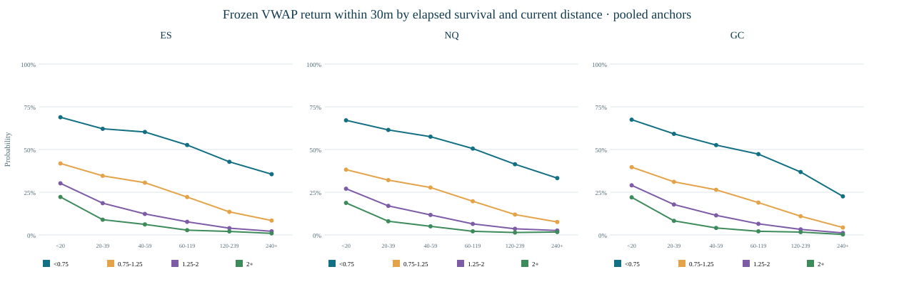
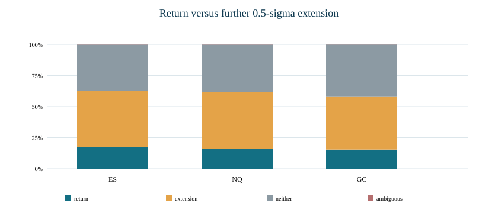
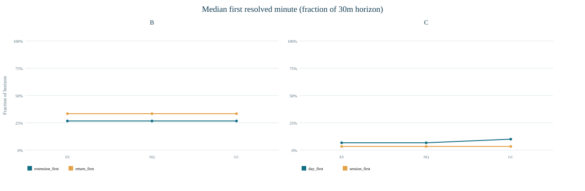
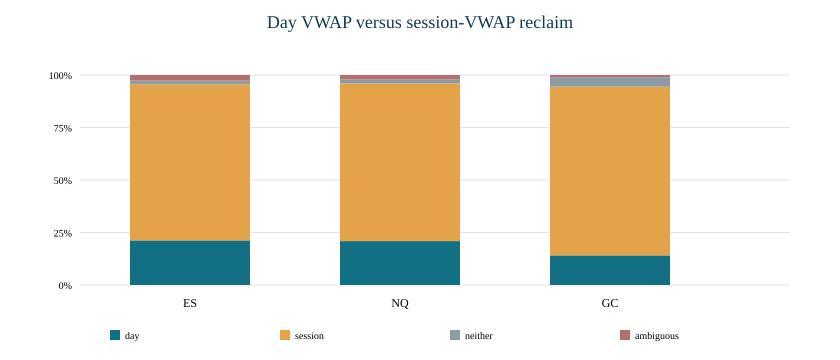
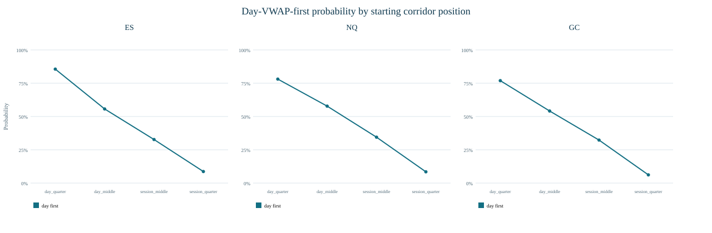
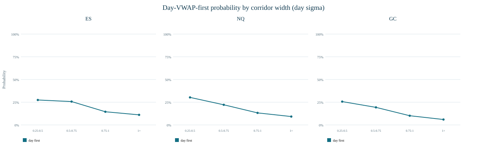
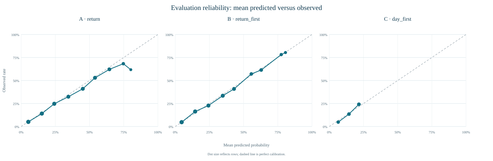
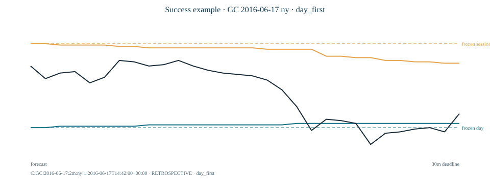
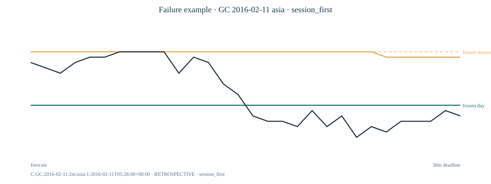
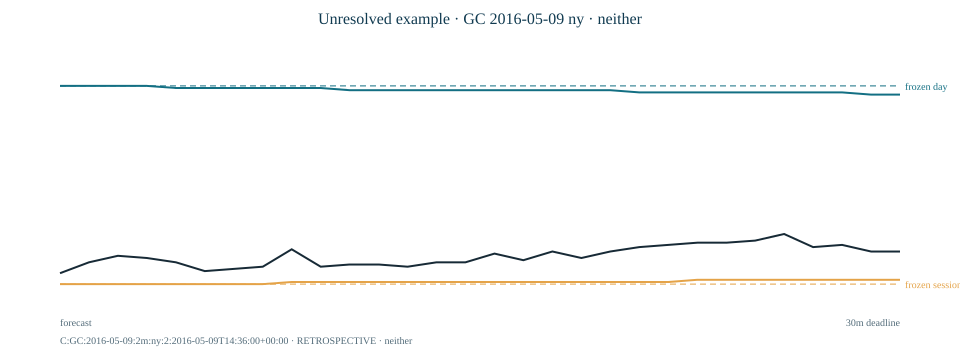

# VWAP conditional probabilities

Run 20260924T155331Z_vwap11 · frozen protocol 1.0.0 · pinned session_anchored_vwap 1.0.0. The primary population uses two-minute features and unadjusted one-minute future paths; five-minute calculations are a correlated sensitivity. All historical periods are exploratory because earlier VWAP outcomes were already viewed. These are conditional price-path probabilities, not trading win rates or profitability claims.

## Executive interpretation

| Question | Product | Future event | Numerator/denominator | Rate | 95% shared-week CI | Episodes/events | Product-sessions |
| --- | --- | --- | --- | --- | --- | --- | --- |
| A | ES | frozen VWAP contact within 30 minutes | 36,501/165,983 | 22.0% | 21.5%–22.5% | 19,882 | 1,037 |
| B | ES | frozen VWAP before 0.5-sigma extension | 28,438/165,983 | 17.1% | 16.8%–17.5% | 19,882 | 1,037 |
| C | ES | frozen day VWAP before session reclaim | 832/3,918 | 21.2% | 20.0%–22.6% | 3,918 | 979 |
| A | NQ | frozen VWAP contact within 30 minutes | 39,411/192,155 | 20.5% | 20.0%–21.0% | 21,205 | 1,177 |
| B | NQ | frozen VWAP before 0.5-sigma extension | 30,576/192,155 | 15.9% | 15.6%–16.3% | 21,205 | 1,177 |
| C | NQ | frozen day VWAP before session reclaim | 1,461/6,993 | 20.9% | 20.0%–21.9% | 6,993 | 1,173 |
| A | GC | frozen VWAP contact within 30 minutes | 26,015/131,697 | 19.8% | 19.3%–20.3% | 14,536 | 825 |
| B | GC | frozen VWAP before 0.5-sigma extension | 20,220/131,697 | 15.4% | 15.0%–15.8% | 14,536 | 825 |
| C | GC | frozen day VWAP before session reclaim | 587/4,167 | 14.1% | 13.0%–15.3% | 4,167 | 810 |

The useful chart candidates are the directly measured, deadline-specific event probabilities with adequate support: remaining 30-minute frozen-return probability, the full four-class return/extension race, and the full four-class day/session corridor race. Pooled rows are descriptive only; chart lookup must remain product-specific. Added path conditions are judged by chronological Brier score below, not by whichever historical cell has the highest rate.

## Question A — remaining probability of returning to VWAP

| Product | Frozen return ≤30m | 95% CI | Evolving return ≤30m | Evolving-only ≤30m | Frozen by window end | Episodes | Checkpoint rows |
| --- | --- | --- | --- | --- | --- | --- | --- |
| ES | 22.0% | 21.5%–22.5% | 24.0% | 2.0% | 64.0% | 19,882 | 165,983 |
| NQ | 20.5% | 20.0%–21.0% | 22.3% | 1.8% | 62.6% | 21,205 | 192,155 |
| GC | 19.8% | 19.3%–20.3% | 21.7% | 2.0% | 56.4% | 14,536 | 131,697 |

Each row is conditional on a fresh departure episode still surviving under the causal evolving-VWAP definition at a regular checkpoint. The window-end rate uses the same 30-minute-capable checkpoint cohort but a longer, variable deadline. Evolving-only contact quantifies how often reference movement changes the answer without price reaching the checkpoint-frozen level.

## Question B — frozen VWAP return versus further extension

| Product | Return first | Extension first | Neither | Ambiguous | Median return distance, points / ticks / sigma | Median extension distance, points / ticks / sigma | Rows |
| --- | --- | --- | --- | --- | --- | --- | --- |
| ES | 17.1% | 45.7% | 37.0% | 0.2% | 7.50 / 30 / 1.24 | 3.50 / 14 / 0.52 | 165,983 |
| NQ | 15.9% | 45.9% | 38.1% | 0.1% | 34.25 / 137 / 1.26 | 14.75 / 59 / 0.50 | 192,155 |
| GC | 15.4% | 42.4% | 42.1% | 0.1% | 4.30 / 43 / 1.18 | 2.00 / 20 / 0.51 | 131,697 |

The return and extension barriers are unequal, so 50% is not a neutral benchmark. Opening gaps are assigned to the crossed destination and flagged; a one-minute bar touching both destinations remains ambiguous. Full-horizon favorable/adverse movement and target-conditional timing are saved separately in timing_movements.csv.

## Question C — day VWAP versus active-session VWAP

| Product | Day VWAP first | Session reclaim first | Neither | Ambiguous | Events | Product-sessions |
| --- | --- | --- | --- | --- | --- | --- |
| ES | 21.2% | 74.3% | 1.8% | 2.7% | 3,918 | 979 |
| NQ | 20.9% | 75.0% | 1.9% | 2.1% | 6,993 | 1,173 |
| GC | 14.1% | 80.3% | 4.5% | 1.1% | 4,167 | 810 |

Events require a completed-close session-VWAP failure, both anchors mature, price strictly between rounded destination zones, at least eight ticks and 0.25 day sigma of separation, and full 30-minute capacity. The fixed 30-minute lockout suppressed repeated crossings without consulting future outcomes. Position and corridor width are baseline geometry, not evidence of VWAP attraction by themselves.

| Unresolved checkpoint | Product | Day first by original deadline | 95% CI | Still-at-risk rows |
| --- | --- | --- | --- | --- |
| 10m | ES | 30.0% | 26.3%–34.6% | 617 |
| 10m | NQ | 30.3% | 27.3%–33.2% | 1,254 |
| 10m | GC | 19.1% | 16.3%–22.0% | 1,150 |
| 20m | ES | 15.6% | 11.0%–20.1% | 282 |
| 20m | NQ | 20.4% | 16.4%–24.6% | 559 |
| 20m | GC | 10.7% | 7.5%–13.8% | 618 |

These update rows are measured only among events unresolved at 10 or 20 minutes, with the original frozen targets and original 30-minute deadline. They are not the event-time frequency reused as an update.

## Incremental prediction beyond geometry and clock

| Question | Baseline Brier | Augmented Brier | Δ augmented−baseline | 95% shared-week CI | Specific-context coverage | Interpretation |
| --- | --- | --- | --- | --- | --- | --- |
| A | 0.1338 | 0.1331 | -0.0007 | -0.0008 to -0.0005 | 10.7% | improved by 0.0007 Brier (-0.5% relative); interval excludes zero |
| B | 0.2791 | 0.2763 | -0.0028 | -0.0033 to -0.0023 | 14.6% | improved by 0.0028 Brier (-1.0% relative); interval excludes zero |
| C | 0.1845 | 0.1845 | +0.0000 | +0.0000 to +0.0000 | 0.0% | changed by +0.0000 Brier; interval includes zero |

Every prediction was learned only from development dates. The baseline uses geometry, product/anchor, clock, time remaining, anchor age where applicable, and prior-only volatility. Added A/B context is elapsed survival, residence/slope class, and observed maximum excursion; added C context is prior hold, slope agreement, and corridor trend. Cells below 100 development observations fall back to the baseline. No three-question familywise superiority claim is made.

## Chronology, five-minute sensitivity, and coverage

| Product | A 2m | B 2m | C 2m | A 5m | B 5m | C 5m |
| --- | --- | --- | --- | --- | --- | --- |
| ES | 22.0% | 17.1% | 21.2% | 18.3% | 14.8% | 26.2% |
| NQ | 20.5% | 15.9% | 20.9% | 17.0% | 13.5% | 25.7% |
| GC | 19.8% | 15.4% | 14.1% | 14.4% | 11.9% | 18.6% |

Two- and five-minute views are independent calculations of the same underlying market history, not independent samples. ES/NQ cover eligible dates from 2021-06-28 through 2026-09-18; GC covers 2016-02-11 through 2026-09-18 with discontinuous eligible coverage. The release contributes 3,039 retrospectively complete product-days. All current dates are exploratory; 2024 and 2025–2026 are chronological diagnostics only.

| Population | Product | Constructed rows | Outcome-capable | Unavailable | Episodes/events | Product-sessions |
| --- | --- | --- | --- | --- | --- | --- |
| AB | ES | 165,992 | 165,983 | 9 | 19,888 | 1,037 |
| AB | NQ | 192,158 | 192,155 | 3 | 21,205 | 1,177 |
| AB | GC | 131,706 | 131,697 | 9 | 14,542 | 825 |
| C | ES | 3,918 | 3,918 | 0 | 3,918 | 979 |
| C | NQ | 6,993 | 6,993 | 0 | 6,993 | 1,173 |
| C | GC | 4,167 | 4,167 | 0 | 4,167 | 810 |

The 21 unavailable primary A/B rows placed the checkpoint close inside its tick-rounded return zone and remain null rather than observed failures. All selected primary corridor events had complete future evidence. Feature-gate counts and all threshold alternatives are retained in the feasibility and corridor-support artifacts.

## Mechanically selected chart examples

Examples are selected by earliest forecast timestamp within their outcome class, not for visual attractiveness. Solid curves are causal evolving VWAPs; dashed lines are event-time frozen destinations. The examples illustrate state handling, not representative profitability.

## Limitations and chart decision

Checkpoint rows within an episode, anchors on the same product-day, products on a shared week, and the two timeframes are dependent. Week-block intervals preserve those rows together but do not eliminate observational confounding. Complete-day eligibility is retrospective. One-minute OHLC cannot order two intraminute touches, so ambiguity is retained. Price references are translated to unadjusted contract coordinates, but no fills, costs, latency, overlap policy, sizing, stop, or P&L are modeled.

A future chart may show only product-specific estimates with adequate development support, explicit forecast time/deadline, all competing outcome probabilities including unresolved/ambiguous mass, and hoverable numerator/denominator/interval/baseline/history. Sparse or unavailable states should show no percentage. Conditions whose evaluation Brier score fails to improve geometry should be omitted from the default state panel even if a raw subgroup rate looks attractive.

[Protocol](protocol-1.0.0.md) · [Probability atlas](tables/probability_atlas.csv) · [Model scores](tables/model_scores.csv) · [Calibration](tables/calibration.csv) · [Examples](tables/examples.csv) · [Event manifest](events.manifest.json) · [Chart-display specification](chart-display-spec.md) · [Run manifest](manifest.json)

