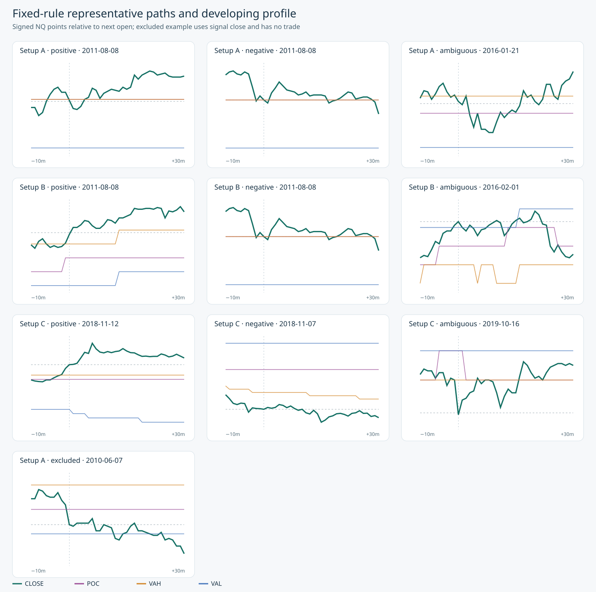

# Asia session VP levels — NQ one-minute study

Frozen protocol 1.0.0. Setup A is **long at POC after an upper VAH excursion** and **short at POC after a lower VAL excursion**, as confirmed by the user. The primary 30-minute complete cohort has 11,990 setup/horizon records across sides and splits. These are hypothetical next-open excursions, not realized trades.

## Primary 30-minute paths

| split | setup | direction | complete | mfe_points_median | mae_points_median | terminal_points_mean | terminal_positive_share | support |
| --- | --- | --- | --- | --- | --- | --- | --- | --- |
| development | A | -1 | 998 | 7.125 | 8.000 | -0.671 | 0.456 | adequate |
| development | A | 1 | 1287 | 6.750 | 7.750 | -0.930 | 0.482 | adequate |
| development | B | -1 | 1294 | 8.000 | 7.750 | 0.700 | 0.462 | adequate |
| development | B | 1 | 1772 | 6.750 | 6.750 | 0.242 | 0.486 | adequate |
| development | C | -1 | 156 | 11.250 | 10.125 | 1.074 | 0.526 | adequate |
| development | C | 1 | 171 | 11.000 | 11.500 | -0.282 | 0.573 | adequate |
| final_2026_ytd | A | -1 | 177 | 23.750 | 22.750 | 3.903 | 0.525 | adequate |
| final_2026_ytd | A | 1 | 257 | 21.000 | 20.250 | -2.305 | 0.533 | adequate |
| final_2026_ytd | B | -1 | 221 | 23.500 | 23.250 | -0.015 | 0.516 | adequate |
| final_2026_ytd | B | 1 | 282 | 16.125 | 17.000 | -1.515 | 0.489 | adequate |
| final_2026_ytd | C | -1 | 111 | 28.750 | 25.750 | 6.910 | 0.550 | adequate |
| final_2026_ytd | C | 1 | 104 | 17.875 | 32.000 | -9.147 | 0.385 | adequate |
| historical | A | -1 | 413 | 4.000 | 4.000 | 0.115 | 0.465 | adequate |
| historical | A | 1 | 621 | 3.750 | 3.500 | 0.162 | 0.512 | adequate |
| historical | B | -1 | 526 | 3.750 | 4.250 | 0.278 | 0.409 | adequate |
| historical | B | 1 | 905 | 3.500 | 3.500 | -0.065 | 0.491 | adequate |
| historical | C | -1 | 15 | 7.000 | 3.000 | -0.633 | 0.400 | low_support |
| historical | C | 1 | 7 | 2.500 | 6.000 | -4.857 | 0.286 | low_support |
| validation | A | -1 | 450 | 8.250 | 9.500 | -0.937 | 0.451 | adequate |
| validation | A | 1 | 588 | 8.250 | 8.250 | 1.164 | 0.541 | adequate |
| validation | B | -1 | 540 | 8.500 | 8.500 | -0.351 | 0.472 | adequate |
| validation | B | 1 | 889 | 8.000 | 7.500 | 1.317 | 0.538 | adequate |
| validation | C | -1 | 95 | 13.000 | 13.750 | -3.161 | 0.505 | adequate |
| validation | C | 1 | 111 | 14.500 | 12.500 | 3.358 | 0.559 | adequate |

## Matched-minute differences (event minus control, NQ points)

| split | setup | direction | events | matched | mfe_difference_mean | mfe_ci_lower | mfe_ci_upper | mae_difference_mean | mae_ci_lower | mae_ci_upper | terminal_difference_mean | terminal_ci_lower | terminal_ci_upper |
| --- | --- | --- | --- | --- | --- | --- | --- | --- | --- | --- | --- | --- | --- |
| development | A | -1 | 998 | 998 | 0.272 | -0.861 | 1.428 | 1.330 | 0.478 | 2.306 | -1.012 | -2.434 | 0.363 |
| development | A | 1 | 1287 | 1287 | -0.567 | -1.342 | 0.267 | 1.555 | 0.749 | 2.365 | -1.523 | -2.584 | -0.433 |
| development | B | -1 | 1294 | 1294 | 1.286 | 0.070 | 2.556 | -0.091 | -0.864 | 0.736 | 0.453 | -0.905 | 1.778 |
| development | B | 1 | 1772 | 1772 | 0.252 | -0.504 | 1.132 | -0.633 | -1.398 | 0.145 | 0.542 | -0.526 | 1.702 |
| development | C | -1 | 156 | 156 | 1.138 | -2.583 | 5.320 | 1.149 | -1.105 | 3.284 | 0.256 | -3.610 | 4.721 |
| development | C | 1 | 171 | 171 | 2.608 | 0.416 | 4.811 | 2.323 | -0.340 | 5.265 | 0.456 | -4.316 | 4.182 |
| final_2026_ytd | A | -1 | 177 | 177 | 3.244 | -3.367 | 10.850 | 2.254 | -3.889 | 10.072 | 2.400 | -2.816 | 6.701 |
| final_2026_ytd | A | 1 | 257 | 257 | -2.018 | -6.430 | 3.488 | -0.946 | -6.940 | 6.109 | 1.804 | -5.011 | 7.742 |
| final_2026_ytd | B | -1 | 221 | 221 | 4.590 | -1.351 | 10.803 | 6.584 | 1.427 | 12.107 | -1.803 | -7.214 | 3.132 |
| final_2026_ytd | B | 1 | 282 | 282 | -2.385 | -7.763 | 3.290 | 2.234 | -3.101 | 9.381 | -5.488 | -11.330 | 0.080 |
| final_2026_ytd | C | -1 | 111 | 111 | 1.291 | -5.166 | 6.644 | 2.439 | -6.022 | 10.750 | -0.993 | -11.894 | 10.030 |
| final_2026_ytd | C | 1 | 104 | 104 | 1.375 | -5.650 | 9.014 | 5.041 | -6.434 | 13.322 | -6.721 | -13.376 | 1.443 |
| historical | A | -1 | 413 | 413 | -0.454 | -1.529 | 0.821 | -0.114 | -0.953 | 0.634 | -0.475 | -1.827 | 1.107 |
| historical | A | 1 | 621 | 621 | 0.612 | 0.006 | 1.202 | -0.180 | -0.941 | 0.587 | 0.508 | -0.386 | 1.451 |
| historical | B | -1 | 526 | 526 | 0.712 | 0.065 | 1.483 | 0.212 | -0.318 | 0.777 | 0.469 | -0.350 | 1.348 |
| historical | B | 1 | 905 | 905 | 0.249 | -0.343 | 0.893 | -0.460 | -0.931 | 0.057 | 0.299 | -0.418 | 1.002 |
| historical | C | -1 | 15 | 15 | 3.183 | -0.250 | 6.100 | -2.017 | -6.875 | 2.429 | 0.800 | -3.340 | 7.917 |
| historical | C | 1 | 7 | 7 | -3.643 | -8.250 | 4.250 | 1.750 | -2.938 | 8.333 | -5.714 | -12.000 | 1.312 |
| validation | A | -1 | 450 | 450 | -0.192 | -2.880 | 2.205 | 0.127 | -1.577 | 2.206 | -0.249 | -3.499 | 2.472 |
| validation | A | 1 | 588 | 588 | 1.098 | -0.860 | 3.040 | -1.057 | -2.939 | 0.713 | 1.579 | -0.574 | 3.891 |
| validation | B | -1 | 540 | 540 | 2.759 | 0.643 | 5.101 | 0.523 | -1.349 | 2.715 | 1.622 | -1.012 | 4.310 |
| validation | B | 1 | 889 | 889 | 0.262 | -1.004 | 1.706 | -0.332 | -1.671 | 0.899 | 0.329 | -1.193 | 2.131 |
| validation | C | -1 | 95 | 95 | 2.061 | -3.648 | 7.383 | 6.797 | 1.051 | 14.414 | -3.866 | -13.570 | 4.129 |
| validation | C | 1 | 111 | 111 | 3.225 | -2.666 | 9.215 | -1.622 | -6.807 | 3.554 | 4.628 | -3.870 | 12.852 |

## First-passage race, +1 versus −1 prior-60-minute true-range unit

| split | setup | direction | events | favorable_first_lower | favorable_first_upper | ambiguous | neither |
| --- | --- | --- | --- | --- | --- | --- | --- |
| development | A | -1 | 998 | 0.481 | 0.484 | 3 | 0 |
| development | A | 1 | 1287 | 0.467 | 0.476 | 11 | 0 |
| development | B | -1 | 1294 | 0.509 | 0.516 | 10 | 0 |
| development | B | 1 | 1772 | 0.501 | 0.505 | 7 | 0 |
| development | C | -1 | 156 | 0.532 | 0.538 | 1 | 0 |
| development | C | 1 | 171 | 0.497 | 0.509 | 2 | 0 |
| final_2026_ytd | A | -1 | 177 | 0.480 | 0.508 | 5 | 0 |
| final_2026_ytd | A | 1 | 257 | 0.521 | 0.529 | 2 | 0 |
| final_2026_ytd | B | -1 | 221 | 0.484 | 0.507 | 5 | 0 |
| final_2026_ytd | B | 1 | 282 | 0.504 | 0.514 | 3 | 0 |
| final_2026_ytd | C | -1 | 111 | 0.559 | 0.559 | 0 | 0 |
| final_2026_ytd | C | 1 | 104 | 0.394 | 0.413 | 2 | 0 |
| historical | A | -1 | 413 | 0.504 | 0.506 | 1 | 0 |
| historical | A | 1 | 621 | 0.481 | 0.491 | 6 | 0 |
| historical | B | -1 | 526 | 0.477 | 0.485 | 4 | 0 |
| historical | B | 1 | 905 | 0.483 | 0.487 | 4 | 0 |
| historical | C | -1 | 15 | 0.667 | 0.733 | 1 | 0 |
| historical | C | 1 | 7 | 0.429 | 0.429 | 0 | 0 |
| validation | A | -1 | 450 | 0.502 | 0.516 | 6 | 0 |
| validation | A | 1 | 588 | 0.491 | 0.500 | 5 | 0 |
| validation | B | -1 | 540 | 0.476 | 0.480 | 2 | 0 |
| validation | B | 1 | 889 | 0.514 | 0.520 | 5 | 0 |
| validation | C | -1 | 95 | 0.432 | 0.432 | 0 | 0 |
| validation | C | 1 | 111 | 0.613 | 0.622 | 1 | 0 |

## Conclusions

- Setup A, POC-entry fade: validation does not establish an excess favorable excursion on either side. The long matched-MFE difference is +1.10 points [-0.86, +3.04]; the short difference is -0.19 [-2.88, +2.21]. Both intervals span zero; this hypothesis remains inconclusive as an advantage.
- Setup B, VAH/VAL breakout retest: validation shows a larger favorable excursion on the short side (+2.76 points, interval [+0.64, +5.10]). The long estimate is +0.26 [-1.00, +1.71]. This is partial descriptive support for short-side movement, not a demonstrated two-sided or net-trading edge.
- Setup C, selected HVN fade: favorable-excursion differences remain uncertain on both validation sides. Short-side adverse excursion is higher than matched minutes by +6.80 points [+1.05, +14.41], evidence against the short fade’s risk premise. The long side remains inconclusive.

## Input quality and historical coverage

| year | complete_six_hour_evenings | strict_overnight_input | strict_hvn_reference_input |
| --- | --- | --- | --- |
| 2010 | 0 | 0 | 0 |
| 2011 | 0 | 207 | 0 |
| 2012 | 0 | 9 | 0 |
| 2013 | 0 | 38 | 0 |
| 2014 | 1 | 553 | 0 |
| 2015 | 1 | 885 | 0 |
| 2016 | 11 | 3929 | 0 |
| 2017 | 11 | 7433 | 0 |
| 2018 | 147 | 38290 | 3120 |
| 2019 | 197 | 49972 | 5943 |
| 2020 | 242 | 57878 | 15310 |
| 2021 | 240 | 57895 | 12960 |
| 2022 | 246 | 60240 | 22305 |
| 2023 | 231 | 56547 | 13590 |
| 2024 | 238 | 58462 | 11769 |
| 2025 | 243 | 58439 | 19369 |
| 2026 | 179 | 42457 | 17797 |

Strict six-hour input coverage is sparse before 2018; early historical estimates have materially weaker support. The full source-quality ledger is in `tables/quality_by_year.csv`.

## Prespecified coordinate and frozen-level sensitivities

| split | setup | direction | variant | complete | mfe_points_mean | mae_points_mean | terminal_points_mean |
| --- | --- | --- | --- | --- | --- | --- | --- |
| validation | A | -1 | adjusted_snapshot | 444 | 14.626 | 13.834 | -0.972 |
| validation | A | 1 | adjusted_snapshot | 600 | 12.854 | 12.229 | 0.981 |
| validation | A | -1 | frozen_breakout_level | 383 | 12.809 | 13.550 | -2.102 |
| validation | A | 1 | frozen_breakout_level | 494 | 12.345 | 12.564 | 0.897 |
| validation | B | -1 | adjusted_snapshot | 555 | 15.625 | 13.813 | 0.107 |
| validation | B | 1 | adjusted_snapshot | 893 | 11.926 | 11.050 | 1.305 |
| validation | B | -1 | frozen_breakout_level | 580 | 15.172 | 14.003 | -0.876 |
| validation | B | 1 | frozen_breakout_level | 854 | 11.864 | 11.101 | 1.047 |
| validation | C | -1 | adjusted_snapshot | 94 | 20.702 | 21.588 | -1.888 |
| validation | C | 1 | adjusted_snapshot | 106 | 21.403 | 18.340 | 3.399 |

These rows use different event cohorts, so differences in means are not paired effects. The adjusted-profile coordinate variant is retrospective and is not certified point in time. All hypothetical fills and excursions remain in actual unadjusted NQ prices. Other splits and horizons are in `tables/sensitivity_metrics.csv`.

## Fixed-rule representative paths

The positive/negative labels use the 30-minute terminal move. The excluded example has no trade outcome and is anchored to its signal close. The selected examples are the first chronological match in each setup and class.

## Methods and limits

Primary inputs are pre-signal unadjusted feature snapshots; the indicator release is pinned. Every complete fixed horizon uses contiguous minute bars, the actual next open, and entry candle OHLC. Incomplete futures paths and unavailable causal features are explicit exclusions. Two-week moving ISO-week blocks (2,000 draws) express uncertainty. Matched controls share year, side, New York hour and development-defined pre-signal volatility quintile. One-minute OHLCV does not reveal bid/ask, queue position, exact intrabar ordering, or TradingView tick parity. Same-bar threshold ordering is bounded. No net-profit or strategy claim is made.

Saved evidence includes all horizon rows, year and side tables, signal and exclusion ledgers, threshold races, and representative paths. Historical 2010–2019 is context; 2020–2023 is development; 2024–2025 is validation; 2026 is YTD final check. The report is local and offline; it has not been published to the web.
