# London — anchored VWAP excursion and return

Fresh historical execution · Protocol 1.0.0 · Frozen before new outcomes · 2026 YTD through September 18

London uses its own 03:00 New York-clock anchor and [03:00, 09:00) observation window. Both entry and complete horizons stay inside this window; a final candle closing exactly at the end is eligible. DST uses America/New_York. Globex is a separate overlapping population, not a sum of local sessions.

The pinned VWAP uses completed two-minute HLC3 weighted by bar volume and a volume-weighted population sigma; it is not trade-by-trade VWAP. Signals are first fresh strict closes beyond 2, 2.5 or 3 sigma within a causal parent excursion. Entry is the next two-minute open. Horizons 5/10/15/20/50 candles are 10/20/30/40/100 minutes; 15 is supplementary. Touch is source one-minute range overlap with the tick-rounded ±1-tick VWAP zone available at that minute open. Evolving VWAP is primary; signal-frozen VWAP is secondary. A gap or reference overtake alone is not a touch. Touch response begins after the containing two-minute candle closes. All MAE/MFE excludes the signal/touch candle and follows the full horizon. Upper departures: continuation is long and fade is short; upper-arrival bounce is long and through is short. Lower departures: continuation is short and fade is long; lower-arrival bounce is short and through is long.

The release contains 1,037 ES days, 1,177 NQ days and 825 GC days, selected retrospectively for whole-day completeness. ES/NQ feature history begins in 2021; GC eligible history begins in 2016; all end September 18, 2026. Absent minutes can be no-trade intervals; absence is not asserted to be corruption. This is previously inspected exploratory history, with overlapping sessions and nested thresholds. No threshold or horizon was optimized. Tick-rounded OHLC contact does not establish an executable fill, and OHLC cannot order two barriers reached in the same minute. No fees, slippage, position sizing, stops or profitability were tested. Delta means price change; true aggressor volume delta is unavailable.

Intervals are marginal 95% percentile intervals from 2,000 shared ISO-week cluster draws (seed 1501), preserving cross-product/session dependence. Brackets contain intervals. † marks zero/all-success boundary uncertainty unresolved by a degenerate bootstrap. Sparse flags: fewer than 100 events, 30 product-session dates or 20 weeks. Latency summaries condition on actual touching. Unavailable horizons never enter success/failure denominators.

[Full numerical tables: points, ticks, sigma units, tails, contexts, uncertainty and counts](tables/summary.csv)

[Per-horizon eligibility, exclusion reasons, parent/date/week support](tables/coverage.csv)

## Primary 2-sigma overview

Mirrored upper/lower sides are combined only within each product and session in this overview. The side-specific tables below retain every threshold and horizon. Endpoint bounce frequency describes the closing direction; it differs from the 0.5-sigma first-move race.

| Session | Product | h | Departure n | Evolving return % [CI] | Continuation Δ points [CI] | Touch n | Bounce endpoint % [CI] |
| --- | --- | --- | --- | --- | --- | --- | --- |
| London | ES | 10 | 3,293 | 46.8% [45.2%, 48.4%] | 0.11 [-0.10, 0.32] | 2,821 | 49.0% [47.4%, 50.7%] |
| London | ES | 50 | 2,919 | 81.9% [80.7%, 83.1%] | -0.12 [-0.52, 0.32] | 2,436 | 49.9% [47.9%, 52.0%] |
| London | GC | 10 | 2,526 | 44.7% [43.0%, 46.6%] | 0.03 [-0.16, 0.21] | 2,128 | 49.3% [47.1%, 51.6%] |
| London | GC | 50 | 2,132 | 83.2% [81.7%, 84.7%] | 0.06 [-0.38, 0.53] | 1,777 | 49.7% [47.3%, 52.2%] |
| London | NQ | 10 | 3,482 | 42.2% [40.7%, 43.7%] | 0.45 [-0.33, 1.31] | 2,892 | 49.6% [47.9%, 51.2%] |
| London | NQ | 50 | 3,042 | 79.5% [78.1%, 80.8%] | 0.05 [-1.61, 1.78] | 2,474 | 50.0% [48.1%, 52.0%] |

## ES

Coverage: 1,037 retrospectively eligible dates, 2021-06-28 through 2026-09-18. All prices below are raw contract points. Full point/tick/sigma distributions and every tie numerator are saved in summary.csv.

### ES year coverage and retrospective exclusions

| Year | Candidate days | Eligible | Excluded |
| --- | --- | --- | --- |
| 2010 | 150 | 0 | 150 |
| 2011 | 260 | 0 | 260 |
| 2012 | 261 | 0 | 261 |
| 2013 | 261 | 0 | 261 |
| 2014 | 261 | 0 | 261 |
| 2015 | 261 | 0 | 261 |
| 2016 | 261 | 0 | 261 |
| 2017 | 260 | 0 | 260 |
| 2018 | 261 | 0 | 261 |
| 2019 | 261 | 0 | 261 |
| 2020 | 262 | 0 | 262 |
| 2021 | 261 | 101 | 160 |
| 2022 | 260 | 239 | 21 |
| 2023 | 260 | 155 | 105 |
| 2024 | 262 | 159 | 103 |
| 2025 | 261 | 216 | 45 |
| 2026 | 187 | 167 | 20 |

[Release exclusion reasons by product/year (reasons may overlap)](tables/release-coverage.csv)

### Upper departure / arrival: continuation and bounce long; fade and through short

#### Departure response

| σ | h | n | Continuation MAE mean [CI] / median | Continuation MFE mean [CI] / median | Fade MAE mean [CI] / median | Fade MFE mean [CI] / median | Continuation Δ mean [CI] | Fade Δ mean [CI] | Continuation endpoint % | Close > entry % | Final candle up % | Entry ties | Days / weeks | Unavailable | Support |
| --- | --- | --- | --- | --- | --- | --- | --- | --- | --- | --- | --- | --- | --- | --- | --- |
| 2.0 | 5 | 1,702 | 2.79 [2.58, 3.01] / 1.75 | 2.88 [2.63, 3.15] / 1.75 | 2.88 [2.63, 3.15] / 1.75 | 2.79 [2.58, 3.01] / 1.75 | 0.05 [-0.16, 0.29] | -0.05 [-0.29, 0.16] | 47.6% [45.2%, 49.9%] | 47.6% [45.2%, 49.9%] | 44.3% [42.1%, 46.6%] | 78 | 862 / 264 | 17 | adequate descriptive support |
| 2.0 | 10 | 1,676 | 3.86 [3.55, 4.21] / 2.50 | 3.93 [3.59, 4.30] / 2.50 | 3.93 [3.59, 4.30] / 2.50 | 3.86 [3.55, 4.21] / 2.50 | 0.03 [-0.25, 0.32] | -0.03 [-0.32, 0.25] | 49.6% [47.1%, 52.1%] | 49.6% [47.1%, 52.1%] | 47.4% [45.2%, 49.6%] | 54 | 861 / 264 | 43 | adequate descriptive support |
| 2.0 | 15 | 1,605 | 4.66 [4.27, 5.11] / 3.00 | 4.57 [4.16, 5.01] / 3.00 | 4.57 [4.16, 5.01] / 3.00 | 4.66 [4.27, 5.11] / 3.00 | -0.08 [-0.46, 0.32] | 0.08 [-0.32, 0.46] | 48.7% [46.2%, 51.3%] | 48.7% [46.2%, 51.3%] | 43.6% [41.2%, 46.0%] | 33 | 846 / 264 | 114 | adequate descriptive support |
| 2.0 | 20 | 1,585 | 5.21 [4.79, 5.71] / 3.50 | 5.15 [4.69, 5.64] / 3.50 | 5.15 [4.69, 5.64] / 3.50 | 5.21 [4.79, 5.71] / 3.50 | -0.01 [-0.46, 0.42] | 0.01 [-0.42, 0.46] | 48.6% [46.0%, 51.2%] | 48.6% [46.0%, 51.2%] | 47.6% [45.1%, 50.2%] | 33 | 845 / 264 | 134 | adequate descriptive support |
| 2.0 | 50 | 1,459 | 7.89 [7.20, 8.67] / 5.25 | 7.58 [6.95, 8.25] / 5.25 | 7.58 [6.95, 8.25] / 5.25 | 7.89 [7.20, 8.67] / 5.25 | -0.03 [-0.66, 0.62] | 0.03 [-0.62, 0.66] | 51.0% [47.9%, 54.1%] | 51.0% [47.9%, 54.1%] | 46.5% [43.8%, 49.2%] | 22 | 809 / 264 | 260 | adequate descriptive support |
| 2.5 | 5 | 784 | 3.03 [2.69, 3.43] / 1.75 | 3.09 [2.70, 3.57] / 1.75 | 3.09 [2.70, 3.57] / 1.75 | 3.03 [2.69, 3.43] / 1.75 | -0.13 [-0.54, 0.32] | 0.13 [-0.32, 0.54] | 46.9% [43.5%, 50.5%] | 46.9% [43.5%, 50.5%] | 44.1% [40.4%, 48.1%] | 33 | 549 / 248 | 3 | adequate descriptive support |
| 2.5 | 10 | 766 | 4.00 [3.59, 4.46] / 2.50 | 4.15 [3.68, 4.70] / 2.75 | 4.15 [3.68, 4.70] / 2.75 | 4.00 [3.59, 4.46] / 2.50 | 0.06 [-0.45, 0.57] | -0.06 [-0.57, 0.45] | 47.7% [44.0%, 51.4%] | 47.7% [44.0%, 51.4%] | 50.1% [46.7%, 53.8%] | 27 | 541 / 248 | 21 | adequate descriptive support |
| 2.5 | 15 | 734 | 4.61 [4.16, 5.12] / 3.25 | 4.80 [4.25, 5.50] / 3.25 | 4.80 [4.25, 5.50] / 3.25 | 4.61 [4.16, 5.12] / 3.25 | 0.12 [-0.50, 0.77] | -0.12 [-0.77, 0.50] | 48.4% [44.5%, 52.4%] | 48.4% [44.5%, 52.4%] | 46.5% [42.7%, 50.1%] | 12 | 524 / 246 | 53 | adequate descriptive support |
| 2.5 | 20 | 727 | 4.97 [4.58, 5.39] / 3.75 | 5.44 [4.81, 6.21] / 3.50 | 5.44 [4.81, 6.21] / 3.50 | 4.97 [4.58, 5.39] / 3.75 | 0.41 [-0.20, 1.08] | -0.41 [-1.08, 0.20] | 47.9% [43.8%, 52.1%] | 47.9% [43.8%, 52.1%] | 47.0% [43.3%, 50.9%] | 13 | 521 / 245 | 60 | adequate descriptive support |
| 2.5 | 50 | 677 | 7.89 [7.22, 8.60] / 5.50 | 7.90 [7.03, 8.89] / 5.25 | 7.90 [7.03, 8.89] / 5.25 | 7.89 [7.22, 8.60] / 5.50 | 0.14 [-0.76, 1.07] | -0.14 [-1.07, 0.76] | 51.0% [46.9%, 55.3%] | 51.0% [46.9%, 55.3%] | 47.1% [43.1%, 51.1%] | 11 | 502 / 243 | 110 | adequate descriptive support |
| 3.0 | 5 | 216 | 3.85 [2.85, 5.15] / 2.25 | 3.52 [2.56, 4.96] / 1.62 | 3.52 [2.56, 4.96] / 1.62 | 3.85 [2.85, 5.15] / 2.25 | -0.52 [-1.92, 0.98] | 0.52 [-0.98, 1.92] | 39.4% [32.7%, 46.6%] | 39.4% [32.7%, 46.6%] | 40.3% [34.3%, 46.3%] | 12 | 190 / 140 | 1 | adequate descriptive support |
| 3.0 | 10 | 212 | 4.87 [3.75, 6.33] / 2.88 | 4.59 [3.47, 6.13] / 2.50 | 4.59 [3.47, 6.13] / 2.50 | 4.87 [3.75, 6.33] / 2.88 | -0.29 [-1.79, 1.15] | 0.29 [-1.15, 1.79] | 46.7% [40.1%, 53.4%] | 46.7% [40.1%, 53.4%] | 50.0% [43.4%, 56.5%] | 7 | 186 / 139 | 5 | adequate descriptive support |
| 3.0 | 15 | 202 | 5.59 [4.35, 7.15] / 3.50 | 4.99 [3.74, 6.68] / 2.75 | 4.99 [3.74, 6.68] / 2.75 | 5.59 [4.35, 7.15] / 3.50 | -0.60 [-2.21, 1.08] | 0.60 [-1.08, 2.21] | 43.6% [36.7%, 50.3%] | 43.6% [36.7%, 50.3%] | 44.1% [36.9%, 51.4%] | 4 | 178 / 134 | 15 | adequate descriptive support |
| 3.0 | 20 | 198 | 5.28 [4.55, 6.04] / 3.88 | 5.67 [4.33, 7.49] / 3.00 | 5.67 [4.33, 7.49] / 3.00 | 5.28 [4.55, 6.04] / 3.88 | 0.05 [-1.11, 1.40] | -0.05 [-1.40, 1.11] | 44.4% [37.6%, 51.6%] | 44.4% [37.6%, 51.6%] | 45.5% [38.0%, 53.0%] | 6 | 174 / 132 | 19 | adequate descriptive support |
| 3.0 | 50 | 188 | 8.62 [7.31, 10.16] / 5.62 | 7.81 [6.26, 9.81] / 4.25 | 7.81 [6.26, 9.81] / 4.25 | 8.62 [7.31, 10.16] / 5.62 | -1.10 [-2.95, 0.83] | 1.10 [-0.83, 2.95] | 44.7% [37.7%, 52.3%] | 44.7% [37.7%, 52.3%] | 47.3% [40.6%, 53.8%] | 4 | 168 / 129 | 29 | adequate descriptive support |

#### VWAP return probability and timing

| σ | h | Target | n | Touches | Touch % [CI] | No touch | Latency h median / p75 | Gap paths | Overtake paths | Unavailable | Evolving only | Frozen only |
| --- | --- | --- | --- | --- | --- | --- | --- | --- | --- | --- | --- | --- |
| 2.0 | 5 | evolving | 1,702 | 560 | 32.9% [30.7%, 35.0%] | 1,142 | 2.0 / 3.0 | 0 | 0 | 17 | 81 | 0 |
| 2.0 | 5 | frozen | 1,702 | 479 | 28.1% [26.0%, 30.2%] | 1,223 | 2.0 / 3.0 | 0 | 0 | 17 | 81 | 0 |
| 2.0 | 10 | evolving | 1,676 | 745 | 44.5% [42.0%, 46.8%] | 931 | 3.0 / 6.0 | 0 | 0 | 43 | 121 | 0 |
| 2.0 | 10 | frozen | 1,676 | 624 | 37.2% [34.8%, 39.6%] | 1,052 | 3.0 / 5.0 | 0 | 0 | 43 | 121 | 0 |
| 2.0 | 15 | evolving | 1,605 | 865 | 53.9% [51.3%, 56.3%] | 740 | 4.0 / 8.0 | 0 | 0 | 114 | 155 | 0 |
| 2.0 | 15 | frozen | 1,605 | 710 | 44.2% [41.7%, 46.6%] | 895 | 3.0 / 7.0 | 0 | 0 | 114 | 155 | 0 |
| 2.0 | 20 | evolving | 1,585 | 948 | 59.8% [57.3%, 62.3%] | 637 | 4.0 / 10.0 | 0 | 0 | 134 | 175 | 0 |
| 2.0 | 20 | frozen | 1,585 | 773 | 48.8% [46.3%, 51.1%] | 812 | 4.0 / 9.0 | 0 | 0 | 134 | 175 | 0 |
| 2.0 | 50 | evolving | 1,459 | 1,156 | 79.2% [77.3%, 81.1%] | 303 | 7.0 / 18.0 | 0 | 0 | 260 | 211 | 0 |
| 2.0 | 50 | frozen | 1,459 | 945 | 64.8% [62.3%, 67.1%] | 514 | 6.0 / 18.0 | 0 | 0 | 260 | 211 | 0 |
| 2.5 | 5 | evolving | 784 | 256 | 32.7% [29.8%, 35.4%] | 528 | 2.0 / 3.0 | 0 | 0 | 3 | 38 | 0 |
| 2.5 | 5 | frozen | 784 | 218 | 27.8% [24.8%, 30.6%] | 566 | 2.0 / 3.0 | 0 | 0 | 3 | 38 | 0 |
| 2.5 | 10 | evolving | 766 | 336 | 43.9% [40.7%, 46.8%] | 430 | 3.0 / 5.0 | 0 | 0 | 21 | 59 | 0 |
| 2.5 | 10 | frozen | 766 | 277 | 36.2% [32.9%, 39.1%] | 489 | 3.0 / 5.0 | 0 | 0 | 21 | 59 | 0 |
| 2.5 | 15 | evolving | 734 | 393 | 53.5% [49.9%, 57.2%] | 341 | 4.0 / 8.0 | 0 | 0 | 53 | 74 | 0 |
| 2.5 | 15 | frozen | 734 | 319 | 43.5% [39.9%, 46.9%] | 415 | 3.0 / 7.0 | 0 | 0 | 53 | 74 | 0 |
| 2.5 | 20 | evolving | 727 | 427 | 58.7% [55.2%, 62.1%] | 300 | 4.0 / 9.5 | 0 | 0 | 60 | 82 | 0 |
| 2.5 | 20 | frozen | 727 | 345 | 47.5% [43.8%, 50.9%] | 382 | 4.0 / 9.0 | 0 | 0 | 60 | 82 | 0 |
| 2.5 | 50 | evolving | 677 | 527 | 77.8% [74.7%, 81.1%] | 150 | 6.0 / 17.0 | 0 | 0 | 110 | 104 | 0 |
| 2.5 | 50 | frozen | 677 | 423 | 62.5% [58.9%, 66.0%] | 254 | 5.0 / 16.0 | 0 | 0 | 110 | 104 | 0 |
| 3.0 | 5 | evolving | 216 | 84 | 38.9% [32.4%, 45.3%] | 132 | 2.0 / 3.0 | 0 | 0 | 1 | 9 | 0 |
| 3.0 | 5 | frozen | 216 | 75 | 34.7% [28.3%, 41.2%] | 141 | 1.0 / 3.0 | 0 | 0 | 1 | 9 | 0 |
| 3.0 | 10 | evolving | 212 | 111 | 52.4% [45.7%, 59.1%] | 101 | 2.0 / 5.0 | 0 | 0 | 5 | 16 | 0 |
| 3.0 | 10 | frozen | 212 | 95 | 44.8% [38.2%, 51.7%] | 117 | 2.0 / 5.0 | 0 | 0 | 5 | 16 | 0 |
| 3.0 | 15 | evolving | 202 | 122 | 60.4% [53.6%, 67.6%] | 80 | 3.0 / 6.8 | 0 | 0 | 15 | 17 | 0 |
| 3.0 | 15 | frozen | 202 | 105 | 52.0% [45.1%, 59.0%] | 97 | 3.0 / 6.0 | 0 | 0 | 15 | 17 | 0 |
| 3.0 | 20 | evolving | 198 | 128 | 64.6% [57.6%, 71.5%] | 70 | 4.0 / 8.0 | 0 | 0 | 19 | 18 | 0 |
| 3.0 | 20 | frozen | 198 | 110 | 55.6% [48.8%, 62.8%] | 88 | 3.0 / 7.0 | 0 | 0 | 19 | 18 | 0 |
| 3.0 | 50 | evolving | 188 | 158 | 84.0% [78.9%, 88.8%] | 30 | 5.0 / 15.8 | 0 | 0 | 29 | 27 | 0 |
| 3.0 | 50 | frozen | 188 | 131 | 69.7% [62.9%, 76.2%] | 57 | 5.0 / 14.5 | 0 | 0 | 29 | 27 | 0 |

#### First-return response

Reached-threshold cohorts are nested using crossings recorded before this first touch. Response starts at the next open after touch confirmation. Barrier first move freezes 0.5 touch-close sigma, rounded upward to at least one tick. Counts B/T/neither/ambiguous reconcile separately from unavailable barriers. Same-minute ambiguous is not assigned to either direction. Full-horizon excursions continue after a barrier resolves.

| σ | h | n | Bounce MAE mean [CI] / median | Bounce MFE mean [CI] / median | Through MAE mean [CI] / median | Through MFE mean [CI] / median | Bounce Δ mean [CI] | Through Δ mean [CI] | Bounce endpoint % | Close > entry % | Final candle up % | Entry ties | Days / weeks | Unavailable | Support | First B / T / neither / ambiguous | Barrier unavailable |
| --- | --- | --- | --- | --- | --- | --- | --- | --- | --- | --- | --- | --- | --- | --- | --- | --- | --- |
| 2.0 | 5 | 1,434 | 2.84 [2.61, 3.10] / 1.75 | 2.83 [2.57, 3.11] / 1.75 | 2.83 [2.57, 3.11] / 1.75 | 2.84 [2.61, 3.10] / 1.75 | 0.11 [-0.15, 0.37] | -0.11 [-0.37, 0.15] | 49.9% [47.5%, 52.5%] | 49.9% [47.5%, 52.5%] | 46.1% [43.4%, 48.9%] | 58 | 797 / 263 | 15 | adequate descriptive support | 564 / 580 / 172 / 118 | 0 |
| 2.0 | 10 | 1,405 | 4.00 [3.68, 4.35] / 2.50 | 3.78 [3.49, 4.10] / 2.50 | 3.78 [3.49, 4.10] / 2.50 | 4.00 [3.68, 4.35] / 2.50 | -0.02 [-0.36, 0.30] | 0.02 [-0.30, 0.36] | 49.4% [46.9%, 52.0%] | 49.4% [46.9%, 52.0%] | 46.1% [43.4%, 49.0%] | 47 | 792 / 263 | 44 | adequate descriptive support | 617 / 613 / 58 / 117 | 0 |
| 2.0 | 15 | 1,337 | 4.63 [4.22, 5.11] / 3.00 | 4.50 [4.13, 4.90] / 3.00 | 4.50 [4.13, 4.90] / 3.00 | 4.63 [4.22, 5.11] / 3.00 | 0.19 [-0.21, 0.58] | -0.19 [-0.58, 0.21] | 50.3% [47.7%, 53.2%] | 50.3% [47.7%, 53.2%] | 44.9% [42.3%, 47.4%] | 37 | 770 / 261 | 112 | adequate descriptive support | 608 / 596 / 20 / 113 | 0 |
| 2.0 | 20 | 1,313 | 5.20 [4.76, 5.69] / 3.50 | 5.02 [4.64, 5.45] / 3.50 | 5.02 [4.64, 5.45] / 3.50 | 5.20 [4.76, 5.69] / 3.50 | 0.16 [-0.24, 0.58] | -0.16 [-0.58, 0.24] | 52.6% [49.8%, 55.6%] | 52.6% [49.8%, 55.6%] | 45.0% [42.4%, 47.6%] | 26 | 765 / 261 | 136 | adequate descriptive support | 602 / 594 / 6 / 111 | 0 |
| 2.0 | 50 | 1,182 | 8.04 [7.33, 8.88] / 5.25 | 7.68 [6.98, 8.43] / 5.50 | 7.68 [6.98, 8.43] / 5.50 | 8.04 [7.33, 8.88] / 5.25 | 0.08 [-0.64, 0.79] | -0.08 [-0.79, 0.64] | 53.2% [49.9%, 56.5%] | 53.2% [49.9%, 56.5%] | 48.6% [45.9%, 51.5%] | 17 | 720 / 260 | 267 | adequate descriptive support | 536 / 536 / 0 / 110 | 0 |
| 2.5 | 5 | 648 | 2.80 [2.55, 3.06] / 1.75 | 2.80 [2.51, 3.10] / 1.75 | 2.80 [2.51, 3.10] / 1.75 | 2.80 [2.55, 3.06] / 1.75 | 0.16 [-0.15, 0.46] | -0.16 [-0.46, 0.15] | 50.0% [46.1%, 53.9%] | 50.0% [46.1%, 53.9%] | 46.9% [43.2%, 50.9%] | 26 | 475 / 238 | 8 | adequate descriptive support | 243 / 256 / 85 / 64 | 0 |
| 2.5 | 10 | 635 | 3.85 [3.51, 4.20] / 2.75 | 3.73 [3.37, 4.11] / 2.50 | 3.73 [3.37, 4.11] / 2.50 | 3.85 [3.51, 4.20] / 2.75 | -0.03 [-0.44, 0.37] | 0.03 [-0.37, 0.44] | 48.0% [44.2%, 52.1%] | 48.0% [44.2%, 52.1%] | 42.8% [39.0%, 46.8%] | 23 | 469 / 236 | 21 | adequate descriptive support | 267 / 277 / 28 / 63 | 0 |
| 2.5 | 15 | 602 | 4.28 [3.91, 4.67] / 3.25 | 4.50 [4.04, 5.01] / 3.00 | 4.50 [4.04, 5.01] / 3.00 | 4.28 [3.91, 4.67] / 3.25 | 0.41 [-0.14, 0.95] | -0.41 [-0.95, 0.14] | 49.3% [45.3%, 53.2%] | 49.3% [45.3%, 53.2%] | 45.0% [41.2%, 48.9%] | 16 | 451 / 231 | 54 | adequate descriptive support | 267 / 268 / 6 / 61 | 0 |
| 2.5 | 20 | 593 | 5.01 [4.57, 5.46] / 3.75 | 5.13 [4.56, 5.81] / 3.50 | 5.13 [4.56, 5.81] / 3.50 | 5.01 [4.57, 5.46] / 3.75 | 0.19 [-0.43, 0.80] | -0.19 [-0.80, 0.43] | 50.9% [46.8%, 55.0%] | 50.9% [46.8%, 55.0%] | 44.9% [41.3%, 48.6%] | 13 | 447 / 230 | 63 | adequate descriptive support | 267 / 266 / 0 / 60 | 0 |
| 2.5 | 50 | 542 | 7.84 [7.04, 8.70] / 5.00 | 8.06 [7.00, 9.29] / 5.75 | 8.06 [7.00, 9.29] / 5.75 | 7.84 [7.04, 8.70] / 5.00 | 0.49 [-0.74, 1.73] | -0.49 [-1.73, 0.74] | 55.4% [50.8%, 59.8%] | 55.4% [50.8%, 59.8%] | 51.1% [46.8%, 55.2%] | 5 | 420 / 226 | 114 | adequate descriptive support | 242 / 241 / 0 / 59 | 0 |
| 3.0 | 5 | 184 | 2.95 [2.50, 3.48] / 2.12 | 2.73 [2.27, 3.25] / 2.00 | 2.73 [2.27, 3.25] / 2.00 | 2.95 [2.50, 3.48] / 2.12 | 0.08 [-0.56, 0.68] | -0.08 [-0.68, 0.56] | 48.9% [41.8%, 55.9%] | 48.9% [41.8%, 55.9%] | 47.3% [40.6%, 54.3%] | 9 | 163 / 126 | 2 | adequate descriptive support | 68 / 74 / 17 / 25 | 0 |
| 3.0 | 10 | 182 | 4.27 [3.55, 5.04] / 3.00 | 3.68 [3.00, 4.45] / 2.25 | 3.68 [3.00, 4.45] / 2.25 | 4.27 [3.55, 5.04] / 3.00 | -0.55 [-1.51, 0.43] | 0.55 [-0.43, 1.51] | 42.9% [35.1%, 50.9%] | 42.9% [35.1%, 50.9%] | 41.2% [33.5%, 49.3%] | 3 | 162 / 125 | 4 | adequate descriptive support | 73 / 78 / 6 / 25 | 0 |
| 3.0 | 15 | 169 | 4.65 [3.93, 5.54] / 3.75 | 4.25 [3.48, 5.21] / 2.75 | 4.25 [3.48, 5.21] / 2.75 | 4.65 [3.93, 5.54] / 3.75 | -0.33 [-1.57, 0.82] | 0.33 [-0.82, 1.57] | 42.6% [35.1%, 49.7%] | 42.6% [35.1%, 49.7%] | 40.8% [34.0%, 47.4%] | 2 | 151 / 118 | 17 | adequate descriptive support | 70 / 74 / 1 / 24 | 0 |
| 3.0 | 20 | 166 | 5.51 [4.61, 6.63] / 4.00 | 4.80 [3.90, 5.84] / 3.12 | 4.80 [3.90, 5.84] / 3.12 | 5.51 [4.61, 6.63] / 4.00 | -0.47 [-1.83, 0.73] | 0.47 [-0.73, 1.83] | 45.8% [37.7%, 53.8%] | 45.8% [37.7%, 53.8%] | 51.2% [43.5%, 59.1%] | 2 | 148 / 118 | 20 | adequate descriptive support | 69 / 73 / 0 / 24 | 0 |
| 3.0 | 50 | 162 | 8.29 [6.77, 9.98] / 5.25 | 8.06 [6.17, 10.46] / 4.62 | 8.06 [6.17, 10.46] / 4.62 | 8.29 [6.77, 9.98] / 5.25 | 0.02 [-2.35, 2.57] | -0.02 [-2.57, 2.35] | 53.1% [45.1%, 61.6%] | 53.1% [45.1%, 61.6%] | 50.6% [43.7%, 58.3%] | 1 | 144 / 116 | 24 | adequate descriptive support | 68 / 70 / 0 / 24 | 0 |

### Lower departure / arrival: continuation and bounce short; fade and through long

#### Departure response

| σ | h | n | Continuation MAE mean [CI] / median | Continuation MFE mean [CI] / median | Fade MAE mean [CI] / median | Fade MFE mean [CI] / median | Continuation Δ mean [CI] | Fade Δ mean [CI] | Continuation endpoint % | Close > entry % | Final candle up % | Entry ties | Days / weeks | Unavailable | Support |
| --- | --- | --- | --- | --- | --- | --- | --- | --- | --- | --- | --- | --- | --- | --- | --- |
| 2.0 | 5 | 1,644 | 3.06 [2.81, 3.31] / 2.00 | 3.22 [2.99, 3.46] / 2.00 | 3.22 [2.99, 3.46] / 2.00 | 3.06 [2.81, 3.31] / 2.00 | -0.06 [-0.27, 0.15] | 0.06 [-0.15, 0.27] | 46.0% [43.8%, 48.5%] | 50.5% [48.1%, 52.8%] | 46.9% [44.3%, 49.4%] | 56 | 846 / 263 | 12 | adequate descriptive support |
| 2.0 | 10 | 1,617 | 4.09 [3.79, 4.41] / 3.00 | 4.47 [4.17, 4.83] / 3.00 | 4.47 [4.17, 4.83] / 3.00 | 4.09 [3.79, 4.41] / 3.00 | 0.18 [-0.10, 0.48] | -0.18 [-0.48, 0.10] | 47.9% [45.6%, 50.4%] | 49.5% [47.0%, 52.0%] | 44.8% [42.2%, 47.3%] | 42 | 842 / 263 | 39 | adequate descriptive support |
| 2.0 | 15 | 1,578 | 4.84 [4.46, 5.24] / 3.50 | 5.40 [5.01, 5.85] / 3.50 | 5.40 [5.01, 5.85] / 3.50 | 4.84 [4.46, 5.24] / 3.50 | 0.23 [-0.14, 0.61] | -0.23 [-0.61, 0.14] | 49.0% [46.6%, 51.8%] | 49.2% [46.3%, 51.7%] | 46.6% [44.2%, 49.0%] | 28 | 831 / 263 | 78 | adequate descriptive support |
| 2.0 | 20 | 1,558 | 5.53 [5.10, 5.99] / 4.00 | 6.17 [5.69, 6.74] / 4.25 | 6.17 [5.69, 6.74] / 4.25 | 5.53 [5.10, 5.99] / 4.00 | 0.13 [-0.28, 0.57] | -0.13 [-0.57, 0.28] | 48.3% [45.6%, 51.2%] | 49.8% [46.8%, 52.6%] | 47.5% [45.1%, 49.9%] | 29 | 829 / 263 | 98 | adequate descriptive support |
| 2.0 | 50 | 1,460 | 8.38 [7.70, 9.11] / 6.25 | 9.04 [8.25, 10.00] / 6.25 | 9.04 [8.25, 10.00] / 6.25 | 8.38 [7.70, 9.11] / 6.25 | -0.21 [-0.97, 0.61] | 0.21 [-0.61, 0.97] | 46.1% [42.9%, 49.6%] | 52.7% [49.3%, 55.9%] | 46.0% [43.6%, 48.2%] | 17 | 810 / 262 | 196 | adequate descriptive support |
| 2.5 | 5 | 814 | 2.94 [2.64, 3.29] / 2.00 | 3.28 [3.02, 3.55] / 2.25 | 3.28 [3.02, 3.55] / 2.25 | 2.94 [2.64, 3.29] / 2.00 | 0.06 [-0.24, 0.38] | -0.06 [-0.38, 0.24] | 47.9% [44.6%, 51.1%] | 49.1% [45.7%, 52.5%] | 47.9% [44.0%, 51.5%] | 24 | 578 / 251 | 5 | adequate descriptive support |
| 2.5 | 10 | 803 | 4.10 [3.66, 4.59] / 3.00 | 4.52 [4.17, 4.93] / 3.00 | 4.52 [4.17, 4.93] / 3.00 | 4.10 [3.66, 4.59] / 3.00 | -0.03 [-0.46, 0.43] | 0.03 [-0.43, 0.46] | 46.8% [43.5%, 50.4%] | 49.6% [45.9%, 53.0%] | 47.3% [43.9%, 50.8%] | 29 | 576 / 251 | 16 | adequate descriptive support |
| 2.5 | 15 | 781 | 4.87 [4.37, 5.42] / 3.50 | 5.39 [4.94, 5.88] / 3.75 | 5.39 [4.94, 5.88] / 3.75 | 4.87 [4.37, 5.42] / 3.50 | 0.05 [-0.45, 0.57] | -0.05 [-0.57, 0.45] | 48.7% [44.9%, 52.5%] | 49.9% [46.2%, 53.6%] | 48.9% [45.7%, 52.2%] | 11 | 562 / 251 | 38 | adequate descriptive support |
| 2.5 | 20 | 772 | 5.60 [5.01, 6.19] / 4.00 | 6.10 [5.56, 6.70] / 4.25 | 6.10 [5.56, 6.70] / 4.25 | 5.60 [5.01, 6.19] / 4.00 | -0.09 [-0.69, 0.53] | 0.09 [-0.53, 0.69] | 46.2% [42.5%, 50.1%] | 51.9% [48.0%, 55.9%] | 45.3% [41.8%, 48.8%] | 14 | 556 / 248 | 47 | adequate descriptive support |
| 2.5 | 50 | 714 | 8.30 [7.50, 9.11] / 6.00 | 8.95 [8.08, 9.93] / 6.25 | 8.95 [8.08, 9.93] / 6.25 | 8.30 [7.50, 9.11] / 6.00 | -0.13 [-1.03, 0.85] | 0.13 [-0.85, 1.03] | 47.1% [43.1%, 51.4%] | 51.7% [47.4%, 55.6%] | 45.0% [41.6%, 48.0%] | 9 | 532 / 242 | 105 | adequate descriptive support |
| 3.0 | 5 | 259 | 2.69 [2.38, 3.04] / 2.00 | 2.99 [2.62, 3.39] / 2.00 | 2.99 [2.62, 3.39] / 2.00 | 2.69 [2.38, 3.04] / 2.00 | -0.11 [-0.57, 0.35] | 0.11 [-0.35, 0.57] | 45.9% [39.6%, 52.0%] | 51.0% [44.5%, 57.4%] | 45.2% [39.6%, 51.1%] | 8 | 222 / 157 | 1 | adequate descriptive support |
| 3.0 | 10 | 257 | 3.82 [3.29, 4.45] / 3.00 | 4.14 [3.56, 4.74] / 2.75 | 4.14 [3.56, 4.74] / 2.75 | 3.82 [3.29, 4.45] / 3.00 | 0.01 [-0.70, 0.74] | -0.01 [-0.74, 0.70] | 45.1% [39.1%, 51.0%] | 52.5% [46.7%, 58.7%] | 45.9% [40.1%, 51.7%] | 6 | 220 / 156 | 3 | adequate descriptive support |
| 3.0 | 15 | 246 | 4.55 [3.93, 5.23] / 3.38 | 4.97 [4.24, 5.77] / 3.00 | 4.97 [4.24, 5.77] / 3.00 | 4.55 [3.93, 5.23] / 3.38 | 0.14 [-0.76, 1.06] | -0.14 [-1.06, 0.76] | 45.9% [39.6%, 52.3%] | 52.8% [46.4%, 59.1%] | 48.0% [42.0%, 53.7%] | 3 | 212 / 151 | 14 | adequate descriptive support |
| 3.0 | 20 | 244 | 5.19 [4.46, 6.02] / 3.75 | 5.53 [4.81, 6.35] / 3.50 | 5.53 [4.81, 6.35] / 3.50 | 5.19 [4.46, 6.02] / 3.75 | -0.17 [-1.17, 0.76] | 0.17 [-0.76, 1.17] | 46.7% [40.5%, 53.6%] | 51.6% [45.1%, 57.9%] | 47.5% [41.3%, 53.7%] | 4 | 210 / 151 | 16 | adequate descriptive support |
| 3.0 | 50 | 230 | 7.36 [6.43, 8.37] / 5.50 | 7.75 [6.87, 8.69] / 5.75 | 7.75 [6.87, 8.69] / 5.75 | 7.36 [6.43, 8.37] / 5.50 | -0.46 [-1.74, 0.89] | 0.46 [-0.89, 1.74] | 48.7% [42.6%, 55.6%] | 50.4% [43.7%, 56.6%] | 45.7% [39.5%, 51.7%] | 2 | 200 / 148 | 30 | adequate descriptive support |

#### VWAP return probability and timing

| σ | h | Target | n | Touches | Touch % [CI] | No touch | Latency h median / p75 | Gap paths | Overtake paths | Unavailable | Evolving only | Frozen only |
| --- | --- | --- | --- | --- | --- | --- | --- | --- | --- | --- | --- | --- |
| 2.0 | 5 | evolving | 1,644 | 578 | 35.2% [32.8%, 37.4%] | 1,066 | 2.0 / 4.0 | 0 | 0 | 12 | 81 | 0 |
| 2.0 | 5 | frozen | 1,644 | 497 | 30.2% [28.0%, 32.4%] | 1,147 | 2.0 / 4.0 | 0 | 0 | 12 | 81 | 0 |
| 2.0 | 10 | evolving | 1,617 | 797 | 49.3% [47.0%, 51.6%] | 820 | 3.0 / 6.0 | 0 | 0 | 39 | 135 | 0 |
| 2.0 | 10 | frozen | 1,617 | 662 | 40.9% [38.5%, 43.2%] | 955 | 3.0 / 5.8 | 0 | 0 | 39 | 135 | 0 |
| 2.0 | 15 | evolving | 1,578 | 920 | 58.3% [56.1%, 60.3%] | 658 | 4.0 / 8.0 | 0 | 0 | 78 | 167 | 0 |
| 2.0 | 15 | frozen | 1,578 | 753 | 47.7% [45.3%, 50.1%] | 825 | 4.0 / 7.0 | 0 | 0 | 78 | 167 | 0 |
| 2.0 | 20 | evolving | 1,558 | 1,009 | 64.8% [62.6%, 66.8%] | 549 | 5.0 / 10.0 | 0 | 0 | 98 | 203 | 0 |
| 2.0 | 20 | frozen | 1,558 | 806 | 51.7% [49.3%, 54.2%] | 752 | 4.0 / 9.0 | 0 | 0 | 98 | 203 | 0 |
| 2.0 | 50 | evolving | 1,460 | 1,236 | 84.7% [82.8%, 86.3%] | 224 | 6.5 / 17.0 | 0 | 0 | 196 | 237 | 0 |
| 2.0 | 50 | frozen | 1,460 | 999 | 68.4% [66.0%, 70.7%] | 461 | 6.0 / 17.0 | 0 | 0 | 196 | 237 | 0 |
| 2.5 | 5 | evolving | 814 | 247 | 30.3% [27.0%, 33.4%] | 567 | 2.0 / 4.0 | 0 | 0 | 5 | 46 | 0 |
| 2.5 | 5 | frozen | 814 | 201 | 24.7% [21.6%, 27.3%] | 613 | 2.0 / 4.0 | 0 | 0 | 5 | 46 | 0 |
| 2.5 | 10 | evolving | 803 | 350 | 43.6% [40.3%, 46.7%] | 453 | 3.0 / 6.0 | 0 | 0 | 16 | 65 | 0 |
| 2.5 | 10 | frozen | 803 | 285 | 35.5% [32.3%, 38.6%] | 518 | 3.0 / 6.0 | 0 | 0 | 16 | 65 | 0 |
| 2.5 | 15 | evolving | 781 | 400 | 51.2% [48.0%, 54.4%] | 381 | 4.0 / 8.0 | 0 | 0 | 38 | 68 | 0 |
| 2.5 | 15 | frozen | 781 | 332 | 42.5% [39.2%, 45.8%] | 449 | 4.0 / 8.0 | 0 | 0 | 38 | 68 | 0 |
| 2.5 | 20 | evolving | 772 | 456 | 59.1% [55.9%, 62.2%] | 316 | 5.0 / 10.0 | 0 | 0 | 47 | 91 | 0 |
| 2.5 | 20 | frozen | 772 | 365 | 47.3% [43.9%, 50.6%] | 407 | 5.0 / 10.0 | 0 | 0 | 47 | 91 | 0 |
| 2.5 | 50 | evolving | 714 | 579 | 81.1% [78.2%, 83.7%] | 135 | 7.0 / 20.0 | 0 | 0 | 105 | 126 | 0 |
| 2.5 | 50 | frozen | 714 | 453 | 63.4% [59.8%, 66.7%] | 261 | 7.0 / 18.0 | 0 | 0 | 105 | 126 | 0 |
| 3.0 | 5 | evolving | 259 | 94 | 36.3% [31.0%, 42.2%] | 165 | 2.0 / 3.8 | 0 | 0 | 1 | 19 | 0 |
| 3.0 | 5 | frozen | 259 | 75 | 29.0% [23.6%, 34.1%] | 184 | 1.0 / 3.0 | 0 | 0 | 1 | 19 | 0 |
| 3.0 | 10 | evolving | 257 | 124 | 48.2% [41.7%, 54.6%] | 133 | 3.0 / 5.0 | 0 | 0 | 3 | 21 | 0 |
| 3.0 | 10 | frozen | 257 | 103 | 40.1% [34.4%, 45.8%] | 154 | 3.0 / 6.0 | 0 | 0 | 3 | 21 | 0 |
| 3.0 | 15 | evolving | 246 | 132 | 53.7% [47.3%, 60.1%] | 114 | 3.0 / 6.0 | 0 | 0 | 14 | 15 | 0 |
| 3.0 | 15 | frozen | 246 | 117 | 47.6% [41.4%, 53.3%] | 129 | 3.0 / 7.0 | 0 | 0 | 14 | 15 | 0 |
| 3.0 | 20 | evolving | 244 | 152 | 62.3% [56.3%, 67.9%] | 92 | 4.0 / 9.0 | 0 | 0 | 16 | 28 | 0 |
| 3.0 | 20 | frozen | 244 | 124 | 50.8% [44.6%, 56.8%] | 120 | 4.0 / 8.2 | 0 | 0 | 16 | 28 | 0 |
| 3.0 | 50 | evolving | 230 | 189 | 82.2% [77.2%, 86.7%] | 41 | 6.0 / 19.0 | 0 | 0 | 30 | 41 | 0 |
| 3.0 | 50 | frozen | 230 | 148 | 64.3% [58.3%, 70.0%] | 82 | 6.0 / 13.0 | 0 | 0 | 30 | 41 | 0 |

#### First-return response

Reached-threshold cohorts are nested using crossings recorded before this first touch. Response starts at the next open after touch confirmation. Barrier first move freezes 0.5 touch-close sigma, rounded upward to at least one tick. Counts B/T/neither/ambiguous reconcile separately from unavailable barriers. Same-minute ambiguous is not assigned to either direction. Full-horizon excursions continue after a barrier resolves.

| σ | h | n | Bounce MAE mean [CI] / median | Bounce MFE mean [CI] / median | Through MAE mean [CI] / median | Through MFE mean [CI] / median | Bounce Δ mean [CI] | Through Δ mean [CI] | Bounce endpoint % | Close > entry % | Final candle up % | Entry ties | Days / weeks | Unavailable | Support | First B / T / neither / ambiguous | Barrier unavailable |
| --- | --- | --- | --- | --- | --- | --- | --- | --- | --- | --- | --- | --- | --- | --- | --- | --- | --- |
| 2.0 | 5 | 1,434 | 2.79 [2.55, 3.06] / 2.00 | 2.91 [2.69, 3.15] / 1.75 | 2.91 [2.69, 3.15] / 1.75 | 2.79 [2.55, 3.06] / 2.00 | 0.20 [-0.04, 0.43] | -0.20 [-0.43, 0.04] | 47.9% [45.3%, 50.7%] | 48.0% [45.1%, 50.6%] | 44.2% [41.7%, 46.8%] | 59 | 801 / 262 | 18 | adequate descriptive support | 574 / 595 / 166 / 99 | 0 |
| 2.0 | 10 | 1,416 | 3.82 [3.49, 4.18] / 2.50 | 4.11 [3.78, 4.48] / 2.75 | 4.11 [3.78, 4.48] / 2.75 | 3.82 [3.49, 4.18] / 2.50 | 0.20 [-0.13, 0.52] | -0.20 [-0.52, 0.13] | 48.7% [45.9%, 51.3%] | 48.6% [46.0%, 51.2%] | 47.1% [44.4%, 49.7%] | 39 | 795 / 262 | 36 | adequate descriptive support | 609 / 641 / 67 / 99 | 0 |
| 2.0 | 15 | 1,360 | 4.62 [4.25, 5.04] / 3.25 | 4.96 [4.52, 5.45] / 3.25 | 4.96 [4.52, 5.45] / 3.25 | 4.62 [4.25, 5.04] / 3.25 | 0.05 [-0.31, 0.41] | -0.05 [-0.41, 0.31] | 47.7% [44.8%, 50.7%] | 50.4% [47.6%, 53.4%] | 46.8% [44.2%, 49.4%] | 25 | 777 / 262 | 92 | adequate descriptive support | 596 / 639 / 28 / 97 | 0 |
| 2.0 | 20 | 1,346 | 5.23 [4.84, 5.67] / 3.75 | 5.62 [5.12, 6.16] / 3.75 | 5.62 [5.12, 6.16] / 3.75 | 5.23 [4.84, 5.67] / 3.75 | 0.04 [-0.38, 0.48] | -0.04 [-0.48, 0.38] | 46.4% [43.6%, 49.4%] | 52.1% [49.1%, 54.9%] | 46.5% [43.8%, 49.0%] | 20 | 772 / 262 | 106 | adequate descriptive support | 597 / 642 / 11 / 96 | 0 |
| 2.0 | 50 | 1,254 | 7.95 [7.32, 8.61] / 5.50 | 8.70 [7.85, 9.65] / 5.75 | 8.70 [7.85, 9.65] / 5.75 | 7.95 [7.32, 8.61] / 5.50 | 0.29 [-0.50, 1.15] | -0.29 [-1.15, 0.50] | 46.7% [43.3%, 50.1%] | 51.4% [48.0%, 54.9%] | 44.6% [41.7%, 47.6%] | 23 | 742 / 261 | 198 | adequate descriptive support | 556 / 602 / 1 / 95 | 0 |
| 2.5 | 5 | 691 | 2.76 [2.47, 3.10] / 2.00 | 2.95 [2.66, 3.27] / 1.75 | 2.95 [2.66, 3.27] / 1.75 | 2.76 [2.47, 3.10] / 2.00 | 0.18 [-0.16, 0.51] | -0.18 [-0.51, 0.16] | 46.7% [43.0%, 51.0%] | 48.5% [44.4%, 52.0%] | 43.8% [40.3%, 47.5%] | 33 | 521 / 238 | 9 | adequate descriptive support | 270 / 278 / 96 / 47 | 0 |
| 2.5 | 10 | 683 | 3.77 [3.39, 4.16] / 2.50 | 4.06 [3.69, 4.45] / 2.75 | 4.06 [3.69, 4.45] / 2.75 | 3.77 [3.39, 4.16] / 2.50 | 0.14 [-0.28, 0.56] | -0.14 [-0.56, 0.28] | 48.8% [45.1%, 52.3%] | 49.3% [45.7%, 52.9%] | 47.0% [43.0%, 50.8%] | 13 | 514 / 237 | 17 | adequate descriptive support | 291 / 306 / 39 / 47 | 0 |
| 2.5 | 15 | 650 | 4.48 [4.06, 4.91] / 3.25 | 4.82 [4.32, 5.33] / 3.25 | 4.82 [4.32, 5.33] / 3.25 | 4.48 [4.06, 4.91] / 3.25 | -0.01 [-0.51, 0.50] | 0.01 [-0.50, 0.51] | 44.0% [39.9%, 48.1%] | 54.0% [49.9%, 58.0%] | 47.2% [43.1%, 51.4%] | 13 | 494 / 234 | 50 | adequate descriptive support | 278 / 311 / 16 / 45 | 0 |
| 2.5 | 20 | 642 | 4.96 [4.54, 5.41] / 3.75 | 5.42 [4.85, 6.02] / 3.50 | 5.42 [4.85, 6.02] / 3.50 | 4.96 [4.54, 5.41] / 3.75 | 0.08 [-0.48, 0.68] | -0.08 [-0.68, 0.48] | 45.3% [41.4%, 49.4%] | 52.6% [48.6%, 56.6%] | 47.8% [43.9%, 51.6%] | 13 | 489 / 234 | 58 | adequate descriptive support | 279 / 313 / 7 / 43 | 0 |
| 2.5 | 50 | 593 | 7.66 [6.94, 8.36] / 5.50 | 8.50 [7.50, 9.55] / 5.50 | 8.50 [7.50, 9.55] / 5.50 | 7.66 [6.94, 8.36] / 5.50 | 0.31 [-0.73, 1.33] | -0.31 [-1.33, 0.73] | 46.4% [41.8%, 51.1%] | 51.1% [46.4%, 55.9%] | 43.7% [39.5%, 47.9%] | 15 | 459 / 225 | 107 | adequate descriptive support | 255 / 294 / 1 / 43 | 0 |
| 3.0 | 5 | 217 | 2.62 [2.30, 2.95] / 2.00 | 2.33 [1.95, 2.82] / 1.50 | 2.33 [1.95, 2.82] / 1.50 | 2.62 [2.30, 2.95] / 2.00 | -0.24 [-0.68, 0.25] | 0.24 [-0.25, 0.68] | 38.2% [32.1%, 44.7%] | 56.2% [49.6%, 62.4%] | 45.2% [38.7%, 51.5%] | 12 | 191 / 143 | 3 | adequate descriptive support | 76 / 95 / 26 / 20 | 0 |
| 3.0 | 10 | 215 | 3.69 [3.17, 4.29] / 2.75 | 3.30 [2.82, 3.85] / 2.25 | 3.30 [2.82, 3.85] / 2.25 | 3.69 [3.17, 4.29] / 2.75 | -0.23 [-0.95, 0.46] | 0.23 [-0.46, 0.95] | 49.8% [43.1%, 56.7%] | 48.4% [41.3%, 55.3%] | 45.1% [38.2%, 51.9%] | 4 | 189 / 142 | 5 | adequate descriptive support | 81 / 105 / 9 / 20 | 0 |
| 3.0 | 15 | 206 | 4.11 [3.56, 4.71] / 3.12 | 3.84 [3.32, 4.41] / 2.75 | 3.84 [3.32, 4.41] / 2.75 | 4.11 [3.56, 4.71] / 3.12 | -0.15 [-0.83, 0.54] | 0.15 [-0.54, 0.83] | 45.6% [38.7%, 52.8%] | 51.0% [44.2%, 57.5%] | 48.1% [41.0%, 54.9%] | 7 | 182 / 137 | 14 | adequate descriptive support | 78 / 104 / 5 / 19 | 0 |
| 3.0 | 20 | 206 | 4.50 [3.91, 5.11] / 3.50 | 4.46 [3.87, 5.08] / 3.25 | 4.46 [3.87, 5.08] / 3.25 | 4.50 [3.91, 5.11] / 3.50 | 0.04 [-0.69, 0.77] | -0.04 [-0.77, 0.69] | 43.7% [37.3%, 50.5%] | 54.9% [48.1%, 61.5%] | 50.0% [43.4%, 56.7%] | 3 | 182 / 137 | 14 | adequate descriptive support | 81 / 104 / 2 / 19 | 0 |
| 3.0 | 50 | 194 | 6.68 [5.86, 7.57] / 4.88 | 6.97 [6.05, 7.99] / 5.00 | 6.97 [6.05, 7.99] / 5.00 | 6.68 [5.86, 7.57] / 4.88 | -0.32 [-1.46, 0.89] | 0.32 [-0.89, 1.46] | 45.9% [38.1%, 53.8%] | 51.5% [43.4%, 59.9%] | 42.8% [35.8%, 50.0%] | 5 | 174 / 132 | 26 | adequate descriptive support | 77 / 98 / 0 / 19 | 0 |

### Common cohort, distribution and year diagnostics

The horizon curves use the identical complete-50 cohort. Distribution quantiles and year diagnostics use each horizon’s eligible cohort. Year 2026 is partial. These diagnostics are descriptive on previously inspected history.

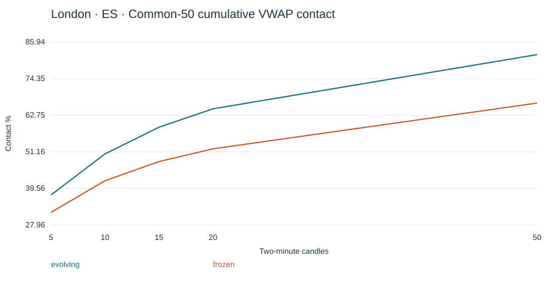

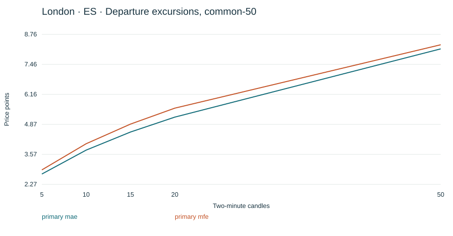

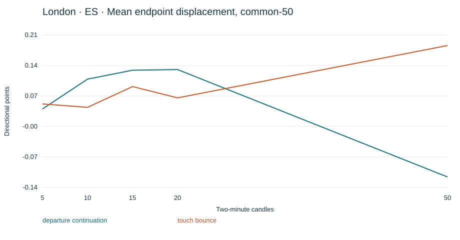

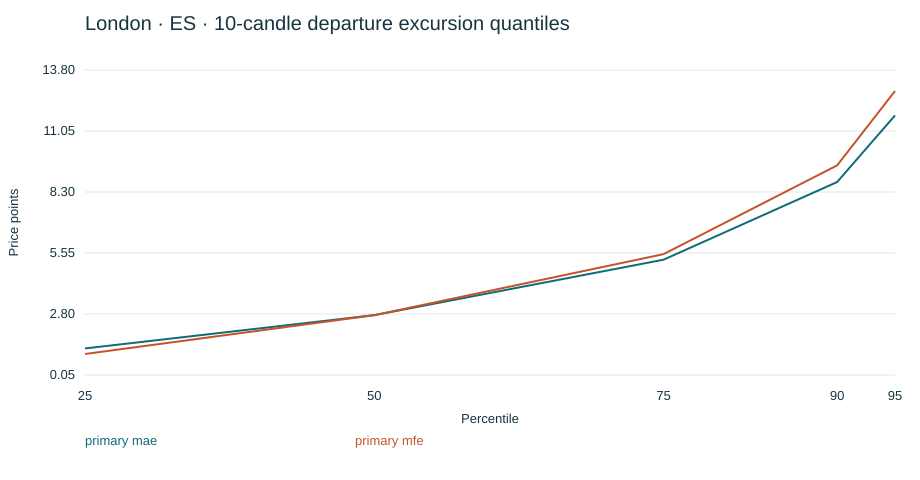

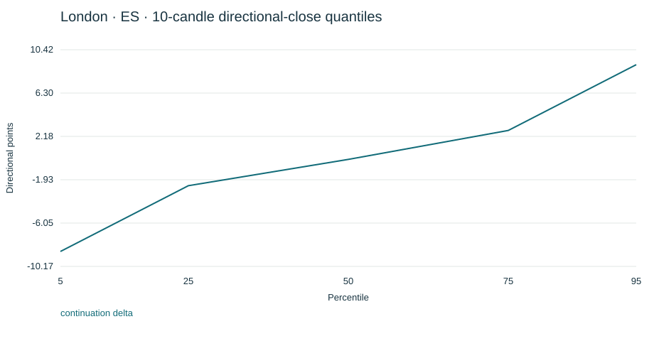

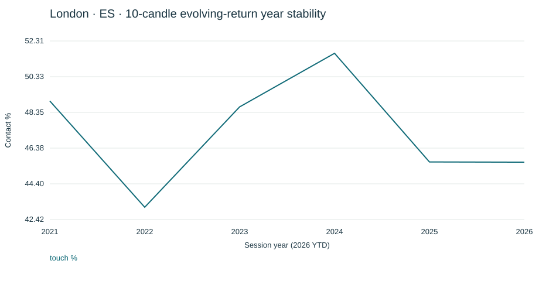

### Sensitivity and chronological periods at 10 candles

| Module | Scope | n | Days / weeks | Directional Δ [CI] | Return or bounce endpoint % [CI] |
| --- | --- | --- | --- | --- | --- |
| departure | all | 3,293 | 1,026 / 267 | 0.11 [-0.10, 0.32] | 46.8% [45.2%, 48.4%] |
| departure | common_50 | 2,919 | 1,019 / 267 | 0.11 [-0.07, 0.31] | 50.5% [48.9%, 52.1%] |
| departure | age_ge30 | 2,097 | 966 / 266 | 0.22 [-0.05, 0.49] | 28.5% [26.3%, 30.5%] |
| departure | through_2023 | 1,507 | 486 / 126 | 0.10 [-0.24, 0.48] | 46.2% [43.6%, 48.8%] |
| departure | year_2024_period | 523 | 158 / 52 | 0.22 [-0.11, 0.60] | 51.6% [47.8%, 55.1%] |
| departure | years_2025_2026 | 1,263 | 382 / 90 | 0.07 [-0.22, 0.36] | 45.6% [43.2%, 47.8%] |
| touch | all | 2,821 | 1,004 / 267 | 0.09 [-0.13, 0.30] | 49.0% [47.4%, 50.7%] |
| touch | common_50 | 2,436 | 978 / 267 | 0.04 [-0.16, 0.26] | 48.6% [46.9%, 50.5%] |
| touch | age_ge30 | 1,627 | 853 / 262 | 0.27 [-0.04, 0.59] | 49.5% [47.2%, 51.8%] |
| touch | through_2023 | 1,295 | 478 / 126 | 0.11 [-0.25, 0.50] | 49.1% [46.6%, 51.7%] |
| touch | year_2024_period | 445 | 153 / 52 | 0.24 [-0.06, 0.56] | 48.8% [44.5%, 53.3%] |
| touch | years_2025_2026 | 1,081 | 373 / 90 | -0.00 [-0.33, 0.32] | 49.0% [46.4%, 51.9%] |

### Deterministic source-path examples

Examples are the earliest stable ID in each prespecified class. They illustrate mechanisms and exclusions, not representative trade quality. The source table includes reference available_at and known sigma for every minute; charts plot raw one-minute high/low and references. Source minute open time relative to entry is shown; contacts have interval resolution. Lines join minute OHLC observations for display and do not imply intraminute order or trades through gaps. The 2-sigma envelope is plotted; 2.5/3-sigma references are retained in the example-path table.

return: ES-london-2021-06-29-P0119-K2-H10; upper side. Signal/confirmation 2021-06-29 07:00:00-04:00; entry 2021-06-29 07:00:00-04:00; deadline 2021-06-29 07:20:00-04:00 (New York time). Frozen sigma 1.50 points; signal VWAP 4,279.35. Band thresholds = VWAP ± 2/2.5/3 × sigma. Exclusion: none.

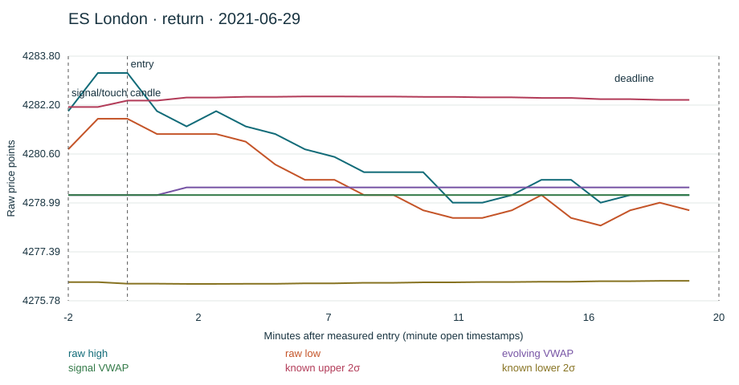

non_return: ES-london-2021-06-28-P0003-K2-H10; upper side. Signal/confirmation 2021-06-28 03:08:00-04:00; entry 2021-06-28 03:08:00-04:00; deadline 2021-06-28 03:28:00-04:00 (New York time). Frozen sigma 0.29 points; signal VWAP 4,273.65. Band thresholds = VWAP ± 2/2.5/3 × sigma. Exclusion: none.

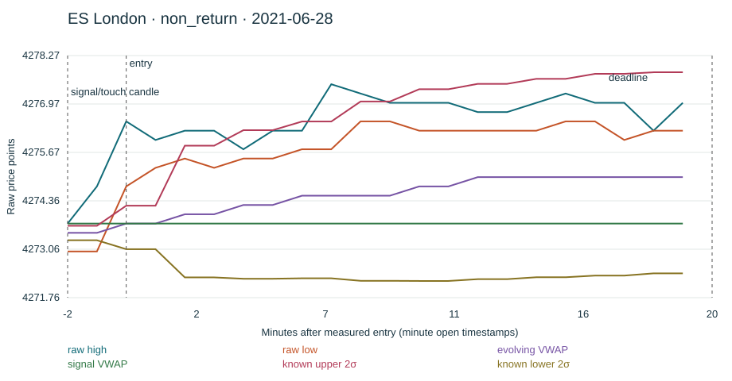

bounce: ES-london-2021-06-28-P0035-T-H10; lower side. Signal/confirmation 2021-06-28 05:00:00-04:00; entry 2021-06-28 05:00:00-04:00; deadline 2021-06-28 05:20:00-04:00 (New York time). Frozen sigma 2.26 points; signal VWAP 4,273.64. Band thresholds = VWAP ± 2/2.5/3 × sigma. Exclusion: none.

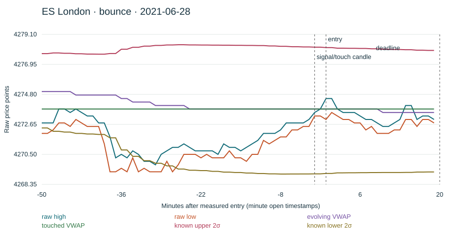

through: ES-london-2021-06-28-P0003-T-H10; upper side. Signal/confirmation 2021-06-28 03:44:00-04:00; entry 2021-06-28 03:44:00-04:00; deadline 2021-06-28 04:04:00-04:00 (New York time). Frozen sigma 1.31 points; signal VWAP 4,275.49. Band thresholds = VWAP ± 2/2.5/3 × sigma. Exclusion: none.

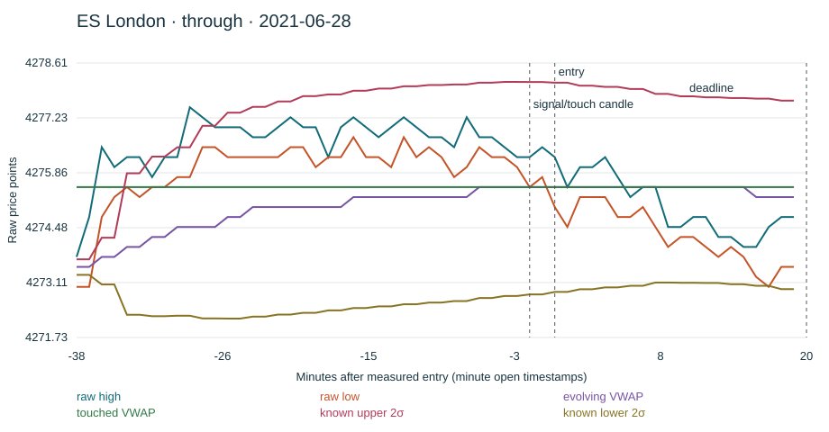

ambiguity: ES-london-2021-07-01-P0006-T-H10; upper side. Signal/confirmation 2021-07-01 03:18:00-04:00; entry 2021-07-01 03:18:00-04:00; deadline 2021-07-01 03:38:00-04:00 (New York time). Frozen sigma 0.90 points; signal VWAP 4,297.03. Band thresholds = VWAP ± 2/2.5/3 × sigma. Exclusion: none.

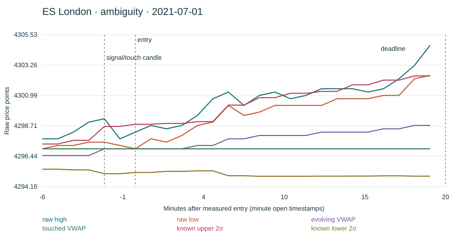

exclusion: ES-london-2021-06-28-P0178-K2-H05; upper side. Signal/confirmation 2021-06-28 08:58:00-04:00; entry 2021-06-28 08:58:00-04:00; deadline 2021-06-28 09:08:00-04:00 (New York time). Frozen sigma 2.08 points; signal VWAP 4,273.55. Band thresholds = VWAP ± 2/2.5/3 × sigma. Exclusion: session_boundary.

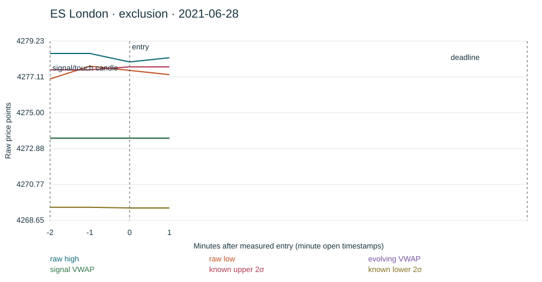

## NQ

Coverage: 1,177 retrospectively eligible dates, 2021-06-28 through 2026-09-18. All prices below are raw contract points. Full point/tick/sigma distributions and every tie numerator are saved in summary.csv.

### NQ year coverage and retrospective exclusions

| Year | Candidate days | Eligible | Excluded |
| --- | --- | --- | --- |
| 2010 | 150 | 0 | 150 |
| 2011 | 260 | 0 | 260 |
| 2012 | 261 | 0 | 261 |
| 2013 | 261 | 0 | 261 |
| 2014 | 261 | 0 | 261 |
| 2015 | 261 | 0 | 261 |
| 2016 | 261 | 0 | 261 |
| 2017 | 260 | 0 | 260 |
| 2018 | 261 | 0 | 261 |
| 2019 | 261 | 0 | 261 |
| 2020 | 262 | 0 | 262 |
| 2021 | 261 | 115 | 146 |
| 2022 | 260 | 236 | 24 |
| 2023 | 260 | 217 | 43 |
| 2024 | 262 | 213 | 49 |
| 2025 | 261 | 224 | 37 |
| 2026 | 187 | 172 | 15 |

[Release exclusion reasons by product/year (reasons may overlap)](tables/release-coverage.csv)

### Upper departure / arrival: continuation and bounce long; fade and through short

#### Departure response

| σ | h | n | Continuation MAE mean [CI] / median | Continuation MFE mean [CI] / median | Fade MAE mean [CI] / median | Fade MFE mean [CI] / median | Continuation Δ mean [CI] | Fade Δ mean [CI] | Continuation endpoint % | Close > entry % | Final candle up % | Entry ties | Days / weeks | Unavailable | Support |
| --- | --- | --- | --- | --- | --- | --- | --- | --- | --- | --- | --- | --- | --- | --- | --- |
| 2.0 | 5 | 1,750 | 11.92 [11.07, 12.78] / 8.00 | 13.28 [12.22, 14.45] / 8.62 | 13.28 [12.22, 14.45] / 8.62 | 11.92 [11.07, 12.78] / 8.00 | 1.05 [0.11, 2.05] | -1.05 [-2.05, -0.11] | 50.2% [47.8%, 52.5%] | 50.2% [47.8%, 52.5%] | 48.4% [46.2%, 50.7%] | 22 | 957 / 273 | 14 | adequate descriptive support |
| 2.0 | 10 | 1,717 | 16.47 [15.30, 17.61] / 11.00 | 18.03 [16.60, 19.61] / 11.75 | 18.03 [16.60, 19.61] / 11.75 | 16.47 [15.30, 17.61] / 11.00 | 1.19 [0.02, 2.40] | -1.19 [-2.40, -0.02] | 50.1% [47.9%, 52.3%] | 50.1% [47.9%, 52.3%] | 49.7% [47.4%, 52.0%] | 12 | 952 / 273 | 47 | adequate descriptive support |
| 2.0 | 15 | 1,635 | 19.54 [18.07, 21.17] / 13.00 | 20.72 [19.19, 22.50] / 13.75 | 20.72 [19.19, 22.50] / 13.75 | 19.54 [18.07, 21.17] / 13.00 | 0.58 [-0.88, 2.21] | -0.58 [-2.21, 0.88] | 49.6% [47.3%, 51.8%] | 49.6% [47.3%, 51.8%] | 47.6% [45.3%, 50.0%] | 10 | 934 / 273 | 129 | adequate descriptive support |
| 2.0 | 20 | 1,609 | 21.92 [20.34, 23.69] / 14.50 | 22.77 [21.13, 24.68] / 15.50 | 22.77 [21.13, 24.68] / 15.50 | 21.92 [20.34, 23.69] / 14.50 | 0.39 [-1.29, 2.08] | -0.39 [-2.08, 1.29] | 49.3% [46.7%, 51.8%] | 49.3% [46.7%, 51.8%] | 49.8% [47.2%, 52.4%] | 6 | 932 / 273 | 155 | adequate descriptive support |
| 2.0 | 50 | 1,476 | 34.16 [31.40, 37.15] / 23.75 | 33.49 [30.96, 36.44] / 23.75 | 33.49 [30.96, 36.44] / 23.75 | 34.16 [31.40, 37.15] / 23.75 | -0.31 [-3.14, 2.48] | 0.31 [-2.48, 3.14] | 49.9% [47.1%, 52.9%] | 49.9% [47.1%, 52.9%] | 47.8% [45.1%, 50.5%] | 3 | 902 / 272 | 288 | adequate descriptive support |
| 2.5 | 5 | 768 | 12.49 [11.25, 13.83] / 8.12 | 14.42 [12.77, 16.46] / 9.00 | 14.42 [12.77, 16.46] / 9.00 | 12.49 [11.25, 13.83] / 8.12 | 0.59 [-1.19, 2.61] | -0.59 [-2.61, 1.19] | 50.7% [47.0%, 54.2%] | 50.7% [47.0%, 54.2%] | 49.3% [46.0%, 52.9%] | 11 | 582 / 260 | 11 | adequate descriptive support |
| 2.5 | 10 | 755 | 16.98 [15.37, 18.76] / 11.50 | 19.21 [17.22, 21.52] / 12.25 | 19.21 [17.22, 21.52] / 12.25 | 16.98 [15.37, 18.76] / 11.50 | 1.38 [-0.63, 3.55] | -1.38 [-3.55, 0.63] | 48.5% [45.0%, 51.9%] | 48.5% [45.0%, 51.9%] | 50.6% [47.2%, 53.9%] | 4 | 573 / 259 | 24 | adequate descriptive support |
| 2.5 | 15 | 712 | 19.90 [17.75, 22.29] / 13.00 | 21.41 [19.19, 23.94] / 13.50 | 21.41 [19.19, 23.94] / 13.50 | 19.90 [17.75, 22.29] / 13.00 | 0.25 [-2.34, 3.11] | -0.25 [-3.11, 2.34] | 49.4% [45.7%, 53.4%] | 49.4% [45.7%, 53.4%] | 49.4% [45.7%, 53.1%] | 5 | 549 / 256 | 67 | adequate descriptive support |
| 2.5 | 20 | 699 | 22.40 [20.15, 25.00] / 14.50 | 23.64 [21.29, 26.39] / 16.00 | 23.64 [21.29, 26.39] / 16.00 | 22.40 [20.15, 25.00] / 14.50 | 0.19 [-2.38, 2.78] | -0.19 [-2.78, 2.38] | 48.9% [45.4%, 52.6%] | 48.9% [45.4%, 52.6%] | 51.8% [48.4%, 55.2%] | 3 | 544 / 256 | 80 | adequate descriptive support |
| 2.5 | 50 | 629 | 36.51 [32.48, 41.20] / 25.00 | 35.05 [31.64, 39.06] / 23.75 | 35.05 [31.64, 39.06] / 23.75 | 36.51 [32.48, 41.20] / 25.00 | -1.48 [-5.69, 2.72] | 1.48 [-2.72, 5.69] | 50.4% [46.4%, 54.7%] | 50.4% [46.4%, 54.7%] | 46.7% [42.6%, 50.7%] | 3 | 502 / 248 | 150 | adequate descriptive support |
| 3.0 | 5 | 174 | 16.82 [12.35, 23.16] / 8.62 | 17.00 [12.68, 23.49] / 10.88 | 17.00 [12.68, 23.49] / 10.88 | 16.82 [12.35, 23.16] / 8.62 | -1.20 [-8.60, 6.42] | 1.20 [-6.42, 8.60] | 47.7% [40.5%, 55.0%] | 47.7% [40.5%, 55.0%] | 44.8% [36.9%, 52.6%] | 4 | 162 / 130 | 0 | adequate descriptive support |
| 3.0 | 10 | 171 | 21.46 [16.27, 28.47] / 13.50 | 21.93 [16.97, 28.67] / 13.75 | 21.93 [16.97, 28.67] / 13.75 | 21.46 [16.27, 28.47] / 13.50 | -0.01 [-7.62, 7.41] | 0.01 [-7.41, 7.62] | 54.4% [47.2%, 61.8%] | 54.4% [47.2%, 61.8%] | 53.8% [46.5%, 61.0%] | 0 | 159 / 128 | 3 | adequate descriptive support |
| 3.0 | 15 | 154 | 22.19 [16.60, 30.07] / 13.38 | 23.85 [18.39, 31.63] / 14.88 | 23.85 [18.39, 31.63] / 14.88 | 22.19 [16.60, 30.07] / 13.38 | 1.62 [-7.14, 10.43] | -1.62 [-10.43, 7.14] | 48.7% [40.3%, 57.0%] | 48.7% [40.3%, 57.0%] | 52.6% [44.9%, 60.3%] | 1 | 144 / 116 | 20 | adequate descriptive support |
| 3.0 | 20 | 152 | 22.11 [18.60, 25.82] / 15.62 | 26.70 [20.80, 34.81] / 16.62 | 26.70 [20.80, 34.81] / 16.62 | 22.11 [18.60, 25.82] / 15.62 | 1.10 [-4.65, 7.47] | -1.10 [-7.47, 4.65] | 45.4% [37.0%, 53.4%] | 45.4% [37.0%, 53.4%] | 45.4% [37.2%, 53.7%] | 1 | 142 / 115 | 22 | adequate descriptive support |
| 3.0 | 50 | 144 | 38.16 [30.60, 47.47] / 29.62 | 39.55 [31.33, 49.73] / 25.12 | 39.55 [31.33, 49.73] / 25.12 | 38.16 [30.60, 47.47] / 29.62 | 0.65 [-9.42, 10.43] | -0.65 [-10.43, 9.42] | 47.2% [38.5%, 55.6%] | 47.2% [38.5%, 55.6%] | 42.4% [34.5%, 50.8%] | 0 | 136 / 111 | 30 | adequate descriptive support |

#### VWAP return probability and timing

| σ | h | Target | n | Touches | Touch % [CI] | No touch | Latency h median / p75 | Gap paths | Overtake paths | Unavailable | Evolving only | Frozen only |
| --- | --- | --- | --- | --- | --- | --- | --- | --- | --- | --- | --- | --- |
| 2.0 | 5 | evolving | 1,750 | 458 | 26.2% [24.2%, 28.0%] | 1,292 | 2.0 / 4.0 | 13 | 2 | 14 | 75 | 0 |
| 2.0 | 5 | frozen | 1,750 | 383 | 21.9% [19.9%, 23.8%] | 1,367 | 2.0 / 4.0 | 13 | 2 | 14 | 75 | 0 |
| 2.0 | 10 | evolving | 1,717 | 680 | 39.6% [37.5%, 41.7%] | 1,037 | 4.0 / 7.0 | 31 | 2 | 47 | 137 | 0 |
| 2.0 | 10 | frozen | 1,717 | 543 | 31.6% [29.5%, 33.7%] | 1,174 | 3.0 / 6.0 | 31 | 2 | 47 | 137 | 0 |
| 2.0 | 15 | evolving | 1,635 | 810 | 49.5% [47.3%, 51.7%] | 825 | 5.0 / 9.0 | 47 | 2 | 129 | 179 | 0 |
| 2.0 | 15 | frozen | 1,635 | 631 | 38.6% [36.2%, 40.9%] | 1,004 | 4.0 / 8.0 | 47 | 2 | 129 | 179 | 0 |
| 2.0 | 20 | evolving | 1,609 | 896 | 55.7% [53.5%, 57.7%] | 713 | 6.0 / 11.0 | 68 | 2 | 155 | 187 | 0 |
| 2.0 | 20 | frozen | 1,609 | 709 | 44.1% [41.8%, 46.2%] | 900 | 5.0 / 11.0 | 68 | 2 | 155 | 187 | 0 |
| 2.0 | 50 | evolving | 1,476 | 1,146 | 77.6% [75.6%, 79.6%] | 330 | 8.0 / 20.8 | 152 | 2 | 288 | 225 | 0 |
| 2.0 | 50 | frozen | 1,476 | 921 | 62.4% [59.8%, 64.8%] | 555 | 8.0 / 21.0 | 152 | 2 | 288 | 225 | 0 |
| 2.5 | 5 | evolving | 768 | 184 | 24.0% [21.0%, 27.0%] | 584 | 2.0 / 4.0 | 6 | 1 | 11 | 31 | 0 |
| 2.5 | 5 | frozen | 768 | 153 | 19.9% [17.1%, 22.9%] | 615 | 2.0 / 3.0 | 6 | 1 | 11 | 31 | 0 |
| 2.5 | 10 | evolving | 755 | 276 | 36.6% [33.2%, 40.1%] | 479 | 4.0 / 7.0 | 16 | 1 | 24 | 56 | 0 |
| 2.5 | 10 | frozen | 755 | 220 | 29.1% [25.8%, 32.5%] | 535 | 3.0 / 6.0 | 16 | 1 | 24 | 56 | 0 |
| 2.5 | 15 | evolving | 712 | 325 | 45.6% [42.0%, 49.2%] | 387 | 5.0 / 8.0 | 22 | 1 | 67 | 76 | 0 |
| 2.5 | 15 | frozen | 712 | 249 | 35.0% [31.6%, 38.3%] | 463 | 4.0 / 8.0 | 22 | 1 | 67 | 76 | 0 |
| 2.5 | 20 | evolving | 699 | 366 | 52.4% [48.7%, 56.0%] | 333 | 6.0 / 11.0 | 29 | 1 | 80 | 87 | 0 |
| 2.5 | 20 | frozen | 699 | 279 | 39.9% [36.4%, 43.4%] | 420 | 5.0 / 9.5 | 29 | 1 | 80 | 87 | 0 |
| 2.5 | 50 | evolving | 629 | 469 | 74.6% [71.2%, 77.8%] | 160 | 8.0 / 21.0 | 63 | 1 | 150 | 96 | 0 |
| 2.5 | 50 | frozen | 629 | 373 | 59.3% [55.5%, 63.2%] | 256 | 8.0 / 23.0 | 63 | 1 | 150 | 96 | 0 |
| 3.0 | 5 | evolving | 174 | 61 | 35.1% [28.1%, 41.9%] | 113 | 2.0 / 3.0 | 2 | 0 | 0 | 8 | 0 |
| 3.0 | 5 | frozen | 174 | 53 | 30.5% [23.8%, 37.0%] | 121 | 2.0 / 3.0 | 2 | 0 | 0 | 8 | 0 |
| 3.0 | 10 | evolving | 171 | 78 | 45.6% [37.8%, 53.0%] | 93 | 3.0 / 5.0 | 3 | 0 | 3 | 13 | 0 |
| 3.0 | 10 | frozen | 171 | 65 | 38.0% [30.5%, 45.5%] | 106 | 2.0 / 5.0 | 3 | 0 | 3 | 13 | 0 |
| 3.0 | 15 | evolving | 154 | 86 | 55.8% [48.1%, 63.4%] | 68 | 3.0 / 6.0 | 4 | 0 | 20 | 13 | 0 |
| 3.0 | 15 | frozen | 154 | 73 | 47.4% [39.2%, 55.5%] | 81 | 3.0 / 6.0 | 4 | 0 | 20 | 13 | 0 |
| 3.0 | 20 | evolving | 152 | 93 | 61.2% [53.6%, 68.6%] | 59 | 3.0 / 9.0 | 5 | 0 | 22 | 16 | 0 |
| 3.0 | 20 | frozen | 152 | 77 | 50.7% [42.5%, 58.7%] | 75 | 3.0 / 7.0 | 5 | 0 | 22 | 16 | 0 |
| 3.0 | 50 | evolving | 144 | 113 | 78.5% [71.6%, 84.5%] | 31 | 5.0 / 16.0 | 10 | 0 | 30 | 20 | 0 |
| 3.0 | 50 | frozen | 144 | 93 | 64.6% [56.5%, 72.2%] | 51 | 5.0 / 15.0 | 10 | 0 | 30 | 20 | 0 |

#### First-return response

Reached-threshold cohorts are nested using crossings recorded before this first touch. Response starts at the next open after touch confirmation. Barrier first move freezes 0.5 touch-close sigma, rounded upward to at least one tick. Counts B/T/neither/ambiguous reconcile separately from unavailable barriers. Same-minute ambiguous is not assigned to either direction. Full-horizon excursions continue after a barrier resolves.

| σ | h | n | Bounce MAE mean [CI] / median | Bounce MFE mean [CI] / median | Through MAE mean [CI] / median | Through MFE mean [CI] / median | Bounce Δ mean [CI] | Through Δ mean [CI] | Bounce endpoint % | Close > entry % | Final candle up % | Entry ties | Days / weeks | Unavailable | Support | First B / T / neither / ambiguous | Barrier unavailable |
| --- | --- | --- | --- | --- | --- | --- | --- | --- | --- | --- | --- | --- | --- | --- | --- | --- | --- |
| 2.0 | 5 | 1,420 | 12.35 [11.43, 13.35] / 8.25 | 12.13 [11.12, 13.20] / 7.75 | 12.13 [11.12, 13.20] / 7.75 | 12.35 [11.43, 13.35] / 8.25 | 0.38 [-0.72, 1.49] | -0.38 [-1.49, 0.72] | 50.5% [47.7%, 53.3%] | 50.5% [47.7%, 53.3%] | 49.7% [47.1%, 52.3%] | 10 | 858 / 271 | 21 | adequate descriptive support | 554 / 606 / 164 / 96 | 0 |
| 2.0 | 10 | 1,397 | 17.52 [16.22, 18.98] / 11.75 | 16.17 [14.94, 17.50] / 11.00 | 16.17 [14.94, 17.50] / 11.00 | 17.52 [16.22, 18.98] / 11.75 | -0.19 [-1.65, 1.20] | 0.19 [-1.20, 1.65] | 51.4% [48.9%, 53.8%] | 51.4% [48.9%, 53.8%] | 50.9% [48.5%, 53.2%] | 7 | 854 / 271 | 44 | adequate descriptive support | 599 / 648 / 53 / 97 | 0 |
| 2.0 | 15 | 1,324 | 20.54 [18.86, 22.46] / 13.50 | 19.25 [17.71, 20.81] / 13.25 | 19.25 [17.71, 20.81] / 13.25 | 20.54 [18.86, 22.46] / 13.50 | 0.16 [-1.69, 2.01] | -0.16 [-2.01, 1.69] | 51.4% [48.5%, 54.3%] | 51.4% [48.5%, 54.3%] | 48.1% [45.5%, 50.6%] | 6 | 831 / 270 | 117 | adequate descriptive support | 586 / 622 / 22 / 94 | 0 |
| 2.0 | 20 | 1,295 | 22.75 [20.91, 24.86] / 15.50 | 21.53 [19.88, 23.47] / 15.00 | 21.53 [19.88, 23.47] / 15.00 | 22.75 [20.91, 24.86] / 15.50 | 0.05 [-1.84, 1.94] | -0.05 [-1.94, 1.84] | 51.8% [48.8%, 54.7%] | 51.8% [48.8%, 54.7%] | 48.4% [45.6%, 51.2%] | 12 | 821 / 270 | 146 | adequate descriptive support | 585 / 611 / 10 / 89 | 0 |
| 2.0 | 50 | 1,170 | 35.85 [32.52, 39.52] / 24.00 | 32.52 [29.92, 35.47] / 23.75 | 32.52 [29.92, 35.47] / 23.75 | 35.85 [32.52, 39.52] / 24.00 | -1.24 [-4.28, 1.93] | 1.24 [-1.93, 4.28] | 53.1% [49.9%, 56.4%] | 53.1% [49.9%, 56.4%] | 51.4% [48.5%, 54.3%] | 5 | 774 / 268 | 271 | adequate descriptive support | 526 / 558 / 1 / 85 | 0 |
| 2.5 | 5 | 600 | 12.87 [11.31, 14.65] / 8.50 | 12.94 [11.76, 14.21] / 8.25 | 12.94 [11.76, 14.21] / 8.25 | 12.87 [11.31, 14.65] / 8.50 | 0.55 [-1.14, 2.10] | -0.55 [-2.10, 1.14] | 52.0% [47.9%, 56.1%] | 52.0% [47.9%, 56.1%] | 50.5% [46.5%, 54.6%] | 4 | 475 / 241 | 9 | adequate descriptive support | 231 / 243 / 73 / 53 | 0 |
| 2.5 | 10 | 592 | 18.24 [16.32, 20.43] / 12.25 | 16.98 [15.51, 18.60] / 11.75 | 16.98 [15.51, 18.60] / 11.75 | 18.24 [16.32, 20.43] / 12.25 | -0.20 [-2.44, 1.85] | 0.20 [-1.85, 2.44] | 52.2% [48.2%, 56.0%] | 52.2% [48.2%, 56.0%] | 49.0% [45.2%, 52.7%] | 1 | 471 / 241 | 17 | adequate descriptive support | 250 / 265 / 24 / 53 | 0 |
| 2.5 | 15 | 551 | 21.62 [19.18, 24.62] / 15.00 | 19.78 [17.73, 21.96] / 13.50 | 19.78 [17.73, 21.96] / 13.50 | 21.62 [19.18, 24.62] / 15.00 | -0.59 [-3.59, 2.31] | 0.59 [-2.31, 3.59] | 50.5% [45.9%, 54.7%] | 50.5% [45.9%, 54.7%] | 51.2% [47.0%, 55.1%] | 3 | 446 / 236 | 58 | adequate descriptive support | 239 / 252 / 10 / 50 | 0 |
| 2.5 | 20 | 537 | 23.77 [21.18, 26.87] / 16.50 | 22.12 [19.68, 24.80] / 15.50 | 22.12 [19.68, 24.80] / 15.50 | 23.77 [21.18, 26.87] / 16.50 | -0.82 [-3.61, 1.82] | 0.82 [-1.82, 3.61] | 50.5% [45.9%, 54.7%] | 50.5% [45.9%, 54.7%] | 47.5% [43.4%, 51.7%] | 3 | 438 / 233 | 72 | adequate descriptive support | 239 / 245 / 6 / 47 | 0 |
| 2.5 | 50 | 480 | 38.49 [33.54, 44.08] / 25.50 | 32.78 [29.31, 36.63] / 24.50 | 32.78 [29.31, 36.63] / 24.50 | 38.49 [33.54, 44.08] / 25.50 | -4.25 [-9.29, 0.47] | 4.25 [-0.47, 9.29] | 50.4% [45.4%, 55.2%] | 50.4% [45.4%, 55.2%] | 49.8% [45.4%, 54.3%] | 2 | 398 / 226 | 129 | adequate descriptive support | 218 / 217 / 0 / 45 | 0 |
| 3.0 | 5 | 134 | 13.30 [10.43, 16.64] / 9.12 | 11.44 [9.27, 13.87] / 7.25 | 11.44 [9.27, 13.87] / 7.25 | 13.30 [10.43, 16.64] / 9.12 | -0.26 [-3.53, 2.92] | 0.26 [-2.92, 3.53] | 49.3% [40.9%, 57.2%] | 49.3% [40.9%, 57.2%] | 50.7% [42.2%, 59.5%] | 1 | 125 / 106 | 3 | adequate descriptive support | 51 / 52 / 13 / 18 | 0 |
| 3.0 | 10 | 132 | 18.17 [14.81, 21.79] / 14.12 | 15.30 [12.71, 18.05] / 11.25 | 15.30 [12.71, 18.05] / 11.25 | 18.17 [14.81, 21.79] / 14.12 | -1.49 [-5.51, 2.37] | 1.49 [-2.37, 5.51] | 49.2% [40.7%, 57.9%] | 49.2% [40.7%, 57.9%] | 44.7% [35.8%, 53.5%] | 1 | 123 / 105 | 5 | adequate descriptive support | 54 / 54 / 6 / 18 | 0 |
| 3.0 | 15 | 124 | 21.22 [18.30, 24.47] / 18.50 | 19.84 [15.14, 26.44] / 13.50 | 19.84 [15.14, 26.44] / 13.50 | 21.22 [18.30, 24.47] / 18.50 | 0.29 [-5.36, 7.24] | -0.29 [-7.24, 5.36] | 46.8% [37.9%, 56.0%] | 46.8% [37.9%, 56.0%] | 50.0% [40.9%, 58.4%] | 0 | 115 / 99 | 13 | adequate descriptive support | 51 / 52 / 3 / 18 | 0 |
| 3.0 | 20 | 123 | 24.08 [20.48, 27.92] / 19.00 | 21.19 [16.28, 27.90] / 14.00 | 21.19 [16.28, 27.90] / 14.00 | 24.08 [20.48, 27.92] / 19.00 | -0.86 [-6.75, 6.11] | 0.86 [-6.11, 6.75] | 48.8% [40.1%, 57.4%] | 48.8% [40.1%, 57.4%] | 45.5% [37.1%, 54.5%] | 0 | 115 / 99 | 14 | adequate descriptive support | 51 / 52 / 2 / 18 | 0 |
| 3.0 | 50 | 117 | 40.44 [31.40, 51.01] / 26.50 | 34.43 [27.64, 42.06] / 24.25 | 34.43 [27.64, 42.06] / 24.25 | 40.44 [31.40, 51.01] / 26.50 | -1.84 [-12.80, 8.53] | 1.84 [-8.53, 12.80] | 52.1% [42.6%, 61.3%] | 52.1% [42.6%, 61.3%] | 55.6% [46.2%, 64.3%] | 0 | 110 / 94 | 20 | adequate descriptive support | 50 / 49 / 0 / 18 | 0 |

### Lower departure / arrival: continuation and bounce short; fade and through long

#### Departure response

| σ | h | n | Continuation MAE mean [CI] / median | Continuation MFE mean [CI] / median | Fade MAE mean [CI] / median | Fade MFE mean [CI] / median | Continuation Δ mean [CI] | Fade Δ mean [CI] | Continuation endpoint % | Close > entry % | Final candle up % | Entry ties | Days / weeks | Unavailable | Support |
| --- | --- | --- | --- | --- | --- | --- | --- | --- | --- | --- | --- | --- | --- | --- | --- |
| 2.0 | 5 | 1,792 | 12.91 [11.94, 13.95] / 9.00 | 14.22 [13.23, 15.34] / 9.25 | 14.22 [13.23, 15.34] / 9.25 | 12.91 [11.94, 13.95] / 9.00 | -0.17 [-1.07, 0.79] | 0.17 [-0.79, 1.07] | 46.5% [44.3%, 48.7%] | 52.9% [50.6%, 55.0%] | 51.5% [49.3%, 53.7%] | 11 | 966 / 273 | 11 | adequate descriptive support |
| 2.0 | 10 | 1,765 | 18.05 [16.72, 19.47] / 12.75 | 19.53 [18.21, 21.03] / 13.25 | 19.53 [18.21, 21.03] / 13.25 | 18.05 [16.72, 19.47] / 12.75 | -0.28 [-1.53, 1.06] | 0.28 [-1.06, 1.53] | 46.2% [43.8%, 48.7%] | 53.3% [50.8%, 55.5%] | 51.4% [48.9%, 53.8%] | 10 | 961 / 273 | 38 | adequate descriptive support |
| 2.0 | 15 | 1,693 | 21.08 [19.49, 22.76] / 15.25 | 23.53 [21.82, 25.48] / 15.25 | 23.53 [21.82, 25.48] / 15.25 | 21.08 [19.49, 22.76] / 15.25 | 0.24 [-1.34, 1.87] | -0.24 [-1.87, 1.34] | 47.1% [44.7%, 49.5%] | 52.6% [50.1%, 55.0%] | 50.6% [48.1%, 53.2%] | 5 | 945 / 273 | 110 | adequate descriptive support |
| 2.0 | 20 | 1,673 | 23.98 [22.15, 25.88] / 17.50 | 26.56 [24.60, 28.82] / 18.00 | 26.56 [24.60, 28.82] / 18.00 | 23.98 [22.15, 25.88] / 17.50 | -0.47 [-2.27, 1.29] | 0.47 [-1.29, 2.27] | 45.3% [42.9%, 47.8%] | 54.2% [51.6%, 56.6%] | 49.0% [46.6%, 51.3%] | 9 | 941 / 273 | 130 | adequate descriptive support |
| 2.0 | 50 | 1,566 | 36.11 [33.32, 39.12] / 26.62 | 40.59 [37.04, 44.53] / 26.75 | 40.59 [37.04, 44.53] / 26.75 | 36.11 [33.32, 39.12] / 26.62 | 0.40 [-2.64, 3.58] | -0.40 [-3.58, 2.64] | 47.0% [44.0%, 49.8%] | 52.8% [50.0%, 55.8%] | 49.0% [46.5%, 51.7%] | 3 | 916 / 272 | 237 | adequate descriptive support |
| 2.5 | 5 | 849 | 13.24 [11.96, 14.65] / 9.00 | 15.24 [14.00, 16.66] / 10.25 | 15.24 [14.00, 16.66] / 10.25 | 13.24 [11.96, 14.65] / 9.00 | -0.06 [-1.37, 1.35] | 0.06 [-1.35, 1.37] | 47.1% [44.1%, 50.4%] | 51.7% [48.5%, 54.7%] | 51.1% [47.9%, 54.2%] | 10 | 631 / 259 | 5 | adequate descriptive support |
| 2.5 | 10 | 834 | 18.55 [16.78, 20.35] / 13.00 | 20.76 [18.99, 22.69] / 14.00 | 20.76 [18.99, 22.69] / 14.00 | 18.55 [16.78, 20.35] / 13.00 | -0.22 [-2.07, 1.62] | 0.22 [-1.62, 2.07] | 46.5% [43.1%, 50.0%] | 52.6% [49.1%, 55.9%] | 53.5% [50.1%, 56.5%] | 7 | 621 / 257 | 20 | adequate descriptive support |
| 2.5 | 15 | 798 | 22.01 [20.03, 24.06] / 16.00 | 24.19 [22.13, 26.37] / 16.00 | 24.19 [22.13, 26.37] / 16.00 | 22.01 [20.03, 24.06] / 16.00 | -0.57 [-2.60, 1.50] | 0.57 [-1.50, 2.60] | 47.2% [43.9%, 50.8%] | 52.1% [48.6%, 55.4%] | 51.1% [47.5%, 54.8%] | 5 | 600 / 255 | 56 | adequate descriptive support |
| 2.5 | 20 | 789 | 24.55 [22.32, 26.80] / 17.75 | 27.19 [24.83, 29.70] / 18.75 | 27.19 [24.83, 29.70] / 18.75 | 24.55 [22.32, 26.80] / 17.75 | -0.58 [-2.85, 1.79] | 0.58 [-1.79, 2.85] | 45.2% [42.0%, 48.6%] | 54.2% [51.0%, 57.4%] | 48.7% [45.2%, 52.2%] | 4 | 595 / 255 | 65 | adequate descriptive support |
| 2.5 | 50 | 730 | 35.72 [32.66, 39.13] / 27.12 | 41.80 [37.25, 46.69] / 26.50 | 41.80 [37.25, 46.69] / 26.50 | 35.72 [32.66, 39.13] / 27.12 | 1.26 [-2.80, 5.51] | -1.26 [-5.51, 2.80] | 46.0% [41.7%, 49.9%] | 53.7% [49.9%, 58.0%] | 48.6% [45.3%, 52.2%] | 2 | 565 / 250 | 124 | adequate descriptive support |
| 3.0 | 5 | 221 | 12.94 [11.29, 14.72] / 9.25 | 16.27 [13.83, 18.94] / 11.25 | 16.27 [13.83, 18.94] / 11.25 | 12.94 [11.29, 14.72] / 9.25 | 0.78 [-1.79, 3.49] | -0.78 [-3.49, 1.79] | 46.2% [40.0%, 52.3%] | 52.5% [46.2%, 58.6%] | 52.9% [45.8%, 59.9%] | 3 | 204 / 159 | 1 | adequate descriptive support |
| 3.0 | 10 | 219 | 18.57 [16.03, 21.29] / 13.25 | 23.02 [19.05, 27.90] / 14.00 | 23.02 [19.05, 27.90] / 14.00 | 18.57 [16.03, 21.29] / 13.25 | 0.66 [-3.87, 5.60] | -0.66 [-5.60, 3.87] | 44.7% [37.8%, 51.6%] | 54.3% [47.6%, 61.3%] | 55.7% [48.5%, 62.7%] | 2 | 202 / 157 | 3 | adequate descriptive support |
| 3.0 | 15 | 209 | 21.88 [18.95, 25.00] / 16.50 | 25.97 [21.34, 31.45] / 15.00 | 25.97 [21.34, 31.45] / 15.00 | 21.88 [18.95, 25.00] / 16.50 | -0.11 [-4.74, 4.64] | 0.11 [-4.64, 4.74] | 43.5% [36.1%, 51.4%] | 56.5% [48.6%, 63.9%] | 56.5% [49.3%, 63.3%] | 0 | 192 / 151 | 13 | adequate descriptive support |
| 3.0 | 20 | 207 | 24.43 [21.27, 27.84] / 18.50 | 29.67 [24.02, 36.30] / 19.25 | 29.67 [24.02, 36.30] / 19.25 | 24.43 [21.27, 27.84] / 18.50 | 1.60 [-4.27, 8.17] | -1.60 [-8.17, 4.27] | 42.5% [35.4%, 49.7%] | 57.0% [49.8%, 64.1%] | 47.8% [41.4%, 54.7%] | 1 | 191 / 151 | 15 | adequate descriptive support |
| 3.0 | 50 | 192 | 35.51 [30.81, 40.67] / 28.25 | 42.72 [32.42, 57.15] / 24.38 | 42.72 [32.42, 57.15] / 24.38 | 35.51 [30.81, 40.67] / 28.25 | 1.77 [-8.31, 14.49] | -1.77 [-14.49, 8.31] | 45.8% [38.0%, 53.0%] | 53.6% [46.5%, 61.5%] | 41.7% [34.9%, 48.6%] | 1 | 178 / 140 | 30 | adequate descriptive support |

#### VWAP return probability and timing

| σ | h | Target | n | Touches | Touch % [CI] | No touch | Latency h median / p75 | Gap paths | Overtake paths | Unavailable | Evolving only | Frozen only |
| --- | --- | --- | --- | --- | --- | --- | --- | --- | --- | --- | --- | --- |
| 2.0 | 5 | evolving | 1,792 | 512 | 28.6% [26.5%, 30.5%] | 1,280 | 2.0 / 4.0 | 13 | 2 | 11 | 78 | 0 |
| 2.0 | 5 | frozen | 1,792 | 434 | 24.2% [22.2%, 26.1%] | 1,358 | 2.0 / 4.0 | 13 | 2 | 11 | 78 | 0 |
| 2.0 | 10 | evolving | 1,765 | 791 | 44.8% [42.5%, 47.0%] | 974 | 4.0 / 7.0 | 36 | 2 | 38 | 143 | 0 |
| 2.0 | 10 | frozen | 1,765 | 648 | 36.7% [34.5%, 39.0%] | 1,117 | 4.0 / 7.0 | 36 | 2 | 38 | 143 | 0 |
| 2.0 | 15 | evolving | 1,693 | 924 | 54.6% [52.4%, 56.8%] | 769 | 5.0 / 9.0 | 58 | 2 | 110 | 172 | 0 |
| 2.0 | 15 | frozen | 1,693 | 752 | 44.4% [42.0%, 46.9%] | 941 | 5.0 / 8.2 | 58 | 2 | 110 | 172 | 0 |
| 2.0 | 20 | evolving | 1,673 | 1,031 | 61.6% [59.5%, 63.7%] | 642 | 6.0 / 11.0 | 93 | 2 | 130 | 206 | 0 |
| 2.0 | 20 | frozen | 1,673 | 825 | 49.3% [46.9%, 51.6%] | 848 | 5.0 / 10.0 | 93 | 2 | 130 | 206 | 0 |
| 2.0 | 50 | evolving | 1,566 | 1,271 | 81.2% [79.3%, 82.9%] | 295 | 8.0 / 18.0 | 193 | 2 | 237 | 264 | 0 |
| 2.0 | 50 | frozen | 1,566 | 1,007 | 64.3% [61.8%, 66.7%] | 559 | 7.0 / 17.0 | 193 | 2 | 237 | 264 | 0 |
| 2.5 | 5 | evolving | 849 | 205 | 24.1% [21.3%, 26.9%] | 644 | 2.0 / 4.0 | 3 | 0 | 5 | 32 | 0 |
| 2.5 | 5 | frozen | 849 | 173 | 20.4% [17.8%, 23.0%] | 676 | 2.0 / 4.0 | 3 | 0 | 5 | 32 | 0 |
| 2.5 | 10 | evolving | 834 | 311 | 37.3% [34.0%, 40.4%] | 523 | 4.0 / 7.0 | 7 | 0 | 20 | 66 | 0 |
| 2.5 | 10 | frozen | 834 | 245 | 29.4% [26.3%, 32.3%] | 589 | 4.0 / 6.0 | 7 | 0 | 20 | 66 | 0 |
| 2.5 | 15 | evolving | 798 | 378 | 47.4% [44.2%, 50.4%] | 420 | 5.0 / 9.0 | 17 | 0 | 56 | 81 | 0 |
| 2.5 | 15 | frozen | 798 | 297 | 37.2% [34.1%, 40.1%] | 501 | 5.0 / 9.0 | 17 | 0 | 56 | 81 | 0 |
| 2.5 | 20 | evolving | 789 | 436 | 55.3% [51.9%, 58.3%] | 353 | 6.0 / 12.0 | 34 | 0 | 65 | 105 | 0 |
| 2.5 | 20 | frozen | 789 | 331 | 42.0% [38.8%, 44.9%] | 458 | 5.0 / 11.0 | 34 | 0 | 65 | 105 | 0 |
| 2.5 | 50 | evolving | 730 | 561 | 76.8% [73.8%, 79.9%] | 169 | 10.0 / 20.0 | 76 | 0 | 124 | 135 | 0 |
| 2.5 | 50 | frozen | 730 | 426 | 58.4% [54.8%, 61.9%] | 304 | 9.0 / 21.8 | 76 | 0 | 124 | 135 | 0 |
| 3.0 | 5 | evolving | 221 | 67 | 30.3% [24.4%, 36.6%] | 154 | 2.0 / 4.0 | 2 | 0 | 1 | 10 | 0 |
| 3.0 | 5 | frozen | 221 | 57 | 25.8% [20.2%, 31.6%] | 164 | 2.0 / 4.0 | 2 | 0 | 1 | 10 | 0 |
| 3.0 | 10 | evolving | 219 | 90 | 41.1% [34.6%, 47.8%] | 129 | 3.0 / 5.8 | 4 | 0 | 3 | 13 | 0 |
| 3.0 | 10 | frozen | 219 | 77 | 35.2% [28.8%, 41.5%] | 142 | 4.0 / 6.0 | 4 | 0 | 3 | 13 | 0 |
| 3.0 | 15 | evolving | 209 | 104 | 49.8% [43.2%, 56.2%] | 105 | 4.0 / 7.2 | 8 | 0 | 13 | 20 | 0 |
| 3.0 | 15 | frozen | 209 | 84 | 40.2% [33.5%, 46.8%] | 125 | 4.0 / 6.0 | 8 | 0 | 13 | 20 | 0 |
| 3.0 | 20 | evolving | 207 | 119 | 57.5% [51.7%, 63.7%] | 88 | 4.0 / 10.5 | 11 | 0 | 15 | 30 | 0 |
| 3.0 | 20 | frozen | 207 | 89 | 43.0% [36.4%, 49.7%] | 118 | 4.0 / 7.0 | 11 | 0 | 15 | 30 | 0 |
| 3.0 | 50 | evolving | 192 | 146 | 76.0% [70.0%, 82.0%] | 46 | 7.0 / 18.0 | 21 | 0 | 30 | 33 | 0 |
| 3.0 | 50 | frozen | 192 | 113 | 58.9% [51.8%, 66.1%] | 79 | 6.0 / 18.0 | 21 | 0 | 30 | 33 | 0 |

#### First-return response

Reached-threshold cohorts are nested using crossings recorded before this first touch. Response starts at the next open after touch confirmation. Barrier first move freezes 0.5 touch-close sigma, rounded upward to at least one tick. Counts B/T/neither/ambiguous reconcile separately from unavailable barriers. Same-minute ambiguous is not assigned to either direction. Full-horizon excursions continue after a barrier resolves.

| σ | h | n | Bounce MAE mean [CI] / median | Bounce MFE mean [CI] / median | Through MAE mean [CI] / median | Through MFE mean [CI] / median | Bounce Δ mean [CI] | Through Δ mean [CI] | Bounce endpoint % | Close > entry % | Final candle up % | Entry ties | Days / weeks | Unavailable | Support | First B / T / neither / ambiguous | Barrier unavailable |
| --- | --- | --- | --- | --- | --- | --- | --- | --- | --- | --- | --- | --- | --- | --- | --- | --- | --- |
| 2.0 | 5 | 1,514 | 11.66 [10.85, 12.56] / 8.00 | 12.23 [11.32, 13.17] / 8.00 | 12.23 [11.32, 13.17] / 8.00 | 11.66 [10.85, 12.56] / 8.00 | 0.49 [-0.34, 1.34] | -0.49 [-1.34, 0.34] | 47.5% [45.1%, 49.9%] | 51.5% [49.1%, 54.0%] | 49.6% [47.3%, 52.0%] | 15 | 892 / 272 | 19 | adequate descriptive support | 591 / 593 / 214 / 116 | 0 |
| 2.0 | 10 | 1,495 | 16.18 [15.03, 17.40] / 11.50 | 17.56 [16.02, 19.19] / 11.00 | 17.56 [16.02, 19.19] / 11.00 | 16.18 [15.03, 17.40] / 11.50 | 0.64 [-0.65, 1.95] | -0.64 [-1.95, 0.65] | 47.8% [45.3%, 50.3%] | 51.7% [49.2%, 54.2%] | 51.4% [48.7%, 54.0%] | 7 | 886 / 272 | 38 | adequate descriptive support | 634 / 667 / 78 / 116 | 0 |
| 2.0 | 15 | 1,436 | 19.46 [18.13, 20.94] / 14.00 | 20.67 [18.86, 22.64] / 13.50 | 20.67 [18.86, 22.64] / 13.50 | 19.46 [18.13, 20.94] / 14.00 | -0.44 [-1.96, 1.06] | 0.44 [-1.06, 1.96] | 47.2% [44.4%, 49.9%] | 52.3% [49.5%, 55.2%] | 51.0% [48.7%, 53.4%] | 7 | 869 / 272 | 97 | adequate descriptive support | 628 / 659 / 35 / 114 | 0 |
| 2.0 | 20 | 1,416 | 22.16 [20.54, 23.92] / 16.00 | 23.40 [21.42, 25.52] / 15.50 | 23.40 [21.42, 25.52] / 15.50 | 22.16 [20.54, 23.92] / 16.00 | -0.12 [-1.77, 1.59] | 0.12 [-1.59, 1.77] | 46.1% [43.4%, 48.9%] | 53.1% [50.3%, 55.8%] | 47.5% [44.8%, 50.1%] | 11 | 864 / 271 | 117 | adequate descriptive support | 631 / 656 / 20 / 109 | 0 |
| 2.0 | 50 | 1,304 | 34.31 [31.69, 37.15] / 24.25 | 37.36 [33.99, 41.04] / 24.75 | 37.36 [33.99, 41.04] / 24.75 | 34.31 [31.69, 37.15] / 24.25 | 1.39 [-1.82, 4.65] | -1.39 [-4.65, 1.82] | 47.3% [44.3%, 50.5%] | 52.5% [49.3%, 55.5%] | 51.2% [48.3%, 54.1%] | 3 | 824 / 269 | 229 | adequate descriptive support | 575 / 620 / 0 / 109 | 0 |
| 2.5 | 5 | 688 | 11.55 [10.49, 12.67] / 7.75 | 13.32 [12.06, 14.66] / 8.50 | 13.32 [12.06, 14.66] / 8.50 | 11.55 [10.49, 12.67] / 7.75 | 0.93 [-0.43, 2.30] | -0.93 [-2.30, 0.43] | 48.1% [44.4%, 51.8%] | 50.7% [47.1%, 54.3%] | 50.9% [47.1%, 54.6%] | 8 | 539 / 245 | 7 | adequate descriptive support | 274 / 236 / 120 / 58 | 0 |
| 2.5 | 10 | 676 | 16.23 [14.65, 17.85] / 11.00 | 18.58 [16.71, 20.61] / 11.75 | 18.58 [16.71, 20.61] / 11.75 | 16.23 [14.65, 17.85] / 11.00 | 1.24 [-0.85, 3.38] | -1.24 [-3.38, 0.85] | 49.3% [45.3%, 53.3%] | 50.4% [46.5%, 54.3%] | 51.2% [47.2%, 55.0%] | 2 | 529 / 244 | 19 | adequate descriptive support | 299 / 274 / 45 / 58 | 0 |
| 2.5 | 15 | 640 | 19.12 [17.39, 20.93] / 13.75 | 21.65 [19.25, 24.16] / 14.75 | 21.65 [19.25, 24.16] / 14.75 | 19.12 [17.39, 20.93] / 13.75 | 0.48 [-1.56, 2.64] | -0.48 [-2.64, 1.56] | 49.7% [45.9%, 53.5%] | 49.8% [46.1%, 53.7%] | 50.3% [46.7%, 53.9%] | 3 | 508 / 242 | 55 | adequate descriptive support | 290 / 270 / 22 / 58 | 0 |
| 2.5 | 20 | 631 | 21.58 [19.61, 23.69] / 16.00 | 24.32 [21.82, 27.06] / 17.50 | 24.32 [21.82, 27.06] / 17.50 | 21.58 [19.61, 23.69] / 16.00 | 0.86 [-1.62, 3.53] | -0.86 [-3.53, 1.62] | 46.4% [42.5%, 50.6%] | 52.9% [48.8%, 56.9%] | 45.8% [41.5%, 49.7%] | 4 | 501 / 240 | 64 | adequate descriptive support | 293 / 269 / 14 / 55 | 0 |
| 2.5 | 50 | 575 | 32.73 [29.89, 35.63] / 24.00 | 39.07 [34.60, 44.02] / 25.50 | 39.07 [34.60, 44.02] / 25.50 | 32.73 [29.89, 35.63] / 24.00 | 4.34 [-0.14, 9.07] | -4.34 [-9.07, 0.14] | 48.5% [44.4%, 52.6%] | 51.5% [47.4%, 55.6%] | 49.6% [45.3%, 53.8%] | 0 | 464 / 232 | 120 | adequate descriptive support | 270 / 250 / 0 / 55 | 0 |
| 3.0 | 5 | 178 | 11.92 [9.82, 14.39] / 7.50 | 13.83 [11.34, 16.93] / 9.50 | 13.83 [11.34, 16.93] / 9.50 | 11.92 [9.82, 14.39] / 7.50 | 0.53 [-2.54, 3.71] | -0.53 [-3.71, 2.54] | 49.4% [42.0%, 56.6%] | 48.9% [41.7%, 56.1%] | 48.3% [40.7%, 56.4%] | 3 | 166 / 131 | 0 | adequate descriptive support | 69 / 57 / 27 / 25 | 0 |
| 3.0 | 10 | 173 | 16.12 [13.54, 19.01] / 11.00 | 19.89 [15.62, 26.08] / 12.75 | 19.89 [15.62, 26.08] / 12.75 | 16.12 [13.54, 19.01] / 11.00 | 2.43 [-2.46, 8.91] | -2.43 [-8.91, 2.46] | 47.4% [40.0%, 54.3%] | 52.6% [45.7%, 60.0%] | 50.9% [43.6%, 57.6%] | 0 | 161 / 127 | 5 | adequate descriptive support | 76 / 64 / 8 / 25 | 0 |
| 3.0 | 15 | 163 | 19.96 [16.72, 23.54] / 16.00 | 23.46 [18.17, 31.01] / 15.75 | 23.46 [18.17, 31.01] / 15.75 | 19.96 [16.72, 23.54] / 16.00 | 1.17 [-4.26, 7.75] | -1.17 [-7.75, 4.26] | 49.7% [42.2%, 57.1%] | 50.3% [42.9%, 57.8%] | 48.5% [41.1%, 56.3%] | 0 | 153 / 121 | 15 | adequate descriptive support | 72 / 61 / 5 / 25 | 0 |
| 3.0 | 20 | 160 | 22.08 [18.70, 25.91] / 17.25 | 25.57 [20.10, 33.48] / 18.00 | 25.57 [20.10, 33.48] / 18.00 | 22.08 [18.70, 25.91] / 17.25 | 0.18 [-6.03, 7.71] | -0.18 [-7.71, 6.03] | 43.1% [35.6%, 50.8%] | 56.2% [48.7%, 63.7%] | 46.9% [38.3%, 55.0%] | 1 | 150 / 119 | 18 | adequate descriptive support | 71 / 59 / 5 / 25 | 0 |
| 3.0 | 50 | 145 | 36.32 [30.71, 42.35] / 27.00 | 36.54 [27.93, 49.12] / 24.75 | 36.54 [27.93, 49.12] / 24.75 | 36.32 [30.71, 42.35] / 27.00 | -1.63 [-11.64, 10.58] | 1.63 [-10.58, 11.64] | 46.9% [38.5%, 55.1%] | 53.1% [44.9%, 61.5%] | 55.2% [47.0%, 63.6%] | 0 | 136 / 115 | 33 | adequate descriptive support | 64 / 56 / 0 / 25 | 0 |

### Common cohort, distribution and year diagnostics

The horizon curves use the identical complete-50 cohort. Distribution quantiles and year diagnostics use each horizon’s eligible cohort. Year 2026 is partial. These diagnostics are descriptive on previously inspected history.

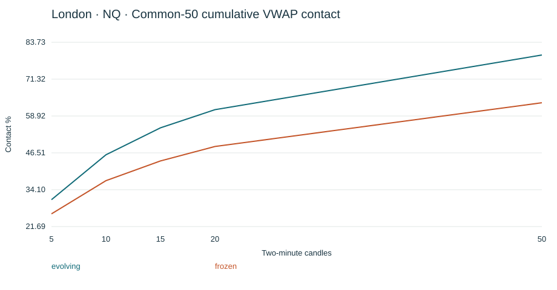

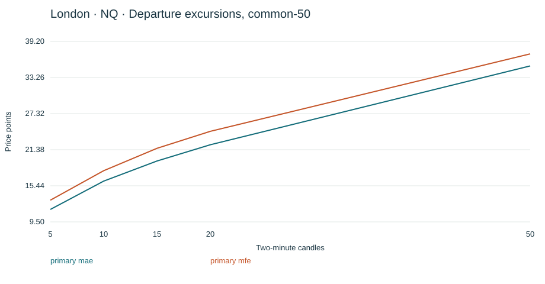

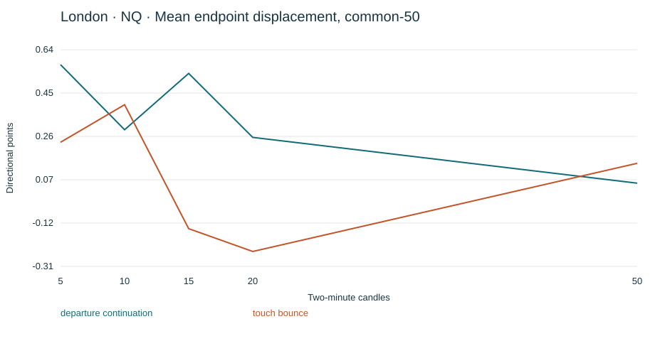

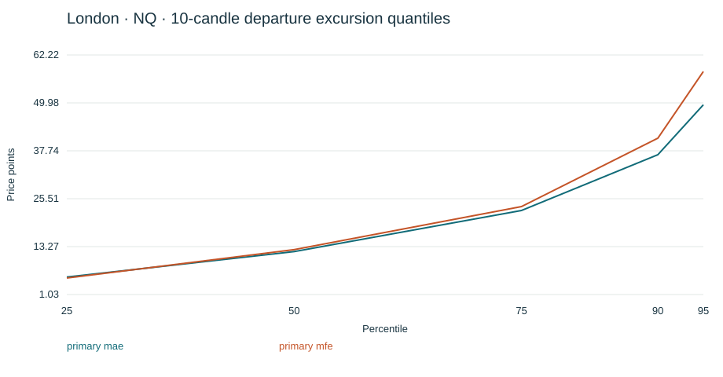

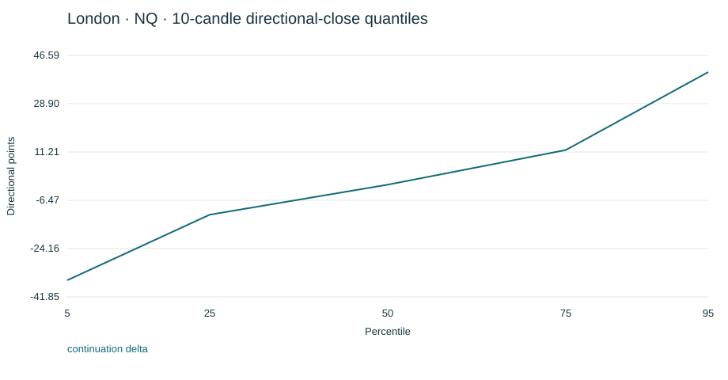

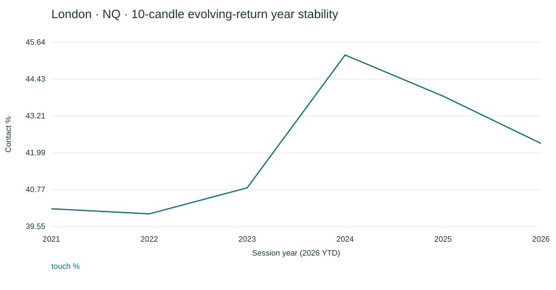

### Sensitivity and chronological periods at 10 candles

| Module | Scope | n | Days / weeks | Directional Δ [CI] | Return or bounce endpoint % [CI] |
| --- | --- | --- | --- | --- | --- |
| departure | all | 3,482 | 1,167 / 273 | 0.45 [-0.33, 1.31] | 42.2% [40.7%, 43.7%] |
| departure | common_50 | 3,042 | 1,158 / 273 | 0.29 [-0.43, 1.15] | 45.9% [44.3%, 47.4%] |
| departure | age_ge30 | 2,275 | 1,099 / 273 | 1.17 [-0.01, 2.35] | 24.6% [22.6%, 26.5%] |
| departure | through_2023 | 1,621 | 562 / 131 | 0.62 [-0.48, 1.80] | 40.3% [37.9%, 42.7%] |
| departure | year_2024_period | 670 | 212 / 53 | 0.53 [-1.20, 2.46] | 45.2% [41.6%, 48.9%] |
| departure | years_2025_2026 | 1,191 | 393 / 90 | 0.17 [-1.39, 1.72] | 43.2% [40.9%, 45.3%] |
| touch | all | 2,892 | 1,117 / 273 | 0.24 [-0.69, 1.21] | 49.6% [47.9%, 51.2%] |
| touch | common_50 | 2,474 | 1,074 / 273 | 0.40 [-0.47, 1.34] | 49.7% [47.9%, 51.6%] |
| touch | age_ge30 | 1,703 | 948 / 270 | 0.74 [-0.49, 1.99] | 49.6% [47.5%, 51.7%] |
| touch | through_2023 | 1,348 | 531 / 131 | 0.14 [-1.10, 1.39] | 49.0% [46.6%, 51.5%] |
| touch | year_2024_period | 550 | 207 / 53 | 0.05 [-1.79, 2.15] | 50.2% [45.7%, 54.6%] |
| touch | years_2025_2026 | 994 | 379 / 90 | 0.48 [-1.41, 2.41] | 49.9% [47.1%, 52.8%] |

### Deterministic source-path examples

Examples are the earliest stable ID in each prespecified class. They illustrate mechanisms and exclusions, not representative trade quality. The source table includes reference available_at and known sigma for every minute; charts plot raw one-minute high/low and references. Source minute open time relative to entry is shown; contacts have interval resolution. Lines join minute OHLC observations for display and do not imply intraminute order or trades through gaps. The 2-sigma envelope is plotted; 2.5/3-sigma references are retained in the example-path table.

return: NQ-london-2021-06-28-P0002-K2-H10; upper side. Signal/confirmation 2021-06-28 03:06:00-04:00; entry 2021-06-28 03:06:00-04:00; deadline 2021-06-28 03:26:00-04:00 (New York time). Frozen sigma 0.05 points; signal VWAP 14,358.81. Band thresholds = VWAP ± 2/2.5/3 × sigma. Exclusion: none.

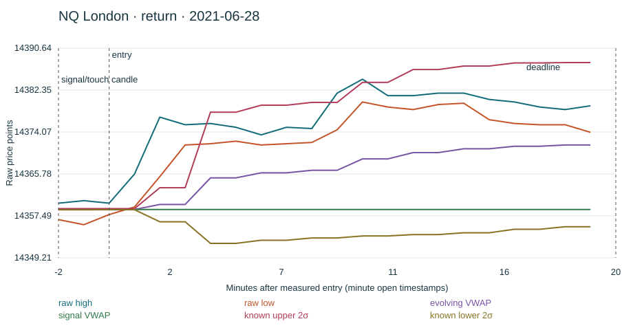

non_return: NQ-london-2021-06-28-P0044-K2-H10; lower side. Signal/confirmation 2021-06-28 04:30:00-04:00; entry 2021-06-28 04:30:00-04:00; deadline 2021-06-28 04:50:00-04:00 (New York time). Frozen sigma 7.82 points; signal VWAP 14,372.52. Band thresholds = VWAP ± 2/2.5/3 × sigma. Exclusion: none.

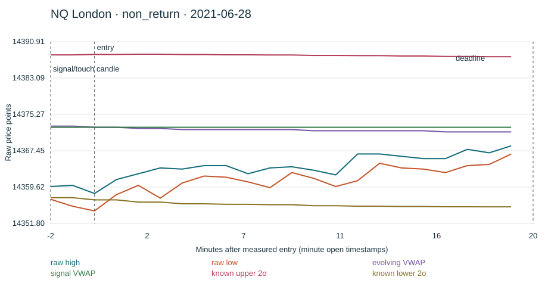

bounce: NQ-london-2021-06-28-P0002-T-H10; upper side. Signal/confirmation 2021-06-28 03:08:00-04:00; entry 2021-06-28 03:08:00-04:00; deadline 2021-06-28 03:28:00-04:00 (New York time). Frozen sigma 1.68 points; signal VWAP 14,359.69. Band thresholds = VWAP ± 2/2.5/3 × sigma. Exclusion: none.

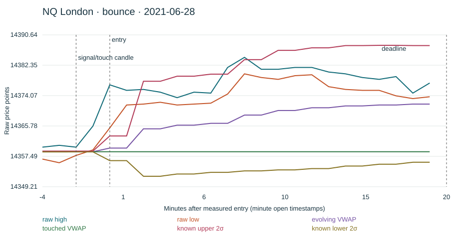

through: NQ-london-2021-06-28-P0044-T-H10; lower side. Signal/confirmation 2021-06-28 04:56:00-04:00; entry 2021-06-28 04:56:00-04:00; deadline 2021-06-28 05:16:00-04:00 (New York time). Frozen sigma 7.94 points; signal VWAP 14,371.43. Band thresholds = VWAP ± 2/2.5/3 × sigma. Exclusion: none.

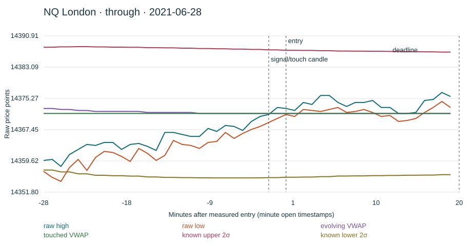

ambiguity: NQ-london-2021-06-30-P0003-T-H10; upper side. Signal/confirmation 2021-06-30 03:10:00-04:00; entry 2021-06-30 03:10:00-04:00; deadline 2021-06-30 03:30:00-04:00 (New York time). Frozen sigma 1.38 points; signal VWAP 14,578.58. Band thresholds = VWAP ± 2/2.5/3 × sigma. Exclusion: none.

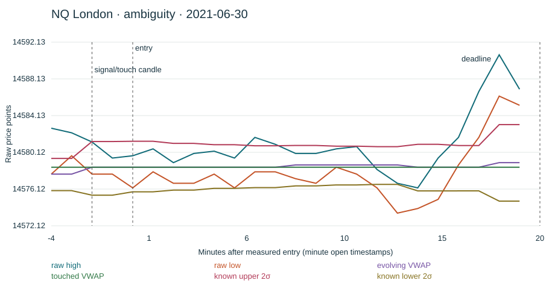

exclusion: NQ-london-2021-07-02-P0144-K2-H50; upper side. Signal/confirmation 2021-07-02 07:50:00-04:00; entry 2021-07-02 07:50:00-04:00; deadline 2021-07-02 09:30:00-04:00 (New York time). Frozen sigma 14.16 points; signal VWAP 14,569.30. Band thresholds = VWAP ± 2/2.5/3 × sigma. Exclusion: session_boundary.

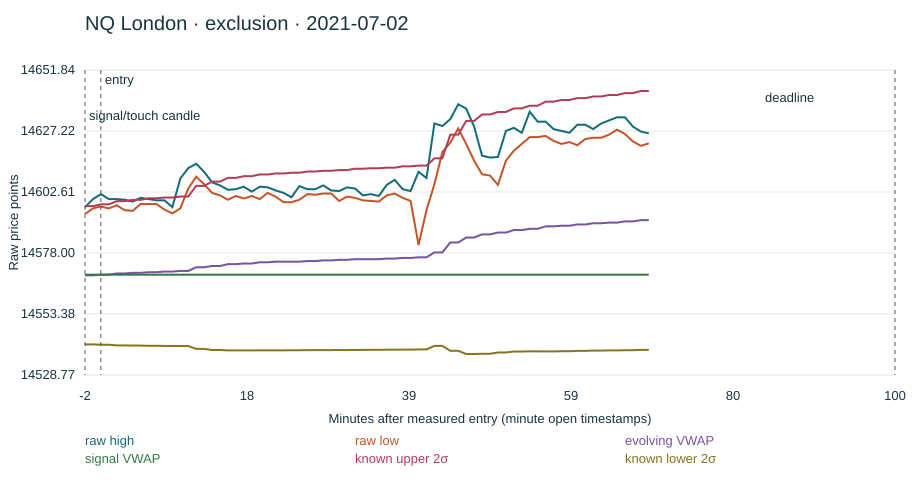

## GC

Coverage: 825 retrospectively eligible dates, 2016-02-11 through 2026-09-18. All prices below are raw contract points. Full point/tick/sigma distributions and every tie numerator are saved in summary.csv.

### GC year coverage and retrospective exclusions

| Year | Candidate days | Eligible | Excluded |
| --- | --- | --- | --- |
| 2010 | 150 | 0 | 150 |
| 2011 | 260 | 0 | 260 |
| 2012 | 261 | 0 | 261 |
| 2013 | 261 | 0 | 261 |
| 2014 | 261 | 0 | 261 |
| 2015 | 261 | 0 | 261 |
| 2016 | 261 | 10 | 251 |
| 2017 | 260 | 55 | 205 |
| 2018 | 261 | 56 | 205 |
| 2019 | 261 | 83 | 178 |
| 2020 | 262 | 145 | 117 |
| 2021 | 261 | 73 | 188 |
| 2022 | 260 | 55 | 205 |
| 2023 | 260 | 35 | 225 |
| 2024 | 262 | 62 | 200 |
| 2025 | 261 | 165 | 96 |
| 2026 | 187 | 86 | 101 |

[Release exclusion reasons by product/year (reasons may overlap)](tables/release-coverage.csv)

### Upper departure / arrival: continuation and bounce long; fade and through short

#### Departure response

| σ | h | n | Continuation MAE mean [CI] / median | Continuation MFE mean [CI] / median | Fade MAE mean [CI] / median | Fade MFE mean [CI] / median | Continuation Δ mean [CI] | Fade Δ mean [CI] | Continuation endpoint % | Close > entry % | Final candle up % | Entry ties | Days / weeks | Unavailable | Support |
| --- | --- | --- | --- | --- | --- | --- | --- | --- | --- | --- | --- | --- | --- | --- | --- |
| 2.0 | 5 | 1,285 | 1.84 [1.62, 2.09] / 1.00 | 2.07 [1.86, 2.33] / 1.20 | 2.07 [1.86, 2.33] / 1.20 | 1.84 [1.62, 2.09] / 1.00 | 0.08 [-0.11, 0.25] | -0.08 [-0.25, 0.11] | 49.0% [46.6%, 51.4%] | 49.0% [46.6%, 51.4%] | 45.6% [42.9%, 48.4%] | 37 | 694 / 333 | 14 | adequate descriptive support |
| 2.0 | 10 | 1,262 | 2.55 [2.27, 2.90] / 1.40 | 2.79 [2.50, 3.12] / 1.70 | 2.79 [2.50, 3.12] / 1.70 | 2.55 [2.27, 2.90] / 1.40 | 0.08 [-0.16, 0.33] | -0.08 [-0.33, 0.16] | 49.3% [46.5%, 52.0%] | 49.3% [46.5%, 52.0%] | 47.9% [45.1%, 50.6%] | 33 | 690 / 332 | 37 | adequate descriptive support |
| 2.0 | 15 | 1,212 | 3.02 [2.67, 3.44] / 1.70 | 3.35 [2.97, 3.82] / 1.90 | 3.35 [2.97, 3.82] / 1.90 | 3.02 [2.67, 3.44] / 1.70 | 0.20 [-0.11, 0.51] | -0.20 [-0.51, 0.11] | 49.4% [46.4%, 52.3%] | 49.4% [46.4%, 52.3%] | 44.1% [41.2%, 47.1%] | 19 | 677 / 328 | 87 | adequate descriptive support |
| 2.0 | 20 | 1,182 | 3.54 [3.13, 4.04] / 1.90 | 3.79 [3.36, 4.29] / 2.10 | 3.79 [3.36, 4.29] / 2.10 | 3.54 [3.13, 4.04] / 1.90 | 0.12 [-0.24, 0.48] | -0.12 [-0.48, 0.24] | 47.6% [44.5%, 50.6%] | 47.6% [44.5%, 50.6%] | 44.7% [41.8%, 47.3%] | 19 | 667 / 327 | 117 | adequate descriptive support |
| 2.0 | 50 | 1,069 | 5.42 [4.71, 6.24] / 2.90 | 5.44 [4.73, 6.28] / 3.20 | 5.44 [4.73, 6.28] / 3.20 | 5.42 [4.71, 6.24] / 2.90 | 0.01 [-0.64, 0.68] | -0.01 [-0.68, 0.64] | 50.8% [47.1%, 54.5%] | 50.8% [47.1%, 54.5%] | 46.1% [43.0%, 49.3%] | 14 | 635 / 323 | 230 | adequate descriptive support |
| 2.5 | 5 | 565 | 2.16 [1.80, 2.67] / 1.20 | 2.20 [1.86, 2.62] / 1.30 | 2.20 [1.86, 2.62] / 1.30 | 2.16 [1.80, 2.67] / 1.20 | -0.05 [-0.33, 0.24] | 0.05 [-0.24, 0.33] | 46.9% [42.5%, 51.2%] | 46.9% [42.5%, 51.2%] | 44.4% [40.7%, 48.4%] | 17 | 430 / 265 | 6 | adequate descriptive support |
| 2.5 | 10 | 555 | 2.92 [2.44, 3.57] / 1.50 | 3.06 [2.60, 3.64] / 1.80 | 3.06 [2.60, 3.64] / 1.80 | 2.92 [2.44, 3.57] / 1.50 | 0.06 [-0.42, 0.58] | -0.06 [-0.58, 0.42] | 49.5% [45.1%, 54.0%] | 49.5% [45.1%, 54.0%] | 48.8% [44.6%, 53.1%] | 12 | 424 / 261 | 16 | adequate descriptive support |
| 2.5 | 15 | 524 | 3.39 [2.81, 4.16] / 1.70 | 3.79 [3.21, 4.53] / 2.10 | 3.79 [3.21, 4.53] / 2.10 | 3.39 [2.81, 4.16] / 1.70 | 0.27 [-0.28, 0.86] | -0.27 [-0.86, 0.28] | 52.3% [47.7%, 56.8%] | 52.3% [47.7%, 56.8%] | 48.7% [44.3%, 52.9%] | 5 | 408 / 254 | 47 | adequate descriptive support |
| 2.5 | 20 | 509 | 3.92 [3.25, 4.76] / 2.00 | 4.30 [3.64, 5.10] / 2.40 | 4.30 [3.64, 5.10] / 2.40 | 3.92 [3.25, 4.76] / 2.00 | 0.26 [-0.31, 0.88] | -0.26 [-0.88, 0.31] | 50.1% [45.3%, 55.0%] | 50.1% [45.3%, 55.0%] | 45.0% [40.6%, 48.9%] | 9 | 400 / 250 | 62 | adequate descriptive support |
| 2.5 | 50 | 446 | 5.77 [4.80, 7.01] / 2.90 | 5.83 [4.85, 7.08] / 3.10 | 5.83 [4.85, 7.08] / 3.10 | 5.77 [4.80, 7.01] / 2.90 | 0.19 [-0.98, 1.41] | -0.19 [-1.41, 0.98] | 50.4% [45.4%, 55.4%] | 50.4% [45.4%, 55.4%] | 50.0% [45.3%, 54.5%] | 9 | 361 / 240 | 125 | adequate descriptive support |
| 3.0 | 5 | 136 | 2.46 [1.82, 3.29] / 1.30 | 2.66 [1.89, 3.65] / 1.20 | 2.66 [1.89, 3.65] / 1.20 | 2.46 [1.82, 3.29] / 1.30 | 0.09 [-0.50, 0.67] | -0.09 [-0.67, 0.50] | 47.1% [38.6%, 55.4%] | 47.1% [38.6%, 55.4%] | 42.6% [33.9%, 50.7%] | 4 | 124 / 113 | 1 | adequate descriptive support |
| 3.0 | 10 | 134 | 3.41 [2.44, 4.66] / 1.80 | 4.01 [3.00, 5.16] / 2.00 | 4.01 [3.00, 5.16] / 2.00 | 3.41 [2.44, 4.66] / 1.80 | 0.51 [-0.45, 1.44] | -0.51 [-1.44, 0.45] | 53.0% [44.4%, 61.4%] | 53.0% [44.4%, 61.4%] | 47.8% [39.5%, 55.9%] | 3 | 122 / 111 | 3 | adequate descriptive support |
| 3.0 | 15 | 129 | 4.11 [2.91, 5.61] / 1.80 | 4.49 [3.38, 5.79] / 2.50 | 4.49 [3.38, 5.79] / 2.50 | 4.11 [2.91, 5.61] / 1.80 | -0.06 [-1.13, 0.94] | 0.06 [-0.94, 1.13] | 56.6% [47.5%, 65.3%] | 56.6% [47.5%, 65.3%] | 38.8% [30.4%, 46.5%] | 0 | 118 / 107 | 8 | adequate descriptive support |
| 3.0 | 20 | 125 | 4.84 [3.41, 6.58] / 2.00 | 5.05 [3.75, 6.48] / 2.80 | 5.05 [3.75, 6.48] / 2.80 | 4.84 [3.41, 6.58] / 2.00 | -0.34 [-1.75, 0.94] | 0.34 [-0.94, 1.75] | 49.6% [40.3%, 58.3%] | 49.6% [40.3%, 58.3%] | 44.8% [36.4%, 53.3%] | 2 | 114 / 103 | 12 | adequate descriptive support |
| 3.0 | 50 | 108 | 6.59 [4.64, 8.98] / 2.95 | 6.75 [4.98, 8.87] / 3.50 | 6.75 [4.98, 8.87] / 3.50 | 6.59 [4.64, 8.98] / 2.95 | 0.45 [-1.46, 2.39] | -0.45 [-2.39, 1.46] | 52.8% [43.1%, 62.3%] | 52.8% [43.1%, 62.3%] | 50.9% [41.4%, 60.4%] | 1 | 99 / 92 | 29 | adequate descriptive support |

#### VWAP return probability and timing

| σ | h | Target | n | Touches | Touch % [CI] | No touch | Latency h median / p75 | Gap paths | Overtake paths | Unavailable | Evolving only | Frozen only |
| --- | --- | --- | --- | --- | --- | --- | --- | --- | --- | --- | --- | --- |
| 2.0 | 5 | evolving | 1,285 | 363 | 28.2% [26.0%, 30.4%] | 922 | 2.0 / 4.0 | 6 | 0 | 14 | 68 | 0 |
| 2.0 | 5 | frozen | 1,285 | 295 | 23.0% [20.8%, 25.1%] | 990 | 2.0 / 4.0 | 6 | 0 | 14 | 68 | 0 |
| 2.0 | 10 | evolving | 1,262 | 544 | 43.1% [40.5%, 45.8%] | 718 | 4.0 / 7.0 | 8 | 0 | 37 | 111 | 0 |
| 2.0 | 10 | frozen | 1,262 | 433 | 34.3% [32.1%, 36.7%] | 829 | 4.0 / 6.0 | 8 | 0 | 37 | 111 | 0 |
| 2.0 | 15 | evolving | 1,212 | 646 | 53.3% [50.8%, 55.9%] | 566 | 5.0 / 9.0 | 12 | 0 | 87 | 141 | 0 |
| 2.0 | 15 | frozen | 1,212 | 505 | 41.7% [39.2%, 44.3%] | 707 | 4.0 / 9.0 | 12 | 0 | 87 | 141 | 0 |
| 2.0 | 20 | evolving | 1,182 | 718 | 60.7% [58.2%, 63.5%] | 464 | 6.0 / 11.0 | 16 | 0 | 117 | 170 | 0 |
| 2.0 | 20 | frozen | 1,182 | 548 | 46.4% [43.7%, 49.1%] | 634 | 5.0 / 10.0 | 16 | 0 | 117 | 170 | 0 |
| 2.0 | 50 | evolving | 1,069 | 876 | 81.9% [79.8%, 84.2%] | 193 | 8.0 / 20.0 | 35 | 0 | 230 | 194 | 0 |
| 2.0 | 50 | frozen | 1,069 | 682 | 63.8% [60.9%, 66.7%] | 387 | 8.0 / 20.0 | 35 | 0 | 230 | 194 | 0 |
| 2.5 | 5 | evolving | 565 | 137 | 24.2% [20.9%, 27.6%] | 428 | 2.0 / 4.0 | 2 | 0 | 6 | 25 | 0 |
| 2.5 | 5 | frozen | 565 | 112 | 19.8% [16.5%, 23.1%] | 453 | 2.0 / 4.0 | 2 | 0 | 6 | 25 | 0 |
| 2.5 | 10 | evolving | 555 | 203 | 36.6% [32.4%, 40.6%] | 352 | 4.0 / 6.0 | 2 | 0 | 16 | 45 | 0 |
| 2.5 | 10 | frozen | 555 | 158 | 28.5% [24.7%, 32.3%] | 397 | 3.0 / 6.0 | 2 | 0 | 16 | 45 | 0 |
| 2.5 | 15 | evolving | 524 | 235 | 44.8% [40.3%, 49.2%] | 289 | 4.0 / 9.0 | 3 | 0 | 47 | 62 | 0 |
| 2.5 | 15 | frozen | 524 | 173 | 33.0% [28.8%, 37.2%] | 351 | 4.0 / 8.0 | 3 | 0 | 47 | 62 | 0 |
| 2.5 | 20 | evolving | 509 | 269 | 52.8% [48.2%, 57.6%] | 240 | 6.0 / 12.0 | 6 | 0 | 62 | 72 | 0 |
| 2.5 | 20 | frozen | 509 | 197 | 38.7% [34.4%, 43.0%] | 312 | 5.0 / 10.0 | 6 | 0 | 62 | 72 | 0 |
| 2.5 | 50 | evolving | 446 | 352 | 78.9% [75.2%, 82.5%] | 94 | 10.0 / 23.0 | 13 | 0 | 125 | 98 | 0 |
| 2.5 | 50 | frozen | 446 | 254 | 57.0% [52.4%, 61.5%] | 192 | 8.0 / 23.0 | 13 | 0 | 125 | 98 | 0 |
| 3.0 | 5 | evolving | 136 | 43 | 31.6% [23.5%, 39.2%] | 93 | 1.0 / 2.0 | 1 | 0 | 1 | 8 | 0 |
| 3.0 | 5 | frozen | 136 | 35 | 25.7% [18.3%, 32.9%] | 101 | 1.0 / 2.0 | 1 | 0 | 1 | 8 | 0 |
| 3.0 | 10 | evolving | 134 | 57 | 42.5% [34.4%, 50.7%] | 77 | 2.0 / 5.0 | 1 | 0 | 3 | 12 | 0 |
| 3.0 | 10 | frozen | 134 | 45 | 33.6% [25.6%, 41.4%] | 89 | 1.0 / 4.0 | 1 | 0 | 3 | 12 | 0 |
| 3.0 | 15 | evolving | 129 | 70 | 54.3% [46.0%, 62.6%] | 59 | 3.0 / 9.0 | 1 | 0 | 8 | 19 | 0 |
| 3.0 | 15 | frozen | 129 | 51 | 39.5% [31.3%, 47.4%] | 78 | 2.0 / 7.0 | 1 | 0 | 8 | 19 | 0 |
| 3.0 | 20 | evolving | 125 | 80 | 64.0% [55.3%, 72.3%] | 45 | 5.0 / 11.2 | 3 | 0 | 12 | 23 | 0 |
| 3.0 | 20 | frozen | 125 | 57 | 45.6% [37.4%, 54.2%] | 68 | 2.0 / 10.0 | 3 | 0 | 12 | 23 | 0 |
| 3.0 | 50 | evolving | 108 | 92 | 85.2% [78.0%, 91.5%] | 16 | 7.0 / 17.2 | 5 | 0 | 29 | 22 | 0 |
| 3.0 | 50 | frozen | 108 | 70 | 64.8% [56.5%, 73.7%] | 38 | 5.0 / 19.0 | 5 | 0 | 29 | 22 | 0 |

#### First-return response

Reached-threshold cohorts are nested using crossings recorded before this first touch. Response starts at the next open after touch confirmation. Barrier first move freezes 0.5 touch-close sigma, rounded upward to at least one tick. Counts B/T/neither/ambiguous reconcile separately from unavailable barriers. Same-minute ambiguous is not assigned to either direction. Full-horizon excursions continue after a barrier resolves.

| σ | h | n | Bounce MAE mean [CI] / median | Bounce MFE mean [CI] / median | Through MAE mean [CI] / median | Through MFE mean [CI] / median | Bounce Δ mean [CI] | Through Δ mean [CI] | Bounce endpoint % | Close > entry % | Final candle up % | Entry ties | Days / weeks | Unavailable | Support | First B / T / neither / ambiguous | Barrier unavailable |
| --- | --- | --- | --- | --- | --- | --- | --- | --- | --- | --- | --- | --- | --- | --- | --- | --- | --- |
| 2.0 | 5 | 1,074 | 1.93 [1.69, 2.21] / 1.00 | 1.79 [1.57, 2.06] / 1.00 | 1.79 [1.57, 2.06] / 1.00 | 1.93 [1.69, 2.21] / 1.00 | -0.01 [-0.19, 0.15] | 0.01 [-0.15, 0.19] | 47.9% [44.7%, 50.8%] | 47.9% [44.7%, 50.8%] | 45.2% [42.2%, 48.2%] | 43 | 626 / 320 | 10 | adequate descriptive support | 438 / 463 / 104 / 69 | 0 |
| 2.0 | 10 | 1,056 | 2.71 [2.39, 3.10] / 1.40 | 2.49 [2.21, 2.83] / 1.40 | 2.49 [2.21, 2.83] / 1.40 | 2.71 [2.39, 3.10] / 1.40 | -0.03 [-0.29, 0.22] | 0.03 [-0.22, 0.29] | 50.9% [47.7%, 53.8%] | 50.9% [47.7%, 53.8%] | 45.5% [42.7%, 48.6%] | 19 | 620 / 319 | 28 | adequate descriptive support | 458 / 500 / 29 / 69 | 0 |
| 2.0 | 15 | 1,020 | 3.40 [2.95, 3.93] / 1.70 | 2.98 [2.64, 3.39] / 1.70 | 2.98 [2.64, 3.39] / 1.70 | 3.40 [2.95, 3.93] / 1.70 | -0.22 [-0.56, 0.11] | 0.22 [-0.11, 0.56] | 47.9% [44.7%, 51.5%] | 47.9% [44.7%, 51.5%] | 47.2% [43.9%, 50.2%] | 18 | 609 / 315 | 64 | adequate descriptive support | 452 / 487 / 12 / 69 | 0 |
| 2.0 | 20 | 987 | 3.68 [3.23, 4.20] / 1.90 | 3.36 [2.96, 3.86] / 1.90 | 3.36 [2.96, 3.86] / 1.90 | 3.68 [3.23, 4.20] / 1.90 | 0.00 [-0.32, 0.35] | -0.00 [-0.35, 0.32] | 51.0% [47.5%, 54.2%] | 51.0% [47.5%, 54.2%] | 46.5% [43.3%, 49.7%] | 21 | 603 / 315 | 97 | adequate descriptive support | 442 / 470 / 6 / 69 | 0 |
| 2.0 | 50 | 882 | 5.54 [4.82, 6.36] / 2.90 | 5.22 [4.49, 6.10] / 3.10 | 5.22 [4.49, 6.10] / 3.10 | 5.54 [4.82, 6.36] / 2.90 | -0.03 [-0.74, 0.67] | 0.03 [-0.67, 0.74] | 52.4% [48.5%, 56.3%] | 52.4% [48.5%, 56.3%] | 44.9% [41.3%, 48.6%] | 10 | 561 / 304 | 202 | adequate descriptive support | 392 / 422 / 0 / 68 | 0 |
| 2.5 | 5 | 449 | 2.08 [1.77, 2.47] / 1.10 | 2.01 [1.64, 2.52] / 1.00 | 2.01 [1.64, 2.52] / 1.00 | 2.08 [1.77, 2.47] / 1.10 | 0.05 [-0.31, 0.51] | -0.05 [-0.51, 0.31] | 47.7% [42.9%, 52.3%] | 47.7% [42.9%, 52.3%] | 44.1% [39.1%, 48.7%] | 14 | 358 / 241 | 5 | adequate descriptive support | 177 / 190 / 44 / 38 | 0 |
| 2.5 | 10 | 442 | 2.92 [2.50, 3.42] / 1.50 | 2.77 [2.33, 3.39] / 1.75 | 2.77 [2.33, 3.39] / 1.75 | 2.92 [2.50, 3.42] / 1.50 | 0.12 [-0.28, 0.58] | -0.12 [-0.58, 0.28] | 51.6% [46.5%, 56.5%] | 51.6% [46.5%, 56.5%] | 48.2% [43.6%, 52.8%] | 8 | 353 / 239 | 12 | adequate descriptive support | 188 / 206 / 10 / 38 | 0 |
| 2.5 | 15 | 421 | 3.56 [3.01, 4.20] / 1.70 | 3.33 [2.76, 4.15] / 1.90 | 3.33 [2.76, 4.15] / 1.90 | 3.56 [3.01, 4.20] / 1.70 | -0.03 [-0.64, 0.61] | 0.03 [-0.61, 0.64] | 49.6% [44.7%, 54.5%] | 49.6% [44.7%, 54.5%] | 51.1% [46.2%, 55.8%] | 3 | 339 / 233 | 33 | adequate descriptive support | 182 / 197 / 4 / 38 | 0 |
| 2.5 | 20 | 404 | 3.82 [3.29, 4.39] / 2.00 | 3.78 [3.06, 4.76] / 2.20 | 3.78 [3.06, 4.76] / 2.20 | 3.82 [3.29, 4.39] / 2.00 | 0.15 [-0.54, 1.03] | -0.15 [-1.03, 0.54] | 52.2% [47.1%, 57.4%] | 52.2% [47.1%, 57.4%] | 42.6% [37.4%, 47.6%] | 11 | 329 / 230 | 50 | adequate descriptive support | 178 / 186 / 2 / 38 | 0 |
| 2.5 | 50 | 346 | 5.49 [4.60, 6.48] / 2.90 | 5.90 [4.52, 7.83] / 3.30 | 5.90 [4.52, 7.83] / 3.30 | 5.49 [4.60, 6.48] / 2.90 | 0.44 [-0.92, 2.19] | -0.44 [-2.19, 0.92] | 54.0% [48.1%, 59.9%] | 54.0% [48.1%, 59.9%] | 43.6% [38.6%, 48.8%] | 3 | 283 / 208 | 108 | adequate descriptive support | 156 / 153 / 0 / 37 | 0 |
| 3.0 | 5 | 109 | 2.12 [1.60, 2.80] / 1.10 | 2.14 [1.64, 2.76] / 1.20 | 2.14 [1.64, 2.76] / 1.20 | 2.12 [1.60, 2.80] / 1.10 | 0.11 [-0.61, 0.80] | -0.11 [-0.80, 0.61] | 46.8% [36.7%, 56.7%] | 46.8% [36.7%, 56.7%] | 41.3% [31.5%, 50.4%] | 3 | 99 / 92 | 2 | adequate descriptive support | 39 / 43 / 7 / 20 | 0 |
| 3.0 | 10 | 107 | 3.19 [2.41, 4.10] / 1.50 | 3.07 [2.34, 3.92] / 1.80 | 3.07 [2.34, 3.92] / 1.80 | 3.19 [2.41, 4.10] / 1.50 | -0.02 [-1.00, 0.97] | 0.02 [-0.97, 1.00] | 52.3% [43.1%, 61.8%] | 52.3% [43.1%, 61.8%] | 45.8% [36.6%, 55.5%] | 3 | 97 / 90 | 4 | adequate descriptive support | 40 / 45 / 2 / 20 | 0 |
| 3.0 | 15 | 105 | 4.05 [2.87, 5.59] / 1.70 | 3.73 [2.84, 4.76] / 2.20 | 3.73 [2.84, 4.76] / 2.20 | 4.05 [2.87, 5.59] / 1.70 | -0.49 [-2.15, 0.84] | 0.49 [-0.84, 2.15] | 50.5% [40.2%, 60.5%] | 50.5% [40.2%, 60.5%] | 50.5% [40.6%, 60.4%] | 0 | 96 / 89 | 6 | adequate descriptive support | 41 / 44 / 0 / 20 | 0 |
| 3.0 | 20 | 100 | 3.92 [2.92, 4.97] / 1.95 | 3.95 [3.02, 5.03] / 2.20 | 3.95 [3.02, 5.03] / 2.20 | 3.92 [2.92, 4.97] / 1.95 | -0.03 [-1.11, 1.09] | 0.03 [-1.09, 1.11] | 55.0% [44.7%, 65.1%] | 55.0% [44.7%, 65.1%] | 42.0% [31.8%, 52.1%] | 3 | 91 / 84 | 11 | adequate descriptive support | 39 / 41 / 0 / 20 | 0 |
| 3.0 | 50 | 88 | 6.39 [4.68, 8.25] / 3.30 | 5.74 [4.00, 7.80] / 3.50 | 5.74 [4.00, 7.80] / 3.50 | 6.39 [4.68, 8.25] / 3.30 | -0.53 [-2.61, 1.67] | 0.53 [-1.67, 2.61] | 52.3% [39.8%, 64.3%] | 52.3% [39.8%, 64.3%] | 47.7% [36.9%, 58.2%] | 2 | 79 / 73 | 23 | events_below_100 | 34 / 35 / 0 / 19 | 0 |

### Lower departure / arrival: continuation and bounce short; fade and through long

#### Departure response

| σ | h | n | Continuation MAE mean [CI] / median | Continuation MFE mean [CI] / median | Fade MAE mean [CI] / median | Fade MFE mean [CI] / median | Continuation Δ mean [CI] | Fade Δ mean [CI] | Continuation endpoint % | Close > entry % | Final candle up % | Entry ties | Days / weeks | Unavailable | Support |
| --- | --- | --- | --- | --- | --- | --- | --- | --- | --- | --- | --- | --- | --- | --- | --- |
| 2.0 | 5 | 1,284 | 2.14 [1.88, 2.45] / 1.20 | 2.44 [2.12, 2.82] / 1.20 | 2.44 [2.12, 2.82] / 1.20 | 2.14 [1.88, 2.45] / 1.20 | -0.12 [-0.33, 0.07] | 0.12 [-0.07, 0.33] | 44.5% [41.8%, 47.3%] | 52.3% [49.4%, 55.0%] | 47.3% [44.7%, 49.9%] | 42 | 677 / 334 | 16 | adequate descriptive support |
| 2.0 | 10 | 1,264 | 2.95 [2.58, 3.39] / 1.70 | 3.36 [2.88, 3.93] / 1.70 | 3.36 [2.88, 3.93] / 1.70 | 2.95 [2.58, 3.39] / 1.70 | -0.03 [-0.30, 0.23] | 0.03 [-0.23, 0.30] | 46.8% [44.1%, 49.5%] | 51.7% [49.1%, 54.4%] | 46.9% [44.1%, 49.6%] | 20 | 674 / 331 | 36 | adequate descriptive support |
| 2.0 | 15 | 1,210 | 3.51 [3.10, 3.98] / 2.15 | 4.09 [3.43, 4.92] / 2.10 | 4.09 [3.43, 4.92] / 2.10 | 3.51 [3.10, 3.98] / 2.15 | -0.05 [-0.44, 0.34] | 0.05 [-0.34, 0.44] | 45.5% [42.6%, 48.6%] | 53.4% [50.3%, 56.3%] | 49.2% [46.4%, 51.9%] | 13 | 661 / 325 | 90 | adequate descriptive support |
| 2.0 | 20 | 1,173 | 4.00 [3.51, 4.55] / 2.50 | 4.57 [3.86, 5.44] / 2.30 | 4.57 [3.86, 5.44] / 2.30 | 4.00 [3.51, 4.55] / 2.50 | -0.13 [-0.54, 0.32] | 0.13 [-0.32, 0.54] | 45.3% [42.3%, 48.6%] | 53.2% [49.9%, 56.2%] | 46.9% [43.8%, 49.8%] | 18 | 653 / 324 | 127 | adequate descriptive support |
| 2.0 | 50 | 1,063 | 5.83 [5.09, 6.63] / 3.40 | 6.97 [5.65, 8.73] / 3.40 | 6.97 [5.65, 8.73] / 3.40 | 5.83 [5.09, 6.63] / 3.40 | 0.12 [-0.63, 0.95] | -0.12 [-0.95, 0.63] | 44.5% [40.9%, 48.4%] | 54.2% [50.2%, 57.8%] | 47.0% [43.8%, 50.2%] | 14 | 627 / 319 | 237 | adequate descriptive support |
| 2.5 | 5 | 584 | 2.26 [1.98, 2.56] / 1.30 | 2.51 [2.16, 2.88] / 1.40 | 2.51 [2.16, 2.88] / 1.40 | 2.26 [1.98, 2.56] / 1.30 | -0.08 [-0.38, 0.21] | 0.08 [-0.21, 0.38] | 48.1% [44.2%, 52.0%] | 49.7% [45.7%, 53.7%] | 45.7% [41.8%, 49.9%] | 13 | 425 / 269 | 7 | adequate descriptive support |
| 2.5 | 10 | 572 | 3.00 [2.64, 3.37] / 1.80 | 3.41 [2.89, 3.96] / 1.90 | 3.41 [2.89, 3.96] / 1.90 | 3.00 [2.64, 3.37] / 1.80 | 0.02 [-0.37, 0.44] | -0.02 [-0.44, 0.37] | 47.4% [43.0%, 51.7%] | 49.8% [45.5%, 54.3%] | 47.7% [43.5%, 51.8%] | 16 | 422 / 267 | 19 | adequate descriptive support |
| 2.5 | 15 | 542 | 3.54 [3.09, 4.00] / 2.30 | 4.18 [3.39, 5.15] / 2.30 | 4.18 [3.39, 5.15] / 2.30 | 3.54 [3.09, 4.00] / 2.30 | 0.02 [-0.54, 0.64] | -0.02 [-0.64, 0.54] | 45.0% [40.8%, 49.5%] | 54.4% [49.9%, 58.6%] | 50.4% [46.2%, 54.6%] | 3 | 406 / 259 | 49 | adequate descriptive support |
| 2.5 | 20 | 526 | 4.07 [3.52, 4.64] / 2.55 | 4.68 [3.81, 5.73] / 2.60 | 4.68 [3.81, 5.73] / 2.60 | 4.07 [3.52, 4.64] / 2.55 | -0.21 [-0.91, 0.47] | 0.21 [-0.47, 0.91] | 44.7% [40.4%, 49.3%] | 54.4% [49.8%, 58.7%] | 48.1% [43.4%, 52.6%] | 5 | 395 / 252 | 65 | adequate descriptive support |
| 2.5 | 50 | 467 | 5.55 [4.78, 6.33] / 3.50 | 6.95 [5.54, 8.60] / 3.40 | 6.95 [5.54, 8.60] / 3.40 | 5.55 [4.78, 6.33] / 3.50 | 0.51 [-0.63, 1.64] | -0.51 [-1.64, 0.63] | 48.6% [43.6%, 54.0%] | 51.2% [45.8%, 56.3%] | 48.2% [43.5%, 52.9%] | 1 | 359 / 239 | 124 | adequate descriptive support |
| 3.0 | 5 | 135 | 2.47 [1.96, 3.02] / 1.60 | 2.32 [1.88, 2.80] / 1.60 | 2.32 [1.88, 2.80] / 1.60 | 2.47 [1.96, 3.02] / 1.60 | -0.41 [-0.87, 0.06] | 0.41 [-0.06, 0.87] | 46.7% [38.6%, 55.3%] | 51.9% [42.9%, 60.0%] | 50.4% [42.1%, 58.1%] | 2 | 124 / 110 | 3 | adequate descriptive support |
| 3.0 | 10 | 132 | 3.19 [2.57, 3.86] / 2.45 | 3.46 [2.73, 4.32] / 2.30 | 3.46 [2.73, 4.32] / 2.30 | 3.19 [2.57, 3.86] / 2.45 | 0.24 [-0.55, 1.08] | -0.24 [-1.08, 0.55] | 50.0% [40.9%, 59.0%] | 48.5% [39.4%, 57.7%] | 42.4% [33.6%, 51.2%] | 2 | 121 / 108 | 6 | adequate descriptive support |
| 3.0 | 15 | 127 | 3.56 [2.87, 4.29] / 2.60 | 4.15 [3.32, 5.07] / 2.80 | 4.15 [3.32, 5.07] / 2.80 | 3.56 [2.87, 4.29] / 2.60 | 0.34 [-0.57, 1.30] | -0.34 [-1.30, 0.57] | 52.0% [43.3%, 60.7%] | 48.0% [39.3%, 56.7%] | 48.8% [40.8%, 57.4%] | 0 | 116 / 104 | 11 | adequate descriptive support |
| 3.0 | 20 | 124 | 4.20 [3.29, 5.18] / 2.80 | 4.81 [3.71, 6.10] / 3.00 | 4.81 [3.71, 6.10] / 3.00 | 4.20 [3.29, 5.18] / 2.80 | -0.03 [-1.41, 1.48] | 0.03 [-1.48, 1.41] | 53.2% [44.0%, 61.9%] | 46.0% [37.1%, 55.0%] | 45.2% [36.6%, 53.7%] | 1 | 114 / 102 | 14 | adequate descriptive support |
| 3.0 | 50 | 107 | 6.18 [4.63, 8.05] / 4.20 | 7.21 [4.90, 9.91] / 3.40 | 7.21 [4.90, 9.91] / 3.40 | 6.18 [4.63, 8.05] / 4.20 | 0.81 [-1.99, 3.68] | -0.81 [-3.68, 1.99] | 47.7% [36.6%, 57.9%] | 51.4% [40.9%, 62.5%] | 47.7% [39.2%, 56.6%] | 1 | 99 / 89 | 31 | adequate descriptive support |

#### VWAP return probability and timing

| σ | h | Target | n | Touches | Touch % [CI] | No touch | Latency h median / p75 | Gap paths | Overtake paths | Unavailable | Evolving only | Frozen only |
| --- | --- | --- | --- | --- | --- | --- | --- | --- | --- | --- | --- | --- |
| 2.0 | 5 | evolving | 1,284 | 392 | 30.5% [27.8%, 33.1%] | 892 | 2.0 / 4.0 | 3 | 0 | 16 | 74 | 0 |
| 2.0 | 5 | frozen | 1,284 | 318 | 24.8% [22.4%, 27.1%] | 966 | 2.0 / 3.0 | 3 | 0 | 16 | 74 | 0 |
| 2.0 | 10 | evolving | 1,264 | 586 | 46.4% [43.7%, 48.9%] | 678 | 4.0 / 7.0 | 4 | 0 | 36 | 110 | 0 |
| 2.0 | 10 | frozen | 1,264 | 476 | 37.7% [35.0%, 40.3%] | 788 | 3.0 / 7.0 | 4 | 0 | 36 | 110 | 0 |
| 2.0 | 15 | evolving | 1,210 | 686 | 56.7% [54.0%, 59.3%] | 524 | 5.0 / 9.0 | 12 | 0 | 90 | 140 | 0 |
| 2.0 | 15 | frozen | 1,210 | 546 | 45.1% [42.3%, 47.8%] | 664 | 4.0 / 9.0 | 12 | 0 | 90 | 140 | 0 |
| 2.0 | 20 | evolving | 1,173 | 766 | 65.3% [62.4%, 68.1%] | 407 | 6.0 / 11.0 | 15 | 0 | 127 | 165 | 0 |
| 2.0 | 20 | frozen | 1,173 | 601 | 51.2% [48.4%, 54.0%] | 572 | 5.0 / 11.0 | 15 | 0 | 127 | 165 | 0 |
| 2.0 | 50 | evolving | 1,063 | 898 | 84.5% [82.2%, 86.6%] | 165 | 8.0 / 18.0 | 33 | 0 | 237 | 184 | 0 |
| 2.0 | 50 | frozen | 1,063 | 714 | 67.2% [64.1%, 70.2%] | 349 | 8.0 / 19.0 | 33 | 0 | 237 | 184 | 0 |
| 2.5 | 5 | evolving | 584 | 146 | 25.0% [21.7%, 28.3%] | 438 | 2.0 / 4.0 | 2 | 0 | 7 | 31 | 0 |
| 2.5 | 5 | frozen | 584 | 115 | 19.7% [16.8%, 22.7%] | 469 | 2.0 / 4.0 | 2 | 0 | 7 | 31 | 0 |
| 2.5 | 10 | evolving | 572 | 220 | 38.5% [34.8%, 42.0%] | 352 | 4.0 / 7.0 | 3 | 0 | 19 | 47 | 0 |
| 2.5 | 10 | frozen | 572 | 173 | 30.2% [26.8%, 33.9%] | 399 | 4.0 / 7.0 | 3 | 0 | 19 | 47 | 0 |
| 2.5 | 15 | evolving | 542 | 265 | 48.9% [44.8%, 52.6%] | 277 | 5.0 / 9.0 | 4 | 0 | 49 | 56 | 0 |
| 2.5 | 15 | frozen | 542 | 209 | 38.6% [34.7%, 42.4%] | 333 | 5.0 / 9.0 | 4 | 0 | 49 | 56 | 0 |
| 2.5 | 20 | evolving | 526 | 311 | 59.1% [55.1%, 63.0%] | 215 | 6.0 / 13.0 | 4 | 0 | 65 | 71 | 0 |
| 2.5 | 20 | frozen | 526 | 240 | 45.6% [41.6%, 49.6%] | 286 | 6.0 / 12.0 | 4 | 0 | 65 | 71 | 0 |
| 2.5 | 50 | evolving | 467 | 378 | 80.9% [77.3%, 84.3%] | 89 | 9.0 / 20.0 | 12 | 0 | 124 | 83 | 0 |
| 2.5 | 50 | frozen | 467 | 295 | 63.2% [58.8%, 67.5%] | 172 | 9.0 / 21.0 | 12 | 0 | 124 | 83 | 0 |
| 3.0 | 5 | evolving | 135 | 36 | 26.7% [19.5%, 33.8%] | 99 | 1.0 / 3.0 | 0 | 0 | 3 | 8 | 0 |
| 3.0 | 5 | frozen | 135 | 28 | 20.7% [14.7%, 27.1%] | 107 | 1.0 / 2.0 | 0 | 0 | 3 | 8 | 0 |
| 3.0 | 10 | evolving | 132 | 50 | 37.9% [29.3%, 45.9%] | 82 | 3.0 / 6.0 | 0 | 0 | 6 | 9 | 0 |
| 3.0 | 10 | frozen | 132 | 41 | 31.1% [23.6%, 38.5%] | 91 | 2.0 / 7.0 | 0 | 0 | 6 | 9 | 0 |
| 3.0 | 15 | evolving | 127 | 58 | 45.7% [36.7%, 55.0%] | 69 | 3.0 / 7.0 | 0 | 0 | 11 | 13 | 0 |
| 3.0 | 15 | frozen | 127 | 45 | 35.4% [27.8%, 43.3%] | 82 | 2.0 / 8.0 | 0 | 0 | 11 | 13 | 0 |
| 3.0 | 20 | evolving | 124 | 68 | 54.8% [45.5%, 63.9%] | 56 | 5.0 / 11.2 | 0 | 0 | 14 | 17 | 0 |
| 3.0 | 20 | frozen | 124 | 51 | 41.1% [32.7%, 50.0%] | 73 | 4.0 / 9.0 | 0 | 0 | 14 | 17 | 0 |
| 3.0 | 50 | evolving | 107 | 85 | 79.4% [70.9%, 87.1%] | 22 | 7.0 / 19.0 | 2 | 0 | 31 | 20 | 0 |
| 3.0 | 50 | frozen | 107 | 65 | 60.7% [51.3%, 69.8%] | 42 | 8.0 / 18.0 | 2 | 0 | 31 | 20 | 0 |

#### First-return response

Reached-threshold cohorts are nested using crossings recorded before this first touch. Response starts at the next open after touch confirmation. Barrier first move freezes 0.5 touch-close sigma, rounded upward to at least one tick. Counts B/T/neither/ambiguous reconcile separately from unavailable barriers. Same-minute ambiguous is not assigned to either direction. Full-horizon excursions continue after a barrier resolves.

| σ | h | n | Bounce MAE mean [CI] / median | Bounce MFE mean [CI] / median | Through MAE mean [CI] / median | Through MFE mean [CI] / median | Bounce Δ mean [CI] | Through Δ mean [CI] | Bounce endpoint % | Close > entry % | Final candle up % | Entry ties | Days / weeks | Unavailable | Support | First B / T / neither / ambiguous | Barrier unavailable |
| --- | --- | --- | --- | --- | --- | --- | --- | --- | --- | --- | --- | --- | --- | --- | --- | --- | --- |
| 2.0 | 5 | 1,093 | 2.00 [1.78, 2.25] / 1.10 | 1.92 [1.68, 2.20] / 1.00 | 1.92 [1.68, 2.20] / 1.00 | 2.00 [1.78, 2.25] / 1.10 | -0.07 [-0.27, 0.13] | 0.07 [-0.13, 0.27] | 47.7% [44.8%, 50.6%] | 49.3% [46.4%, 52.2%] | 47.1% [43.9%, 50.2%] | 33 | 622 / 316 | 13 | adequate descriptive support | 460 / 425 / 145 / 63 | 0 |
| 2.0 | 10 | 1,072 | 2.73 [2.43, 3.05] / 1.50 | 2.83 [2.38, 3.43] / 1.50 | 2.83 [2.38, 3.43] / 1.50 | 2.73 [2.43, 3.05] / 1.50 | 0.10 [-0.24, 0.52] | -0.10 [-0.52, 0.24] | 47.9% [44.3%, 51.1%] | 50.2% [47.0%, 53.6%] | 46.7% [44.0%, 49.9%] | 21 | 617 / 315 | 34 | adequate descriptive support | 510 / 448 / 51 / 63 | 0 |
| 2.0 | 15 | 1,027 | 3.21 [2.83, 3.61] / 1.70 | 3.56 [2.92, 4.48] / 1.90 | 3.56 [2.92, 4.48] / 1.90 | 3.21 [2.83, 3.61] / 1.70 | 0.17 [-0.24, 0.64] | -0.17 [-0.64, 0.24] | 46.3% [42.5%, 49.9%] | 52.1% [48.4%, 55.8%] | 45.6% [42.7%, 48.5%] | 17 | 601 / 312 | 79 | adequate descriptive support | 509 / 436 / 21 / 61 | 0 |
| 2.0 | 20 | 1,002 | 3.63 [3.20, 4.07] / 2.10 | 4.10 [3.37, 5.12] / 2.10 | 4.10 [3.37, 5.12] / 2.10 | 3.63 [3.20, 4.07] / 2.10 | 0.21 [-0.28, 0.78] | -0.21 [-0.78, 0.28] | 46.2% [42.6%, 49.8%] | 51.5% [47.9%, 55.0%] | 45.4% [42.3%, 48.8%] | 23 | 591 / 309 | 104 | adequate descriptive support | 501 / 429 / 12 / 60 | 0 |
| 2.0 | 50 | 895 | 5.39 [4.78, 6.06] / 3.20 | 6.57 [5.01, 8.69] / 3.10 | 6.57 [5.01, 8.69] / 3.10 | 5.39 [4.78, 6.06] / 3.20 | 0.55 [-0.41, 1.77] | -0.55 [-1.77, 0.41] | 47.2% [43.4%, 51.0%] | 52.0% [48.2%, 55.8%] | 48.0% [44.9%, 51.1%] | 8 | 556 / 299 | 211 | adequate descriptive support | 446 / 390 / 0 / 59 | 0 |
| 2.5 | 5 | 468 | 2.02 [1.74, 2.31] / 1.10 | 1.91 [1.60, 2.24] / 1.00 | 1.91 [1.60, 2.24] / 1.00 | 2.02 [1.74, 2.31] / 1.10 | -0.04 [-0.33, 0.25] | 0.04 [-0.25, 0.33] | 48.3% [44.1%, 52.7%] | 49.6% [45.2%, 53.8%] | 49.6% [45.2%, 53.9%] | 10 | 360 / 239 | 6 | adequate descriptive support | 182 / 184 / 73 / 29 | 0 |
| 2.5 | 10 | 455 | 2.64 [2.29, 3.01] / 1.50 | 2.70 [2.25, 3.14] / 1.50 | 2.70 [2.25, 3.14] / 1.50 | 2.64 [2.29, 3.01] / 1.50 | 0.11 [-0.29, 0.51] | -0.11 [-0.51, 0.29] | 49.5% [44.8%, 54.2%] | 49.0% [44.2%, 53.6%] | 45.1% [40.3%, 50.0%] | 7 | 352 / 235 | 19 | adequate descriptive support | 207 / 191 / 28 / 29 | 0 |
| 2.5 | 15 | 436 | 3.00 [2.58, 3.45] / 1.70 | 3.38 [2.79, 3.97] / 1.90 | 3.38 [2.79, 3.97] / 1.90 | 3.00 [2.58, 3.45] / 1.70 | 0.27 [-0.24, 0.78] | -0.27 [-0.78, 0.24] | 48.9% [43.8%, 53.8%] | 49.8% [44.7%, 54.8%] | 46.6% [42.0%, 51.1%] | 6 | 336 / 225 | 38 | adequate descriptive support | 211 / 185 / 12 / 28 | 0 |
| 2.5 | 20 | 426 | 3.34 [2.90, 3.79] / 2.10 | 3.93 [3.19, 4.72] / 2.00 | 3.93 [3.19, 4.72] / 2.00 | 3.34 [2.90, 3.79] / 2.10 | 0.40 [-0.27, 1.10] | -0.40 [-1.10, 0.27] | 47.7% [42.7%, 52.4%] | 49.1% [44.4%, 54.0%] | 48.1% [43.3%, 52.9%] | 14 | 328 / 223 | 48 | adequate descriptive support | 207 / 183 / 8 / 28 | 0 |
| 2.5 | 50 | 379 | 4.95 [4.29, 5.65] / 3.20 | 6.40 [4.96, 8.08] / 3.40 | 6.40 [4.96, 8.08] / 3.40 | 4.95 [4.29, 5.65] / 3.20 | 0.92 [-0.25, 2.33] | -0.92 [-2.33, 0.25] | 50.4% [44.8%, 56.0%] | 49.3% [43.7%, 54.9%] | 48.3% [42.9%, 53.6%] | 1 | 298 / 209 | 95 | adequate descriptive support | 183 / 169 / 0 / 27 | 0 |
| 3.0 | 5 | 104 | 2.05 [1.53, 2.78] / 1.10 | 1.83 [1.43, 2.29] / 1.20 | 1.83 [1.43, 2.29] / 1.20 | 2.05 [1.53, 2.78] / 1.10 | -0.23 [-1.02, 0.42] | 0.23 [-0.42, 1.02] | 51.9% [42.3%, 61.7%] | 44.2% [34.5%, 53.9%] | 49.0% [39.8%, 58.2%] | 4 | 96 / 87 | 2 | adequate descriptive support | 44 / 32 / 16 / 12 | 0 |
| 3.0 | 10 | 103 | 2.78 [2.06, 3.73] / 1.50 | 2.65 [2.06, 3.36] / 1.70 | 2.65 [2.06, 3.36] / 1.70 | 2.78 [2.06, 3.73] / 1.50 | 0.03 [-0.85, 0.89] | -0.03 [-0.89, 0.85] | 50.5% [41.1%, 60.7%] | 48.5% [38.0%, 58.3%] | 39.8% [30.7%, 49.0%] | 1 | 96 / 87 | 3 | adequate descriptive support | 47 / 36 / 8 / 12 | 0 |
| 3.0 | 15 | 97 | 3.10 [2.23, 4.29] / 1.60 | 3.51 [2.55, 4.75] / 1.90 | 3.51 [2.55, 4.75] / 1.90 | 3.10 [2.23, 4.29] / 1.60 | 0.17 [-1.17, 1.28] | -0.17 [-1.28, 1.17] | 49.5% [38.6%, 59.6%] | 48.5% [38.4%, 59.0%] | 48.5% [38.5%, 58.7%] | 2 | 90 / 81 | 9 | events_below_100 | 48 / 35 / 3 / 11 | 0 |
| 3.0 | 20 | 97 | 3.54 [2.64, 4.77] / 2.00 | 4.10 [2.98, 5.55] / 2.30 | 4.10 [2.98, 5.55] / 2.30 | 3.54 [2.64, 4.77] / 2.00 | 0.37 [-1.02, 1.72] | -0.37 [-1.72, 1.02] | 47.4% [36.9%, 57.0%] | 49.5% [39.5%, 60.3%] | 46.4% [35.8%, 56.9%] | 3 | 90 / 81 | 9 | events_below_100 | 48 / 37 / 1 / 11 | 0 |
| 3.0 | 50 | 84 | 5.89 [4.08, 8.09] / 3.35 | 6.13 [4.10, 8.55] / 3.00 | 6.13 [4.10, 8.55] / 3.00 | 5.89 [4.08, 8.09] / 3.35 | -0.43 [-2.96, 2.18] | 0.43 [-2.18, 2.96] | 45.2% [33.3%, 58.0%] | 54.8% [42.0%, 66.7%] | 50.0% [38.8%, 61.1%] | 0 | 77 / 69 | 22 | events_below_100 | 39 / 34 / 0 / 11 | 0 |

### Common cohort, distribution and year diagnostics

The horizon curves use the identical complete-50 cohort. Distribution quantiles and year diagnostics use each horizon’s eligible cohort. Year 2026 is partial. These diagnostics are descriptive on previously inspected history.

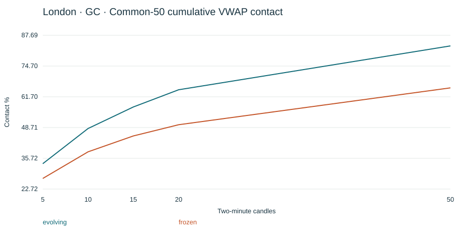

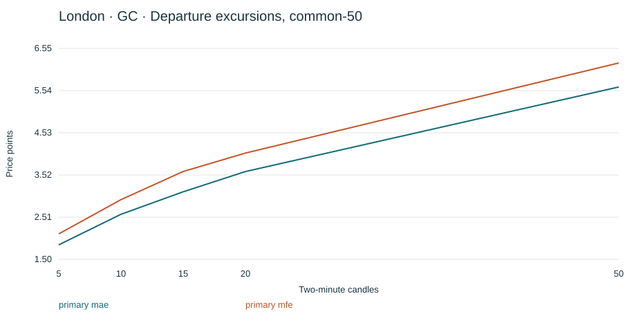

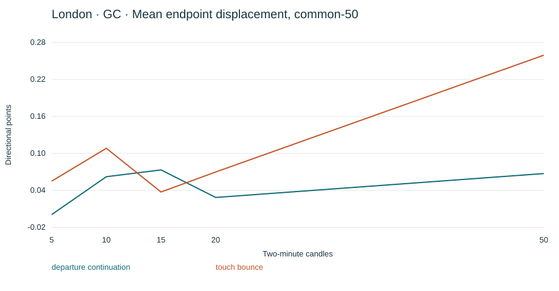

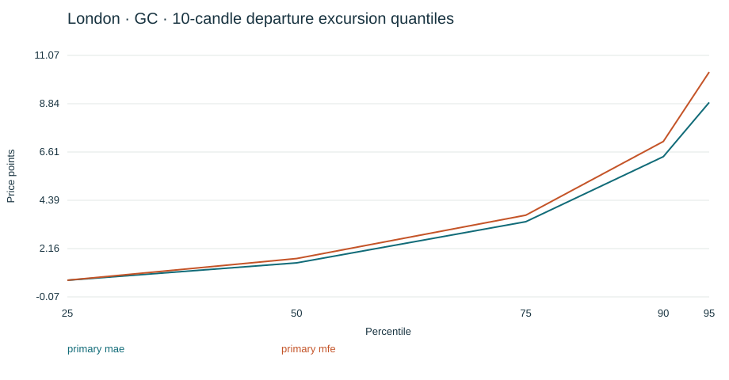

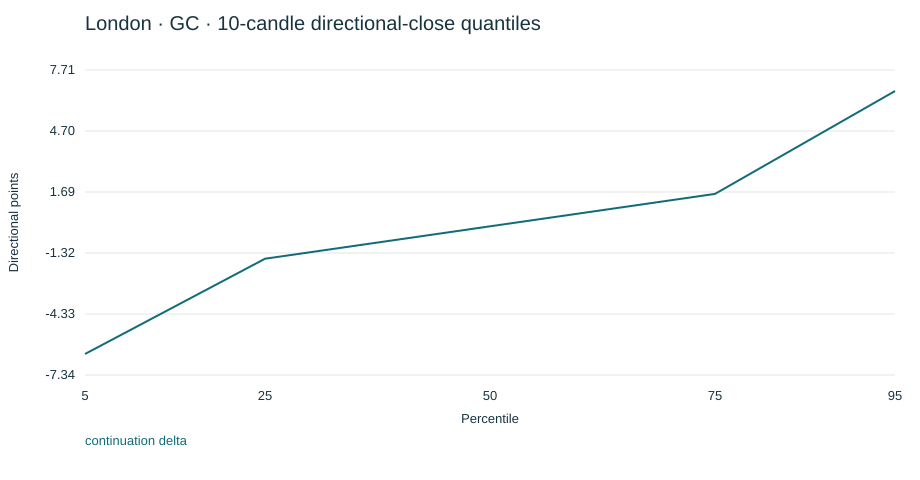

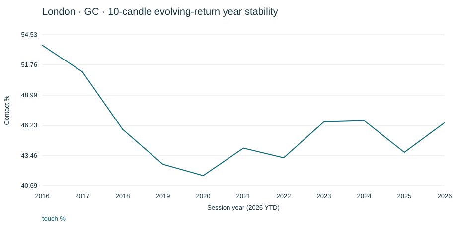

### Sensitivity and chronological periods at 10 candles

| Module | Scope | n | Days / weeks | Directional Δ [CI] | Return or bounce endpoint % [CI] |
| --- | --- | --- | --- | --- | --- |
| departure | all | 2,526 | 822 / 356 | 0.03 [-0.16, 0.21] | 44.7% [43.0%, 46.6%] |
| departure | common_50 | 2,132 | 815 / 355 | 0.06 [-0.13, 0.24] | 48.3% [46.4%, 50.2%] |
| departure | age_ge30 | 1,734 | 786 / 353 | 0.04 [-0.23, 0.28] | 28.3% [26.1%, 30.6%] |
| departure | through_2023 | 1,533 | 509 / 241 | 0.09 [-0.03, 0.21] | 44.5% [42.1%, 46.8%] |
| departure | year_2024_period | 195 | 62 / 32 | 0.25 [-0.19, 0.66] | 46.7% [41.1%, 51.5%] |
| departure | years_2025_2026 | 798 | 251 / 83 | -0.14 [-0.69, 0.39] | 44.7% [41.4%, 48.1%] |
| touch | all | 2,128 | 792 / 350 | 0.03 [-0.18, 0.28] | 49.3% [47.1%, 51.6%] |
| touch | common_50 | 1,777 | 769 / 343 | 0.11 [-0.13, 0.37] | 49.7% [47.3%, 52.0%] |
| touch | age_ge30 | 1,339 | 705 / 340 | 0.04 [-0.23, 0.32] | 50.0% [47.1%, 52.8%] |
| touch | through_2023 | 1,282 | 486 / 235 | 0.00 [-0.13, 0.13] | 49.9% [46.9%, 52.7%] |
| touch | year_2024_period | 163 | 62 / 32 | 0.09 [-0.40, 0.54] | 50.9% [41.8%, 60.3%] |
| touch | years_2025_2026 | 683 | 244 / 83 | 0.08 [-0.55, 0.83] | 47.9% [44.0%, 51.6%] |

### Deterministic source-path examples

Examples are the earliest stable ID in each prespecified class. They illustrate mechanisms and exclusions, not representative trade quality. The source table includes reference available_at and known sigma for every minute; charts plot raw one-minute high/low and references. Source minute open time relative to entry is shown; contacts have interval resolution. Lines join minute OHLC observations for display and do not imply intraminute order or trades through gaps. The 2-sigma envelope is plotted; 2.5/3-sigma references are retained in the example-path table.

return: GC-london-2016-05-09-P0006-K2-H10; upper side. Signal/confirmation 2016-05-09 03:14:00-04:00; entry 2016-05-09 03:14:00-04:00; deadline 2016-05-09 03:34:00-04:00 (New York time). Frozen sigma 0.27 points; signal VWAP 1,282.00. Band thresholds = VWAP ± 2/2.5/3 × sigma. Exclusion: none.

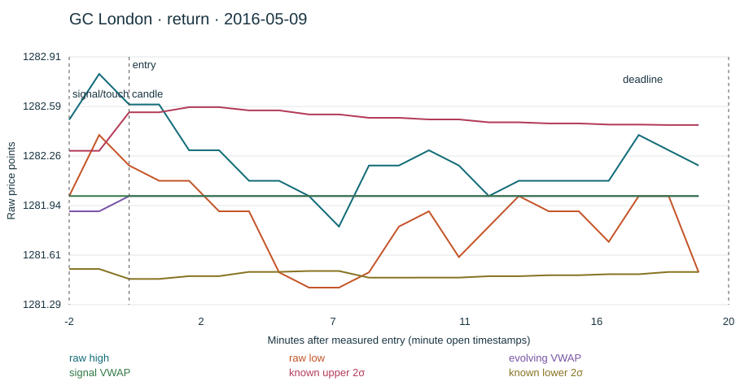

non_return: GC-london-2016-02-11-P0012-K2-H10; upper side. Signal/confirmation 2016-02-11 03:26:00-05:00; entry 2016-02-11 03:26:00-05:00; deadline 2016-02-11 03:46:00-05:00 (New York time). Frozen sigma 1.27 points; signal VWAP 1,211.14. Band thresholds = VWAP ± 2/2.5/3 × sigma. Exclusion: none.

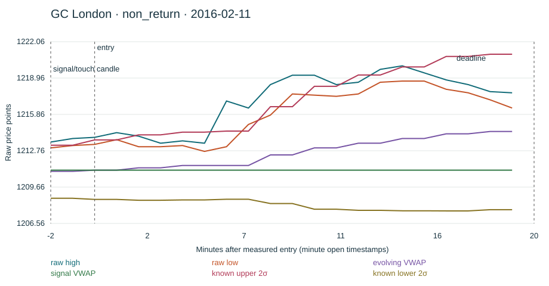

bounce: GC-london-2016-05-09-P0019-T-H10; lower side. Signal/confirmation 2016-05-09 03:44:00-04:00; entry 2016-05-09 03:44:00-04:00; deadline 2016-05-09 04:04:00-04:00 (New York time). Frozen sigma 0.28 points; signal VWAP 1,281.92. Band thresholds = VWAP ± 2/2.5/3 × sigma. Exclusion: none.

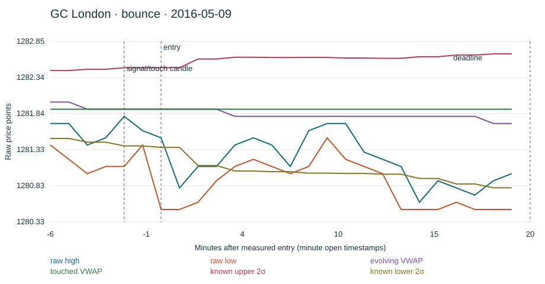

through: GC-london-2016-05-09-P0006-T-H10; upper side. Signal/confirmation 2016-05-09 03:16:00-04:00; entry 2016-05-09 03:16:00-04:00; deadline 2016-05-09 03:36:00-04:00 (New York time). Frozen sigma 0.28 points; signal VWAP 1,282.03. Band thresholds = VWAP ± 2/2.5/3 × sigma. Exclusion: none.

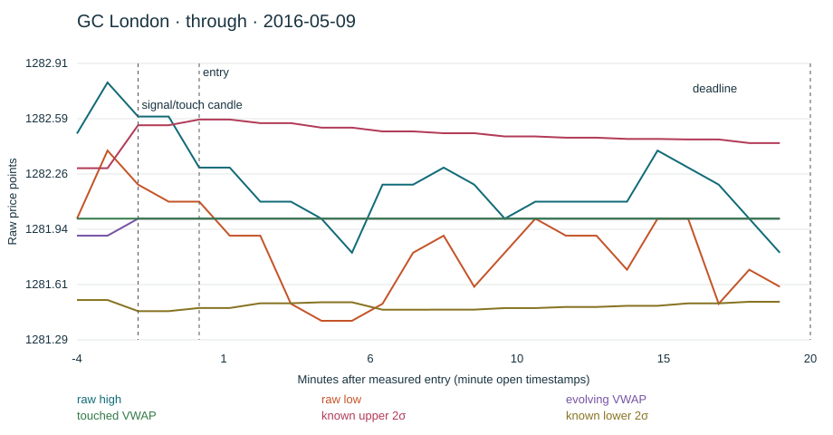

ambiguity: GC-london-2016-11-21-P0002-T-H10; lower side. Signal/confirmation 2016-11-21 03:08:00-05:00; entry 2016-11-21 03:08:00-05:00; deadline 2016-11-21 03:28:00-05:00 (New York time). Frozen sigma 0.21 points; signal VWAP 1,214.13. Band thresholds = VWAP ± 2/2.5/3 × sigma. Exclusion: none.

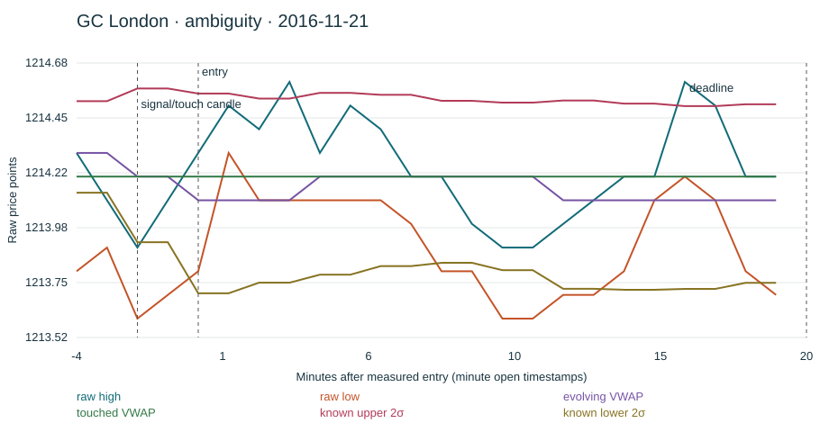

exclusion: GC-london-2016-11-17-P0154-K2-H50; lower side. Signal/confirmation 2016-11-17 08:10:00-05:00; entry 2016-11-17 08:10:00-05:00; deadline 2016-11-17 09:50:00-05:00 (New York time). Frozen sigma 1.11 points; signal VWAP 1,228.61. Band thresholds = VWAP ± 2/2.5/3 × sigma. Exclusion: session_boundary.

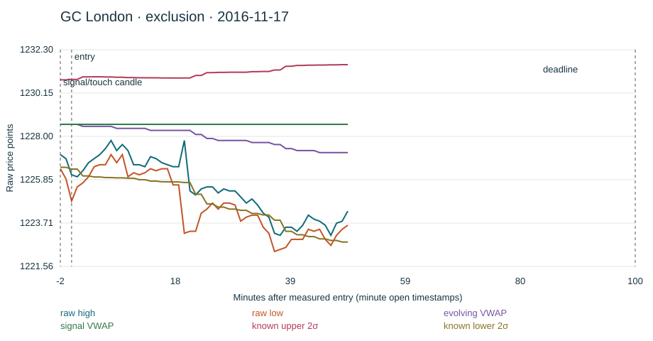

## Interpretation and verification

Return rates, first-move rates and terminal directional frequencies answer different questions. MAE/MFE maxima are favorable/adverse opportunities on an observed path, not obtainable trading profits. Threshold comparisons are descriptive because signal times and eligible populations differ. Treat sparse cells and boundary uncertainty as unresolved. Shared week intervals do not remove retrospective selection or establish a causal predictor.

[Numerical verification record](verification.json)

[Dated findings and advice](advice.md)

[Example selection ledger](tables/example-selection.csv)

[Independent source recounts](tables/independent-recounts.csv)

[Retained event evidence and checksums](events.manifest.json)
