# Range XV reversals: continuation, landing and predictive lead-up

Completed protocol 2.0.0. Eight pinned FX charts are kept separate by bullish/bearish reversal direction. OHLC alone identifies the events. No GUI, screenshots, browser automation or external publication were used.

R is already completed before the reference entry. L excludes R; F counts only consecutive completed followers. A doji breaks a leg. The primary price reference enters at B1 open and marks at B4 open after three physical future bars regardless of colour. These are price-path associations, not verified executable trading profits.

## Direct answers

The compact findings table summarizes the range across the sixteen chart/direction populations without treating them as independent confirmations. Supported and contradicted counts use pointwise session-bootstrap bounds; stable_block5_supported also requires a positive five-session lower bound. An interval spanning zero is inconclusive.

| finding | minimum | maximum | supported | stable_block5_supported | inconclusive | contradicted | comparisons |
| --- | --- | --- | --- | --- | --- | --- | --- |
| baseline:common3_p1 | 0.758 | 0.7719 | undefined | undefined | undefined | undefined | 16 |
| baseline:common3_p3 | 0.3214 | 0.345 | undefined | undefined | undefined | undefined | 16 |
| baseline:cap10_mean | 2.153 | 2.282 | undefined | undefined | undefined | undefined | 16 |
| baseline:cap10_median | 1 | 2 | undefined | undefined | undefined | undefined | 16 |
| baseline:cap10_mode | 1 | 1 | undefined | undefined | undefined | undefined | 16 |
| price_time:favourable | 0.4274 | 0.4694 | undefined | undefined | undefined | undefined | 16 |
| price_time:D_q_mean | -0.3874 | 0.2885 | undefined | undefined | undefined | undefined | 16 |
| price_time:D_q_median | 0 | 0 | undefined | undefined | undefined | undefined | 16 |
| price_time:D_q_p10 | -30 | -25 | undefined | undefined | undefined | undefined | 16 |
| price_time:MAE_q_mean | 10.38 | 13.92 | undefined | undefined | undefined | undefined | 16 |
| price_time:MAE_q_p95 | 25 | 36 | undefined | undefined | undefined | undefined | 16 |
| price_time:MFE_q_mean | 9.66 | 13.74 | undefined | undefined | undefined | undefined | 16 |
| price_time:MFE_q_p95 | 15 | 30 | undefined | undefined | undefined | undefined | 16 |
| price_time:elapsed_seconds_mean | 1457 | 3550 | undefined | undefined | undefined | undefined | 16 |
| price_time:elapsed_seconds_median | 716 | 2085 | undefined | undefined | undefined | undefined | 16 |
| price_time:elapsed_seconds_p90 | 3497 | 8694 | undefined | undefined | undefined | undefined | 16 |
| M1 versus B1:later F3 log loss | -0.0004904 | 0.0002337 | 0 | 0 | 13 | 3 | 16 |
| M2 versus M1:later F3 log loss | -0.002334 | 4.497e-05 | 0 | 0 | 8 | 8 | 16 |
| M2 versus B1:later F3 log loss | -0.002824 | -4.55e-05 | 0 | 0 | 10 | 6 | 16 |
| L3 minus L2:later F3 probability | -0.01267 | 0.01786 | 0 | undefined | 16 | 0 | 16 |

1. Baseline follow-through and typical count: the table gives threshold-specific rates and the common three-bar cohort. The capped mean, median and mode use one common ten-bar cohort. Exact F and censor bounds are separate in continuation.csv. High persistence may reflect price-event chart construction.

| chart | direction | n | common3_n | common3_p1 | common3_p2 | common3_p3 | p5 | p10 | common10_n | cap10_mean | cap10_median | cap10_mode | F_exact_mean | unresolved_F |
| --- | --- | --- | --- | --- | --- | --- | --- | --- | --- | --- | --- | --- | --- | --- |
| 6B_4 | -1 | 30329 | 28951 | 0.7623 | 0.5038 | 0.3296 | 0.138 | 0.01669 | 26190 | 2.187 | 2 | 1 | 2.128 | 1113 |
| 6B_4 | 1 | 30468 | 29004 | 0.7582 | 0.4994 | 0.3248 | 0.1401 | 0.01505 | 26249 | 2.173 | 2 | 1 | 2.119 | 1268 |
| 6B_5 | -1 | 20643 | 19261 | 0.7689 | 0.507 | 0.329 | 0.1382 | 0.01745 | 16616 | 2.227 | 2 | 1 | 2.122 | 1170 |
| 6B_5 | 1 | 20703 | 19300 | 0.7639 | 0.5049 | 0.332 | 0.1427 | 0.01569 | 16638 | 2.203 | 2 | 1 | 2.113 | 1206 |
| 6E_4 | -1 | 67137 | 65654 | 0.7626 | 0.4988 | 0.3251 | 0.1369 | 0.01581 | 62954 | 2.163 | 1 | 1 | 2.158 | 1190 |
| 6E_4 | 1 | 67245 | 65765 | 0.758 | 0.4961 | 0.3214 | 0.1366 | 0.01637 | 63050 | 2.153 | 1 | 1 | 2.147 | 1195 |
| 6E_5 | -1 | 46152 | 44734 | 0.7631 | 0.5017 | 0.3268 | 0.1396 | 0.01529 | 42000 | 2.177 | 2 | 1 | 2.156 | 1202 |
| 6E_5 | 1 | 46244 | 44831 | 0.7584 | 0.4963 | 0.3223 | 0.1376 | 0.01636 | 42123 | 2.162 | 1 | 1 | 2.141 | 1176 |
| 6J_4 | -1 | 38087 | 36658 | 0.7593 | 0.5063 | 0.3324 | 0.1452 | 0.01586 | 33919 | 2.203 | 2 | 1 | 2.178 | 1309 |
| 6J_4 | 1 | 37917 | 36445 | 0.76 | 0.5009 | 0.3282 | 0.14 | 0.01624 | 33807 | 2.206 | 2 | 1 | 2.16 | 1067 |
| 6J_5 | -1 | 26186 | 24743 | 0.7644 | 0.5061 | 0.3359 | 0.1458 | 0.01851 | 22145 | 2.217 | 2 | 1 | 2.168 | 1345 |
| 6J_5 | 1 | 25952 | 24577 | 0.7627 | 0.5073 | 0.3326 | 0.1447 | 0.01711 | 22098 | 2.24 | 2 | 1 | 2.168 | 1012 |
| 6S_4 | -1 | 41800 | 40402 | 0.7697 | 0.5109 | 0.3421 | 0.1502 | 0.01869 | 37821 | 2.264 | 2 | 1 | 2.242 | 1211 |
| 6S_4 | 1 | 41694 | 40301 | 0.7637 | 0.5102 | 0.34 | 0.1519 | 0.01981 | 37703 | 2.269 | 2 | 1 | 2.247 | 1158 |
| 6S_5 | -1 | 29651 | 28267 | 0.7719 | 0.5193 | 0.345 | 0.1519 | 0.0181 | 25858 | 2.282 | 2 | 1 | 2.237 | 1187 |
| 6S_5 | 1 | 29548 | 28188 | 0.7706 | 0.5127 | 0.3393 | 0.1517 | 0.02062 | 25806 | 2.275 | 2 | 1 | 2.24 | 1164 |

2. L=2 versus L=3: differences below are L3 minus L2 on identical physical-window rules, with paired session uncertainty and five-session sensitivity. The saved matched-L-lifts table includes every other prior-length bin, raw and window/era-standardized comparisons. L2-L3-adjustment.csv compares later residual differences after frozen R/context and lead-up model expectations.

| chart | direction | metric | n2 | n3 | L3_minus_L2 | low | high | standardized_difference | standardized_low | standardized_high | block5_low | block5_high |
| --- | --- | --- | --- | --- | --- | --- | --- | --- | --- | --- | --- | --- |
| 6B_4 | -1 | y3 | 2198 | 1487 | 0.008974 | -0.02039 | 0.0385 | 0.008549 | -0.01994 | 0.03827 | -0.02353 | 0.0386 |
| 6B_4 | -1 | h3_D_q | 2041 | 1397 | 0.6378 | -0.2766 | 1.578 | 0.6366 | -0.2678 | 1.572 | -0.2711 | 1.498 |
| 6B_4 | 1 | y3 | 2228 | 1424 | -0.003833 | -0.03592 | 0.02822 | -0.004308 | -0.03629 | 0.02669 | -0.03562 | 0.026 |
| 6B_4 | 1 | h3_D_q | 2072 | 1341 | 0.1407 | -0.8356 | 1.084 | 0.1304 | -0.8503 | 1.076 | -0.8467 | 1.09 |
| 6B_5 | -1 | y3 | 1477 | 984 | 0.001916 | -0.03596 | 0.03923 | 0.003349 | -0.03455 | 0.03988 | -0.03353 | 0.03775 |
| 6B_5 | -1 | h3_D_q | 1386 | 905 | -0.08022 | -1.469 | 1.299 | -0.1015 | -1.452 | 1.28 | -1.401 | 1.24 |
| 6B_5 | 1 | y3 | 1539 | 977 | -0.004892 | -0.04171 | 0.03223 | -0.00543 | -0.04184 | 0.03201 | -0.04141 | 0.02912 |
| 6B_5 | 1 | h3_D_q | 1438 | 897 | 0.4893 | -0.8327 | 1.841 | 0.4963 | -0.8358 | 1.856 | -0.9871 | 1.887 |
| 6E_4 | -1 | y3 | 6218 | 4167 | -0.005845 | -0.02519 | 0.01227 | -0.005629 | -0.02501 | 0.01254 | -0.02408 | 0.01289 |
| 6E_4 | -1 | h3_D_q | 5825 | 3876 | -0.08819 | -0.6418 | 0.4643 | -0.08524 | -0.6438 | 0.4656 | -0.6572 | 0.4636 |
| 6E_4 | 1 | y3 | 6253 | 4118 | 0.004388 | -0.0152 | 0.02251 | 0.004106 | -0.01528 | 0.02221 | -0.01348 | 0.02203 |
| 6E_4 | 1 | h3_D_q | 5858 | 3857 | 0.5588 | -0.001438 | 1.133 | 0.5576 | -0.008825 | 1.126 | 0.03541 | 1.07 |
| 6E_5 | -1 | y3 | 4263 | 2802 | -0.007401 | -0.02921 | 0.01385 | -0.007147 | -0.0289 | 0.01405 | -0.02932 | 0.01543 |
| 6E_5 | -1 | h3_D_q | 3985 | 2620 | 0.2331 | -0.6406 | 1.041 | 0.2344 | -0.6268 | 1.045 | -0.5609 | 1.053 |
| 6E_5 | 1 | y3 | 4305 | 2854 | 0.00134 | -0.02042 | 0.02284 | 0.0009445 | -0.02051 | 0.0228 | -0.02041 | 0.02288 |
| 6E_5 | 1 | h3_D_q | 4007 | 2680 | 0.01449 | -0.7689 | 0.8173 | 0.01109 | -0.7724 | 0.8115 | -0.795 | 0.8443 |
| 6J_4 | -1 | y3 | 4521 | 2954 | -0.01267 | -0.03377 | 0.008199 | -0.01226 | -0.03331 | 0.008507 | -0.03475 | 0.00906 |
| 6J_4 | -1 | h3_D_q | 4089 | 2676 | -0.5307 | -1.245 | 0.1366 | -0.5214 | -1.223 | 0.149 | -1.235 | 0.14 |
| 6J_4 | 1 | y3 | 4441 | 2966 | -0.006884 | -0.02813 | 0.01548 | -0.006966 | -0.02779 | 0.01605 | -0.0297 | 0.01672 |
| 6J_4 | 1 | h3_D_q | 4008 | 2674 | -0.08741 | -0.7667 | 0.623 | -0.08881 | -0.7827 | 0.6318 | -0.7755 | 0.5968 |
| 6J_5 | -1 | y3 | 3001 | 2008 | -0.007869 | -0.03324 | 0.01728 | -0.008157 | -0.03344 | 0.01714 | -0.03396 | 0.01739 |
| 6J_5 | -1 | h3_D_q | 2718 | 1849 | -0.587 | -1.582 | 0.3765 | -0.5752 | -1.583 | 0.4175 | -1.656 | 0.4611 |
| 6J_5 | 1 | y3 | 3081 | 1981 | 0.01786 | -0.007656 | 0.04382 | 0.01815 | -0.006238 | 0.04546 | -0.004426 | 0.04029 |
| 6J_5 | 1 | h3_D_q | 2787 | 1798 | 0.3407 | -0.671 | 1.375 | 0.3858 | -0.5933 | 1.425 | -0.6027 | 1.254 |
| 6S_4 | -1 | y3 | 6972 | 4722 | 0.002713 | -0.01433 | 0.0193 | 0.001955 | -0.01511 | 0.0185 | -0.01351 | 0.01934 |
| 6S_4 | -1 | h3_D_q | 6586 | 4487 | 0.2197 | -0.3455 | 0.7639 | 0.2028 | -0.3645 | 0.7452 | -0.3078 | 0.7591 |
| 6S_4 | 1 | y3 | 7181 | 4659 | -0.0004999 | -0.01811 | 0.01623 | -0.0001006 | -0.01743 | 0.01672 | -0.01884 | 0.01748 |
| 6S_4 | 1 | h3_D_q | 6783 | 4388 | -0.1724 | -0.7415 | 0.3831 | -0.1551 | -0.7156 | 0.3952 | -0.7442 | 0.3826 |
| 6S_5 | -1 | y3 | 5109 | 3371 | -0.006128 | -0.0265 | 0.01345 | -0.006054 | -0.02656 | 0.01342 | -0.02624 | 0.01404 |
| 6S_5 | -1 | h3_D_q | 4834 | 3230 | -0.07033 | -0.8536 | 0.7243 | -0.0637 | -0.836 | 0.7239 | -0.8076 | 0.7747 |
| 6S_5 | 1 | y3 | 4984 | 3443 | 0.005 | -0.01529 | 0.02495 | 0.004944 | -0.01536 | 0.02452 | -0.01517 | 0.02575 |
| 6S_5 | 1 | h3_D_q | 4726 | 3258 | 0.1033 | -0.6693 | 0.8808 | 0.1074 | -0.6565 | 0.896 | -0.6927 | 0.9239 |

No later L=2 versus L=3 continuation difference is supported in any chart/direction: every paired interval spans zero. Standardization and R/context residual comparisons remain visible rather than treating a small raw point difference as a finding.

The adjustment table subtracts the frozen model expectation from each later F3 label. B1 residual contrasts use R geometry and context; M2 also includes the richer lead-up. These are descriptive residual associations, not causal effects. Yearly contrasts and prediction stability are saved as separate audits.

| chart | direction | model | n2 | n3 | L3_minus_L2_observed | L3_minus_L2_predicted | L3_minus_L2_residual | low | high |
| --- | --- | --- | --- | --- | --- | --- | --- | --- | --- |
| 6B_4 | -1 | B1 | 2194 | 1483 | 0.009062 | -0.0004043 | 0.009466 | -0.01994 | 0.0391 |
| 6B_4 | -1 | M2 | 2194 | 1483 | 0.009062 | -0.00199 | 0.01105 | -0.01862 | 0.04035 |
| 6B_4 | 1 | B1 | 2219 | 1417 | -0.002919 | 0.001589 | -0.004508 | -0.03678 | 0.02855 |
| 6B_4 | 1 | M2 | 2219 | 1417 | -0.002919 | -0.004469 | 0.001551 | -0.03074 | 0.03437 |
| 6B_5 | -1 | B1 | 1473 | 982 | 0.001358 | -0.0006812 | 0.002039 | -0.03624 | 0.03869 |
| 6B_5 | -1 | M2 | 1473 | 982 | 0.001358 | -0.01767 | 0.01903 | -0.01894 | 0.05579 |
| 6B_5 | 1 | B1 | 1533 | 971 | -0.00429 | -0.0004274 | -0.003863 | -0.04136 | 0.03359 |
| 6B_5 | 1 | M2 | 1533 | 971 | -0.00429 | -0.01737 | 0.01308 | -0.02471 | 0.05102 |
| 6E_4 | -1 | B1 | 6204 | 4159 | -0.005396 | 8.938e-05 | -0.005485 | -0.0247 | 0.01279 |
| 6E_4 | -1 | M2 | 6204 | 4159 | -0.005396 | -0.008857 | 0.003461 | -0.01613 | 0.02164 |
| 6E_4 | 1 | B1 | 6242 | 4111 | 0.004127 | -5.622e-05 | 0.004183 | -0.01526 | 0.02236 |
| 6E_4 | 1 | M2 | 6242 | 4111 | 0.004127 | 0.003499 | 0.0006275 | -0.01868 | 0.01869 |
| 6E_5 | -1 | B1 | 4256 | 2798 | -0.007726 | -1.04e-05 | -0.007715 | -0.02966 | 0.01354 |
| 6E_5 | -1 | M2 | 4256 | 2798 | -0.007726 | -0.01857 | 0.01085 | -0.01123 | 0.03221 |
| 6E_5 | 1 | B1 | 4295 | 2848 | 0.00115 | -0.0001968 | 0.001346 | -0.02041 | 0.02326 |
| 6E_5 | 1 | M2 | 4295 | 2848 | 0.00115 | 0.00982 | -0.00867 | -0.03012 | 0.01311 |
| 6J_4 | -1 | B1 | 4507 | 2946 | -0.01184 | 0.000776 | -0.01262 | -0.03319 | 0.008388 |
| 6J_4 | -1 | M2 | 4507 | 2946 | -0.01184 | -0.04673 | 0.03488 | 0.01386 | 0.0552 |
| 6J_4 | 1 | B1 | 4428 | 2960 | -0.005728 | 0.0005515 | -0.00628 | -0.02742 | 0.01582 |
| 6J_4 | 1 | M2 | 4428 | 2960 | -0.005728 | -0.01577 | 0.01004 | -0.01107 | 0.03205 |
| 6J_5 | -1 | B1 | 2993 | 2000 | -0.006952 | 0.0009378 | -0.00789 | -0.03299 | 0.0172 |
| 6J_5 | -1 | M2 | 2993 | 2000 | -0.006952 | -0.003892 | -0.00306 | -0.02784 | 0.02208 |
| 6J_5 | 1 | B1 | 3070 | 1977 | 0.01886 | 0.0004356 | 0.01842 | -0.007113 | 0.0443 |
| 6J_5 | 1 | M2 | 3070 | 1977 | 0.01886 | -0.02441 | 0.04326 | 0.01752 | 0.06943 |
| 6S_4 | -1 | B1 | 6951 | 4714 | 0.002355 | 0.0001218 | 0.002234 | -0.01472 | 0.01911 |
| 6S_4 | -1 | M2 | 6951 | 4714 | 0.002355 | 0.01354 | -0.01119 | -0.0281 | 0.005636 |
| 6S_4 | 1 | B1 | 7161 | 4649 | -0.0008044 | 3.351e-05 | -0.000838 | -0.01838 | 0.01596 |
| 6S_4 | 1 | M2 | 7161 | 4649 | -0.0008044 | -0.003837 | 0.003033 | -0.01453 | 0.01987 |
| 6S_5 | -1 | B1 | 5099 | 3367 | -0.00621 | 0.000128 | -0.006338 | -0.02683 | 0.01321 |
| 6S_5 | -1 | M2 | 5099 | 3367 | -0.00621 | 0.001635 | -0.007845 | -0.02833 | 0.0119 |
| 6S_5 | 1 | B1 | 4971 | 3435 | 0.004759 | 7.888e-05 | 0.00468 | -0.01563 | 0.02448 |
| 6S_5 | 1 | M2 | 4971 | 3435 | 0.004759 | 0.009214 | -0.004455 | -0.02469 | 0.01534 |

3. Incremental later prediction: positive improvements mean lower loss than the reference model. B1 uses context and R geometry; M1 adds L; M2 adds richer history. Interval bounds and the block sensitivity establish support separately for each chart/direction. Model choice was saved after validation, before later metrics were read. Prior input and earlier-study inspection means this is not a pristine holdout or a familywise-confirmatory claim.

The primary later F>=3 result is negative: neither adding L nor richer lead-up history gives a supported log-loss improvement beyond R geometry/context in any chart/direction. Some richer models perform worse, while other differences are inconclusive. Supplementary F>=1, signed D3 and capped-F targets are evaluated separately; their score comparisons are retained in supplementary-prediction-findings.csv.

| chart | direction | model | baseline | improvement | low | high | block5_low | block5_high | n |
| --- | --- | --- | --- | --- | --- | --- | --- | --- | --- |
| 6B_4 | -1 | M1 | B1 | 0.0002337 | -0.0001155 | 0.0005559 | -6.565e-05 | 0.0005257 | 8352 |
| 6B_4 | -1 | M2 | M1 | -0.0005664 | -0.001652 | 0.0004564 | -0.001584 | 0.0004846 | 8352 |
| 6B_4 | -1 | M2 | B1 | -0.0003328 | -0.001485 | 0.0007152 | -0.001368 | 0.000751 | 8352 |
| 6B_4 | 1 | M1 | B1 | 0.000106 | -0.0002926 | 0.0005253 | -0.0002941 | 0.0005232 | 8358 |
| 6B_4 | 1 | M2 | M1 | -0.000369 | -0.001436 | 0.0006364 | -0.001319 | 0.000544 | 8358 |
| 6B_4 | 1 | M2 | B1 | -0.000263 | -0.001408 | 0.0008517 | -0.001232 | 0.0007321 | 8358 |
| 6B_5 | -1 | M1 | B1 | 6.286e-05 | -0.0003813 | 0.0005044 | -0.0003519 | 0.0004926 | 5545 |
| 6B_5 | -1 | M2 | M1 | -0.001311 | -0.00284 | 0.0002027 | -0.002956 | 0.0002371 | 5545 |
| 6B_5 | -1 | M2 | B1 | -0.001248 | -0.002805 | 0.0003922 | -0.002929 | 0.0003178 | 5545 |
| 6B_5 | 1 | M1 | B1 | -0.0002584 | -0.0007411 | 0.0002189 | -0.0007796 | 0.0002591 | 5525 |
| 6B_5 | 1 | M2 | M1 | -0.0005675 | -0.001605 | 0.0004592 | -0.0016 | 0.0004234 | 5525 |
| 6B_5 | 1 | M2 | B1 | -0.0008258 | -0.00193 | 0.0002868 | -0.001931 | 0.0002721 | 5525 |
| 6E_4 | -1 | M1 | B1 | -9.047e-05 | -0.0002457 | 5.578e-05 | -0.0002505 | 6.777e-05 | 23669 |
| 6E_4 | -1 | M2 | M1 | 4.497e-05 | -0.0003881 | 0.0004529 | -0.0003876 | 0.000482 | 23669 |
| 6E_4 | -1 | M2 | B1 | -4.55e-05 | -0.0005006 | 0.0003879 | -0.0004984 | 0.0004174 | 23669 |
| 6E_4 | 1 | M1 | B1 | 4.667e-05 | -5.643e-05 | 0.0001511 | -5.957e-05 | 0.0001483 | 23700 |
| 6E_4 | 1 | M2 | M1 | -0.0002272 | -0.0005745 | 0.0001267 | -0.0006098 | 0.0001097 | 23700 |
| 6E_4 | 1 | M2 | B1 | -0.0001806 | -0.00055 | 0.0001861 | -0.0005992 | 0.0001933 | 23700 |
| 6E_5 | -1 | M1 | B1 | -0.0001819 | -0.0004671 | 0.0001114 | -0.0004957 | 0.0001133 | 16174 |
| 6E_5 | -1 | M2 | M1 | -0.001021 | -0.001752 | -0.000331 | -0.001737 | -0.000348 | 16174 |
| 6E_5 | -1 | M2 | B1 | -0.001203 | -0.002 | -0.0004361 | -0.002008 | -0.0004541 | 16174 |
| 6E_5 | 1 | M1 | B1 | -0.0001558 | -0.0005336 | 0.0002168 | -0.000528 | 0.0002274 | 16172 |
| 6E_5 | 1 | M2 | M1 | -0.0003017 | -0.001051 | 0.0004564 | -0.001126 | 0.0004404 | 16172 |
| 6E_5 | 1 | M2 | B1 | -0.0004575 | -0.001268 | 0.0003447 | -0.001339 | 0.0003036 | 16172 |
| 6J_4 | -1 | M1 | B1 | 2.269e-05 | -0.0006185 | 0.0006834 | -0.000544 | 0.0006182 | 17279 |
| 6J_4 | -1 | M2 | M1 | -0.0009377 | -0.001738 | -0.0001524 | -0.00175 | -0.0001512 | 17279 |
| 6J_4 | -1 | M2 | B1 | -0.000915 | -0.001921 | 0.0001106 | -0.001867 | 5.542e-05 | 17279 |
| 6J_4 | 1 | M1 | B1 | -0.0002759 | -0.0005637 | 1.5e-05 | -0.0005845 | 2.425e-05 | 17156 |
| 6J_4 | 1 | M2 | M1 | -0.0001421 | -0.0009186 | 0.0006539 | -0.0008761 | 0.0006609 | 17156 |
| 6J_4 | 1 | M2 | B1 | -0.0004179 | -0.001266 | 0.0003934 | -0.001213 | 0.0004277 | 17156 |
| 6J_5 | -1 | M1 | B1 | 6.654e-05 | -0.0003905 | 0.0005172 | -0.0004018 | 0.0005278 | 11731 |
| 6J_5 | -1 | M2 | M1 | -0.001925 | -0.002999 | -0.0007772 | -0.003097 | -0.0008931 | 11731 |
| 6J_5 | -1 | M2 | B1 | -0.001858 | -0.003025 | -0.0006168 | -0.003207 | -0.0006601 | 11731 |
| 6J_5 | 1 | M1 | B1 | -0.0004904 | -0.0009085 | -6.653e-05 | -0.00092 | -9.093e-05 | 11618 |
| 6J_5 | 1 | M2 | M1 | -0.002334 | -0.003878 | -0.0009657 | -0.004001 | -0.0008787 | 11618 |
| 6J_5 | 1 | M2 | B1 | -0.002824 | -0.004447 | -0.001313 | -0.004626 | -0.001314 | 11618 |
| 6S_4 | -1 | M1 | B1 | -0.0003421 | -0.0006399 | -4.373e-05 | -0.0006217 | -7.289e-05 | 27824 |
| 6S_4 | -1 | M2 | M1 | -0.001941 | -0.002705 | -0.001232 | -0.002735 | -0.001215 | 27824 |
| 6S_4 | -1 | M2 | B1 | -0.002284 | -0.003062 | -0.00152 | -0.003088 | -0.001535 | 27824 |
| 6S_4 | 1 | M1 | B1 | 3.578e-05 | -7.194e-05 | 0.0001404 | -7.04e-05 | 0.0001416 | 27774 |
| 6S_4 | 1 | M2 | M1 | -0.0004624 | -0.0009324 | -1.308e-05 | -0.0009522 | 8.822e-06 | 27774 |
| 6S_4 | 1 | M2 | B1 | -0.0004266 | -0.000909 | 4.837e-05 | -0.0009355 | 6.779e-05 | 27774 |
| 6S_5 | -1 | M1 | B1 | -0.0004019 | -0.000792 | -3.652e-05 | -0.0007961 | -2.457e-05 | 19617 |
| 6S_5 | -1 | M2 | M1 | -0.001954 | -0.00307 | -0.001034 | -0.003003 | -0.001014 | 19617 |
| 6S_5 | -1 | M2 | B1 | -0.002356 | -0.003484 | -0.00135 | -0.003543 | -0.001318 | 19617 |
| 6S_5 | 1 | M1 | B1 | -0.0003874 | -0.0008457 | 5.353e-05 | -0.0008192 | 4.73e-05 | 19580 |
| 6S_5 | 1 | M2 | M1 | -0.0009095 | -0.001598 | -0.0002288 | -0.001611 | -0.0002329 | 19580 |
| 6S_5 | 1 | M2 | B1 | -0.001297 | -0.002101 | -0.0004598 | -0.002114 | -0.0004661 | 19580 |

4–6. Three-bar landing, signed delta, excursion tails and elapsed time: strict positive-duration paths are below. Favourable/flat/adverse are signed landing probabilities. MAE/MFE are nonnegative and include entry, B1–B3 extremes and B4 open, including gaps. R range is excluded. Constant q equivalents do not change with historical tick eras; raw prices and separate historical units remain in evidence. Elapsed time is a proxy and varies with price-event bars.

| chart | direction | n | dates | favourable | flat | adverse | D_q_mean | D_q_low | D_q_high | D_q_median | D_q_p10 | MAE_q_mean | MAE_q_p95 | MFE_q_mean | MFE_q_p95 | elapsed_seconds_mean | elapsed_seconds_median | elapsed_seconds_p90 | within_1_minutes | within_5_minutes | within_15_minutes | within_30_minutes |
| --- | --- | --- | --- | --- | --- | --- | --- | --- | --- | --- | --- | --- | --- | --- | --- | --- | --- | --- | --- | --- | --- | --- |
| 6B_4 | -1 | 27194 | 2367 | 0.438 | 0.1685 | 0.3935 | -0.1051 | -0.2827 | 0.07682 | 0 | -25 | 10.38 | 25 | 9.738 | 15 | 2750 | 1516 | 6724 | 0.03637 | 0.1462 | 0.3513 | 0.5535 |
| 6B_4 | 1 | 27209 | 2371 | 0.4344 | 0.1694 | 0.3963 | -0.2151 | -0.3996 | -0.04183 | 0 | -25 | 10.45 | 25 | 9.695 | 15 | 2781 | 1521 | 6765 | 0.03543 | 0.1447 | 0.3499 | 0.5534 |
| 6B_5 | -1 | 18179 | 2343 | 0.4328 | 0.173 | 0.3942 | -0.0791 | -0.3369 | 0.1856 | 0 | -30 | 12.32 | 30 | 11.73 | 18 | 3503 | 2085 | 8580 | 0.02701 | 0.1125 | 0.2764 | 0.4573 |
| 6B_5 | 1 | 18218 | 2344 | 0.4362 | 0.1669 | 0.397 | -0.07163 | -0.3262 | 0.1632 | 0 | -30 | 12.43 | 30 | 11.74 | 18 | 3550 | 2084 | 8694 | 0.02882 | 0.1107 | 0.2695 | 0.4535 |
| 6E_4 | -1 | 61953 | 2375 | 0.4325 | 0.1699 | 0.3976 | -0.1981 | -0.3019 | -0.08701 | 0 | -25 | 10.43 | 25 | 9.707 | 15 | 1457 | 716 | 3497 | 0.06272 | 0.2726 | 0.5685 | 0.7656 |
| 6E_4 | 1 | 62031 | 2375 | 0.4274 | 0.1704 | 0.4021 | -0.3475 | -0.4638 | -0.2416 | 0 | -25 | 10.49 | 25 | 9.66 | 15 | 1480 | 734 | 3572 | 0.06303 | 0.2669 | 0.5624 | 0.7623 |
| 6E_5 | -1 | 42386 | 2374 | 0.4354 | 0.1714 | 0.3931 | -0.1301 | -0.2903 | 0.03631 | 0 | -30 | 12.47 | 30 | 11.72 | 18 | 1976 | 1010 | 4802 | 0.04546 | 0.2058 | 0.4665 | 0.6729 |
| 6E_5 | 1 | 42551 | 2375 | 0.4289 | 0.1699 | 0.4012 | -0.3809 | -0.547 | -0.222 | 0 | -30 | 12.62 | 30 | 11.65 | 18 | 1998 | 1030 | 4823 | 0.04531 | 0.2015 | 0.4597 | 0.6703 |
| 6J_4 | -1 | 33480 | 2325 | 0.4417 | 0.1673 | 0.391 | 0.0002091 | -0.1639 | 0.1586 | 0 | -25 | 10.72 | 26 | 10.14 | 15 | 2525 | 1130 | 6403 | 0.06753 | 0.2254 | 0.4443 | 0.6248 |
| 6J_4 | 1 | 33164 | 2314 | 0.4316 | 0.1661 | 0.4024 | -0.3374 | -0.5043 | -0.1653 | 0 | -25 | 10.87 | 26 | 10.04 | 15 | 2490 | 1103 | 6257 | 0.06827 | 0.2268 | 0.4497 | 0.6284 |
| 6J_5 | -1 | 22738 | 2250 | 0.4448 | 0.1644 | 0.3908 | 0.03307 | -0.2079 | 0.288 | 0 | -30 | 12.84 | 31 | 12.18 | 18 | 3348 | 1557 | 8640 | 0.05647 | 0.1839 | 0.3693 | 0.5409 |
| 6J_5 | 1 | 22545 | 2232 | 0.4312 | 0.1686 | 0.4002 | -0.3874 | -0.6286 | -0.1417 | 0 | -30 | 12.92 | 31 | 12.1 | 18 | 3235 | 1484 | 8456 | 0.05908 | 0.1857 | 0.3807 | 0.5507 |
| 6S_4 | -1 | 38239 | 2328 | 0.4694 | 0.1136 | 0.4169 | 0.1217 | -0.05708 | 0.299 | 0 | -25 | 11.87 | 31 | 11.6 | 26 | 1915 | 825 | 4760 | 0.04686 | 0.2403 | 0.527 | 0.7116 |
| 6S_4 | 1 | 38020 | 2321 | 0.4675 | 0.1148 | 0.4177 | 0.07312 | -0.1262 | 0.2499 | 0 | -25 | 11.89 | 31 | 11.56 | 26 | 1893 | 822 | 4721 | 0.04621 | 0.2427 | 0.5267 | 0.7144 |
| 6S_5 | -1 | 26850 | 2236 | 0.4694 | 0.118 | 0.4126 | 0.2885 | 0.04438 | 0.5303 | 0 | -30 | 13.86 | 36 | 13.74 | 30 | 2386 | 1096 | 6027 | 0.0349 | 0.1831 | 0.4434 | 0.6447 |
| 6S_5 | 1 | 26721 | 2210 | 0.4647 | 0.1169 | 0.4185 | 0.06549 | -0.1952 | 0.3181 | 0 | -30 | 13.92 | 36 | 13.7 | 28 | 2385 | 1094 | 6048 | 0.03473 | 0.1847 | 0.4434 | 0.6452 |

| chart | direction | strict3_n | order3_n | strict3_coverage_of_order3 | F_ge1 | F_ge2 | F_ge3 | F_ge3_low | F_ge3_high |
| --- | --- | --- | --- | --- | --- | --- | --- | --- | --- |
| 6B_4 | -1 | 27194 | 28951 | 0.9393 | 0.7638 | 0.5032 | 0.3284 | 0.3226 | 0.334 |
| 6B_4 | 1 | 27209 | 29004 | 0.9381 | 0.759 | 0.4985 | 0.3228 | 0.317 | 0.3283 |
| 6B_5 | -1 | 18179 | 19261 | 0.9438 | 0.7702 | 0.5063 | 0.3272 | 0.3198 | 0.3345 |
| 6B_5 | 1 | 18218 | 19300 | 0.9439 | 0.7655 | 0.5047 | 0.331 | 0.3243 | 0.3382 |
| 6E_4 | -1 | 61953 | 65654 | 0.9436 | 0.764 | 0.4976 | 0.3226 | 0.319 | 0.3262 |
| 6E_4 | 1 | 62031 | 65765 | 0.9432 | 0.7593 | 0.4944 | 0.3182 | 0.3147 | 0.3219 |
| 6E_5 | -1 | 42386 | 44734 | 0.9475 | 0.7649 | 0.501 | 0.3251 | 0.3207 | 0.3293 |
| 6E_5 | 1 | 42551 | 44831 | 0.9491 | 0.7591 | 0.4951 | 0.3207 | 0.3162 | 0.3248 |
| 6J_4 | -1 | 33480 | 36658 | 0.9133 | 0.7633 | 0.5078 | 0.3319 | 0.327 | 0.337 |
| 6J_4 | 1 | 33164 | 36445 | 0.91 | 0.759 | 0.4969 | 0.3232 | 0.318 | 0.3285 |
| 6J_5 | -1 | 22738 | 24743 | 0.919 | 0.7662 | 0.5049 | 0.3327 | 0.3265 | 0.3389 |
| 6J_5 | 1 | 22545 | 24577 | 0.9173 | 0.7615 | 0.5052 | 0.3289 | 0.3226 | 0.335 |
| 6S_4 | -1 | 38239 | 40402 | 0.9465 | 0.7706 | 0.5104 | 0.3404 | 0.336 | 0.3448 |
| 6S_4 | 1 | 38020 | 40301 | 0.9434 | 0.7648 | 0.5094 | 0.3383 | 0.3334 | 0.3431 |
| 6S_5 | -1 | 26850 | 28267 | 0.9499 | 0.7731 | 0.5203 | 0.3451 | 0.3396 | 0.3508 |
| 6S_5 | 1 | 26721 | 28188 | 0.948 | 0.7729 | 0.5135 | 0.3385 | 0.3321 | 0.3446 |

No adverse D3 landing was observed among F>=3 in the strict three-bar cohort. Early colour breaks did sometimes land favourably. The joint table retains both tests, including the observed zero and flat landings; it does not discard failures.

Same-second price paths are a descriptive sensitivity with unresolved execution opportunities. Time-to-followers is conditional on attainment and includes all-candidate failure/unresolved counts. The clock-mark table uses stale completed closes with actual timestamps and explicit coverage, never an exact market price at T.

| chart | direction | F_ge3 | landing | n | denominator |
| --- | --- | --- | --- | --- | --- |
| 6B_4 | -1 | 0 | favourable | 2981 | 27194 |
| 6B_4 | -1 | 0 | flat | 4583 | 27194 |
| 6B_4 | -1 | 0 | adverse | 10700 | 27194 |
| 6B_4 | -1 | 1 | favourable | 8930 | 27194 |
| 6B_4 | -1 | 1 | flat | 0 | 27194 |
| 6B_4 | -1 | 1 | adverse | 0 | 27194 |
| 6B_4 | 1 | 0 | favourable | 3037 | 27209 |
| 6B_4 | 1 | 0 | flat | 4608 | 27209 |
| 6B_4 | 1 | 0 | adverse | 10782 | 27209 |
| 6B_4 | 1 | 1 | favourable | 8782 | 27209 |
| 6B_4 | 1 | 1 | flat | 0 | 27209 |
| 6B_4 | 1 | 1 | adverse | 0 | 27209 |
| 6B_5 | -1 | 0 | favourable | 1918 | 18179 |
| 6B_5 | -1 | 0 | flat | 3145 | 18179 |
| 6B_5 | -1 | 0 | adverse | 7167 | 18179 |
| 6B_5 | -1 | 1 | favourable | 5949 | 18179 |
| 6B_5 | -1 | 1 | flat | 0 | 18179 |
| 6B_5 | -1 | 1 | adverse | 0 | 18179 |
| 6B_5 | 1 | 0 | favourable | 1915 | 18218 |
| 6B_5 | 1 | 0 | flat | 3040 | 18218 |
| 6B_5 | 1 | 0 | adverse | 7232 | 18218 |
| 6B_5 | 1 | 1 | favourable | 6031 | 18218 |
| 6B_5 | 1 | 1 | flat | 0 | 18218 |
| 6B_5 | 1 | 1 | adverse | 0 | 18218 |
| 6E_4 | -1 | 0 | favourable | 6811 | 61953 |
| 6E_4 | -1 | 0 | flat | 10527 | 61953 |
| 6E_4 | -1 | 0 | adverse | 24631 | 61953 |
| 6E_4 | -1 | 1 | favourable | 19984 | 61953 |
| 6E_4 | -1 | 1 | flat | 0 | 61953 |
| 6E_4 | -1 | 1 | adverse | 0 | 61953 |
| 6E_4 | 1 | 0 | favourable | 6773 | 62031 |
| 6E_4 | 1 | 0 | flat | 10573 | 62031 |
| 6E_4 | 1 | 0 | adverse | 24945 | 62031 |
| 6E_4 | 1 | 1 | favourable | 19740 | 62031 |
| 6E_4 | 1 | 1 | flat | 0 | 62031 |
| 6E_4 | 1 | 1 | adverse | 0 | 62031 |
| 6E_5 | -1 | 0 | favourable | 4677 | 42386 |
| 6E_5 | -1 | 0 | flat | 7267 | 42386 |
| 6E_5 | -1 | 0 | adverse | 16663 | 42386 |
| 6E_5 | -1 | 1 | favourable | 13779 | 42386 |
| 6E_5 | -1 | 1 | flat | 0 | 42386 |
| 6E_5 | -1 | 1 | adverse | 0 | 42386 |
| 6E_5 | 1 | 0 | favourable | 4608 | 42551 |
| 6E_5 | 1 | 0 | flat | 7229 | 42551 |
| 6E_5 | 1 | 0 | adverse | 17070 | 42551 |
| 6E_5 | 1 | 1 | favourable | 13644 | 42551 |
| 6E_5 | 1 | 1 | flat | 0 | 42551 |
| 6E_5 | 1 | 1 | adverse | 0 | 42551 |
| 6J_4 | -1 | 0 | favourable | 3675 | 33480 |
| 6J_4 | -1 | 0 | flat | 5601 | 33480 |
| 6J_4 | -1 | 0 | adverse | 13092 | 33480 |
| 6J_4 | -1 | 1 | favourable | 11112 | 33480 |
| 6J_4 | -1 | 1 | flat | 0 | 33480 |
| 6J_4 | -1 | 1 | adverse | 0 | 33480 |
| 6J_4 | 1 | 0 | favourable | 3593 | 33164 |
| 6J_4 | 1 | 0 | flat | 5507 | 33164 |
| 6J_4 | 1 | 0 | adverse | 13344 | 33164 |
| 6J_4 | 1 | 1 | favourable | 10720 | 33164 |
| 6J_4 | 1 | 1 | flat | 0 | 33164 |
| 6J_4 | 1 | 1 | adverse | 0 | 33164 |
| 6J_5 | -1 | 0 | favourable | 2547 | 22738 |
| 6J_5 | -1 | 0 | flat | 3738 | 22738 |
| 6J_5 | -1 | 0 | adverse | 8887 | 22738 |
| 6J_5 | -1 | 1 | favourable | 7566 | 22738 |
| 6J_5 | -1 | 1 | flat | 0 | 22738 |
| 6J_5 | -1 | 1 | adverse | 0 | 22738 |
| 6J_5 | 1 | 0 | favourable | 2308 | 22545 |
| 6J_5 | 1 | 0 | flat | 3800 | 22545 |
| 6J_5 | 1 | 0 | adverse | 9023 | 22545 |
| 6J_5 | 1 | 1 | favourable | 7414 | 22545 |
| 6J_5 | 1 | 1 | flat | 0 | 22545 |
| 6J_5 | 1 | 1 | adverse | 0 | 22545 |
| 6S_4 | -1 | 0 | favourable | 4934 | 38239 |
| 6S_4 | -1 | 0 | flat | 4345 | 38239 |
| 6S_4 | -1 | 0 | adverse | 15943 | 38239 |
| 6S_4 | -1 | 1 | favourable | 13017 | 38239 |
| 6S_4 | -1 | 1 | flat | 0 | 38239 |
| 6S_4 | -1 | 1 | adverse | 0 | 38239 |
| 6S_4 | 1 | 0 | favourable | 4911 | 38020 |
| 6S_4 | 1 | 0 | flat | 4364 | 38020 |
| 6S_4 | 1 | 0 | adverse | 15882 | 38020 |
| 6S_4 | 1 | 1 | favourable | 12863 | 38020 |
| 6S_4 | 1 | 1 | flat | 0 | 38020 |
| 6S_4 | 1 | 1 | adverse | 0 | 38020 |
| 6S_5 | -1 | 0 | favourable | 3338 | 26850 |
| 6S_5 | -1 | 0 | flat | 3169 | 26850 |
| 6S_5 | -1 | 0 | adverse | 11077 | 26850 |
| 6S_5 | -1 | 1 | favourable | 9266 | 26850 |
| 6S_5 | -1 | 1 | flat | 0 | 26850 |
| 6S_5 | -1 | 1 | adverse | 0 | 26850 |
| 6S_5 | 1 | 0 | favourable | 3372 | 26721 |
| 6S_5 | 1 | 0 | flat | 3123 | 26721 |
| 6S_5 | 1 | 0 | adverse | 11182 | 26721 |
| 6S_5 | 1 | 1 | favourable | 9044 | 26721 |
| 6S_5 | 1 | 1 | flat | 0 | 26721 |
| 6S_5 | 1 | 1 | adverse | 0 | 26721 |

7. Conditions: at most one per nominated type was selected using development/validation support only. Every nominated condition appears below, including later failure, coverage and pointwise uncertainty. A later lower lift bound above zero with adequate support is a descriptive supported association; bounds spanning zero are inconclusive; a nonpositive lift contradicts the nominated continuation hypothesis. Price, risk and time can disagree with colour lift.

| candidate_id | chart | direction | predicates | coverage | order_n | order_dates | p3 | baseline_p3 | lift | lift_low | lift_high | block5_low | block5_high | D_q_mean | MAE_q_mean | MFE_q_mean | elapsed_seconds_mean | F3_and_adverse_n | early_break_and_favourable_n |
| --- | --- | --- | --- | --- | --- | --- | --- | --- | --- | --- | --- | --- | --- | --- | --- | --- | --- | --- | --- |
| C0576 | 6J_4 | -1 | [['L_bin', 'eq', '1']] | 0.2473 | 4273 | 872 | 0.3429 | 0.3288 | 0.01401 | 0.002798 | 0.02561 | 0.003139 | 0.02659 | -0.2995 | 11.11 | 10.01 | 2787 | 0 | 410 |
| C0592 | 6J_4 | -1 | [['L_bin', 'eq', '2'], ['prior_efficiency', 'le', 1.0]] | 0.2608 | 4507 | 864 | 0.337 | 0.3288 | 0.008193 | -0.003747 | 0.01964 | -0.004472 | 0.02065 | 0.6322 | 9.945 | 9.842 | 2263 | 0 | 471 |

| candidate_id | chart | direction | support | block5_stable | continuation_lift | gross_D3_q | price_path_note | executable_edge_verified |
| --- | --- | --- | --- | --- | --- | --- | --- | --- |
| C0576 | 6J_4 | -1 | supported | True | 0.01401 | -0.2995 | nonpositive gross mean | False |
| C0592 | 6J_4 | -1 | inconclusive | False | 0.008193 | 0.6322 | positive gross mean | False |

The efficiency predicate in a nominated condition must be read against its frozen cutpoints. A collapsed efficiency distribution can make that predicate redundant with the L condition; it does not establish an incremental efficient-versus-choppy effect. The selection history and quartile support audit preserve this limitation.

## Interpretation and limits

| product | constant_q_price | historical_pre_20220502_tick_price | units_policy |
| --- | --- | --- | --- |
| 6B | 0.0001 | 0.0001 | raw and constant q are primary; 6S historical units separately within each era |
| 6E | 5e-05 | 5e-05 | raw and constant q are primary; 6S historical units separately within each era |
| 6J | 5e-07 | 5e-07 | raw and constant q are primary; 6S historical units separately within each era |
| 6S | 5e-05 | 0.0001 | raw and constant q are primary; 6S historical units separately within each era |

Continuation is chart-colour persistence. Model improvements, if supported, measure incremental predictive association within these exports. Correlated settings and instruments are not independent confirmations. No volume/order-flow delta is present. Unknown contract-roll/adjustment history, inferred clocks, completion proxies, intrabar ambiguity and unavailable fills/spreads prevent an executable edge claim.

Fixed assumed round-trip costs of 1/2/4 q are sensitivity calculations on gross D, not observed trading costs. Positive mean D is only a gross cost allowance. Excursion attainment at half/one R span is OHLC reachability; it cannot establish stop-versus-target order. No optimizer or hindsight MFE exit is used. Censor bounds avoid assuming random censoring, and sparse cells are flagged below 100 events or 30 dates.

The 6S pre/post trade-date 2022-05-02 panels are mandatory. Off-grid prices remain unrounded and raw evidence is retained. The primary first/final sessions are excluded. Repeated records create barriers. Long gaps and prior same-second observations are disclosed with sensitivities. Full-history quartiles never enter the predictors; discovery-only bins remain frozen.

Historical-tick CSV means outside the 6S era-specific rows mix event-date unit sizes and are retained only as diagnostics. Use the separate pre/post rows for historical ticks. Every headline and cross-era comparison uses raw prices or constant q equivalents.

## Input and cohort audit

| chart | rows | session_dates | repeated | doji | same_second | long_gaps_gt_3600 | off_grid_constant | off_grid_historical | unavailable |
| --- | --- | --- | --- | --- | --- | --- | --- | --- | --- |
| 6E_4 | 435603 | 2377 | 13 | 222 | 14883 | 7329 | 0 | 0 | 2377 |
| 6E_5 | 303314 | 2377 | 3 | 209 | 9150 | 9313 | 0 | 0 | 2377 |
| 6B_4 | 202295 | 2377 | 6 | 235 | 6846 | 11517 | 0 | 0 | 2377 |
| 6B_5 | 142007 | 2377 | 3 | 199 | 4146 | 12996 | 0 | 0 | 2377 |
| 6J_4 | 253253 | 2377 | 6 | 259 | 12906 | 10391 | 0 | 0 | 2377 |
| 6J_5 | 178148 | 2377 | 8 | 209 | 8206 | 11722 | 0 | 0 | 2377 |
| 6S_4 | 283389 | 2377 | 1 | 269 | 8391 | 10450 | 0 | 0 | 2377 |
| 6S_5 | 204269 | 2377 | 1 | 204 | 5504 | 11442 | 0 | 4083 | 2377 |

| chart | era | rows | body_q_mean | body_q_median | span_q_mean | span_q_median | duration_seconds_mean | off_grid_constant | off_grid_historical |
| --- | --- | --- | --- | --- | --- | --- | --- | --- | --- |
| 6B_4 | constant | 202295 | 5.99 | 4 | 9.899 | 10 | 920.3 | 0 | 0 |
| 6B_5 | constant | 142007 | 7.309 | 5 | 11.87 | 12 | 1293 | 0 | 0 |
| 6E_4 | constant | 435603 | 6.027 | 4 | 9.98 | 10 | 436.5 | 0 | 0 |
| 6E_5 | constant | 303314 | 7.401 | 5 | 11.99 | 12 | 620.5 | 0 | 0 |
| 6J_4 | constant | 253253 | 6.255 | 4 | 10.37 | 10 | 730.8 | 0 | 0 |
| 6J_5 | constant | 178148 | 7.652 | 5 | 12.44 | 12 | 1025 | 0 | 0 |
| 6S_4 | post | 235845 | 6.09 | 4 | 10.15 | 10 | 392.3 | 0 | 0 |
| 6S_4 | pre | 47544 | 11.14 | 8 | 18.5 | 18 | 1996 | 0 | 0 |
| 6S_5 | post | 169228 | 7.449 | 5 | 12.16 | 12 | 541.2 | 0 | 0 |
| 6S_5 | pre | 35041 | 13.33 | 10 | 21.54 | 20 | 2663 | 0 | 4083 |

| chart | direction | horizon | candidate | order_eligible | strict_eligible | same_second_excluded | boundary_excluded | zero_event_dates |
| --- | --- | --- | --- | --- | --- | --- | --- | --- |
| 6B_4 | -1 | 1 | 30329 | 29773 | 28783 | 990 | 556 | 2 |
| 6B_4 | -1 | 2 | 30329 | 29339 | 27910 | 1429 | 990 | 2 |
| 6B_4 | -1 | 3 | 30329 | 28951 | 27194 | 1757 | 1378 | 2 |
| 6B_4 | -1 | 5 | 30329 | 28142 | 25726 | 2416 | 2187 | 2 |
| 6B_4 | -1 | 10 | 30329 | 26190 | 22481 | 3709 | 4139 | 2 |
| 6B_4 | 1 | 1 | 30468 | 29834 | 28845 | 989 | 634 | 2 |
| 6B_4 | 1 | 2 | 30468 | 29413 | 28015 | 1398 | 1055 | 2 |
| 6B_4 | 1 | 3 | 30468 | 29004 | 27209 | 1795 | 1464 | 2 |
| 6B_4 | 1 | 5 | 30468 | 28246 | 25817 | 2429 | 2222 | 2 |
| 6B_4 | 1 | 10 | 30468 | 26249 | 22507 | 3742 | 4219 | 2 |
| 6B_5 | -1 | 1 | 20643 | 20064 | 19453 | 611 | 579 | 11 |
| 6B_5 | -1 | 2 | 20643 | 19635 | 18753 | 882 | 1008 | 11 |
| 6B_5 | -1 | 3 | 20643 | 19261 | 18179 | 1082 | 1382 | 11 |
| 6B_5 | -1 | 5 | 20643 | 18476 | 17029 | 1447 | 2167 | 11 |
| 6B_5 | -1 | 10 | 20643 | 16616 | 14421 | 2195 | 4027 | 11 |
| 6B_5 | 1 | 1 | 20703 | 20134 | 19538 | 596 | 569 | 9 |
| 6B_5 | 1 | 2 | 20703 | 19682 | 18824 | 858 | 1021 | 9 |
| 6B_5 | 1 | 3 | 20703 | 19300 | 18218 | 1082 | 1403 | 9 |
| 6B_5 | 1 | 5 | 20703 | 18553 | 17091 | 1462 | 2150 | 9 |
| 6B_5 | 1 | 10 | 20703 | 16638 | 14439 | 2199 | 4065 | 9 |
| 6E_4 | -1 | 1 | 67137 | 66546 | 64519 | 2027 | 591 | 2 |
| 6E_4 | -1 | 2 | 67137 | 66097 | 63189 | 2908 | 1040 | 2 |
| 6E_4 | -1 | 3 | 67137 | 65654 | 61953 | 3701 | 1483 | 2 |
| 6E_4 | -1 | 5 | 67137 | 64869 | 59732 | 5137 | 2268 | 2 |
| 6E_4 | -1 | 10 | 67137 | 62954 | 54630 | 8324 | 4183 | 2 |
| 6E_4 | 1 | 1 | 67245 | 66622 | 64583 | 2039 | 623 | 2 |
| 6E_4 | 1 | 2 | 67245 | 66196 | 63249 | 2947 | 1049 | 2 |
| 6E_4 | 1 | 3 | 67245 | 65765 | 62031 | 3734 | 1480 | 2 |
| 6E_4 | 1 | 5 | 67245 | 64963 | 59771 | 5192 | 2282 | 2 |
| 6E_4 | 1 | 10 | 67245 | 63050 | 54599 | 8451 | 4195 | 2 |
| 6E_5 | -1 | 1 | 46152 | 45548 | 44276 | 1272 | 604 | 2 |
| 6E_5 | -1 | 2 | 46152 | 45111 | 43254 | 1857 | 1041 | 2 |
| 6E_5 | -1 | 3 | 46152 | 44734 | 42386 | 2348 | 1418 | 2 |
| 6E_5 | -1 | 5 | 46152 | 43961 | 40832 | 3129 | 2191 | 2 |
| 6E_5 | -1 | 10 | 46152 | 42000 | 36957 | 5043 | 4152 | 2 |
| 6E_5 | 1 | 1 | 46244 | 45626 | 44330 | 1296 | 618 | 2 |
| 6E_5 | 1 | 2 | 46244 | 45232 | 43418 | 1814 | 1012 | 2 |
| 6E_5 | 1 | 3 | 46244 | 44831 | 42551 | 2280 | 1413 | 2 |
| 6E_5 | 1 | 5 | 46244 | 44042 | 40850 | 3192 | 2202 | 2 |
| 6E_5 | 1 | 10 | 46244 | 42123 | 37039 | 5084 | 4121 | 2 |
| 6J_4 | -1 | 1 | 38087 | 37509 | 35641 | 1868 | 578 | 14 |
| 6J_4 | -1 | 2 | 38087 | 37058 | 34480 | 2578 | 1029 | 14 |
| 6J_4 | -1 | 3 | 38087 | 36658 | 33480 | 3178 | 1429 | 14 |
| 6J_4 | -1 | 5 | 38087 | 35784 | 31691 | 4093 | 2303 | 14 |
| 6J_4 | -1 | 10 | 38087 | 33919 | 27873 | 6046 | 4168 | 14 |
| 6J_4 | 1 | 1 | 37917 | 37270 | 35254 | 2016 | 647 | 15 |
| 6J_4 | 1 | 2 | 37917 | 36860 | 34121 | 2739 | 1057 | 15 |
| 6J_4 | 1 | 3 | 37917 | 36445 | 33164 | 3281 | 1472 | 15 |
| 6J_4 | 1 | 5 | 37917 | 35719 | 31491 | 4228 | 2198 | 15 |
| 6J_4 | 1 | 10 | 37917 | 33807 | 27698 | 6109 | 4110 | 15 |
| 6J_5 | -1 | 1 | 26186 | 25617 | 24430 | 1187 | 569 | 39 |
| 6J_5 | -1 | 2 | 26186 | 25182 | 23558 | 1624 | 1004 | 39 |
| 6J_5 | -1 | 3 | 26186 | 24743 | 22738 | 2005 | 1443 | 39 |
| 6J_5 | -1 | 5 | 26186 | 23969 | 21339 | 2630 | 2217 | 39 |
| 6J_5 | -1 | 10 | 26186 | 22145 | 18358 | 3787 | 4041 | 39 |
| 6J_5 | 1 | 1 | 25952 | 25345 | 24088 | 1257 | 607 | 57 |
| 6J_5 | 1 | 2 | 25952 | 24960 | 23270 | 1690 | 992 | 57 |
| 6J_5 | 1 | 3 | 25952 | 24577 | 22545 | 2032 | 1375 | 57 |
| 6J_5 | 1 | 5 | 25952 | 23834 | 21205 | 2629 | 2118 | 57 |
| 6J_5 | 1 | 10 | 25952 | 22098 | 18258 | 3840 | 3854 | 57 |
| 6S_4 | -1 | 1 | 41800 | 41180 | 40000 | 1180 | 620 | 15 |
| 6S_4 | -1 | 2 | 41800 | 40794 | 39080 | 1714 | 1006 | 15 |
| 6S_4 | -1 | 3 | 41800 | 40402 | 38239 | 2163 | 1398 | 15 |
| 6S_4 | -1 | 5 | 41800 | 39630 | 36579 | 3051 | 2170 | 15 |
| 6S_4 | -1 | 10 | 41800 | 37821 | 32938 | 4883 | 3979 | 15 |
| 6S_4 | 1 | 1 | 41694 | 41101 | 39870 | 1231 | 593 | 19 |
| 6S_4 | 1 | 2 | 41694 | 40669 | 38889 | 1780 | 1025 | 19 |
| 6S_4 | 1 | 3 | 41694 | 40301 | 38020 | 2281 | 1393 | 19 |
| 6S_4 | 1 | 5 | 41694 | 39552 | 36425 | 3127 | 2142 | 19 |
| 6S_4 | 1 | 10 | 41694 | 37703 | 32723 | 4980 | 3991 | 19 |
| 6S_5 | -1 | 1 | 29651 | 29077 | 28276 | 801 | 574 | 51 |
| 6S_5 | -1 | 2 | 29651 | 28683 | 27548 | 1135 | 968 | 51 |
| 6S_5 | -1 | 3 | 29651 | 28267 | 26850 | 1417 | 1384 | 51 |
| 6S_5 | -1 | 5 | 29651 | 27534 | 25560 | 1974 | 2117 | 51 |
| 6S_5 | -1 | 10 | 29651 | 25858 | 22728 | 3130 | 3793 | 51 |
| 6S_5 | 1 | 1 | 29548 | 28929 | 28088 | 841 | 619 | 59 |
| 6S_5 | 1 | 2 | 29548 | 28520 | 27332 | 1188 | 1028 | 59 |
| 6S_5 | 1 | 3 | 29548 | 28188 | 26721 | 1467 | 1360 | 59 |
| 6S_5 | 1 | 5 | 29548 | 27490 | 25495 | 1995 | 2058 | 59 |
| 6S_5 | 1 | 10 | 29548 | 25806 | 22642 | 3164 | 3742 | 59 |

## Chart and direction evidence

## 6B_4 bearish

| level | n | sparse | common3_n | common3_p1 | common3_p2 | common3_p3 | p3_low | p3_high | cap10_mean | cap10_median | unresolved_F |
| --- | --- | --- | --- | --- | --- | --- | --- | --- | --- | --- | --- |
| 1 | 7685 | False | 7299 | 0.8105 | 0.5366 | 0.3465 | 0.3355 | 0.3577 | 2.273 | 2 | 314 |
| 2 | 7902 | False | 7541 | 0.7398 | 0.4948 | 0.3266 | 0.3152 | 0.3374 | 2.168 | 2 | 285 |
| 3 | 5217 | False | 4964 | 0.7462 | 0.4958 | 0.329 | 0.3158 | 0.3426 | 2.182 | 1 | 201 |
| 4 | 3318 | False | 3186 | 0.753 | 0.494 | 0.3192 | 0.3033 | 0.3351 | 2.168 | 1 | 103 |
| 5 | 2220 | False | 2136 | 0.736 | 0.4672 | 0.3015 | 0.2823 | 0.3209 | 2.051 | 1 | 64 |
| 6 | 1435 | False | 1374 | 0.7358 | 0.4869 | 0.3166 | 0.2909 | 0.3423 | 2.083 | 1 | 56 |
| 7 | 984 | False | 941 | 0.7598 | 0.4973 | 0.3199 | 0.2889 | 0.3509 | 2.204 | 2 | 35 |
| 8 | 546 | False | 526 | 0.7947 | 0.519 | 0.3498 | 0.3102 | 0.3903 | 2.197 | 2 | 22 |
| 9 | 386 | False | 369 | 0.7669 | 0.5014 | 0.3333 | 0.2827 | 0.3835 | 2.165 | 2 | 13 |
| 10 | 233 | False | 224 | 0.7545 | 0.5223 | 0.3527 | 0.2933 | 0.4147 | 2.259 | 2 | 8 |
| 11-15 | 354 | False | 344 | 0.782 | 0.4913 | 0.3314 | 0.2811 | 0.3831 | 2.179 | 1 | 12 |
| 16+ | 49 | True | 47 | 0.7234 | 0.4894 | 0.4043 | 0.2632 | 0.55 | 2.435 | 1.5 | 0 |

| level | n | sparse | D_q_mean | D_q_median | favourable | MAE_q_mean | MAE_q_p95 | MFE_q_mean | elapsed_seconds_mean |
| --- | --- | --- | --- | --- | --- | --- | --- | --- | --- |
| 1 | 6835 | False | -0.02926 | 0 | 0.4467 | 10.88 | 30 | 10.07 | 3094 |
| 2 | 7092 | False | -0.2751 | 0 | 0.4318 | 10.3 | 25 | 9.59 | 2782 |
| 3 | 4687 | False | -0.1359 | 0 | 0.4382 | 10.22 | 25 | 9.623 | 2667 |
| 4 | 3022 | False | 0.07809 | 0 | 0.4421 | 10.03 | 25 | 9.691 | 2629 |
| 5 | 2012 | False | -0.8917 | 0 | 0.4076 | 10.55 | 25 | 9.383 | 2676 |
| 6 | 1288 | False | -0.1848 | 0 | 0.4348 | 10.28 | 25 | 9.592 | 2516 |
| 7 | 878 | False | 0.5547 | 0 | 0.4476 | 9.981 | 25 | 9.681 | 2271 |
| 8 | 491 | False | 1.057 | 0 | 0.4521 | 9.456 | 25 | 10.09 | 2204 |
| 9 | 341 | False | 1.314 | 0 | 0.4721 | 9.739 | 25 | 9.933 | 2078 |
| 10 | 200 | False | 0.41 | 0 | 0.455 | 10.11 | 25 | 10.22 | 1836 |
| 11-15 | 309 | False | 0.2718 | 0 | 0.4434 | 9.502 | 25 | 9.864 | 2070 |
| 16+ | 39 | True | 2.718 | 10 | 0.5641 | 9.615 | 25 | 10.31 | 1360 |

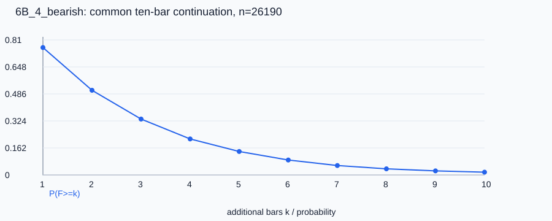

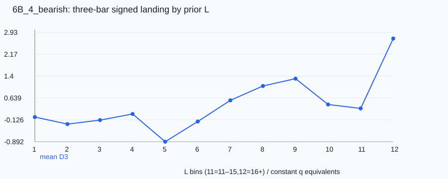

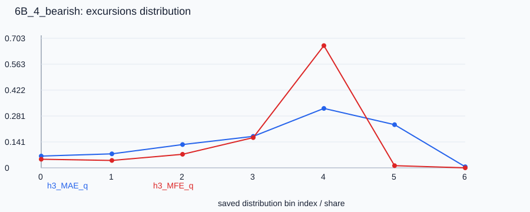

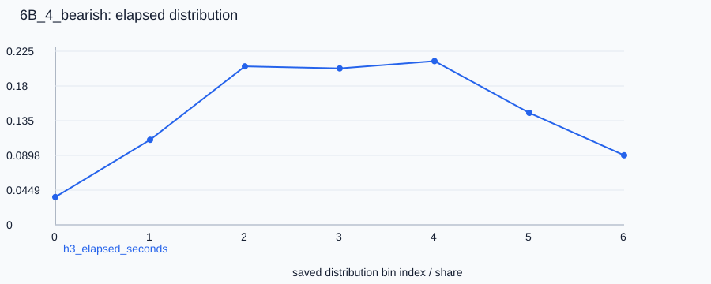

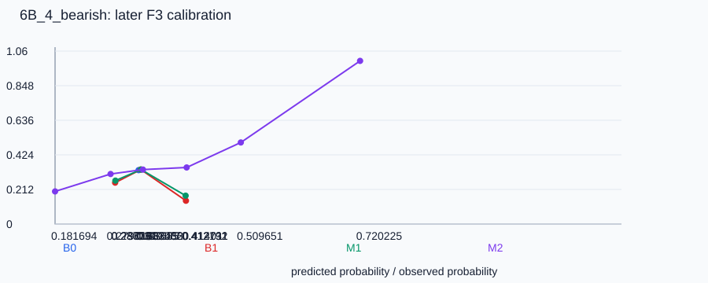

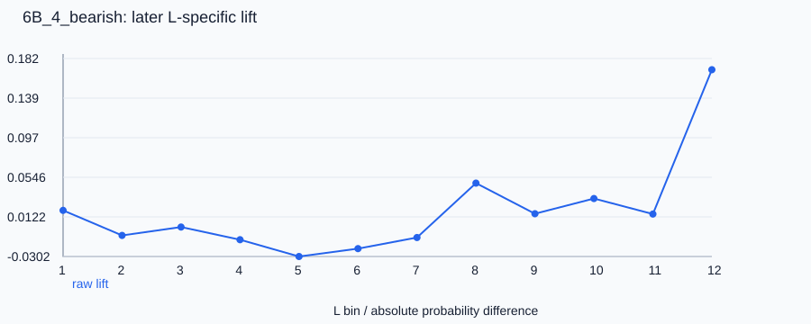

## 6B_4 bullish

| level | n | sparse | common3_n | common3_p1 | common3_p2 | common3_p3 | p3_low | p3_high | cap10_mean | cap10_median | unresolved_F |
| --- | --- | --- | --- | --- | --- | --- | --- | --- | --- | --- | --- |
| 1 | 7614 | False | 7228 | 0.8156 | 0.5356 | 0.3459 | 0.3356 | 0.3565 | 2.306 | 2 | 358 |
| 2 | 7924 | False | 7515 | 0.7333 | 0.4908 | 0.3253 | 0.3147 | 0.3363 | 2.127 | 1 | 332 |
| 3 | 5239 | False | 4986 | 0.7511 | 0.498 | 0.3207 | 0.308 | 0.3336 | 2.169 | 1 | 221 |
| 4 | 3517 | False | 3355 | 0.7386 | 0.4909 | 0.3225 | 0.3064 | 0.3372 | 2.18 | 1 | 133 |
| 5 | 2207 | False | 2108 | 0.7249 | 0.4478 | 0.2851 | 0.2659 | 0.3044 | 1.997 | 1 | 87 |
| 6 | 1470 | False | 1409 | 0.7516 | 0.4798 | 0.3052 | 0.2812 | 0.3288 | 2.068 | 1 | 56 |
| 7 | 926 | False | 894 | 0.7416 | 0.4955 | 0.3322 | 0.3014 | 0.3652 | 2.174 | 1 | 26 |
| 8 | 562 | False | 537 | 0.7374 | 0.4972 | 0.3184 | 0.2796 | 0.3582 | 2.086 | 2 | 22 |
| 9 | 342 | False | 327 | 0.7492 | 0.5015 | 0.3272 | 0.2774 | 0.3781 | 2.189 | 2 | 11 |
| 10 | 214 | False | 207 | 0.7343 | 0.4783 | 0.2512 | 0.1917 | 0.3134 | 1.952 | 1 | 6 |
| 11-15 | 408 | False | 394 | 0.7234 | 0.4518 | 0.3046 | 0.2594 | 0.3503 | 2.019 | 1 | 15 |
| 16+ | 45 | True | 44 | 0.7955 | 0.5909 | 0.3636 | 0.2285 | 0.5135 | 3.025 | 2 | 1 |

| level | n | sparse | D_q_mean | D_q_median | favourable | MAE_q_mean | MAE_q_p95 | MFE_q_mean | elapsed_seconds_mean |
| --- | --- | --- | --- | --- | --- | --- | --- | --- | --- |
| 1 | 6709 | False | 0.0322 | 0 | 0.4492 | 10.83 | 30 | 10.09 | 3286 |
| 2 | 7073 | False | -0.3185 | 0 | 0.4311 | 10.41 | 25 | 9.552 | 2801 |
| 3 | 4727 | False | -0.154 | 0 | 0.4309 | 10.17 | 25 | 9.629 | 2738 |
| 4 | 3153 | False | -0.1367 | 0 | 0.4377 | 10.3 | 25 | 9.644 | 2609 |
| 5 | 1998 | False | -0.7668 | 0 | 0.4169 | 10.64 | 25 | 9.268 | 2499 |
| 6 | 1312 | False | -0.4733 | 0 | 0.4154 | 10.3 | 25 | 9.585 | 2321 |
| 7 | 835 | False | 0.109 | 0 | 0.4431 | 10.19 | 25 | 9.659 | 2105 |
| 8 | 510 | False | -0.3392 | 0 | 0.4294 | 10.21 | 25 | 9.671 | 2183 |
| 9 | 305 | False | -0.4623 | 0 | 0.4164 | 10.46 | 25 | 9.649 | 2117 |
| 10 | 193 | False | -1.497 | 0 | 0.3472 | 10.04 | 25 | 9.249 | 1966 |
| 11-15 | 356 | False | -0.08989 | 0 | 0.4494 | 10.15 | 25 | 9.57 | 1880 |
| 16+ | 38 | True | 1.079 | 0 | 0.4737 | 9.316 | 25 | 10.26 | 1205 |

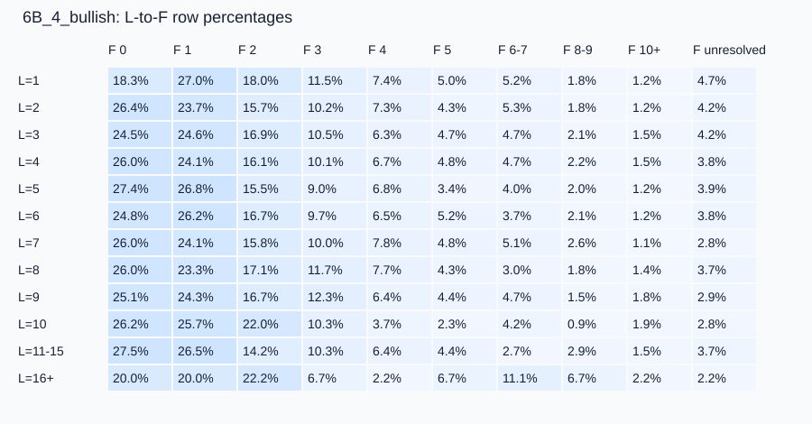

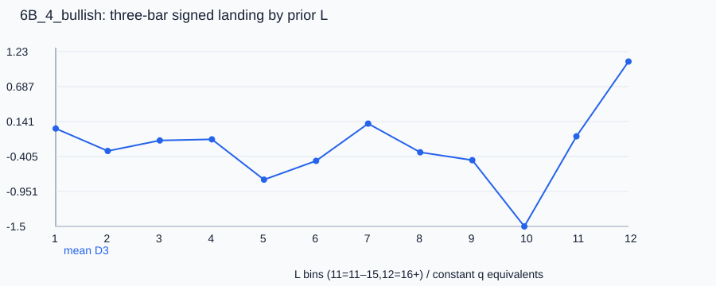

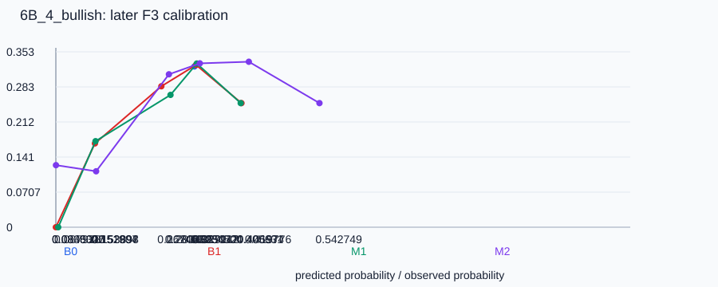

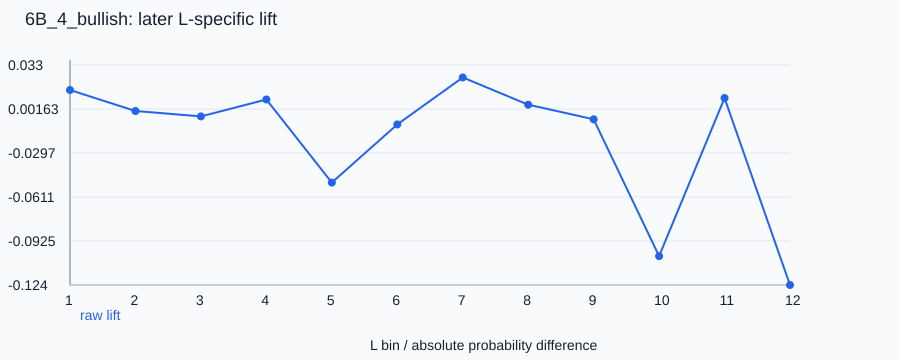

## 6B_5 bearish

| level | n | sparse | common3_n | common3_p1 | common3_p2 | common3_p3 | p3_low | p3_high | cap10_mean | cap10_median | unresolved_F |
| --- | --- | --- | --- | --- | --- | --- | --- | --- | --- | --- | --- |
| 1 | 5215 | False | 4820 | 0.8214 | 0.5237 | 0.3324 | 0.3185 | 0.3467 | 2.303 | 2 | 340 |
| 2 | 5392 | False | 5036 | 0.7486 | 0.5113 | 0.3396 | 0.3257 | 0.3529 | 2.234 | 2 | 307 |
| 3 | 3498 | False | 3293 | 0.7555 | 0.5047 | 0.328 | 0.3118 | 0.3444 | 2.244 | 2 | 184 |
| 4 | 2310 | False | 2156 | 0.7505 | 0.4903 | 0.3094 | 0.2906 | 0.3293 | 2.176 | 1 | 124 |
| 5 | 1523 | False | 1430 | 0.7301 | 0.486 | 0.3147 | 0.2897 | 0.3402 | 2.129 | 1 | 74 |
| 6 | 973 | False | 899 | 0.7864 | 0.5128 | 0.3382 | 0.3086 | 0.3671 | 2.24 | 2 | 50 |
| 7 | 648 | False | 610 | 0.7508 | 0.4967 | 0.318 | 0.2795 | 0.3558 | 2.043 | 1 | 32 |
| 8 | 421 | False | 390 | 0.7821 | 0.4974 | 0.341 | 0.2956 | 0.3872 | 2.28 | 2 | 28 |
| 9 | 256 | False | 243 | 0.7078 | 0.4774 | 0.3045 | 0.2468 | 0.3626 | 1.971 | 1 | 10 |
| 10 | 144 | False | 139 | 0.7842 | 0.4748 | 0.3237 | 0.2477 | 0.3984 | 2.137 | 1 | 5 |
| 11-15 | 233 | False | 215 | 0.7488 | 0.4698 | 0.3302 | 0.2629 | 0.3955 | 2.022 | 1 | 15 |
| 16+ | 30 | True | 30 | 0.6 | 0.4 | 0.2333 | 0.09091 | 0.3846 | 1.586 | 1 | 1 |

| level | n | sparse | D_q_mean | D_q_median | favourable | MAE_q_mean | MAE_q_p95 | MFE_q_mean | elapsed_seconds_mean |
| --- | --- | --- | --- | --- | --- | --- | --- | --- | --- |
| 1 | 4512 | False | -0.1177 | 0 | 0.4388 | 12.9 | 36 | 12.08 | 4017 |
| 2 | 4773 | False | 0.3013 | 0 | 0.4467 | 12.09 | 30 | 11.73 | 3497 |
| 3 | 3121 | False | -0.1237 | 0 | 0.4284 | 11.98 | 30 | 11.66 | 3329 |
| 4 | 2057 | False | -0.5177 | 0 | 0.4157 | 12.3 | 30 | 11.42 | 3323 |
| 5 | 1363 | False | -0.529 | 0 | 0.4233 | 12.6 | 30 | 11.48 | 3355 |
| 6 | 846 | False | 0.3913 | 0 | 0.422 | 11.57 | 30 | 11.69 | 3008 |
| 7 | 567 | False | -0.7654 | 0 | 0.3951 | 12.42 | 30 | 11.3 | 3180 |
| 8 | 368 | False | 0.8587 | 0 | 0.4484 | 11.27 | 30 | 11.96 | 3053 |
| 9 | 230 | False | -1.639 | 0 | 0.3957 | 13.15 | 30 | 11.19 | 3084 |
| 10 | 123 | False | 0.8374 | 0 | 0.4472 | 11.28 | 30 | 12.28 | 3122 |
| 11-15 | 193 | False | 0.03627 | 0 | 0.4508 | 12.57 | 30 | 11.51 | 2448 |
| 16+ | 26 | True | -4.577 | -12 | 0.2692 | 14.73 | 30 | 9.577 | 1123 |

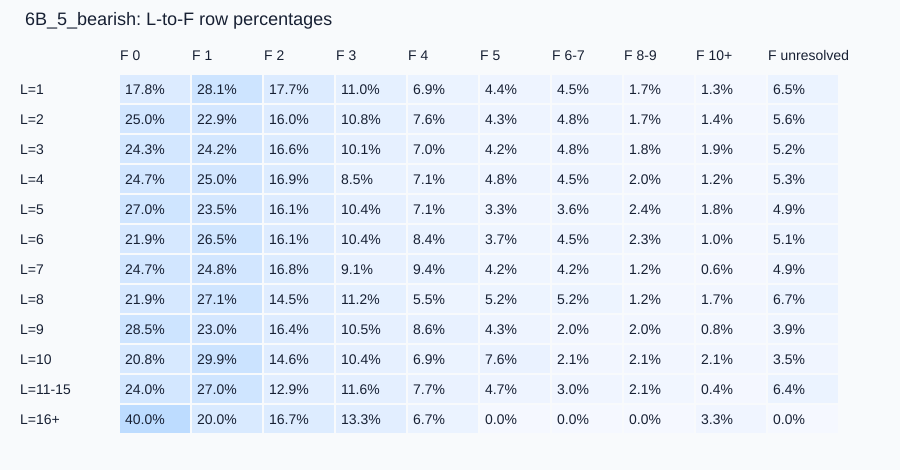

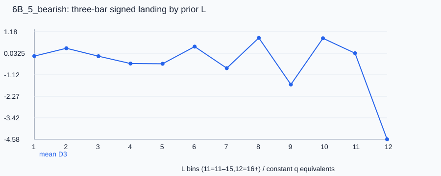

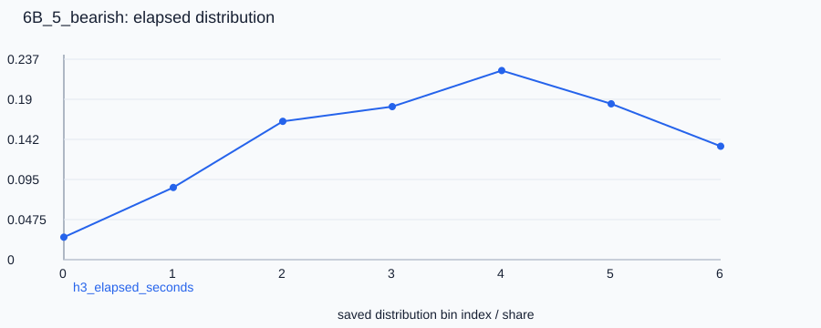

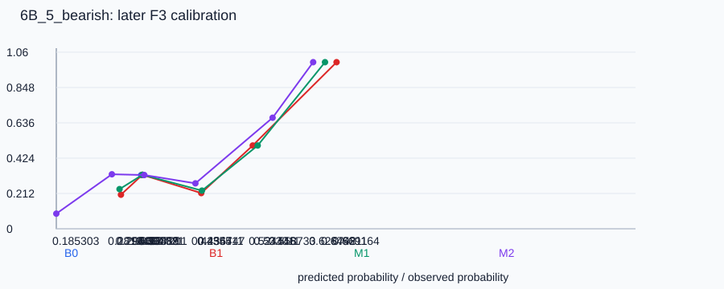

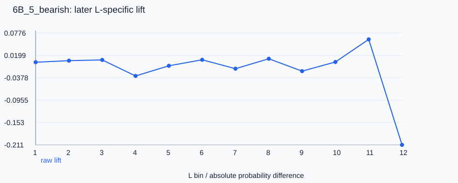

## 6B_5 bullish

| level | n | sparse | common3_n | common3_p1 | common3_p2 | common3_p3 | p3_low | p3_high | cap10_mean | cap10_median | unresolved_F |
| --- | --- | --- | --- | --- | --- | --- | --- | --- | --- | --- | --- |
| 1 | 5130 | False | 4733 | 0.8221 | 0.5364 | 0.3512 | 0.3373 | 0.3646 | 2.332 | 2 | 365 |
| 2 | 5482 | False | 5095 | 0.7458 | 0.5083 | 0.3346 | 0.3217 | 0.3477 | 2.204 | 2 | 317 |
| 3 | 3606 | False | 3371 | 0.7384 | 0.4782 | 0.3198 | 0.3042 | 0.335 | 2.15 | 1 | 203 |
| 4 | 2268 | False | 2124 | 0.7547 | 0.4953 | 0.3296 | 0.3103 | 0.3496 | 2.166 | 2 | 113 |
| 5 | 1599 | False | 1503 | 0.7445 | 0.4824 | 0.314 | 0.2896 | 0.3393 | 2.07 | 1 | 72 |
| 6 | 934 | False | 879 | 0.7383 | 0.5131 | 0.3322 | 0.3 | 0.364 | 2.205 | 2 | 55 |
| 7 | 586 | False | 557 | 0.7451 | 0.4847 | 0.307 | 0.2685 | 0.3449 | 2.146 | 1 | 25 |
| 8 | 401 | False | 378 | 0.7328 | 0.4894 | 0.3175 | 0.2699 | 0.3646 | 2 | 1 | 20 |
| 9 | 237 | False | 228 | 0.7763 | 0.5044 | 0.3246 | 0.2636 | 0.3868 | 2.217 | 2 | 11 |
| 10 | 167 | False | 157 | 0.7389 | 0.4459 | 0.293 | 0.2229 | 0.366 | 1.97 | 1 | 7 |
| 11-15 | 258 | False | 241 | 0.751 | 0.4938 | 0.2988 | 0.243 | 0.3577 | 2.121 | 1 | 17 |
| 16+ | 35 | True | 34 | 0.7941 | 0.4706 | 0.4412 | 0.2727 | 0.5946 | 2.412 | 1 | 1 |

| level | n | sparse | D_q_mean | D_q_median | favourable | MAE_q_mean | MAE_q_p95 | MFE_q_mean | elapsed_seconds_mean |
| --- | --- | --- | --- | --- | --- | --- | --- | --- | --- |
| 1 | 4437 | False | 0.1551 | 0 | 0.4465 | 12.75 | 36 | 12.22 | 4109 |
| 2 | 4833 | False | 0.1405 | 0 | 0.4389 | 12.23 | 30 | 11.65 | 3648 |
| 3 | 3194 | False | -0.4396 | 0 | 0.4311 | 12.58 | 30 | 11.41 | 3491 |
| 4 | 2013 | False | 0.08197 | 0 | 0.4386 | 12.19 | 30 | 11.7 | 3277 |
| 5 | 1411 | False | -0.4146 | 0 | 0.416 | 12.31 | 30 | 11.49 | 3094 |
| 6 | 830 | False | -0.3108 | 0 | 0.4313 | 12.35 | 30 | 11.65 | 3024 |
| 7 | 528 | False | -0.7027 | 0 | 0.4242 | 12.65 | 30 | 11.54 | 3001 |
| 8 | 367 | False | -0.1253 | 0 | 0.436 | 12.37 | 30 | 11.65 | 2995 |
| 9 | 212 | False | -0.4906 | 0 | 0.4009 | 12.01 | 30 | 11.83 | 2976 |
| 10 | 146 | False | -1.075 | 0 | 0.4247 | 12.93 | 30 | 11.16 | 2775 |
| 11-15 | 221 | False | -0.1131 | 0 | 0.4208 | 11.44 | 30 | 11.72 | 1983 |
| 16+ | 26 | True | 4.346 | 12 | 0.5769 | 10.38 | 24.75 | 12.73 | 1349 |

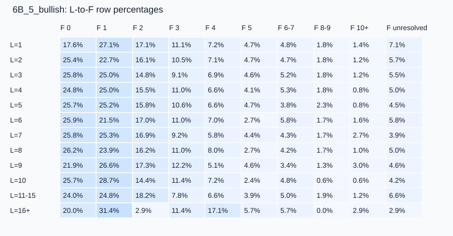

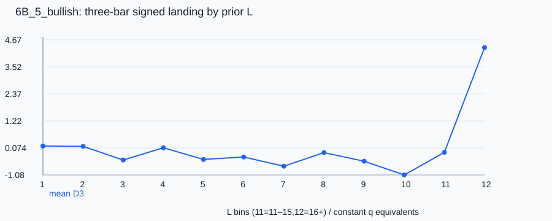

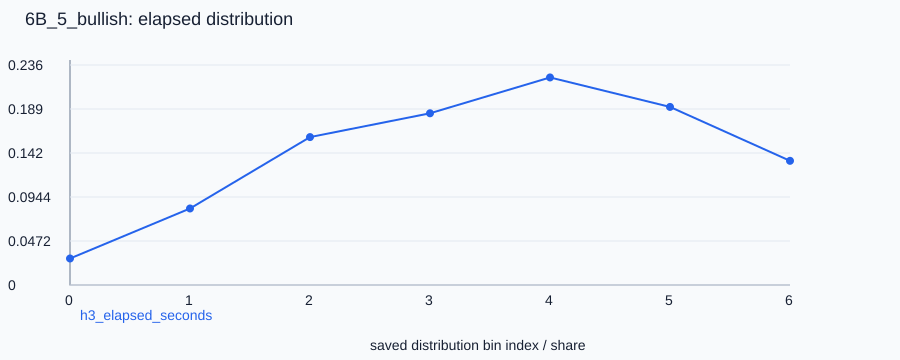

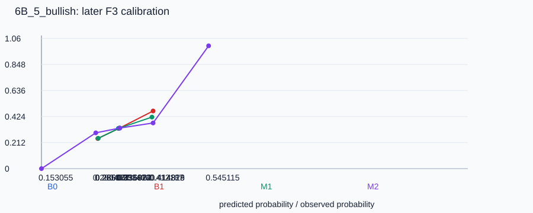

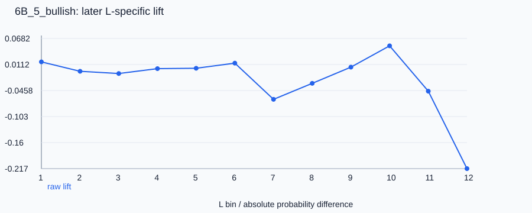

## 6E_4 bearish

| level | n | sparse | common3_n | common3_p1 | common3_p2 | common3_p3 | p3_low | p3_high | cap10_mean | cap10_median | unresolved_F |
| --- | --- | --- | --- | --- | --- | --- | --- | --- | --- | --- | --- |
| 1 | 16547 | False | 16143 | 0.809 | 0.529 | 0.3415 | 0.334 | 0.349 | 2.27 | 2 | 326 |
| 2 | 17650 | False | 17236 | 0.7458 | 0.4948 | 0.3232 | 0.3161 | 0.3302 | 2.13 | 1 | 326 |
| 3 | 11658 | False | 11414 | 0.7502 | 0.4808 | 0.3153 | 0.3066 | 0.3237 | 2.125 | 1 | 195 |
| 4 | 7489 | False | 7342 | 0.746 | 0.489 | 0.3208 | 0.31 | 0.3317 | 2.12 | 1 | 125 |
| 5 | 4840 | False | 4724 | 0.7521 | 0.4911 | 0.323 | 0.3101 | 0.3368 | 2.158 | 1 | 91 |
| 6 | 3190 | False | 3121 | 0.7414 | 0.4838 | 0.314 | 0.298 | 0.33 | 2.108 | 1 | 49 |
| 7 | 2048 | False | 2020 | 0.752 | 0.4792 | 0.3163 | 0.2976 | 0.3359 | 2.127 | 1 | 22 |
| 8 | 1315 | False | 1293 | 0.7448 | 0.4872 | 0.3148 | 0.29 | 0.3407 | 2.043 | 1 | 19 |
| 9 | 845 | False | 825 | 0.76 | 0.503 | 0.3152 | 0.2835 | 0.3471 | 2.159 | 2 | 18 |
| 10 | 515 | False | 509 | 0.7505 | 0.4892 | 0.3242 | 0.2854 | 0.364 | 2.204 | 1 | 7 |
| 11-15 | 928 | False | 915 | 0.7311 | 0.4907 | 0.318 | 0.2885 | 0.3475 | 2.1 | 1 | 12 |
| 16+ | 112 | False | 112 | 0.7857 | 0.5625 | 0.3482 | 0.2631 | 0.4336 | 2.541 | 2 | 0 |

| level | n | sparse | D_q_mean | D_q_median | favourable | MAE_q_mean | MAE_q_p95 | MFE_q_mean | elapsed_seconds_mean |
| --- | --- | --- | --- | --- | --- | --- | --- | --- | --- |
| 1 | 15022 | False | -0.3885 | 0 | 0.438 | 11.18 | 30 | 9.976 | 1634 |
| 2 | 16377 | False | -0.198 | 0 | 0.429 | 10.19 | 25 | 9.623 | 1466 |
| 3 | 10859 | False | -0.2568 | 0 | 0.4271 | 10.24 | 25 | 9.552 | 1438 |
| 4 | 7004 | False | -0.01385 | 0 | 0.4325 | 10.16 | 25 | 9.647 | 1413 |
| 5 | 4479 | False | -0.001563 | 0 | 0.4367 | 10.1 | 25 | 9.674 | 1348 |
| 6 | 2970 | False | -0.1492 | 0 | 0.4316 | 10.31 | 25 | 9.617 | 1357 |
| 7 | 1898 | False | 0.1617 | 0 | 0.4442 | 10.08 | 25 | 9.71 | 1231 |
| 8 | 1203 | False | 0.2909 | 0 | 0.4364 | 10.14 | 25 | 9.691 | 1256 |
| 9 | 767 | False | -0.1512 | 0 | 0.4237 | 10.16 | 25 | 9.669 | 1151 |
| 10 | 466 | False | -0.4742 | 0 | 0.4185 | 10.27 | 25 | 9.609 | 1263 |
| 11-15 | 820 | False | -0.2695 | 0 | 0.439 | 10.49 | 25 | 9.585 | 924.1 |
| 16+ | 88 | True | 0.4659 | 0 | 0.4318 | 9.716 | 25 | 10.05 | 588.3 |

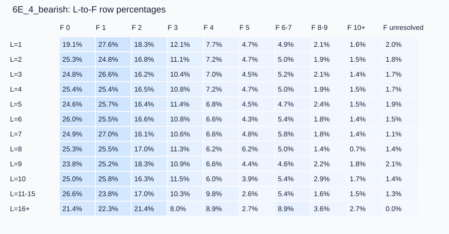

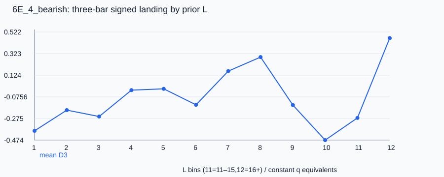

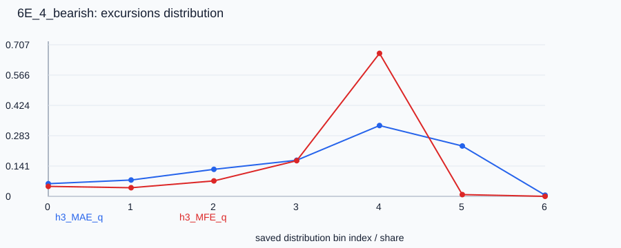

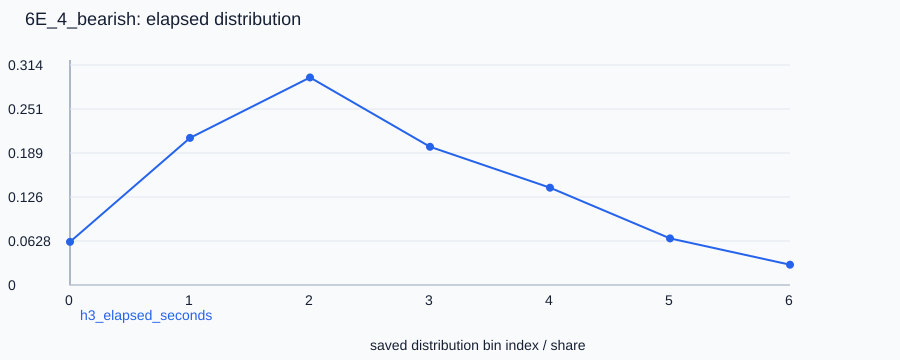

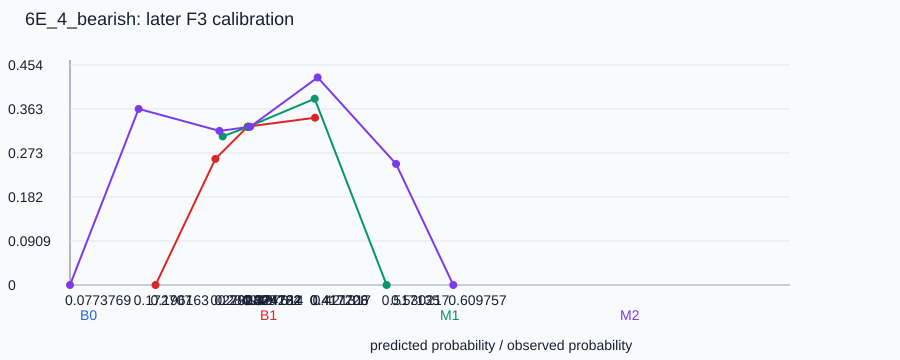

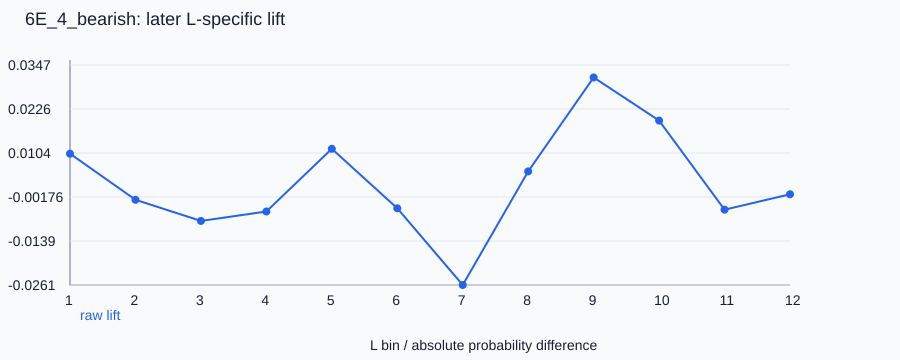

## 6E_4 bullish

| level | n | sparse | common3_n | common3_p1 | common3_p2 | common3_p3 | p3_low | p3_high | cap10_mean | cap10_median | unresolved_F |
| --- | --- | --- | --- | --- | --- | --- | --- | --- | --- | --- | --- |
| 1 | 16307 | False | 15920 | 0.8062 | 0.5293 | 0.3416 | 0.3342 | 0.3487 | 2.297 | 2 | 324 |
| 2 | 17809 | False | 17378 | 0.7412 | 0.4807 | 0.3124 | 0.3054 | 0.3199 | 2.088 | 1 | 332 |
| 3 | 11598 | False | 11358 | 0.7471 | 0.4893 | 0.3164 | 0.3077 | 0.3245 | 2.127 | 1 | 189 |
| 4 | 7670 | False | 7513 | 0.7454 | 0.4907 | 0.321 | 0.3105 | 0.3321 | 2.151 | 1 | 123 |
| 5 | 4911 | False | 4807 | 0.7402 | 0.4785 | 0.3081 | 0.2955 | 0.3212 | 2.076 | 1 | 78 |
| 6 | 3148 | False | 3087 | 0.7331 | 0.4752 | 0.3019 | 0.2867 | 0.3173 | 2.012 | 1 | 56 |
| 7 | 2069 | False | 2029 | 0.7531 | 0.5116 | 0.3322 | 0.3118 | 0.3512 | 2.202 | 2 | 33 |
| 8 | 1353 | False | 1325 | 0.7374 | 0.4875 | 0.3155 | 0.2914 | 0.3397 | 2.079 | 1 | 30 |
| 9 | 828 | False | 816 | 0.7316 | 0.4743 | 0.3223 | 0.291 | 0.3533 | 2.033 | 1 | 12 |
| 10 | 537 | False | 528 | 0.7481 | 0.4943 | 0.3295 | 0.2892 | 0.3714 | 2.225 | 1 | 11 |
| 11-15 | 898 | False | 887 | 0.7373 | 0.5085 | 0.3191 | 0.2891 | 0.3488 | 2.132 | 2 | 6 |
| 16+ | 117 | False | 117 | 0.6923 | 0.4615 | 0.3333 | 0.2524 | 0.4202 | 2.078 | 1 | 1 |

| level | n | sparse | D_q_mean | D_q_median | favourable | MAE_q_mean | MAE_q_p95 | MFE_q_mean | elapsed_seconds_mean |
| --- | --- | --- | --- | --- | --- | --- | --- | --- | --- |
| 1 | 14787 | False | -0.491 | 0 | 0.4318 | 11.17 | 30 | 9.955 | 1691 |
| 2 | 16483 | False | -0.4723 | 0 | 0.4233 | 10.34 | 25 | 9.493 | 1483 |
| 3 | 10819 | False | -0.2412 | 0 | 0.4271 | 10.21 | 25 | 9.604 | 1461 |
| 4 | 7153 | False | 0.03383 | 0 | 0.4376 | 10.18 | 25 | 9.684 | 1426 |
| 5 | 4567 | False | -0.5465 | 0 | 0.4162 | 10.33 | 25 | 9.49 | 1380 |
| 6 | 2911 | False | -0.708 | 0 | 0.4091 | 10.45 | 25 | 9.44 | 1291 |
| 7 | 1902 | False | 0.1777 | 0 | 0.4343 | 10.01 | 25 | 9.83 | 1252 |
| 8 | 1246 | False | -0.1075 | 0 | 0.4294 | 10.37 | 25 | 9.619 | 1281 |
| 9 | 762 | False | 0.07218 | 0 | 0.4462 | 10.44 | 25 | 9.608 | 1100 |
| 10 | 494 | False | 0.04858 | 0 | 0.4312 | 10.19 | 25 | 9.709 | 1137 |
| 11-15 | 815 | False | 0.2515 | 0 | 0.4344 | 10.14 | 25 | 9.708 | 1046 |
| 16+ | 92 | True | -0.7935 | 0 | 0.4348 | 11.2 | 25 | 9.261 | 464.6 |

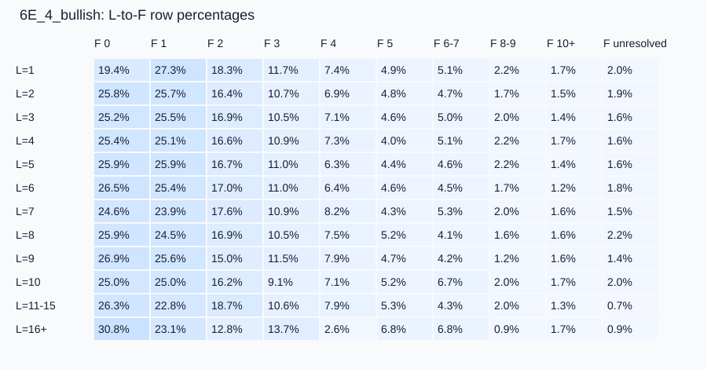

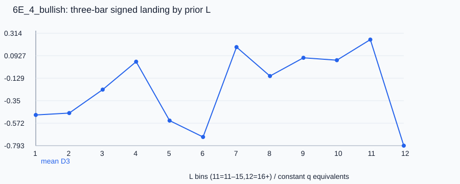

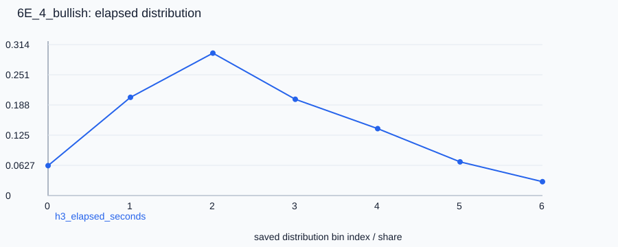

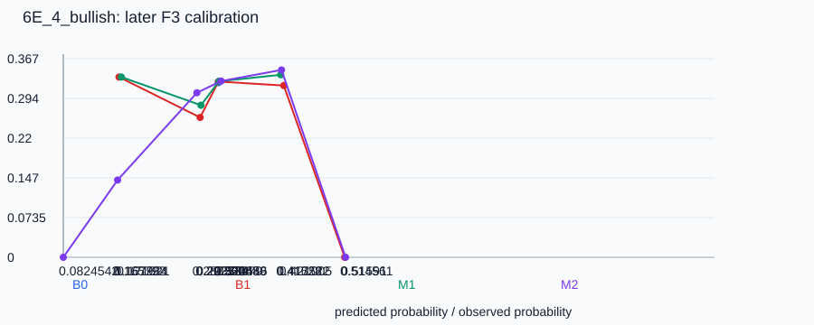

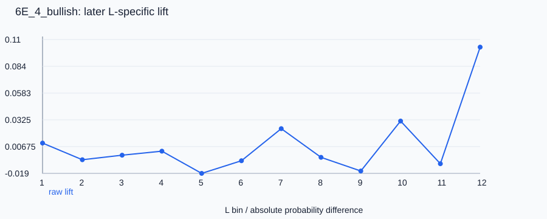

## 6E_5 bearish

| level | n | sparse | common3_n | common3_p1 | common3_p2 | common3_p3 | p3_low | p3_high | cap10_mean | cap10_median | unresolved_F |
| --- | --- | --- | --- | --- | --- | --- | --- | --- | --- | --- | --- |
| 1 | 11442 | False | 11070 | 0.8057 | 0.5307 | 0.3423 | 0.3331 | 0.3515 | 2.282 | 2 | 322 |
| 2 | 12172 | False | 11776 | 0.7481 | 0.4973 | 0.3279 | 0.319 | 0.3367 | 2.153 | 1 | 319 |
| 3 | 7977 | False | 7754 | 0.7515 | 0.4885 | 0.3143 | 0.304 | 0.324 | 2.114 | 1 | 193 |
| 4 | 5095 | False | 4920 | 0.7457 | 0.4913 | 0.3232 | 0.3097 | 0.3367 | 2.149 | 1 | 141 |
| 5 | 3346 | False | 3258 | 0.7468 | 0.4966 | 0.3214 | 0.3055 | 0.3374 | 2.161 | 1 | 81 |
| 6 | 2131 | False | 2077 | 0.754 | 0.4868 | 0.3178 | 0.2976 | 0.3384 | 2.154 | 1 | 51 |
| 7 | 1411 | False | 1360 | 0.7441 | 0.4875 | 0.3199 | 0.2953 | 0.3446 | 2.135 | 1 | 42 |
| 8 | 878 | False | 853 | 0.7479 | 0.4642 | 0.3142 | 0.2833 | 0.345 | 2.074 | 1 | 22 |
| 9 | 626 | False | 607 | 0.7249 | 0.4646 | 0.2998 | 0.2636 | 0.3345 | 2.08 | 1 | 17 |
| 10 | 381 | False | 375 | 0.7467 | 0.4853 | 0.3067 | 0.2619 | 0.3531 | 2.057 | 1 | 4 |
| 11-15 | 609 | False | 601 | 0.792 | 0.5175 | 0.3428 | 0.3057 | 0.3811 | 2.263 | 2 | 8 |
| 16+ | 84 | True | 83 | 0.7952 | 0.5542 | 0.3614 | 0.2667 | 0.4615 | 2.684 | 2 | 2 |

| level | n | sparse | D_q_mean | D_q_median | favourable | MAE_q_mean | MAE_q_p95 | MFE_q_mean | elapsed_seconds_mean |
| --- | --- | --- | --- | --- | --- | --- | --- | --- | --- |
| 1 | 10438 | False | -0.3409 | 0 | 0.44 | 13.31 | 36 | 12.04 | 2208 |
| 2 | 11207 | False | -0.1644 | 0 | 0.4316 | 12.23 | 30 | 11.59 | 1977 |
| 3 | 7394 | False | -0.1081 | 0 | 0.4289 | 12.18 | 30 | 11.59 | 1993 |
| 4 | 4681 | False | -0.03781 | 0 | 0.4384 | 12.17 | 30 | 11.65 | 1899 |
| 5 | 3093 | False | 0.1736 | 0 | 0.4397 | 12.19 | 30 | 11.74 | 1862 |
| 6 | 1967 | False | 0.003559 | 0 | 0.4398 | 12.12 | 30 | 11.63 | 1752 |
| 7 | 1276 | False | 0.5525 | 0 | 0.4514 | 12.27 | 30 | 11.8 | 1693 |
| 8 | 807 | False | -0.829 | 0 | 0.4188 | 12.61 | 30 | 11.4 | 1725 |
| 9 | 555 | False | -0.5225 | 0 | 0.4216 | 12.75 | 30 | 11.17 | 1601 |
| 10 | 352 | False | -0.1847 | 0 | 0.429 | 12 | 30 | 11.45 | 1373 |
| 11-15 | 543 | False | 0.8987 | 0 | 0.4475 | 11.49 | 30 | 11.99 | 1372 |
| 16+ | 73 | True | 2.027 | 0 | 0.4932 | 10.6 | 30 | 12.42 | 733 |

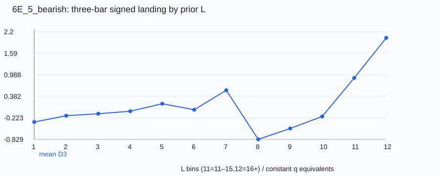

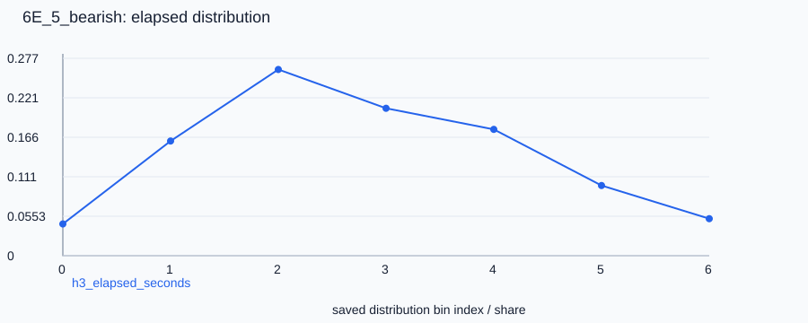

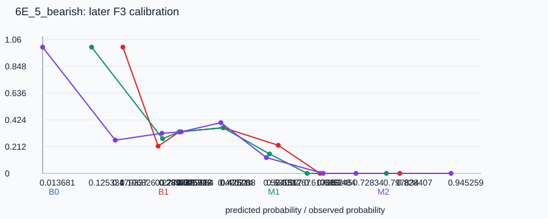

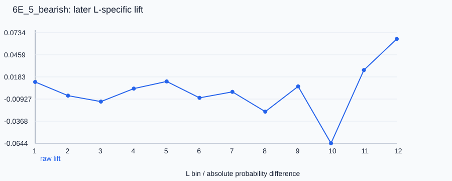

## 6E_5 bullish

| level | n | sparse | common3_n | common3_p1 | common3_p2 | common3_p3 | p3_low | p3_high | cap10_mean | cap10_median | unresolved_F |
| --- | --- | --- | --- | --- | --- | --- | --- | --- | --- | --- | --- |
| 1 | 11262 | False | 10913 | 0.8079 | 0.529 | 0.3376 | 0.3286 | 0.3464 | 2.288 | 2 | 302 |
| 2 | 12170 | False | 11786 | 0.7342 | 0.483 | 0.3193 | 0.311 | 0.3273 | 2.102 | 1 | 308 |
| 3 | 8033 | False | 7777 | 0.7525 | 0.494 | 0.327 | 0.3163 | 0.3367 | 2.199 | 1 | 209 |
| 4 | 5159 | False | 5010 | 0.7387 | 0.4818 | 0.3088 | 0.2966 | 0.3218 | 2.101 | 1 | 111 |
| 5 | 3402 | False | 3301 | 0.7467 | 0.4862 | 0.3145 | 0.2978 | 0.3299 | 2.098 | 1 | 84 |
| 6 | 2238 | False | 2178 | 0.7489 | 0.4803 | 0.3081 | 0.2895 | 0.3276 | 2.08 | 1 | 56 |
| 7 | 1475 | False | 1428 | 0.7213 | 0.4629 | 0.2899 | 0.266 | 0.314 | 2.018 | 1 | 40 |
| 8 | 889 | False | 859 | 0.7672 | 0.5052 | 0.3329 | 0.3012 | 0.3625 | 2.198 | 2 | 25 |
| 9 | 576 | False | 562 | 0.7616 | 0.4947 | 0.3149 | 0.2782 | 0.3507 | 2.148 | 1 | 12 |
| 10 | 377 | False | 369 | 0.7669 | 0.5122 | 0.3225 | 0.2743 | 0.3729 | 2.114 | 2 | 10 |
| 11-15 | 581 | False | 567 | 0.746 | 0.4762 | 0.3175 | 0.2805 | 0.357 | 2.044 | 1 | 18 |
| 16+ | 82 | True | 81 | 0.7407 | 0.5309 | 0.3457 | 0.2468 | 0.4512 | 2.104 | 2 | 1 |

| level | n | sparse | D_q_mean | D_q_median | favourable | MAE_q_mean | MAE_q_p95 | MFE_q_mean | elapsed_seconds_mean |
| --- | --- | --- | --- | --- | --- | --- | --- | --- | --- |
| 1 | 10219 | False | -0.6644 | 0 | 0.4296 | 13.36 | 36 | 11.99 | 2328 |
| 2 | 11230 | False | -0.4363 | 0 | 0.4287 | 12.53 | 30 | 11.46 | 1995 |
| 3 | 7442 | False | -0.159 | 0 | 0.4286 | 12.25 | 30 | 11.6 | 1955 |
| 4 | 4791 | False | -0.5256 | 0 | 0.4218 | 12.49 | 30 | 11.48 | 1912 |
| 5 | 3164 | False | 0.0689 | 0 | 0.4377 | 12.26 | 30 | 11.63 | 1830 |
| 6 | 2071 | False | -0.3728 | 0 | 0.4249 | 12.15 | 30 | 11.52 | 1797 |
| 7 | 1352 | False | -0.8595 | 0 | 0.4135 | 12.88 | 30 | 11.36 | 1684 |
| 8 | 820 | False | 0.8866 | 0 | 0.4573 | 11.69 | 30 | 12.04 | 1596 |
| 9 | 528 | False | -0.1496 | 0 | 0.4242 | 11.99 | 30 | 11.63 | 1572 |
| 10 | 347 | False | 0.7867 | 0 | 0.4611 | 11.69 | 30 | 12.06 | 1386 |
| 11-15 | 518 | False | 0.1236 | 0 | 0.4363 | 12.21 | 30 | 11.66 | 1231 |
| 16+ | 69 | True | -1.232 | 0 | 0.4058 | 12.54 | 30 | 11.51 | 1172 |

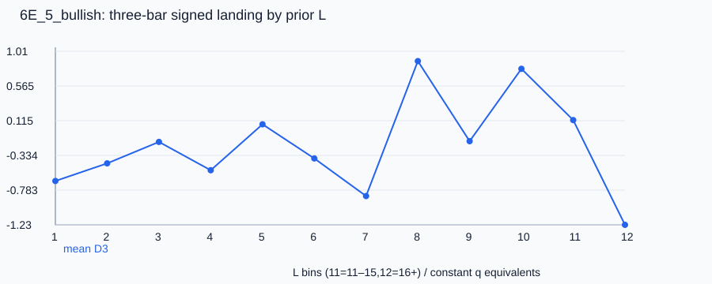

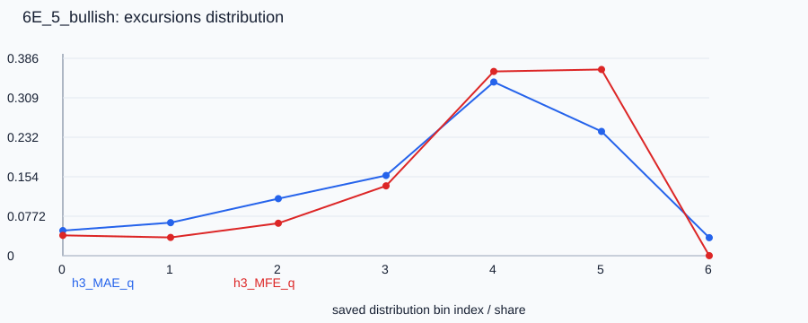

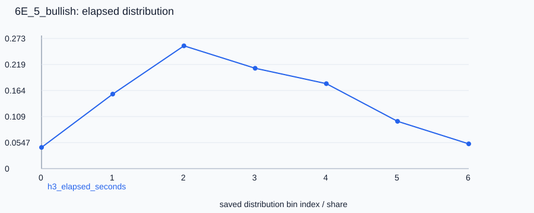

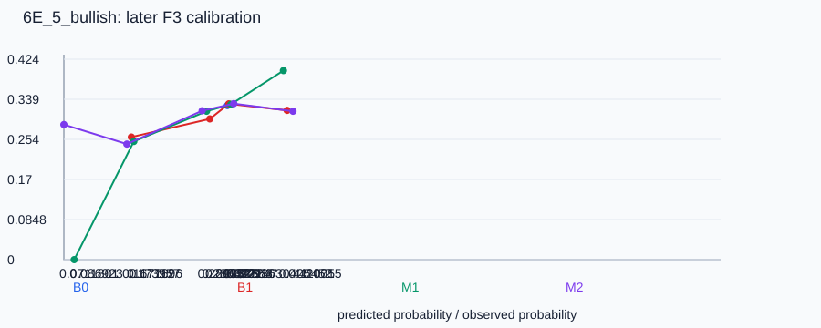

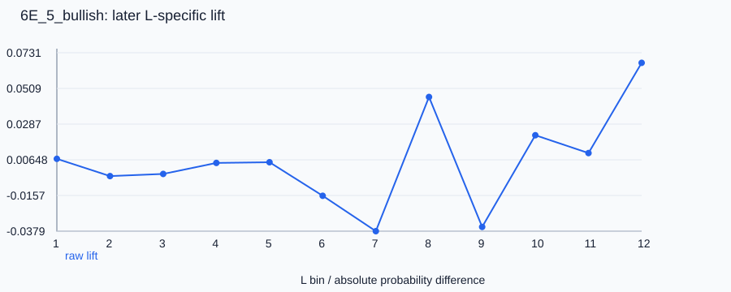

## 6J_4 bearish

| level | n | sparse | common3_n | common3_p1 | common3_p2 | common3_p3 | p3_low | p3_high | cap10_mean | cap10_median | unresolved_F |
| --- | --- | --- | --- | --- | --- | --- | --- | --- | --- | --- | --- |
| 1 | 9531 | False | 9079 | 0.8154 | 0.5473 | 0.358 | 0.3486 | 0.368 | 2.352 | 2 | 411 |
| 2 | 9884 | False | 9487 | 0.7428 | 0.5075 | 0.3451 | 0.3354 | 0.355 | 2.233 | 2 | 339 |
| 3 | 6469 | False | 6236 | 0.738 | 0.4809 | 0.3138 | 0.3014 | 0.3254 | 2.1 | 1 | 215 |
| 4 | 4267 | False | 4114 | 0.7394 | 0.4912 | 0.315 | 0.301 | 0.3295 | 2.138 | 1 | 152 |
| 5 | 2841 | False | 2763 | 0.738 | 0.4853 | 0.3076 | 0.2912 | 0.3247 | 2.059 | 1 | 86 |
| 6 | 1774 | False | 1720 | 0.7331 | 0.4855 | 0.3157 | 0.2928 | 0.3376 | 2.11 | 1 | 52 |
| 7 | 1159 | False | 1140 | 0.7404 | 0.4658 | 0.2965 | 0.2691 | 0.3238 | 2.041 | 1 | 19 |
| 8 | 788 | False | 777 | 0.7336 | 0.4762 | 0.305 | 0.274 | 0.3386 | 2.132 | 1 | 10 |
| 9 | 492 | False | 484 | 0.7748 | 0.5021 | 0.3099 | 0.2691 | 0.3526 | 2.219 | 2 | 9 |
| 10 | 318 | False | 310 | 0.7613 | 0.4419 | 0.2806 | 0.2313 | 0.3322 | 2.038 | 1 | 4 |
| 11-15 | 491 | False | 477 | 0.7568 | 0.5304 | 0.3564 | 0.3133 | 0.3992 | 2.379 | 2 | 10 |
| 16+ | 73 | True | 71 | 0.7606 | 0.6338 | 0.4507 | 0.3374 | 0.5732 | 2.718 | 2 | 2 |

| level | n | sparse | D_q_mean | D_q_median | favourable | MAE_q_mean | MAE_q_p95 | MFE_q_mean | elapsed_seconds_mean |
| --- | --- | --- | --- | --- | --- | --- | --- | --- | --- |
| 1 | 8250 | False | 0.08424 | 0 | 0.4499 | 11.27 | 30 | 10.55 | 2960 |
| 2 | 8711 | False | 0.4601 | 0 | 0.46 | 10.49 | 25 | 10.16 | 2595 |
| 3 | 5723 | False | -0.2154 | 0 | 0.4349 | 10.57 | 25 | 9.903 | 2471 |
| 4 | 3801 | False | -0.3178 | 0 | 0.4246 | 10.61 | 25 | 9.961 | 2441 |
| 5 | 2556 | False | -0.3517 | 0 | 0.4186 | 10.65 | 25 | 9.895 | 2252 |
| 6 | 1574 | False | -0.4612 | 0 | 0.4219 | 10.48 | 25 | 9.828 | 2120 |
| 7 | 1028 | False | -0.6955 | 0 | 0.4095 | 10.68 | 25 | 9.751 | 1900 |
| 8 | 691 | False | -0.822 | 0 | 0.4124 | 10.87 | 25 | 9.928 | 1845 |
| 9 | 429 | False | 1.242 | 0 | 0.4685 | 9.58 | 25 | 10.34 | 1760 |
| 10 | 271 | False | -0.2177 | 0 | 0.4354 | 10.82 | 25 | 9.797 | 1916 |
| 11-15 | 406 | False | 0.4138 | 0 | 0.4606 | 9.993 | 25 | 10.14 | 1176 |
| 16+ | 40 | True | 0.275 | 0 | 0.475 | 10.15 | 25.05 | 10.43 | 748.2 |

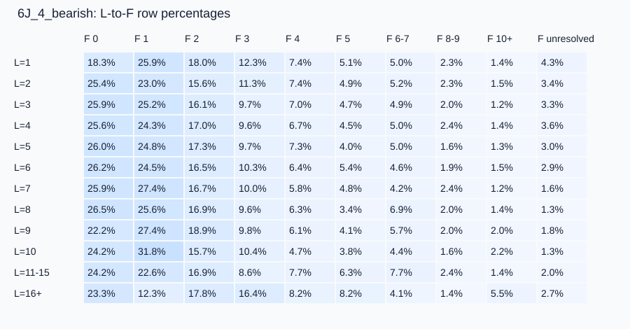

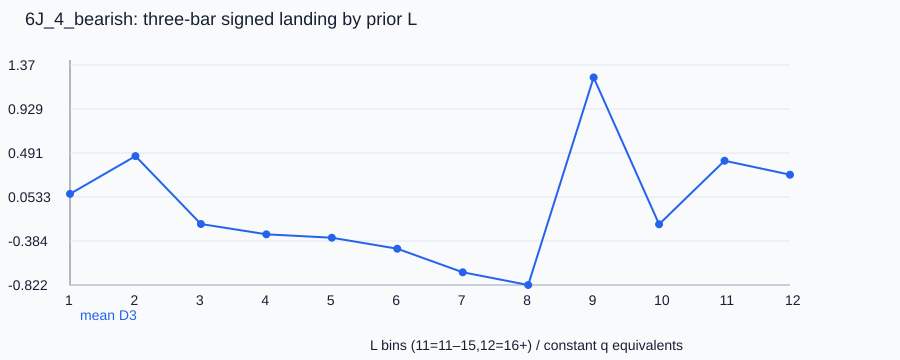

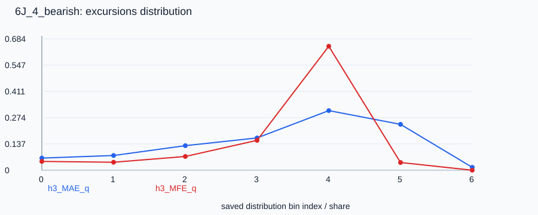

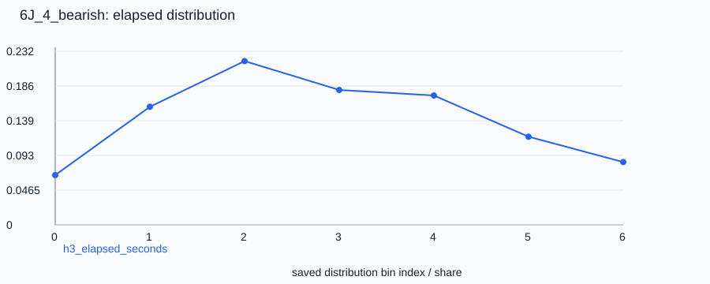

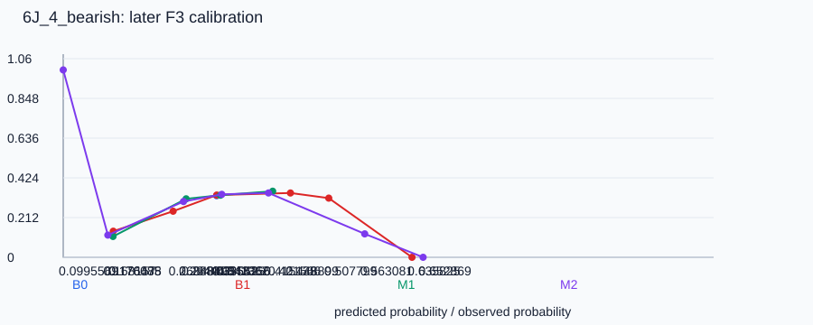

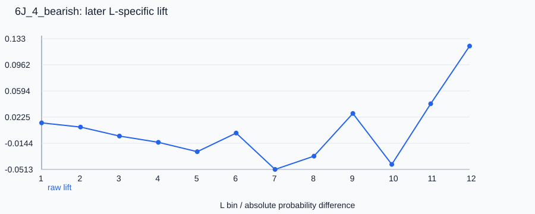

## 6J_4 bullish

| level | n | sparse | common3_n | common3_p1 | common3_p2 | common3_p3 | p3_low | p3_high | cap10_mean | cap10_median | unresolved_F |
| --- | --- | --- | --- | --- | --- | --- | --- | --- | --- | --- | --- |
| 1 | 9388 | False | 9077 | 0.813 | 0.5299 | 0.3437 | 0.3334 | 0.3543 | 2.317 | 2 | 236 |
| 2 | 9702 | False | 9306 | 0.74 | 0.497 | 0.3312 | 0.3217 | 0.3404 | 2.206 | 2 | 251 |
| 3 | 6541 | False | 6255 | 0.7452 | 0.4854 | 0.3191 | 0.3074 | 0.3312 | 2.149 | 1 | 217 |
| 4 | 4233 | False | 4041 | 0.7431 | 0.4895 | 0.3187 | 0.3041 | 0.3327 | 2.14 | 1 | 148 |
| 5 | 2770 | False | 2672 | 0.7223 | 0.4757 | 0.314 | 0.2963 | 0.3326 | 2.154 | 1 | 75 |
| 6 | 1879 | False | 1813 | 0.749 | 0.4843 | 0.3205 | 0.2976 | 0.3424 | 2.161 | 1 | 50 |
| 7 | 1183 | False | 1143 | 0.7349 | 0.4899 | 0.3263 | 0.3006 | 0.3537 | 2.062 | 1 | 31 |
| 8 | 817 | False | 782 | 0.7737 | 0.5141 | 0.312 | 0.2808 | 0.3441 | 2.202 | 2 | 19 |
| 9 | 512 | False | 495 | 0.7576 | 0.5071 | 0.3232 | 0.2825 | 0.3636 | 2.174 | 2 | 13 |
| 10 | 343 | False | 330 | 0.7697 | 0.5 | 0.3091 | 0.261 | 0.3571 | 2.04 | 2 | 13 |
| 11-15 | 481 | False | 463 | 0.7473 | 0.5097 | 0.311 | 0.2691 | 0.3534 | 2.141 | 2 | 14 |
| 16+ | 68 | True | 68 | 0.8676 | 0.6176 | 0.4706 | 0.3461 | 0.5867 | 3.485 | 2 | 0 |

| level | n | sparse | D_q_mean | D_q_median | favourable | MAE_q_mean | MAE_q_p95 | MFE_q_mean | elapsed_seconds_mean |
| --- | --- | --- | --- | --- | --- | --- | --- | --- | --- |
| 1 | 8141 | False | -0.1156 | 0 | 0.4428 | 11.29 | 30 | 10.43 | 2532 |
| 2 | 8528 | False | -0.2011 | 0 | 0.4369 | 10.77 | 25 | 10.04 | 2529 |
| 3 | 5745 | False | -0.6345 | 0 | 0.4212 | 10.81 | 25 | 9.819 | 2563 |
| 4 | 3735 | False | -0.4011 | 0 | 0.4241 | 10.65 | 25 | 9.885 | 2530 |
| 5 | 2453 | False | -0.5703 | 0 | 0.4309 | 11.01 | 25 | 9.789 | 2459 |
| 6 | 1661 | False | -0.4479 | 0 | 0.4281 | 10.6 | 25 | 9.859 | 2405 |
| 7 | 1033 | False | -0.5431 | 0 | 0.4279 | 10.77 | 25 | 9.803 | 2236 |
| 8 | 701 | False | -0.5449 | 0 | 0.3951 | 10.15 | 25 | 9.832 | 2152 |
| 9 | 439 | False | 0.06606 | 0 | 0.4328 | 10.32 | 25 | 9.952 | 2008 |
| 10 | 288 | False | -0.8403 | 0 | 0.3958 | 10.45 | 25 | 9.885 | 2426 |
| 11-15 | 390 | False | -0.5538 | 0 | 0.4103 | 10.54 | 25 | 9.9 | 1919 |
| 16+ | 50 | True | 2.52 | 10 | 0.54 | 8.92 | 25 | 10.68 | 1003 |

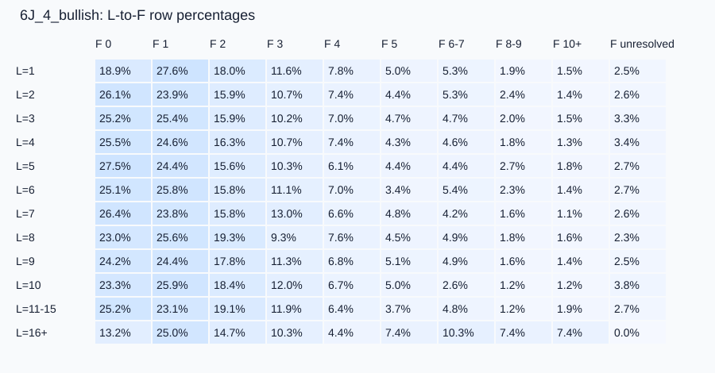

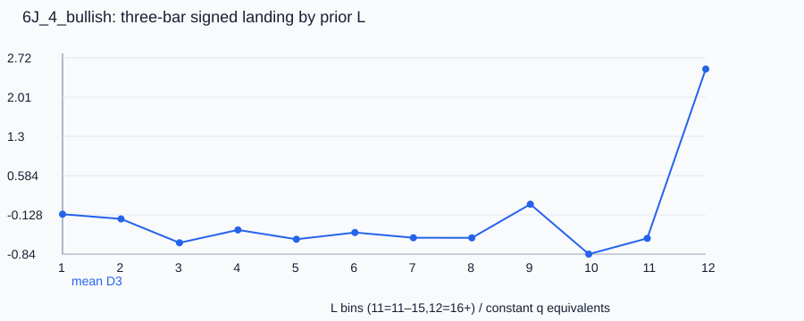

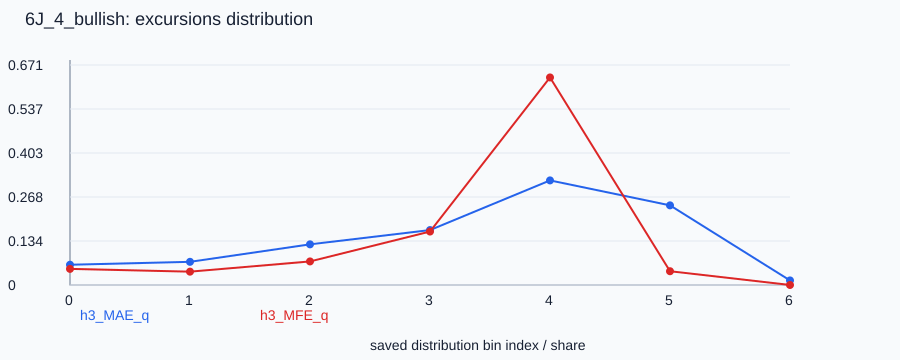

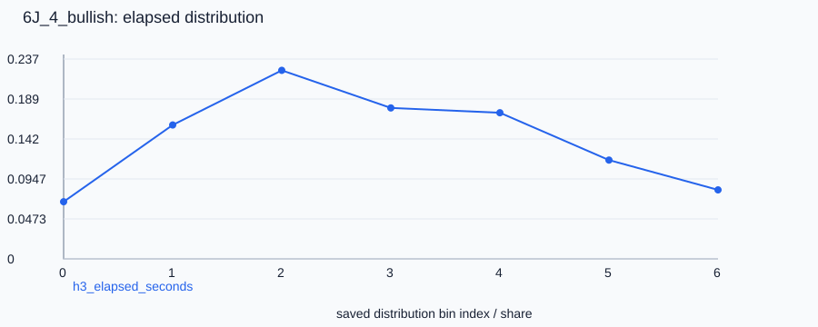

## 6J_5 bearish

| level | n | sparse | common3_n | common3_p1 | common3_p2 | common3_p3 | p3_low | p3_high | cap10_mean | cap10_median | unresolved_F |
| --- | --- | --- | --- | --- | --- | --- | --- | --- | --- | --- | --- |
| 1 | 6553 | False | 6123 | 0.8226 | 0.555 | 0.3609 | 0.3486 | 0.373 | 2.396 | 2 | 399 |
| 2 | 6717 | False | 6298 | 0.7428 | 0.5016 | 0.3388 | 0.3283 | 0.35 | 2.182 | 2 | 377 |
| 3 | 4473 | False | 4249 | 0.7416 | 0.4851 | 0.3333 | 0.3192 | 0.348 | 2.187 | 1 | 231 |
| 4 | 2949 | False | 2787 | 0.7485 | 0.4862 | 0.3254 | 0.3085 | 0.3431 | 2.139 | 1 | 140 |
| 5 | 1927 | False | 1843 | 0.7396 | 0.4764 | 0.299 | 0.2787 | 0.3191 | 2.043 | 1 | 80 |
| 6 | 1274 | False | 1225 | 0.7347 | 0.4808 | 0.3086 | 0.2841 | 0.3342 | 2.142 | 1 | 47 |
| 7 | 831 | False | 796 | 0.7538 | 0.4837 | 0.3229 | 0.2919 | 0.3558 | 2.144 | 1 | 26 |
| 8 | 539 | False | 523 | 0.7667 | 0.478 | 0.3098 | 0.2732 | 0.3487 | 2.114 | 1 | 18 |
| 9 | 299 | False | 292 | 0.7877 | 0.4384 | 0.3116 | 0.2609 | 0.3633 | 2.098 | 1 | 8 |
| 10 | 235 | False | 225 | 0.7867 | 0.5556 | 0.3689 | 0.3077 | 0.4307 | 2.488 | 2 | 11 |
| 11-15 | 337 | False | 330 | 0.7394 | 0.4848 | 0.2909 | 0.2448 | 0.3399 | 2.032 | 1 | 8 |
| 16+ | 52 | True | 52 | 0.8846 | 0.6538 | 0.5 | 0.3684 | 0.64 | 3 | 3 | 0 |

| level | n | sparse | D_q_mean | D_q_median | favourable | MAE_q_mean | MAE_q_p95 | MFE_q_mean | elapsed_seconds_mean |
| --- | --- | --- | --- | --- | --- | --- | --- | --- | --- |
| 1 | 5590 | False | 0.5898 | 0 | 0.4589 | 13.09 | 36 | 12.79 | 3852 |
| 2 | 5802 | False | 0.2758 | 0 | 0.4495 | 12.66 | 30 | 12.14 | 3497 |
| 3 | 3927 | False | -0.3491 | 0 | 0.4398 | 12.94 | 30 | 11.83 | 3362 |
| 4 | 2602 | False | -0.06802 | 0 | 0.4427 | 12.81 | 30 | 12.03 | 3274 |
| 5 | 1713 | False | -0.4454 | 0 | 0.4262 | 12.71 | 30 | 11.9 | 3068 |
| 6 | 1116 | False | -1.476 | 0 | 0.4086 | 13.08 | 30 | 11.68 | 2712 |
| 7 | 726 | False | 0.09917 | 0 | 0.4449 | 12.59 | 30 | 12.12 | 2448 |
| 8 | 479 | False | -0.08768 | 0 | 0.4384 | 12.44 | 30 | 12.1 | 2381 |
| 9 | 261 | False | -1.314 | 0 | 0.4215 | 12.69 | 30 | 11.48 | 1856 |
| 10 | 207 | False | 1.372 | 0 | 0.4638 | 11.43 | 30 | 12.7 | 2047 |
| 11-15 | 282 | False | -1.443 | 0 | 0.4043 | 13.17 | 30 | 11.37 | 1610 |
| 16+ | 33 | True | 7.545 | 12 | 0.6667 | 7.939 | 25 | 13.97 | 522.5 |

## 6J_5 bullish

| level | n | sparse | common3_n | common3_p1 | common3_p2 | common3_p3 | p3_low | p3_high | cap10_mean | cap10_median | unresolved_F |
| --- | --- | --- | --- | --- | --- | --- | --- | --- | --- | --- | --- |
| 1 | 6368 | False | 6076 | 0.8101 | 0.5454 | 0.3496 | 0.3374 | 0.3621 | 2.363 | 2 | 217 |
| 2 | 6823 | False | 6423 | 0.7422 | 0.4977 | 0.3313 | 0.32 | 0.3426 | 2.203 | 2 | 282 |
| 3 | 4379 | False | 4136 | 0.7449 | 0.4901 | 0.3266 | 0.3122 | 0.341 | 2.219 | 1 | 175 |
| 4 | 2926 | False | 2768 | 0.7533 | 0.4971 | 0.327 | 0.3094 | 0.3458 | 2.21 | 1 | 120 |
| 5 | 1922 | False | 1820 | 0.7324 | 0.4808 | 0.3159 | 0.2937 | 0.3362 | 2.108 | 1 | 72 |
| 6 | 1263 | False | 1198 | 0.7604 | 0.5109 | 0.3264 | 0.2994 | 0.3544 | 2.247 | 2 | 51 |
| 7 | 809 | False | 772 | 0.7707 | 0.5155 | 0.3459 | 0.3132 | 0.379 | 2.259 | 2 | 28 |
| 8 | 515 | False | 489 | 0.726 | 0.4703 | 0.3067 | 0.2662 | 0.3478 | 1.972 | 1 | 26 |
| 9 | 331 | False | 314 | 0.7516 | 0.465 | 0.2866 | 0.2342 | 0.3372 | 2.185 | 1 | 16 |
| 10 | 192 | False | 178 | 0.7921 | 0.4775 | 0.3202 | 0.25 | 0.388 | 2.11 | 1 | 9 |
| 11-15 | 375 | False | 357 | 0.7787 | 0.507 | 0.3165 | 0.2693 | 0.3648 | 2.266 | 2 | 14 |
| 16+ | 49 | True | 46 | 0.8696 | 0.6087 | 0.5 | 0.3421 | 0.6512 | 2.93 | 3 | 2 |

| level | n | sparse | D_q_mean | D_q_median | favourable | MAE_q_mean | MAE_q_p95 | MFE_q_mean | elapsed_seconds_mean |
| --- | --- | --- | --- | --- | --- | --- | --- | --- | --- |
| 1 | 5537 | False | -0.2985 | 0 | 0.4369 | 13.7 | 36 | 12.65 | 3440 |
| 2 | 5930 | False | -0.2504 | 0 | 0.4386 | 12.77 | 30 | 11.98 | 3211 |
| 3 | 3820 | False | -0.3395 | 0 | 0.4327 | 12.67 | 30 | 11.94 | 3212 |
| 4 | 2566 | False | -0.5581 | 0 | 0.4182 | 12.52 | 30 | 11.93 | 3291 |
| 5 | 1659 | False | -1.051 | 0 | 0.4219 | 13.27 | 30 | 11.7 | 3333 |
| 6 | 1103 | False | -0.2647 | 0 | 0.4279 | 12.27 | 30 | 11.97 | 3021 |
| 7 | 699 | False | 0.1774 | 0 | 0.4292 | 11.91 | 30 | 12.15 | 2947 |
| 8 | 449 | False | -0.2739 | 0 | 0.4232 | 12.85 | 30 | 11.91 | 3081 |
| 9 | 286 | False | -1.647 | 0 | 0.3951 | 13.01 | 30 | 11.34 | 2604 |
| 10 | 156 | False | -1.109 | 0 | 0.3974 | 12.24 | 30 | 11.43 | 2136 |
| 11-15 | 311 | False | -0.6656 | 0 | 0.4084 | 11.71 | 30 | 11.79 | 2284 |
| 16+ | 29 | True | 0.6207 | 0 | 0.4138 | 10.17 | 27.6 | 13 | 1716 |

## 6S_4 bearish

| level | n | sparse | common3_n | common3_p1 | common3_p2 | common3_p3 | p3_low | p3_high | cap10_mean | cap10_median | unresolved_F |
| --- | --- | --- | --- | --- | --- | --- | --- | --- | --- | --- | --- |
| 1 | 10233 | False | 9838 | 0.8091 | 0.5318 | 0.3522 | 0.3432 | 0.3618 | 2.327 | 2 | 346 |
| 2 | 10665 | False | 10303 | 0.7565 | 0.4988 | 0.3345 | 0.3253 | 0.3433 | 2.225 | 1 | 308 |
| 3 | 7043 | False | 6798 | 0.7539 | 0.4993 | 0.34 | 0.3285 | 0.3506 | 2.228 | 2 | 216 |
| 4 | 4724 | False | 4576 | 0.7618 | 0.5092 | 0.3422 | 0.3286 | 0.3557 | 2.286 | 2 | 124 |
| 5 | 3046 | False | 2950 | 0.7583 | 0.5153 | 0.3349 | 0.3172 | 0.3512 | 2.277 | 2 | 89 |
| 6 | 2022 | False | 1964 | 0.7597 | 0.5158 | 0.3498 | 0.3281 | 0.3709 | 2.251 | 2 | 45 |
| 7 | 1352 | False | 1329 | 0.7524 | 0.4921 | 0.3348 | 0.3099 | 0.3604 | 2.154 | 1 | 24 |
| 8 | 969 | False | 939 | 0.7572 | 0.5101 | 0.3482 | 0.318 | 0.3792 | 2.303 | 2 | 26 |
| 9 | 605 | False | 588 | 0.7364 | 0.5034 | 0.3333 | 0.2942 | 0.3748 | 2.093 | 1 | 16 |
| 10 | 374 | False | 365 | 0.7699 | 0.5425 | 0.3534 | 0.3037 | 0.4034 | 2.431 | 2 | 5 |
| 11-15 | 664 | False | 650 | 0.76 | 0.5 | 0.3354 | 0.3006 | 0.3709 | 2.237 | 1 | 11 |
| 16+ | 103 | False | 102 | 0.8137 | 0.5882 | 0.4216 | 0.3243 | 0.5218 | 2.872 | 2 | 1 |

| level | n | sparse | D_q_mean | D_q_median | favourable | MAE_q_mean | MAE_q_p95 | MFE_q_mean | elapsed_seconds_mean |
| --- | --- | --- | --- | --- | --- | --- | --- | --- | --- |
| 1 | 9179 | False | -0.217 | 0 | 0.4711 | 12.78 | 35 | 11.81 | 2281 |
| 2 | 9790 | False | 0.05822 | 0 | 0.4632 | 11.76 | 28 | 11.54 | 1991 |
| 3 | 6492 | False | 0.3851 | 0 | 0.4791 | 11.7 | 29 | 11.56 | 1897 |
| 4 | 4380 | False | 0.4897 | 0 | 0.474 | 11.32 | 28 | 11.62 | 1775 |
| 5 | 2818 | False | 0.07346 | 0 | 0.4603 | 11.38 | 28 | 11.48 | 1657 |
| 6 | 1851 | False | 0.456 | 0 | 0.4684 | 11.32 | 28 | 11.57 | 1571 |
| 7 | 1262 | False | -0.3067 | 0 | 0.4604 | 11.89 | 28 | 11.3 | 1583 |
| 8 | 897 | False | 0.4415 | 0 | 0.4727 | 11.45 | 28 | 11.28 | 1405 |
| 9 | 542 | False | -0.06642 | 0 | 0.4594 | 11.66 | 28 | 11.09 | 1407 |
| 10 | 343 | False | -0.1749 | 0 | 0.4373 | 11.02 | 28 | 11.83 | 1160 |
| 11-15 | 596 | False | 0.1107 | 0 | 0.4849 | 11.18 | 28 | 11.24 | 1045 |
| 16+ | 89 | True | 4.517 | 10 | 0.5506 | 8.921 | 25 | 14 | 972.4 |

## 6S_4 bullish

| level | n | sparse | common3_n | common3_p1 | common3_p2 | common3_p3 | p3_low | p3_high | cap10_mean | cap10_median | unresolved_F |
| --- | --- | --- | --- | --- | --- | --- | --- | --- | --- | --- | --- |
| 1 | 9890 | False | 9555 | 0.8106 | 0.5418 | 0.3597 | 0.3497 | 0.3696 | 2.396 | 2 | 280 |
| 2 | 10885 | False | 10490 | 0.748 | 0.5044 | 0.3373 | 0.3276 | 0.3469 | 2.242 | 2 | 322 |
| 3 | 6980 | False | 6763 | 0.7488 | 0.4995 | 0.3356 | 0.3242 | 0.3475 | 2.226 | 2 | 187 |
| 4 | 4747 | False | 4576 | 0.7555 | 0.5017 | 0.3295 | 0.3159 | 0.3432 | 2.245 | 2 | 135 |
| 5 | 3177 | False | 3070 | 0.7433 | 0.4909 | 0.3293 | 0.3134 | 0.3452 | 2.185 | 1 | 93 |
| 6 | 2090 | False | 2026 | 0.7438 | 0.502 | 0.3371 | 0.3166 | 0.3583 | 2.173 | 2 | 59 |
| 7 | 1334 | False | 1291 | 0.7607 | 0.495 | 0.3222 | 0.2987 | 0.3472 | 2.203 | 2 | 30 |
| 8 | 878 | False | 853 | 0.7304 | 0.4877 | 0.3294 | 0.2971 | 0.3606 | 2.24 | 1 | 23 |
| 9 | 592 | False | 577 | 0.7296 | 0.4714 | 0.3033 | 0.267 | 0.3409 | 2.125 | 1 | 10 |
| 10 | 401 | False | 395 | 0.7595 | 0.5063 | 0.3241 | 0.2776 | 0.3692 | 2.211 | 2 | 5 |
| 11-15 | 643 | False | 629 | 0.7774 | 0.5231 | 0.3641 | 0.3275 | 0.402 | 2.441 | 2 | 12 |
| 16+ | 77 | True | 76 | 0.7763 | 0.5263 | 0.3684 | 0.2576 | 0.4844 | 2.581 | 2 | 2 |

| level | n | sparse | D_q_mean | D_q_median | favourable | MAE_q_mean | MAE_q_p95 | MFE_q_mean | elapsed_seconds_mean |
| --- | --- | --- | --- | --- | --- | --- | --- | --- | --- |
| 1 | 8935 | False | -0.09077 | 0 | 0.4729 | 12.62 | 35 | 11.87 | 2108 |
| 2 | 9946 | False | 0.04565 | 0 | 0.4652 | 11.83 | 29 | 11.49 | 1961 |
| 3 | 6429 | False | -0.05709 | 0 | 0.4638 | 11.77 | 28 | 11.46 | 1897 |
| 4 | 4330 | False | 0.179 | 0 | 0.4679 | 11.49 | 28 | 11.47 | 1818 |
| 5 | 2910 | False | 0.2722 | 0 | 0.4629 | 11.5 | 28 | 11.38 | 1751 |
| 6 | 1898 | False | 0.2861 | 0 | 0.4752 | 11.69 | 28 | 11.45 | 1628 |
| 7 | 1216 | False | 0.3947 | 0 | 0.4688 | 11.52 | 28 | 11.67 | 1702 |
| 8 | 799 | False | 0.2641 | 0 | 0.4706 | 11.67 | 27.1 | 11.27 | 1545 |
| 9 | 540 | False | -0.8889 | 0 | 0.4259 | 12.02 | 28 | 11.09 | 1603 |
| 10 | 371 | False | 0.8059 | 0 | 0.4528 | 10.98 | 27 | 11.2 | 1364 |
| 11-15 | 582 | False | 1.259 | 0 | 0.4983 | 10.49 | 27 | 11.6 | 1150 |
| 16+ | 64 | True | 2.359 | 0 | 0.4844 | 11.02 | 25.85 | 11.77 | 646.4 |

## 6S_5 bearish

| level | n | sparse | common3_n | common3_p1 | common3_p2 | common3_p3 | p3_low | p3_high | cap10_mean | cap10_median | unresolved_F |
| --- | --- | --- | --- | --- | --- | --- | --- | --- | --- | --- | --- |
| 1 | 7161 | False | 6794 | 0.8148 | 0.5409 | 0.3563 | 0.3457 | 0.3674 | 2.336 | 2 | 346 |
| 2 | 7700 | False | 7358 | 0.7586 | 0.5158 | 0.3406 | 0.3301 | 0.3516 | 2.252 | 2 | 281 |
| 3 | 5071 | False | 4825 | 0.7515 | 0.5001 | 0.3364 | 0.3226 | 0.3494 | 2.252 | 1 | 203 |
| 4 | 3245 | False | 3101 | 0.7604 | 0.5182 | 0.348 | 0.3303 | 0.3655 | 2.336 | 2 | 117 |
| 5 | 2219 | False | 2113 | 0.7672 | 0.5305 | 0.3554 | 0.3354 | 0.3753 | 2.238 | 2 | 92 |
| 6 | 1452 | False | 1391 | 0.7707 | 0.5083 | 0.3343 | 0.3096 | 0.3593 | 2.254 | 2 | 48 |
| 7 | 924 | False | 884 | 0.7466 | 0.5023 | 0.3281 | 0.2979 | 0.3604 | 2.243 | 1 | 33 |
| 8 | 641 | False | 609 | 0.7488 | 0.5074 | 0.3383 | 0.3011 | 0.3742 | 2.288 | 2 | 32 |
| 9 | 437 | False | 427 | 0.7564 | 0.5129 | 0.37 | 0.3238 | 0.4159 | 2.312 | 2 | 7 |
| 10 | 247 | False | 238 | 0.7395 | 0.479 | 0.3235 | 0.2639 | 0.3849 | 2.123 | 1 | 7 |
| 11-15 | 484 | False | 459 | 0.7691 | 0.5163 | 0.3312 | 0.2879 | 0.375 | 2.3 | 2 | 20 |
| 16+ | 70 | True | 68 | 0.8235 | 0.5735 | 0.3529 | 0.24 | 0.4754 | 2.537 | 2 | 1 |

| level | n | sparse | D_q_mean | D_q_median | favourable | MAE_q_mean | MAE_q_p95 | MFE_q_mean | elapsed_seconds_mean |
| --- | --- | --- | --- | --- | --- | --- | --- | --- | --- |
| 1 | 6377 | False | 0.2205 | 0 | 0.4711 | 14.71 | 41 | 14.18 | 2860 |
| 2 | 7016 | False | 0.09364 | 0 | 0.4638 | 13.84 | 33 | 13.69 | 2454 |
| 3 | 4630 | False | 0.08423 | 0 | 0.4672 | 13.92 | 33 | 13.5 | 2408 |
| 4 | 2959 | False | 0.5468 | 0 | 0.4721 | 13.31 | 32 | 13.71 | 2189 |
| 5 | 2014 | False | 1.001 | 0 | 0.4841 | 13.11 | 32 | 13.68 | 2073 |
| 6 | 1322 | False | 0.7398 | 0 | 0.4743 | 13.19 | 33 | 13.62 | 2043 |
| 7 | 834 | False | 0.04077 | 0 | 0.4532 | 13.56 | 32 | 13.42 | 1761 |
| 8 | 584 | False | 0.3613 | 0 | 0.4795 | 13.22 | 33 | 13.36 | 1718 |
| 9 | 405 | False | 0.7012 | 0 | 0.484 | 13.8 | 34.8 | 13.38 | 1713 |
| 10 | 225 | False | -1.262 | 0 | 0.4533 | 13.69 | 32 | 12.87 | 1484 |
| 11-15 | 423 | False | 0.6572 | 0 | 0.461 | 12.7 | 32 | 13.52 | 1373 |
| 16+ | 61 | True | 2.574 | 1 | 0.541 | 9.721 | 31 | 14.48 | 636.7 |

## 6S_5 bullish

| level | n | sparse | common3_n | common3_p1 | common3_p2 | common3_p3 | p3_low | p3_high | cap10_mean | cap10_median | unresolved_F |
| --- | --- | --- | --- | --- | --- | --- | --- | --- | --- | --- | --- |
| 1 | 7077 | False | 6712 | 0.8188 | 0.5451 | 0.3601 | 0.3481 | 0.3729 | 2.412 | 2 | 317 |
| 2 | 7550 | False | 7188 | 0.7539 | 0.5036 | 0.3321 | 0.3213 | 0.3426 | 2.209 | 2 | 308 |
| 3 | 5078 | False | 4863 | 0.7619 | 0.5061 | 0.3385 | 0.3252 | 0.3515 | 2.264 | 2 | 184 |
| 4 | 3418 | False | 3257 | 0.7565 | 0.4955 | 0.3344 | 0.3173 | 0.3507 | 2.24 | 1 | 142 |
| 5 | 2198 | False | 2109 | 0.7515 | 0.4979 | 0.3153 | 0.2959 | 0.3356 | 2.167 | 1 | 81 |
| 6 | 1409 | False | 1354 | 0.7393 | 0.4919 | 0.3257 | 0.3016 | 0.3505 | 2.229 | 2 | 39 |
| 7 | 982 | False | 946 | 0.7294 | 0.4683 | 0.3034 | 0.274 | 0.332 | 2.088 | 1 | 28 |
| 8 | 663 | False | 638 | 0.7508 | 0.5141 | 0.3245 | 0.2877 | 0.3634 | 2.289 | 2 | 21 |
| 9 | 399 | False | 384 | 0.776 | 0.526 | 0.3776 | 0.3281 | 0.4278 | 2.402 | 2 | 12 |
| 10 | 297 | False | 281 | 0.8043 | 0.5516 | 0.3701 | 0.3127 | 0.4265 | 2.438 | 2 | 11 |
| 11-15 | 426 | False | 408 | 0.7843 | 0.5564 | 0.3775 | 0.3326 | 0.4248 | 2.41 | 2 | 17 |
| 16+ | 51 | True | 48 | 0.8333 | 0.5417 | 0.4583 | 0.3095 | 0.6035 | 2.761 | 2 | 4 |

| level | n | sparse | D_q_mean | D_q_median | favourable | MAE_q_mean | MAE_q_p95 | MFE_q_mean | elapsed_seconds_mean |
| --- | --- | --- | --- | --- | --- | --- | --- | --- | --- |
| 1 | 6315 | False | 0.07427 | 0 | 0.4754 | 14.78 | 41 | 14.19 | 2738 |
| 2 | 6839 | False | -0.2499 | 0 | 0.4607 | 13.96 | 33 | 13.56 | 2450 |
| 3 | 4631 | False | 0.6608 | 0 | 0.4727 | 13.41 | 32 | 13.65 | 2240 |
| 4 | 3100 | False | -0.1484 | 0 | 0.4552 | 13.6 | 32.05 | 13.49 | 2295 |
| 5 | 2009 | False | -0.226 | 0 | 0.449 | 13.77 | 32 | 13.54 | 2279 |
| 6 | 1276 | False | 0.2226 | 0 | 0.4694 | 13.94 | 33 | 13.5 | 2316 |
| 7 | 895 | False | -1.159 | 0 | 0.4268 | 14.06 | 33 | 12.84 | 2081 |
| 8 | 604 | False | 0.1093 | 0 | 0.4437 | 13.08 | 32 | 13.46 | 1871 |
| 9 | 358 | False | 1.768 | 0 | 0.4972 | 12.43 | 32 | 13.67 | 1672 |
| 10 | 265 | False | 1.566 | 0 | 0.4755 | 12.18 | 31 | 13.82 | 1843 |
| 11-15 | 386 | False | 0.3705 | 0 | 0.4689 | 12.82 | 32 | 13.89 | 1361 |
| 16+ | 43 | True | 7.907 | 12 | 0.6279 | 10.84 | 24.9 | 15.26 | 982.3 |

## Computed source-row examples

## Saved numerical evidence and reproduction

All displayed values and figures are generated from saved CSV evidence. Event features and forward labels are separate columns with undefined flags and available_at. Event ledgers, input-row evidence and predictions are retained outside ordinary Git with schema/row counts/checksums in events.manifest.json after sealing. The staged and retained copies are local; off-device backup was not verified.

- [L-F-matrix.csv](tables/L-F-matrix.csv)
- [L2-L3-adjustment.csv](tables/L2-L3-adjustment.csv)
- [L2-L3-direct.csv](tables/L2-L3-direct.csv)
- [L2-L3-yearly-audit.csv](tables/L2-L3-yearly-audit.csv)
- [block5-primary-audit.csv](tables/block5-primary-audit.csv)
- [candidate-denominators.csv](tables/candidate-denominators.csv)
- [candidate-evaluation.csv](tables/candidate-evaluation.csv)
- [candidate-exclusions.csv](tables/candidate-exclusions.csv)
- [candidate-matched-differences.csv](tables/candidate-matched-differences.csv)
- [candidate-support-summary.csv](tables/candidate-support-summary.csv)
- [clock-marks.csv](tables/clock-marks.csv)
- [continuation.csv](tables/continuation.csv)
- [development-binned-features.csv](tables/development-binned-features.csv)
- [distributions.csv](tables/distributions.csv)
- [eligibility.csv](tables/eligibility.csv)
- [exact-L-F-counts.csv](tables/exact-L-F-counts.csv)
- [extreme-location-intervals.csv](tables/extreme-location-intervals.csv)
- [failure-landing-joint.csv](tables/failure-landing-joint.csv)
- [feature-coverage.csv](tables/feature-coverage.csv)
- [feature-quartile-paired-audit.csv](tables/feature-quartile-paired-audit.csv)
- [independent-bootstrap-audit.csv](tables/independent-bootstrap-audit.csv)
- [input-geometry-unit-eras.csv](tables/input-geometry-unit-eras.csv)
- [input-identities.csv](tables/input-identities.csv)
- [input-quality.csv](tables/input-quality.csv)
- [matched-L-lifts.csv](tables/matched-L-lifts.csv)
- [model-calibration.csv](tables/model-calibration.csv)
- [model-paired-improvements.csv](tables/model-paired-improvements.csv)
- [model-scores.csv](tables/model-scores.csv)
- [model-validation.csv](tables/model-validation.csv)
- [prediction-stability-audit.csv](tables/prediction-stability-audit.csv)
- [price-cohort-continuation-audit.csv](tables/price-cohort-continuation-audit.csv)
- [price-paths.csv](tables/price-paths.csv)
- [progression-uncertainty-audit.csv](tables/progression-uncertainty-audit.csv)
- [report-findings.csv](tables/report-findings.csv)
- [sensitivities.csv](tables/sensitivities.csv)
- [session-event-counts.csv](tables/session-event-counts.csv)
- [solver-validation.csv](tables/solver-validation.csv)
- [source-example-bars.csv](tables/source-example-bars.csv)
- [source-examples.csv](tables/source-examples.csv)
- [source-row-audits.csv](tables/source-row-audits.csv)
- [split-leakage.csv](tables/split-leakage.csv)
- [supplementary-prediction-findings.csv](tables/supplementary-prediction-findings.csv)
- [time-to-followers.csv](tables/time-to-followers.csv)
- [unit-definitions.csv](tables/unit-definitions.csv)
- [config.json](config.json)
- [inputs.lock.json](inputs.lock.json)
- [feature-dictionary.json](feature-dictionary.json)
- [freeze.json](freeze.json)
- [selection.lock.json](selection.lock.json)
- [development-quartiles.json](development-quartiles.json)
- [candidate-selection-history.json](candidate-selection-history.json)
- [final-model-settings.json](final-model-settings.json)
- [metrics.json](metrics.json)
- [executable-protocol.md](executable-protocol.md)
- [plan.md](plan.md)
- [commands.json](commands.json)
Reproduce from the workspace with the locked environment: UV_CACHE_DIR=.uv-cache OPENBLAS_NUM_THREADS=1 VECLIB_MAXIMUM_THREADS=1 OMP_NUM_THREADS=1 ./scripts/uv run --locked python studies/16_range_xv_reversal_paths/run.py STAGE --out work/16_range_xv_reversal_paths/NEW_UNIQUE_RUN. Stages are prepare, freeze, execute, summarize, verify, seal. Prepare creates a new directory, freeze runs synthetic checks, execute creates labels then locks selection before later evaluation. Reports render saved tables only. Never rerun into a completed run.
