# NQ advanced AMD and the weekly decision process

Tmac's lesson is best understood as a hierarchy of decisions: **form a conditional
weekly view, identify the liquidity level that would make that view actionable,
then wait for a local entry sequence.** The chart pattern alone is not the whole
method. Its most useful contribution is the distinction between having a bullish
view and having an acceptable long entry; Thursday demonstrates that these can
diverge. This is a qualitative reading of one selected week, not evidence of a
profitable or reliably predictive system.

Source: [The COMPLETE advanced AMD masterclass (FULL model guide)](https://www.youtube.com/watch?v=mmem9CI7vvw),
Tmac, published October 5, 2026; duration 27:11. Reviewed on October 5, 2026 from
0:00, including the introduction before the supplied 0:16 offset. English automatic
captions cover the lesson through its closing remarks. Fourteen actual chart
screenshots were inspected. The displayed date labels identify the example week
as September 28–October 2, 2026. See the [coverage table](tables/coverage.csv),
[chart atlas](tables/charts.csv), and [claim ledger](tables/claims.csv).

## What the framework means

In the lesson, AMD means accumulation, manipulation, and distribution. These are
the speaker's interpretations of visible price behavior; candles alone do not
establish deliberate manipulation by an identifiable market participant.

| Term | Working meaning in this lesson | Boundary of what is specified |
| --- | --- | --- |
| Accumulation | Overlap, consolidation, or a channel before an expansion | No fixed duration, volatility threshold, or range rule |
| Manipulation or sweep | Price crosses a selected high/low, then reacts away | Which swing counts as external is discretionary |
| Distribution | Directional expansion away from that sequence | No mechanical start/end test |
| Order block or OB | A marked price zone used as an area of interest after a reaction | Candle selection and body/wick boundaries are not fully specified |
| Break of structure or BOS | Taking a relevant opposing swing as confirmation | Wick versus close and pivot confirmation are not standardized |
| Draw on liquidity or DOL | A selected destination such as an external high or prior high | A target hypothesis, not an obligation for price |
| Protected swing | A high/low expected to survive while the narrative holds | No universal invalidation buffer or close rule is supplied |
| Mitigation | A revisit to a previously marked zone | Touch, fill, and successful defense are different events |
| Inducement entry | Aggressive participation around a sweep/reaction, including a market entry | Earlier access with less confirmation; not equivalent to a confirmed retest |
| LRLR, div, PD array | Target-area or setup shorthand used by the speaker | Exact expansions and detection rules are not established in this lesson |

Higher-timeframe context is used to choose which local patterns deserve attention.
The presenter reads the preceding weekly reaction as bullish and initially aims
toward the all-time high. A bearish intraday sequence can therefore be a pullback
inside that larger view. His preference is to wait for the downside objective to
be cleared before seeking longs, rather than treating every small reversal as a
new weekly direction. This is a conditional ranking of setups, not a finding that
countertrend trades cannot work. [Source 2:33–6:21](https://www.youtube.com/watch?v=mmem9CI7vvw&t=153s).

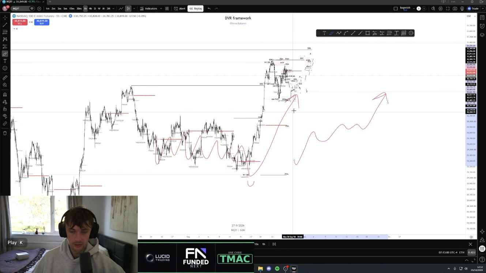

Figure 01 · 3:33. The presenter links the broader rebound to a marked weekly zone
and sketches continuation. The drawing illustrates his thesis; it is not a
calculated forecast distribution.

## The sequence that carries across days

The same logic is nested across timeframes. A higher-timeframe sweep establishes
a *candidate* directional turning point. A subsequent reaction and structure
break make a local zone relevant. A later revisit provides a possible entry, and
the resulting expansion can leave a new zone for the next day's analysis.
The previous day's chart therefore changes the next day's context; each session
does not begin with a blank slate.

The speaker also describes a bullish candle through an open–low–high–close path.
That supplies a narrative for seeking upside after a candidate low. **Reviewer
interpretation:** knowing the eventual high and low of a completed candle is very
different from identifying them in real time. The completed candle's shape cannot
be used as an input available earlier in the week.

## Monday establishes a candidate low

Monday's importance is the sweep of a low the presenter regards as external to
the relevant accumulation. He combines that event with the earlier weekly-zone
reaction and subsequent structure breaks. He says he declined the aggressive
sweep entry and first participated on Tuesday. A correct directional view and
an executed trade are thus separate claims. [Source 6:08–7:38](https://www.youtube.com/watch?v=mmem9CI7vvw&t=368s).

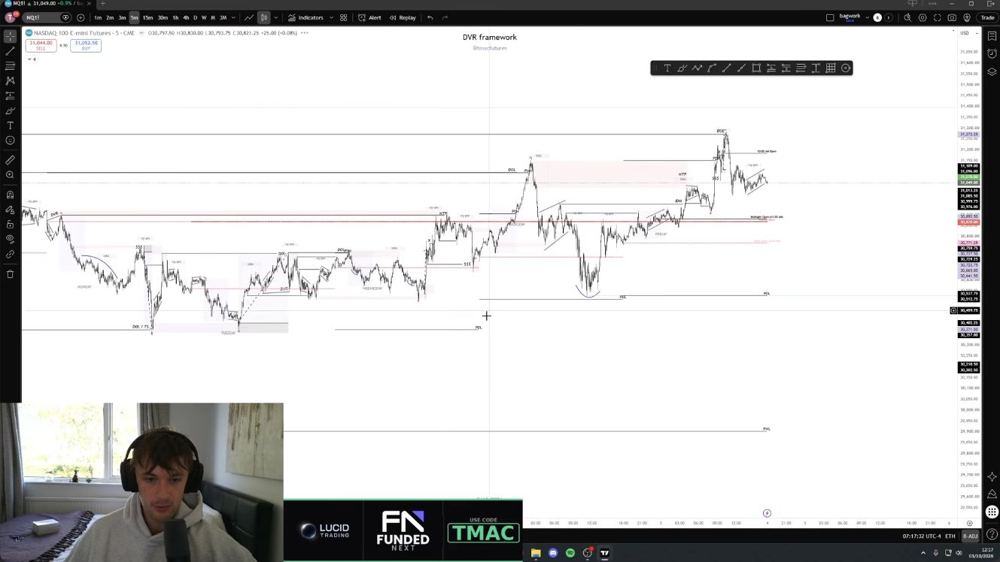

Figure 02 · 6:58. The marked Monday low and ensuing rebound are shown alongside
later sessions. This is a retrospective context chart, not an unedited live
decision screen. The low's eventual survival is an outcome.

The quarterly-candle argument adds confidence for the speaker: he asserts that
NQ's three-month history since 1999 has no relevant inside-candle close and expects
the current candle to resolve upward. That assertion is **unverified here**.
The language alternates between an inside bar and a close inside a prior candle;
those are not necessarily the same event. The video supplies neither a complete
count nor a precise test. Even a verified historical absence would not make a
future exception impossible. [Source 7:46–9:09](https://www.youtube.com/watch?v=mmem9CI7vvw&t=466s).

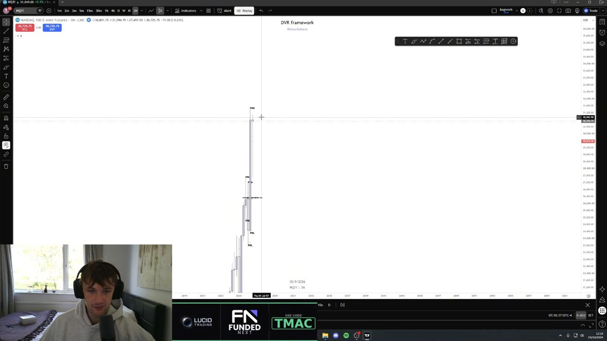

Figure 03 · 8:03. This chart documents the quarterly framing, not a verification
of every quarter since 1999. Contract stitching, price adjustment, quarter
boundaries, equality rules, and the treatment of the unfinished quarter would all
need to be fixed before checking that claim.

## Tuesday tests the prior zone

Tuesday's example revisits the zone associated with Monday's low, forms a smaller
AMD sequence, and expands upward. The presenter contrasts this with a different
possible confirmation: an Asia session that expands directly from its open.
These are alternatives in his narrative, not two conditions both required for
every trade. [Source 9:15–11:28](https://www.youtube.com/watch?v=mmem9CI7vvw&t=555s).

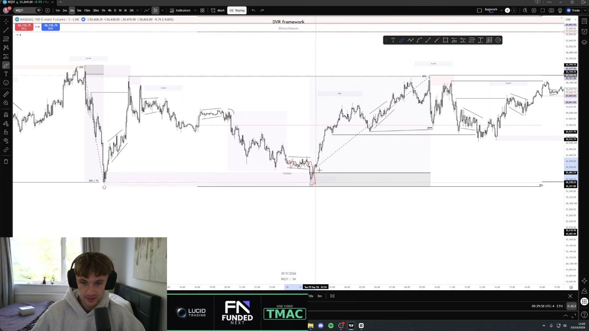

Figure 04 · 10:28. The chart shows the return toward the earlier low/zone and the
subsequent upward leg. The lesson connects this sequence to the following London
opportunity; it does not establish exact universal Asia/London clock boundaries.

He then discusses three ways to participate: the earlier zone trade, a later
“div” entry, and an aggressive market entry based on the larger local sequence.
His stated example magnitudes are approximately 320 points and 7R for the earlier
trade, then roughly 140 and 134 points for the alternatives. They are **speaker
reported chart opportunities**, not independently verified fills or net results.
The precise stop, fill, and exit assumptions needed to reproduce all figures are
not supplied. [Source 11:30–12:53](https://www.youtube.com/watch?v=mmem9CI7vvw&t=690s).

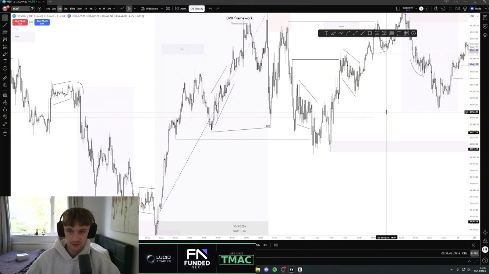

Figure 05 · 12:13. Several reactions appear within the same upward session. Treating
each as an independent winning trade would exaggerate the evidence; they share
market context and may represent alternative entries into the same move.

## Wednesday explains why the second order block matters

The most useful entry distinction appears here. A first zone may be a valid area
of interest while an external low remains vulnerable. Buying it automatically can
lead to a stop-out before the desired move. A later zone is preferred after the
first reaction and a clearer structure break provide additional evidence. The
lesson is not a universal rule to buy the second rectangle on a chart; the reason
for preferring it is the information that has arrived between the two setups.
[Source 14:14–15:50](https://www.youtube.com/watch?v=mmem9CI7vvw&t=854s).

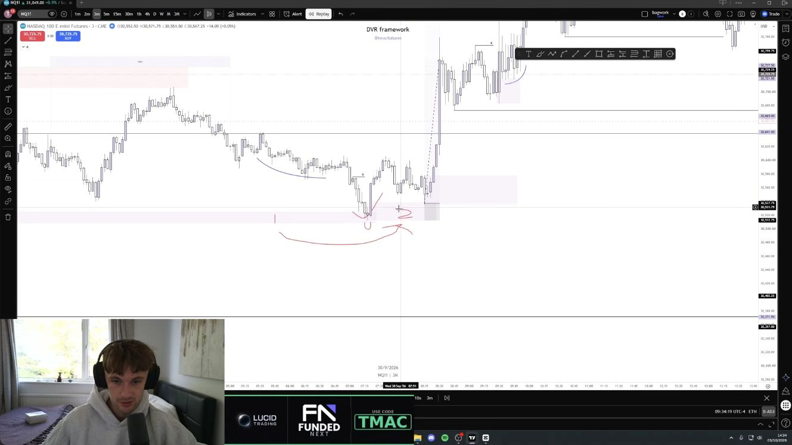

Figure 06 · 15:23. The three-minute chart contains the first reaction, the marked
structure break, and the subsequent zone. **Reviewer inference:** this approach
trades earlier access for confirmation, with a risk of missing a move that never
retests. The video does not estimate that tradeoff.

The speaker rejects a later New York re-entry as lower quality despite identifying
an order block and structure break: repeated revisits and messy delivery weaken
its appeal. He prefers a fresh sweep of the lows and a cleaner expansion. This
shows that the model includes a quality judgment beyond binary pattern detection.
[Source 16:12–16:57](https://www.youtube.com/watch?v=mmem9CI7vvw&t=972s).

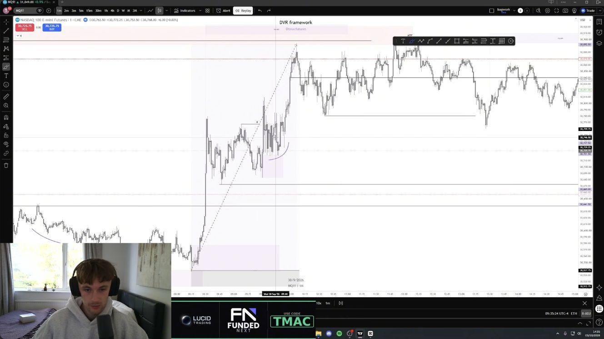

Figure 07 · 16:28. Repeated interaction with the zone is part of the presenter's
reason for passing. No maximum number of permitted retests is defined.

Later, he interprets a fresh downside sweep as the more coherent continuation
opportunity and describes both aggressive and retest entries. The candidate weekly
low remains the backdrop, but the entry is still local. [Source 17:57–18:30](https://www.youtube.com/watch?v=mmem9CI7vvw&t=1077s).

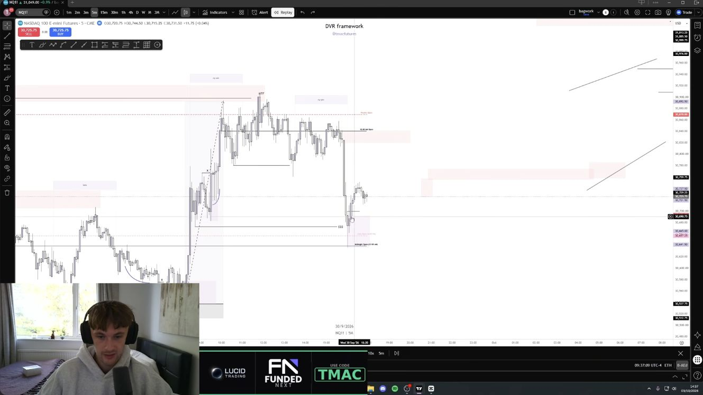

Figure 08 · 18:13. A replay view displays the sweep and projected continuation
lines. The lines are the presenter's annotations, not observed future prices.

## Thursday demonstrates the no-trade state

Thursday is described as overlapping accumulation, awkward transitions, and an
unclear destination. The presenter sees an OB chain but does not find a sufficiently
clean combination of structure and target. He says he took no positions. That is
an essential part of understanding the method: bullish context is permission to
look for a setup, not an instruction to be continuously long.
[Source 19:16–21:00](https://www.youtube.com/watch?v=mmem9CI7vvw&t=1156s).

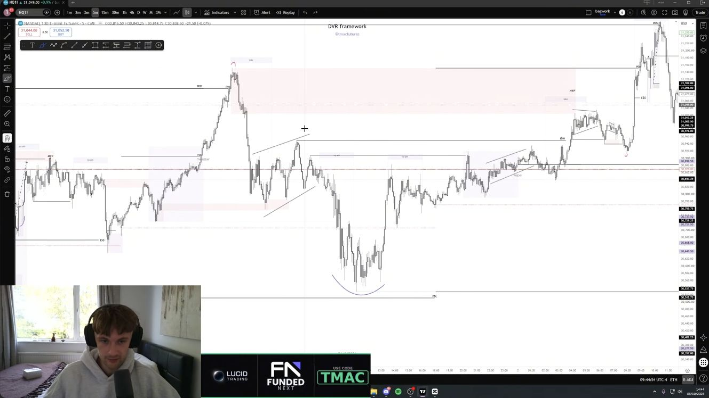

Figure 09 · 20:08. The visible swings do not by themselves establish a tradable
sequence under his discretionary filter. The abstention is reported by the
speaker; no account ledger was provided to verify it.

## Friday shows revision and a target shortfall

The speaker initially considers a range-bound day and a short from an upper
area. He then reads the strong upward response around what he identifies as NFP
as distribution, revises the short idea, and looks for a later long setup. This is
adaptation to the observed price response, not a demonstrated advance prediction
of the release outcome. [Source 21:03–23:23](https://www.youtube.com/watch?v=mmem9CI7vvw&t=1263s).

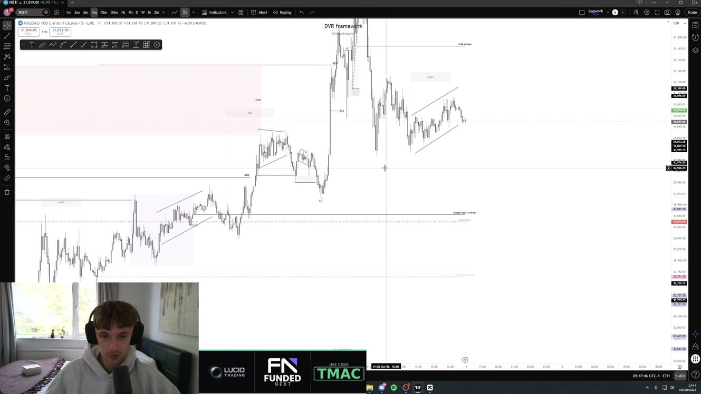

Figure 10 · 22:38. The chart already shows later price action while the narration
explains the prior short hypothesis. Do not misclassify this screenshot as an
ex-ante record of that idea.

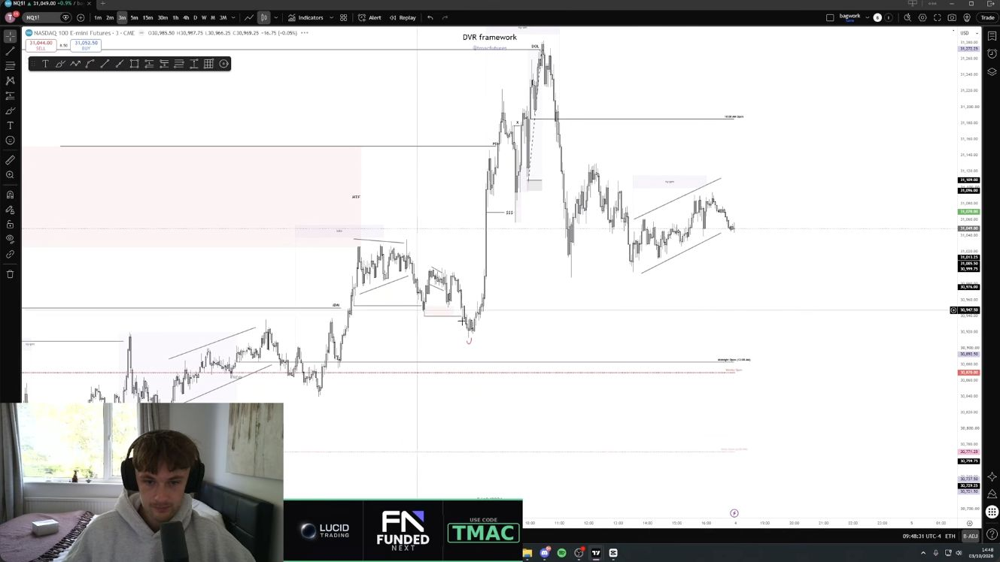

Figure 11 · 23:23. The strong expansion is followed by a substantial retracement
and overlap. A long bias does not imply an unlimited holding period or absence of
adverse movement. The event identity follows the speaker; its release data was
not independently reconstructed for this review.

For the later entry he drops to one minute, although he says he generally prefers
three or five. Again he prefers a reaction, a structure break, and a retest of the
next zone over an unconfirmed first touch. He explicitly discusses placing the
aggressive setup's stop at its low, but does not provide a complete general risk
policy. [Source 23:24–24:24](https://www.youtube.com/watch?v=mmem9CI7vvw&t=1404s).

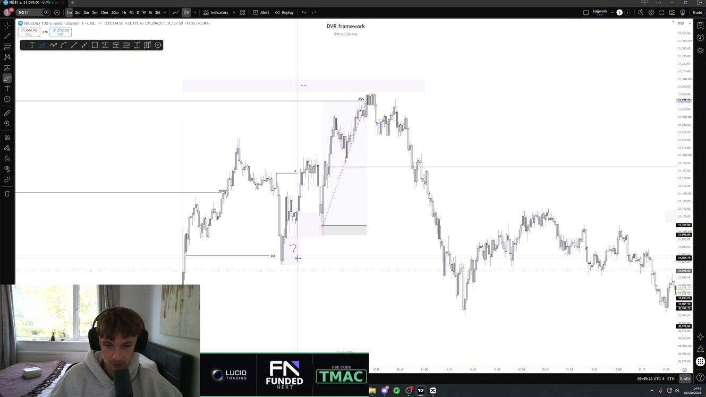

Figure 12 · 24:18. The local sweep and subsequent marked zone are visible. A
quantitative study would have to record when each zone became known, not merely
where it appears on this completed chart.

The final target discussion is especially important: the all-time high was his
broader objective, but he acknowledges it was not reached. He instead identifies
nearer relative equal highs on the hourly chart as the week's actual terminal
draw, then proposes another attempt the following week. That next-week scenario
is an unresolved forecast in this source. [Source 24:27–24:54](https://www.youtube.com/watch?v=mmem9CI7vvw&t=1467s).

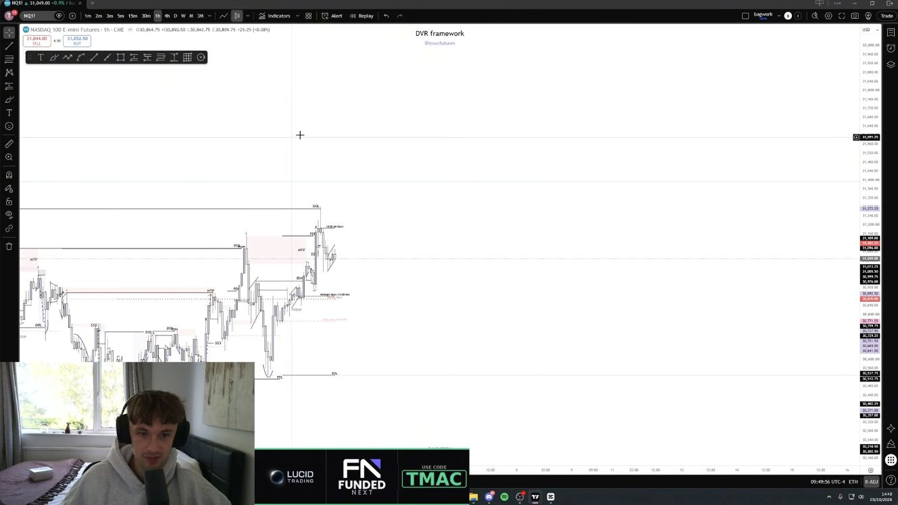

Figure 13 · 24:48. The report preserves the distinction between the objective and
the outcome. Moving an unmet objective into a later week is a revised hypothesis,
not evidence that the original timing was correct.

## A practical reading checklist

The following is a **reviewer synthesis**, not a complete executable strategy:

1. Identify the larger directional thesis and its still-relevant destination.
2. Mark the candidate external level using information already available.
3. Wait for the hypothesized sweep and inspect the reaction; do not assume every
   breach is a reversal.
4. Separate an aggressive sweep entry from a confirmed structure-break/retest
   entry. Decide which is being evaluated before seeing the outcome.
5. Check the target, opposing higher-timeframe zones, repeated retests, and
   available reward relative to the chosen invalidation level.
6. Pass when the structure or destination is unclear. Reassess when price fails
   the thesis or new information changes the context.

The video does not fully define step 6's invalidation or the position-sizing,
stop-buffer, time-stop, scaling, and news-execution rules. Those gaps prevent
faithful mechanical replication from this lesson alone.

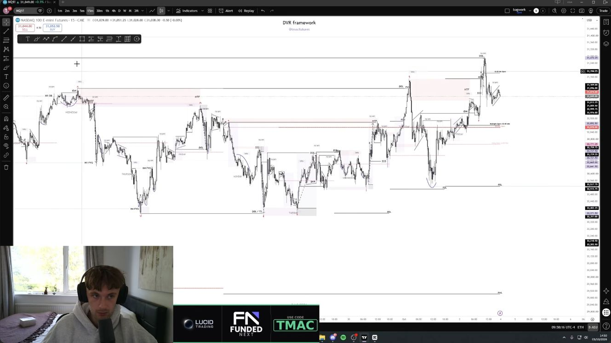

Figure 14 · 25:08. The complete path explains why context can carry from one day
to the next. It also exposes the hindsight problem: a researcher must reconstruct
the evolving view without the later bars visible here.

## What is demonstrated and what remains open

**Demonstrated by the source:** a coherent explanation of how the presenter links
weekly context, local sweeps, confirmation, targets, and abstention in selected
examples. It contains distinctions between possible and preferred entries, and
between the broad objective and the actual stopping point.

**Not demonstrated:** a hit rate, calibrated probability, net expectancy, a complete
trade log, or superiority to a simpler trend-and-pullback rule. The embedded clips
at 1:58–2:21 and 13:22–14:00 are presented as earlier commentary, but this edited
video does not independently authenticate original publication times or disclose
all contemporaneous forecasts. Its opening perfect-prediction claim is therefore
not an audited result.

Several supposedly separate confirmations also derive from the same price path:
a sweep, a reaction, a BOS, and an OB may be descriptions of overlapping evidence.
**Reviewer inference:** counting them as independent probability multipliers would
be unjustified. The discretionary selection of swing, timeframe, and target also
creates room to relabel a failed pattern after the outcome. Thursday's abstention
is useful pedagogically, but cannot supply the missing denominator of all skipped
and failed setups across other weeks.

## How Abacus could test the ideas later

These are proposed investigations, not implemented findings. The source week has
already been inspected and should be treated as a development example.

| Question | A defensible future comparison | What must be fixed first |
| --- | --- | --- |
| Does higher-timeframe alignment add value? | The same causal local trigger with and without a frozen bias filter | Bias timestamp, swing/zone definitions, target and invalidation |
| Does confirmation improve entry quality? | Aggressive post-sweep entry versus BOS plus first eligible retest | BOS close rule, first tradable time, fill logic, missed retests |
| Do repeated retests weaken a setup? | Outcomes by prior touch count using only earlier touches | Touch tolerance, zone lifetime, censoring and overlapping events |
| Does abstention improve the opportunity set? | All eligible events versus a frozen quality/target filter | Quantified consolidation and target-distance rules |
| Is the quarterly assertion true? | Enumerate completed quarters, including counterexamples | Inside-range versus close-in-range definition, stitching and adjustment |

A causal event record would separately store the time each swing becomes known,
sweep time, confirmation time, zone-availability time, first eligible fill, and
subsequent outcome. Right-hand bars required to confirm a pivot cannot be treated
as known at the pivot itself. Unfilled limit orders remain unfilled; bars touching
both target and stop require finer data or an explicit ambiguity rule.

For market-data research, obtain pinned Bhishma inputs and preserve `available_at`;
execution and P&L must use unadjusted prices. Fix session timezones and news-window
treatment. Compare with simple baselines, report costs and uncertainty, and account
for dependence within sessions and weeks. Missing events must remain distinct from
failed events. More examples from this same week would not be out-of-sample evidence.

## Evidence and reproduction

The run preserves fourteen JPEG screenshots, timestamped observations, the full
review timeline, a claim ledger, settings, source identity and caption checksum,
environment/code provenance, and artifact hashes. Raw automatic captions are
retained privately in ignored research storage at the locator in
[inputs.lock.json](inputs.lock.json). Screenshots are source excerpts for this
local study; no public website or full-video copy was produced.

Read [advice](advice.md) for the dated interpretation and
[acquisition notes](provenance/acquisition.md) for source-access and capture details.
The [manifest](manifest.json) records the frozen evidence. Documentation, link,
image, index, and hash checks apply; no market simulation or numerical strategy
test was run.
