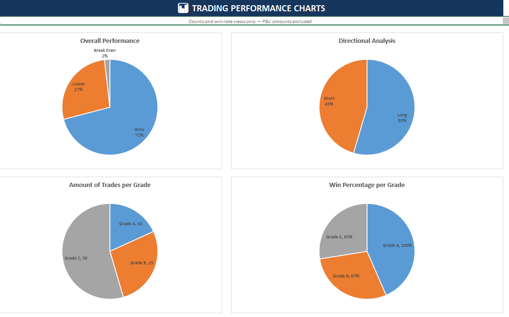
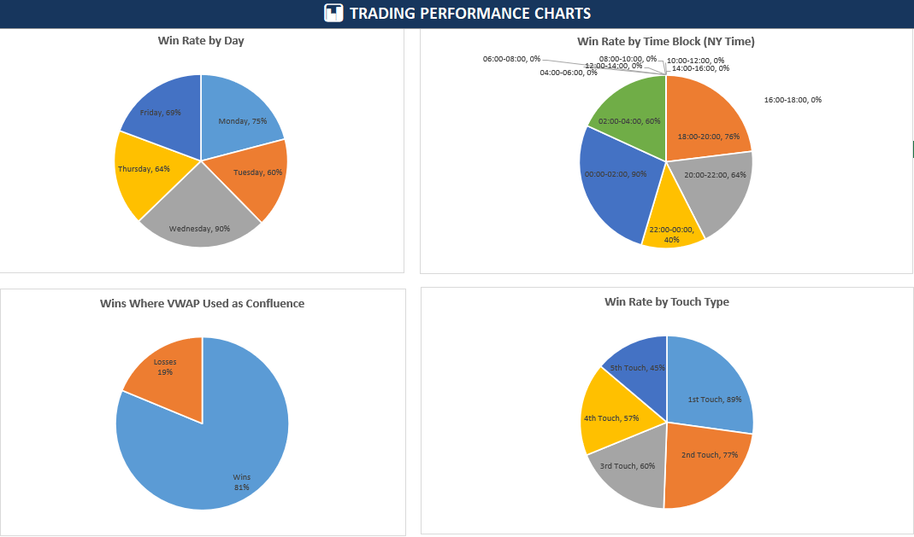
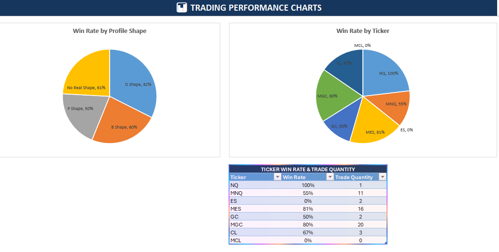
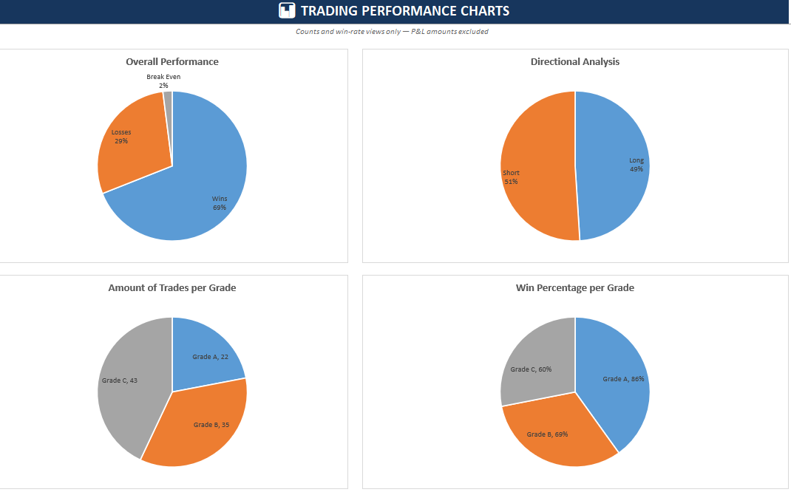
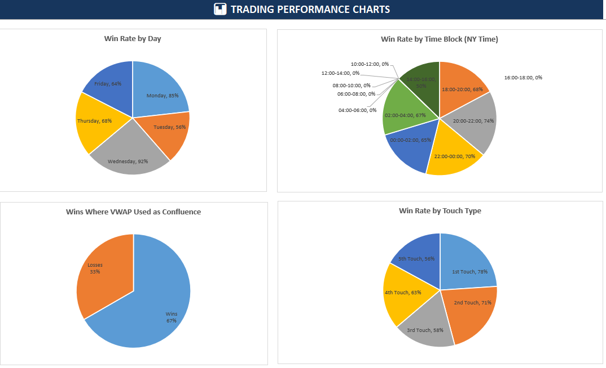
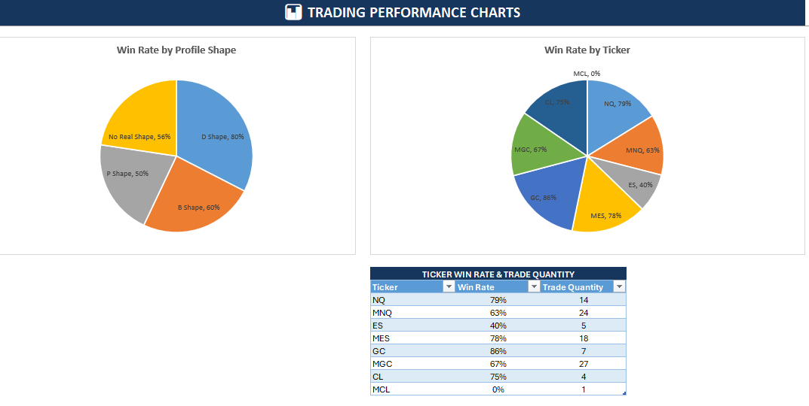
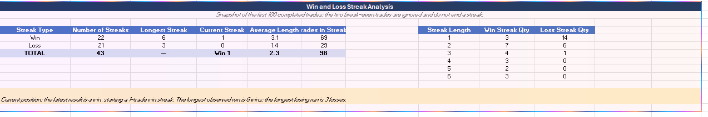

# Value-area fade tracker: 55 to 100 reported trades

An external evidence study and proposed first-touch VAH/VAL-to-POC strategy. Two overlapping snapshots, seven source charts, reported rates and sample counts, contrary evidence, execution gaps and a plan for future independent Abacus analysis.

## What this study establishes

Study 19 is an external source review of two user-supplied community posts and seven tracker screenshots. One trader reports every taken trade was logged: 55 cumulative trades over four weeks, then 100 over seven weeks. Browser headers attribute both posts to Christopher Thornton, with date labels Aug 5 and Aug 28 (edited); the year is not visible. We have no raw ledger or independently authenticated fills. These are overlapping cumulative samples, not 155 independent observations. Abacus has documented the source; our empirical analysis is planned for a future run.

## Reported snapshot sizes and latest win rate

- First snapshot: 55. Four weeks; included again in the later cumulative snapshot.
- Later snapshot: 100. Seven weeks; unaudited external tracking.
- Later reported wins: 69%. 69% of all 100 trades. P&L and costs were not supplied.

## Cumulative results and direction mix

Image 1 / post 1 and image 4 / post 2. Rates are the displayed rounded percentages.

| Snapshot | Weeks | Trades | Wins | Losses | Break-even | Long mix | Short mix |
| --- | --- | --- | --- | --- | --- | --- | --- |
| First | 4 | 55 | 71% | 27% | 2% | 55% | 45% |
| Later | 7 | 100 | 69% | 29% | 2% | 49% | 51% |

- Direction columns describe proportions of trades. No long-versus-short outcome rates are supplied.
- The first text calls direction almost evenly split; its chart shows 55% long and 45% short.
- Arithmetic reconciliation gives 39 wins, 15 losses and one break-even at 55; 69 wins, 29 losses and two break-evens at 100. The earlier counts are reconstructed from rounded percentages, not a supplied ledger.

## Candidate strategy: first-touch value-area fade

Strategy value_area_first_touch_fade · proposed · decision date 2026-10-07. In a balanced/rotational market, the source describes selling from value-area high (VAH) toward point of control (POC), or buying from value-area low (VAL) toward POC. Developing/current-session value areas, D-shaped profiles, early touches and VWAP are possible context variables. The first post reports 40 such fades among 55 trades, but no fade-only win rate; its overall rate cannot be assigned to this strategy. The author says they do not enter at POC. Later discussion separates balanced-day reversals from trending-day continuation. No operational continuation setup is provided, so that is a separate future branch. No Abacus trading or risk-increase recommendation follows from this source review.

## What is described, and what must be defined

Extracted descriptions are not complete executable rules. A final-session profile may not classify an earlier setup.

| Element | Source description | Required before testing |
| --- | --- | --- |
| Market state | Balanced/rotational fades; trending continuation | A causal classifier and separate policies |
| Profile | D-shape or clear volume building / acceptance | Volume resolution, shape metric and value-area percentage |
| Levels | Developing/current VAH or VAL toward POC | Session reset, profile algorithm and level availability |
| Touch | First/second contact favored | Tolerance, approach side, reset and deduplication |
| VWAP | Additional confluence; later used for day context | Anchor, bands, proximity and context rule |
| Grade | A/B/C quality grouping | An entry-time rubric independent of outcome; an author comment mentions generally three confluences with discretion |
| Entry / stop | Wait for the setup; no POC entries | Trigger, timing, fill, stop, invalidation and timeout |
| Exit | Initially 1:1; later let winners run | POC, fixed R and partial/runner policies separately |
| Products | NQ/MNQ, ES/MES, GC/MGC, CL/MCL | Contract identity, rolls, fees, liquidity and position size |

## Reported trade grades

Posts 1–2 and images 1 / 4. All rates are rounded source percentages.

| Grade | N at 55 | Win rate at 55 | N at 100 | Win rate at 100 |
| --- | --- | --- | --- | --- |
| A | 10 | 100% | 22 | 86% |
| B | 15 | 67% | 35 | 69% |
| C | 30 | 63% | 43 | 60% |

- Grade counts sum to 55 and 100. The grading rubric and when labels were assigned are unknown.
- A-grade 100% describes ten trades. Neither snapshot is a held-out test; increasing risk is the author’s suggestion, not a tested Abacus policy.

## Profile, touch and VWAP observations

Posts 1–2 and images 2–3 / 5–6. Missing denominators display as Not available.

| Group | Subgroup | Win rate at 55 | N at 55 | Win rate at 100 | N at 100 |
| --- | --- | --- | --- | --- | --- |
| Profile | D-shape | 82% | Not available | 80% | Not available |
| Profile | B-shape | 60% | Not available | 60% | Not available |
| Profile | P-shape | 50% | Not available | 50% | Not available |
| Profile | No real shape | 61% | Not available | 56% | Not available |
| Touch | First | 89% | Not available | 78% | Not available |
| Touch | Second | 77% | Not available | 71% | Not available |
| Touch | Third | 60% | Not available | 58% | Not available |
| Touch | Fourth | 57% | Not available | 63% | Not available |
| Touch | Fifth | 45% | Not available | 56% | Not available |
| Confluence | VWAP | 81% | 16 | 67% | Not available |

- These are marginal groups, potentially overlapping. No combined A-grade + D-shape + first-touch + VWAP result is supplied.
- First/second-touch rates are higher in both snapshots; rates are not strictly decreasing at every later touch (fourth exceeds third at 100). This does not prove levels weaken causally.
- VWAP was introduced during tracking: 81% at N=16 becomes 67% at unspecified N. Selection and the later change in VWAP interpretation prevent an incremental-effect claim.
- Separate win rates are not shares of all wins. Source pie-slice areas are not appropriate comparisons.

## Reported ticker results and sample counts

Images 3 / 6 provide the full quantities; posts discuss selected tickers.

| Ticker | N at 55 | Win rate at 55 | N at 100 | Win rate at 100 |
| --- | --- | --- | --- | --- |
| NQ | 1 | 100% | 14 | 79% |
| MNQ | 11 | 55% | 24 | 63% |
| ES | 2 | 0% | 5 | 40% |
| MES | 16 | 81% | 18 | 78% |
| GC | 2 | 50% | 7 | 86% |
| MGC | 20 | 80% | 27 | 67% |
| CL | 3 | 67% | 4 | 75% |
| MCL | 0 | Not available | 1 | 0% |

- At 55, the source displays MCL 0% with N=0; its rate is normalized here to unavailable. At 100, MCL 0% has N=1 and is a reported observed rate.
- Small groups, including NQ N=1 and GC N=2 at 55, cannot establish stable ticker rankings.
- The author later trades more minis and reports partial fills in micros. This is not a matched micro-versus-mini comparison.

## Weekday labels as reported

Images 2 / 5. The later post says these are New Zealand weekdays: its Monday/Wednesday correspond to New York Sunday/Tuesday sessions.

| Source weekday label | Win rate at 55 | Win rate at 100 |
| --- | --- | --- |
| Monday | 75% | 85% |
| Tuesday | 60% | 56% |
| Wednesday | 90% | 92% |
| Thursday | 64% | 68% |
| Friday | 69% | 64% |

- Subgroup counts and dated timestamps are absent. Do not use these rows as New York exchange weekday filters.
- The author has more time to focus on Wednesday, a possible availability confound. The first post’s weekday convention was not explicitly defined.

## Time blocks labeled New York time

Images 2 / 5; post 1 supplies N=10 at 00:00–02:00 and N=21 at 18:00–20:00.

| NY time block | Win rate at 55 | N at 55 | Original label at 55 | Win rate at 100 | N at 100 | Original label at 100 |
| --- | --- | --- | --- | --- | --- | --- |
| 00:00–02:00 | 90% | 10 | 90% | 65% | Not available | 65% |
| 02:00–04:00 | 60% | Not available | 60% | 67% | Not available | 67% |
| 04:00–06:00 | Not available | Not available | 0% | Not available | Not available | 0% |
| 06:00–08:00 | Not available | Not available | 0% | Not available | Not available | 0% |
| 08:00–10:00 | Not available | Not available | 0% | Not available | Not available | 0% |
| 10:00–12:00 | Not available | Not available | 0% | Not available | Not available | 0% |
| 12:00–14:00 | Not available | Not available | 0% | Not available | Not available | 0% |
| 14:00–16:00 | Not available | Not available | 0% | 50% | Not available | 50% |
| 16:00–18:00 | Not available | Not available | 0% | Not available | Not available | 0% |
| 18:00–20:00 | 76% | 21 | 76% | 68% | Not available | 68% |
| 20:00–22:00 | 64% | Not available | 64% | 74% | Not available | 74% |
| 22:00–00:00 | 40% | Not available | 40% | 70% | Not available | 70% |

- A displayed 0% with unspecified N cannot distinguish no trades from zero wins. Normalized rates are unavailable; original labels are preserved.
- The source favors Asia trading, but descriptions change from the hour leading into Asia open to about an hour after the market opens. Exact session boundaries are undefined.
- At 100 the largest nonzero time-block rate shown is 74% at 20:00–22:00, not 18:00–20:00 (68%). Missing counts prevent a reliable best-time ranking.
- Future analysis must use dated UTC timestamps, America/New_York DST and explicit exchange/session dates.

## Reported streak summary at 100 trades

Image 7. Total: 43 streaks, 98 included trades, reported average 2.3; latest result is a win.

| Streak type | Streaks | Longest | Current | Reported average length | Trades in streaks |
| --- | --- | --- | --- | --- | --- |
| Win | 22 | 6 | 1 | 3.1 | 69 |
| Loss | 21 | 3 | 0 | 1.4 | 29 |

- Two break-even trades are ignored and do not end a streak. This convention affects streak counts.
- The sequence itself is unavailable. No independent sequence check, simulation or future losing-streak forecast is established.

## Reported streak-length distribution

Image 7. Quantities reconcile to 22 win streaks / 69 wins and 21 loss streaks / 29 losses.

| Length | Win streaks | Loss streaks |
| --- | --- | --- |
| 1 | 3 | 14 |
| 2 | 7 | 6 |
| 3 | 4 | 1 |
| 4 | 3 | 0 |
| 5 | 2 | 0 |
| 6 | 3 | 0 |

## Negative and inconclusive source claims

The author reports no support for the idea that same-type aligned value areas (for example current VAH aligning with prior or overnight VAH) improve success relative to unlike-type alignment. No sample counts, effect estimate or exact comparison rule were provided. Preserve this as a negative external claim, not a controlled Abacus rejection. The later VWAP rate falls to 67%, and A-grade falls to 86%; high early rates did not persist unchanged. The source’s direction-neutrality conclusion lacks direction-specific outcome rates. D-shape, first-touch and grade associations have unspecified confounding and no joint-filter data.

## Trade management and execution limits

Post 1 describes standardizing trades at 1:1 R:R. Post 2 says letting winners run improved profitability despite lower win rate; it reports an average 1:2 R:R for the last eight A-grade trades and suggests partial profits at 1:1 with a runner. These are the author’s descriptions, not verified realized returns or a tested exit comparison. A follow-up author comment says they only trade 1:1 and tracked how far A grades would run, so the 1:2 figure may describe potential excursion rather than realized payoff. There is no payoff series, mean win/loss, fees, slippage, sizing or P&L amounts. Reported partial fills in micros matter for capacity. A 69% win rate cannot establish positive net expectancy, nor does the streak summary justify increasing risk. Psychological comments describe the author’s experience; they are not statistical proof of a coin-flip process.

## Planned Abacus extension

Future work will first obtain a raw timestamped ledger if available and define reproducible causal profiles, balanced/trending state, D-shape, touch counting, grade and VWAP rules before outcome inspection. Pin immutable Bhishma releases and available_at timing. Prespecify chronological development and untouched holdout periods. Compare first-touch balanced VA fades with later-touch opportunities under the same execution policy, then assess shape and VWAP separately; report coverage and retain negative findings. Freeze entry/fill, stop, timeout, POC/fixed-R/partial-runner exits, unadjusted prices, costs, contract rolls and overlapping-position treatment. Report net R, drawdown, MFE/MAE and session-clustered uncertainty, with all missing/ambiguous events retained. Separate discretionary taken-trade audits from all-eligible market-event research. Our own analysis has not been run.

## Fields to collect for our future analysis

Collection plan only; these fields were not supplied in the external summaries.

| Field group | Purpose |
| --- | --- |
| Identity | Trade/event ID, contract, instrument, strategy branch and rule version |
| Time | UTC signal/order/fill/exit; IANA timezone, exchange trade date, session |
| Causal levels | VAH/VAL/POC and available_at; profile algorithm, window and value percentage |
| Context | Shape, balanced/trending state, VWAP/anchor; exact values at signal |
| Touch / grade | Pre-entry touch count/reset/tolerance and frozen grade rubric |
| Orders / fills | Submitted/filled size, order type, partial fills, cancellations and liquidity |
| Risk / exit | Initial stop/risk, target, exit policy, partial/runner fills and timeout |
| Payoff | Unadjusted prices, fees/slippage, realized net R, MFE/MAE and ambiguity |
| Selection | All eligible opportunities, exclusion reason, taken/skipped and trader availability |

## Interpretation limits

One trader, a short evolving seven-week process, self-selected opportunities, overlapping groups and cumulative samples. Grades may be retrospective; many denominators and all individual timestamps are missing. We cannot estimate joint-filter performance, incremental VWAP benefit, a weekday edge, fill capacity, drawdown or net profitability. Rounded percentages and arithmetic consistency do not authenticate the record. Changes in market mix, exits and the author’s skill prevent attributing changes to one filter. The screenshots’ rate pies should be read as labeled values rather than valid shares of a whole.

## Source and preservation record

Two pasted posts and seven supplied screenshots were reviewed on 2026-10-07. The first post is linked by the later post; its webpage was not retrievable with the web tool. Existing signed-in browser tabs confirmed Christopher Thornton as author, the follow-up URL, and date labels Aug 5 / Aug 28 (edited). No year was visible. Selected author comments clarify discretionary grading and uncertainty over realized versus potential R:R. Cam Narayan is acknowledged as a teacher, not the author. Full post bytes are retained privately with checksums. Selected screenshots are preserved without editing, and public tables/downloads are transferred from the saved source-review tables. The completed review has frozen settings, input hashes, source/environment identities and an integrity manifest. New analysis or interpretation requires a new run.

## 55 trades: overall, direction and grades

Source exhibit 1. Overall 71% wins, 27% losses, 2% break-even; long/short is trade mix, not directional win rate. Grade counts are 10/15/30. Separate grade win rates are not a composition.

## 55 trades: days, time blocks, VWAP and touches

Source exhibit 2. Individual win rates are shown as pie slices; slice areas are not subgroup weights. Zero time-block labels do not supply denominators. Weekdays have the later post’s New Zealand caveat.

## 55 trades: shapes and ticker counts

Source exhibit 3. Ticker table supplies sample counts. MCL displays 0% with zero trades, so its rate is undefined. Shape/ticker rate slices are not shares of all wins.

## 100 trades: overall, direction and grades

Source exhibit 4. Overall 69% wins, 29% losses, 2% break-even. Long/short is 49%/51% of trades. Grades have 22/35/43 observations.

## 100 trades: days, time blocks, VWAP and touches

Source exhibit 5. Later chart reports VWAP 67%, first touch 78%, and 20:00–22:00 at 74%; subgroup counts are absent. The later text’s Asia preference is not an independently established best time.

## 100 trades: shapes and ticker counts

Source exhibit 6. Sample sizes are NQ 14, MNQ 24, ES 5, MES 18, GC 7, MGC 27, CL 4 and MCL 1. These are not paired micro/mini comparisons.

## 100 trades: streak summary and length distribution

Source exhibit 7. Two break-even trades are ignored and do not end a streak. The 98 included trades comprise 69 wins and 29 losses; longest observed streaks are six wins and three losses.

## Source link

[First tracker post](https://www.skool.com/volumeprofile/trading-stats-tracked-results?p=6c7c7fc7)
