# Camarilla reversals and the EMA20/50 cloud

Executed 2026-10-08 · Run 20261008T220932Z_cb2711 · protocol 0.3.0-executed.2

## Findings

The final R3/S3 comparison does not support a positive EMA-alignment gain in any of the six primary contrasts. All three alignment path cohorts are sparse (ES N=49, NQ N=55, GC N=40). All reference-cost alignment-policy 95% intervals include zero. NQ's adverse alignment-minus-none path contrast has a four-week familywise interval [-2.4065, -0.0147] ATR and an eight-week interval [-2.2393, -0.0147], but the one-week interval [-2.3577, 0.0388] includes zero. This near-boundary, block-sensitive result does not support a universal cloud advantage. T01, T03 and T08 retain the complete fixed comparisons; the study does not establish a reproducible capturable net edge.

ES: R3/S3 alignment has 49 completed 15-bar paths across 41 sessions, mean signed delta 0.1411 ATR (95% interval -0.9065 to 1.1726), versus 0.0205 ATR for no filter (N=180). The alignment-minus-none contrast is 0.1206 ATR; its six-contrast familywise interval [-1.1339, 1.2991] does not exclude zero. Under reference assumed costs, alignment's 3R policy averages 0.0301 net R per scorable eligible session (95% interval -0.0397 to 0.1077), with the target-first replay giving 0.0301 R. It enters 49 trades; 0 are barrier-ambiguous and 0 eligible sessions remain unresolved. References: T01 product=ES, split=final_evaluation, pair=3, horizon=15, side=both; T08 endpoint=path_delta_ATR, block_weeks=4; T03 target=3R, fee=10, slippage=1, delay=0, window=main, extension=core.

NQ: R3/S3 alignment has 55 completed 15-bar paths across 47 sessions, mean signed delta -0.5370 ATR (95% interval -1.2819 to 0.2042), versus 0.5362 ATR for no filter (N=191). The alignment-minus-none contrast is -1.0732 ATR; its six-contrast familywise interval [-2.4065, -0.0147] is entirely negative. Under reference assumed costs, alignment's 3R policy averages 0.0067 net R per scorable eligible session (95% interval -0.0465 to 0.0612), with the target-first replay giving 0.0067 R. It enters 54 trades; 0 are barrier-ambiguous and 0 eligible sessions remain unresolved. References: T01 product=NQ, split=final_evaluation, pair=3, horizon=15, side=both; T08 endpoint=path_delta_ATR, block_weeks=4; T03 target=3R, fee=10, slippage=1, delay=0, window=main, extension=core.

GC: R3/S3 alignment has 40 completed 15-bar paths across 32 sessions, mean signed delta 0.5390 ATR (95% interval -0.3190 to 1.1967), versus 0.2157 ATR for no filter (N=114). The alignment-minus-none contrast is 0.3234 ATR; its six-contrast familywise interval [-0.7440, 1.1289] does not exclude zero. Under reference assumed costs, alignment's 3R policy averages 0.0532 net R per scorable eligible session (95% interval -0.0079 to 0.1216), with the target-first replay giving 0.0532 R. It enters 38 trades; 0 are barrier-ambiguous and 0 eligible sessions remain unresolved. References: T01 product=GC, split=final_evaluation, pair=3, horizon=15, side=both; T08 endpoint=path_delta_ATR, block_weeks=4; T03 target=3R, fee=10, slippage=1, delay=0, window=main, extension=core.

## Applicability and limits

These are historical conditional associations and assumed-fill simulations, not certified point-in-time or prospective execution results. The retained map has no original mapping arrival timestamps; annual holiday schedules are modeled from a pinned conservative rule set, not individually certified. CME notices support the two historical regular-session changes. Source-condition exclusions are retrospective. Last-trade HLC is not settlement. Modeled bar availability at completion assumes immediate action; the separately reported one-minute delay tests that assumption. Missing no-trade minutes cannot be distinguished from feed loss. Costs of USD 10 plus one adverse tick are assumptions, with USD 5/10/15 and 0/1/2 ticks separately reported. NQ early robustness is particularly sparse. ES and NQ are correlated; stand-alone policy outcomes are never added into a portfolio. MFE and MAE are path statistics and do not establish achievable profitability. Final evaluation was held out from this protocol's development, while prior repository research and 2026 ES chart acceptance exposure are disclosed.

## Data, coverage and exclusions

T00 coverage_summary.csv and the product coverage rosters record every candidate weekday and overlapping exclusion reason. Partition hashes, mapping boundaries and full 5m aggregation/lineage were checked before strategy scoring. Development 2018–2020, validation 2021–2023, final 2024–2025, replication 2026 through September 18 and earlier 2010–2017 remain distinct.

| product | split | candidate_weekdays | eligible_sessions | HLC_valid_sessions | roll_sessions | source_degraded_sessions |
| --- | --- | --- | --- | --- | --- | --- |
| ES | earlier_robustness | 1975 | 784 | 1077 | 31 | 11 |
| ES | development | 784 | 656 | 713 | 12 | 15 |
| ES | validation | 781 | 704 | 746 | 12 | 2 |
| ES | final_evaluation | 523 | 461 | 490 | 8 | 7 |
| ES | recent_replication | 187 | 164 | 176 | 3 | 4 |
| NQ | earlier_robustness | 1975 | 72 | 141 | 31 | 11 |
| NQ | development | 784 | 661 | 717 | 12 | 15 |
| NQ | validation | 781 | 705 | 747 | 12 | 2 |
| NQ | final_evaluation | 523 | 457 | 488 | 8 | 7 |
| NQ | recent_replication | 187 | 163 | 176 | 3 | 4 |
| GC | earlier_robustness | 1975 | 518 | 735 | 22 | 11 |
| GC | development | 784 | 649 | 702 | 11 | 15 |
| GC | validation | 781 | 644 | 696 | 11 | 2 |
| GC | final_evaluation | 523 | 448 | 475 | 9 | 7 |
| GC | recent_replication | 187 | 153 | 169 | 4 | 4 |

## Definitions

Prior electronic-session HLC supplies exact Camarilla fractions: 1.1/6, 1.1/4 and 1.1/2. Long: previous close > support, open >= support, low <= support, close > support and close > open. Short mirrors it at resistance. Dual touches are excluded. First technical rejection consumes its episode before EMA selection; a full candle strictly on the approach side rearms. EMA20/50 and Wilder ATR14 use the full actual five-minute stream and reset on selected-contract changes or unknown gaps >5 minutes. All primary prices are unadjusted on the same contract. Main entries use observed next five-minute opens between 09:30 and 11:30 NY. The entry candle is bar 1, and confirmation extrema are excluded from paths. Fixed horizons are 5/10/15/30/50 bars. Horizon=0 in T01 is a separate terminal 16:00 close with variable elapsed time. Favorable close is direction-normalized; literal close above entry and defended-side pivot close remain separate. Quality requires full confirmation, >=99% preceding-session and seed coverage, complete prior edges and the stated warmup. Invalid immediately prior weekdays never fall back to older valid HLC. T09 also retains a potential recovery interval after an observed adverse excursion, with the non-null recovery count. Same-minute OHLC cannot establish the order of the dip and recovery, so this interval is a possibility diagnostic, not an exact recovery time or a fill claim.

## Uncertainty and six primary contrasts

T08 contains the six primary contrasts: three instrument-specific 15-bar path contrasts and three net-R-per-session policy contrasts. Four-week paired calendar blocks use 10,000 seeded resamples; pointwise intervals are 95% and the primary familywise marginal intervals are 99.1667% (Bonferroni for six contrasts). One/eight-week sensitivity is retained in the same table. Other intervals are descriptive. Sparse means fewer than 100 completed events or 30 sessions; undefined intervals retain their support count and undefined-draw count. Path comparisons change the population, and T07 shows cloud-pass and cloud-fail cohorts from the same technical ledger. Policy contrasts pair the common roster's scorable days. Unknown continuous-price paths receive no invented finite P&L bound. Ordering ambiguity has separate stop-first and target-first replays.

| product | endpoint | estimate | ci95_low | ci95_high | family_low | family_high | N_none | N_alignment | support_blocks |
| --- | --- | --- | --- | --- | --- | --- | --- | --- | --- |
| ES | path_delta_ATR | 0.1206 | -0.786 | 0.9989 | -1.134 | 1.299 | 180 | 49 | 20 |
| ES | policy_net_R_per_session | 0.03948 | -0.05688 | 0.1364 | -0.0867 | 0.1662 | 461 | 461 | 27 |
| NQ | path_delta_ATR | -1.073 | -2.041 | -0.2637 | -2.406 | -0.01466 | 191 | 55 | 21 |
| NQ | policy_net_R_per_session | -0.05709 | -0.1367 | 0.02013 | -0.1631 | 0.04727 | 457 | 457 | 27 |
| GC | path_delta_ATR | 0.3234 | -0.4311 | 0.9397 | -0.744 | 1.129 | 114 | 40 | 19 |
| GC | policy_net_R_per_session | 0.01058 | -0.03558 | 0.05339 | -0.05313 | 0.06783 | 448 | 448 | 27 |

## ES main horizon results — T01

| mode | horizon | elapsed_minutes | accepted | completed_N | mean_MFE | mean_MAE | mean_delta | favorable_share | MFE_gt_MAE_share | ci95_low | ci95_high |
| --- | --- | --- | --- | --- | --- | --- | --- | --- | --- | --- | --- |
| none | 5 | 25 | 180 | 180 | 1.442 | 1.429 | 0.04178 | 0.4778 | 0.4889 | -0.3155 | 0.3812 |
| none | 10 | 50 | 180 | 180 | 2.175 | 1.899 | 0.1999 | 0.5167 | 0.5167 | -0.2283 | 0.6039 |
| none | 15 | 75 | 180 | 180 | 2.613 | 2.32 | 0.0205 | 0.5111 | 0.5389 | -0.4863 | 0.5251 |
| none | 30 | 150 | 180 | 180 | 3.442 | 3.19 | 0.196 | 0.5389 | 0.5 | -0.4136 | 0.8485 |
| none | 50 | 250 | 180 | 180 | 4.046 | 3.876 | -0.1166 | 0.5222 | 0.5167 | -0.8127 | 0.593 |
| alignment | 5 | 25 | 49 | 49 | 1.826 | 1.232 | 0.4239 | 0.5102 | 0.551 | -0.152 | 0.9836 |
| alignment | 10 | 50 | 49 | 49 | 2.512 | 1.862 | 0.2419 | 0.5714 | 0.551 | -0.7778 | 1.155 |
| alignment | 15 | 75 | 49 | 49 | 2.842 | 2.217 | 0.1411 | 0.5714 | 0.6122 | -0.9065 | 1.173 |
| alignment | 30 | 150 | 49 | 49 | 3.677 | 3.405 | -0.1246 | 0.5306 | 0.5102 | -1.701 | 1.4 |
| alignment | 50 | 250 | 49 | 49 | 4.035 | 4.194 | -0.6744 | 0.551 | 0.5102 | -2.524 | 1.135 |

The exact CSV includes separate long/short, all four modes, three pairs, all splits, excursion quantiles, session-balanced means, literal/defended close shares, binary missing bounds and censoring counts.

## NQ main horizon results — T01

| mode | horizon | elapsed_minutes | accepted | completed_N | mean_MFE | mean_MAE | mean_delta | favorable_share | MFE_gt_MAE_share | ci95_low | ci95_high |
| --- | --- | --- | --- | --- | --- | --- | --- | --- | --- | --- | --- |
| none | 5 | 25 | 191 | 191 | 1.784 | 1.536 | 0.1592 | 0.5079 | 0.5288 | -0.1623 | 0.4536 |
| none | 10 | 50 | 191 | 191 | 2.507 | 2.052 | 0.316 | 0.5131 | 0.5236 | -0.1354 | 0.7717 |
| none | 15 | 75 | 191 | 191 | 3.004 | 2.35 | 0.5362 | 0.555 | 0.5026 | -0.1 | 1.264 |
| none | 30 | 150 | 191 | 191 | 3.778 | 2.985 | 0.5989 | 0.5602 | 0.5393 | -0.2253 | 1.587 |
| none | 50 | 250 | 191 | 191 | 4.38 | 3.519 | 0.5192 | 0.4974 | 0.555 | -0.3437 | 1.541 |
| alignment | 5 | 25 | 55 | 55 | 1.691 | 1.55 | -0.09489 | 0.4909 | 0.5091 | -0.6029 | 0.399 |
| alignment | 10 | 50 | 55 | 55 | 2.217 | 2.191 | -0.2398 | 0.4727 | 0.4727 | -0.9804 | 0.4633 |
| alignment | 15 | 75 | 55 | 55 | 2.403 | 2.611 | -0.537 | 0.4727 | 0.4364 | -1.282 | 0.2042 |
| alignment | 30 | 150 | 55 | 55 | 2.712 | 3.505 | -1.111 | 0.4909 | 0.4364 | -1.901 | -0.3227 |
| alignment | 50 | 250 | 55 | 55 | 3.194 | 4.182 | -0.6582 | 0.4727 | 0.4545 | -1.93 | 0.6055 |

The exact CSV includes separate long/short, all four modes, three pairs, all splits, excursion quantiles, session-balanced means, literal/defended close shares, binary missing bounds and censoring counts.

## GC main horizon results — T01

| mode | horizon | elapsed_minutes | accepted | completed_N | mean_MFE | mean_MAE | mean_delta | favorable_share | MFE_gt_MAE_share | ci95_low | ci95_high |
| --- | --- | --- | --- | --- | --- | --- | --- | --- | --- | --- | --- |
| none | 5 | 25 | 114 | 114 | 1.25 | 1.007 | 0.1505 | 0.5088 | 0.5789 | -0.1198 | 0.4249 |
| none | 10 | 50 | 114 | 114 | 1.692 | 1.473 | 0.1691 | 0.5702 | 0.5439 | -0.1931 | 0.5269 |
| none | 15 | 75 | 114 | 114 | 2.061 | 1.759 | 0.2157 | 0.5965 | 0.5965 | -0.1749 | 0.5768 |
| none | 30 | 150 | 114 | 114 | 2.536 | 2.281 | 0.148 | 0.5789 | 0.614 | -0.3821 | 0.6643 |
| none | 50 | 250 | 114 | 114 | 2.809 | 2.779 | -0.166 | 0.5175 | 0.5526 | -0.9794 | 0.5742 |
| alignment | 5 | 25 | 40 | 40 | 1.571 | 0.797 | 0.6347 | 0.725 | 0.675 | 0.1891 | 1.027 |
| alignment | 10 | 50 | 40 | 40 | 2.188 | 1.305 | 0.6099 | 0.7 | 0.7 | -0.255 | 1.286 |
| alignment | 15 | 75 | 40 | 40 | 2.528 | 1.61 | 0.539 | 0.675 | 0.7 | -0.319 | 1.197 |
| alignment | 30 | 150 | 40 | 40 | 3.024 | 1.979 | 0.9403 | 0.65 | 0.675 | -0.01835 | 1.87 |
| alignment | 50 | 250 | 40 | 40 | 3.104 | 2.207 | 0.1281 | 0.525 | 0.575 | -0.8273 | 1.057 |

The exact CSV includes separate long/short, all four modes, three pairs, all splits, excursion quantiles, session-balanced means, literal/defended close shares, binary missing bounds and censoring counts.

## Costs, latency and primary policy contrasts

ES: across the nine declared fee/slippage assumptions, final alignment-policy means range from 0.0256 to 0.0352 net R per scorable eligible session. One-minute delay at reference costs gives 0.0396 R (immediate reference 0.0301 R). The primary paired alignment-minus-none policy contrast is 0.0395 R, familywise interval [-0.0867, 0.1662], over 461 jointly scorable sessions. These are fixed sensitivity results from T03 and T08, not a selection of the best executable policy.

NQ: across the nine declared fee/slippage assumptions, final alignment-policy means range from 0.0046 to 0.0088 net R per scorable eligible session. One-minute delay at reference costs gives -0.0140 R (immediate reference 0.0067 R). The primary paired alignment-minus-none policy contrast is -0.0571 R, familywise interval [-0.1631, 0.0473], over 457 jointly scorable sessions. These are fixed sensitivity results from T03 and T08, not a selection of the best executable policy.

GC: across the nine declared fee/slippage assumptions, final alignment-policy means range from 0.0464 to 0.0571 net R per scorable eligible session. One-minute delay at reference costs gives 0.0226 R (immediate reference 0.0532 R). The primary paired alignment-minus-none policy contrast is 0.0106 R, familywise interval [-0.0531, 0.0678], over 448 jointly scorable sessions. These are fixed sensitivity results from T03 and T08, not a selection of the best executable policy.

## Monthly intervals — T14

Monthly rows preserve both branches, path/session denominators and four-week calendar support. A month generally supplies only one or two blocks; undefined or sparse intervals remain. These diagnostics do not create independent evidence.

## Executed one-position policy — T03

| product | mode | order_assumption | eligible_sessions | scorable_sessions | entered_trades | ambiguous_trades | unresolved_trades | mean_net_R_per_session | ci95_low | ci95_high | net_USD_resolved_trades |
| --- | --- | --- | --- | --- | --- | --- | --- | --- | --- | --- | --- |
| ES | none | stop_first | 461 | 461 | 169 | 0 | 0 | -0.009368 | -0.1081 | 0.09585 | -3652 |
| ES | none | target_first | 461 | 461 | 169 | 0 | 0 | -0.009368 | -0.1081 | 0.09585 | -3652 |
| ES | alignment | stop_first | 461 | 461 | 49 | 0 | 0 | 0.03011 | -0.0397 | 0.1077 | 6960 |
| ES | alignment | target_first | 461 | 461 | 49 | 0 | 0 | 0.03011 | -0.0397 | 0.1077 | 6960 |
| NQ | none | stop_first | 457 | 457 | 179 | 0 | 0 | 0.06374 | -0.02443 | 0.1588 | 2.91e+04 |
| NQ | none | target_first | 457 | 457 | 179 | 0 | 0 | 0.06374 | -0.02443 | 0.1588 | 2.91e+04 |
| NQ | alignment | stop_first | 457 | 457 | 54 | 0 | 0 | 0.006651 | -0.04649 | 0.06123 | 3090 |
| NQ | alignment | target_first | 457 | 457 | 54 | 0 | 0 | 0.006651 | -0.04649 | 0.06123 | 3090 |
| GC | none | stop_first | 448 | 448 | 104 | 0 | 0 | 0.04258 | -0.03099 | 0.1232 | 1.268e+04 |
| GC | none | target_first | 448 | 448 | 104 | 0 | 0 | 0.04258 | -0.03099 | 0.1232 | 1.268e+04 |
| GC | alignment | stop_first | 448 | 448 | 38 | 0 | 0 | 0.05316 | -0.007862 | 0.1216 | 1.506e+04 |
| GC | alignment | target_first | 448 | 448 | 38 | 0 | 0 | 0.05316 | -0.007862 | 0.1216 | 1.506e+04 |

Stop: confirmation extreme plus one adverse tick; primary target: outward-rounded 3R; no pyramiding, trailing or partials. One-minute stop gaps fill adversely; reference limits require one-tick trade-through and no favorable gap improvement. Timeout uses the observed 16:00 minute open. T03 contains all nine costs, delay, touch-fill, 2R/pivot exits and bounded extensions. Trade outcomes and session uncertainty use separate denominators. Drawdown is observed completed-session drawdown and excludes unknown days; it is not a full-history bound.

## Excursions, timing and threshold ordering — T01, T09, T12

Quantiles are per-event frozen ATR, not ratios of averages. T09 distinguishes favorable-first, adverse-first, same-minute ambiguous, neither, censoring and entry cancellation. Time to extrema is the first source-minute interval; zero excursion has no attainment time. T12 retains counts for the joint MAE/MFE distribution. Return to prior close and opposite-pivot touch are path diagnostics, not policy wins.

## Weekly and annual stability — T04, T05, T06, T10, T11

Weeks use confirmation-close New York Mondays; eligible zero-signal weeks remain. TOTAL is event-weighted, never the mean of weekly rates. First/last split weeks are labeled partial. T04 separates sides and years, T05 supplies annual policy returns per eligible scorable session, and T10 shows time bins and development-only range/ATR tertiles. T11 and T03 retain largest-event/best-month contribution diagnostics without replacing the headline sample.

## Bounded controls and unavailable branches — T02, T03

Slope, wick, relative volume, approach distance, one-tick contact, shared technical cooldown, strict 100%, 500-bar warmup, mapping buffer, R4/S4 continuation, fixed 0.225/0.325 location controls and alternate sessions were executed separately. No grid optimization or final-sample winner selection occurred. Daily21, official settlement parity, a VWAP gate and 100-bar overnight behavior are optional branches without the required independent input/policy, so remain unavailable.

## F01: horizon behavior — T01

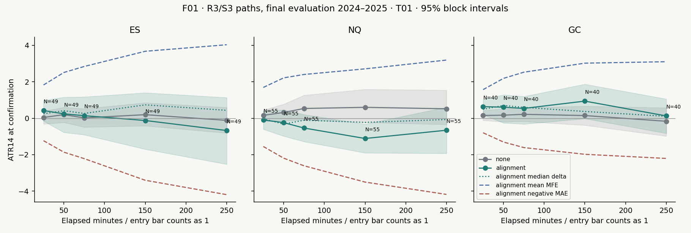

## F02: declared cloud and level grid — T01

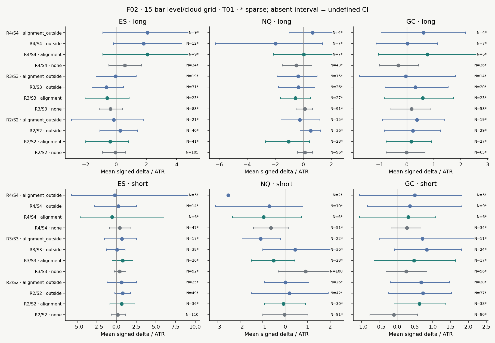

## F03: joint excursions — T12

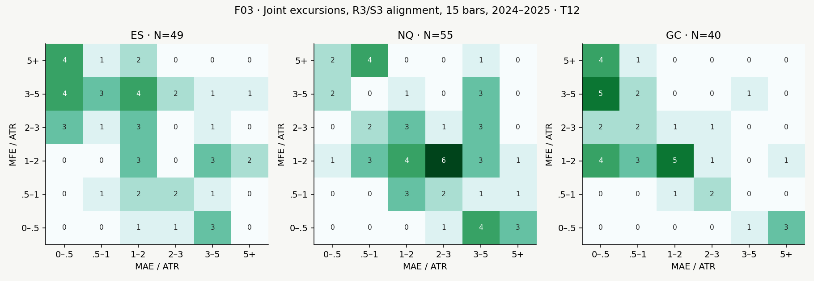

## F04: one-minute threshold ordering — T09

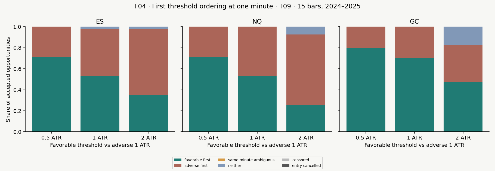

## F05: annual stability — T04

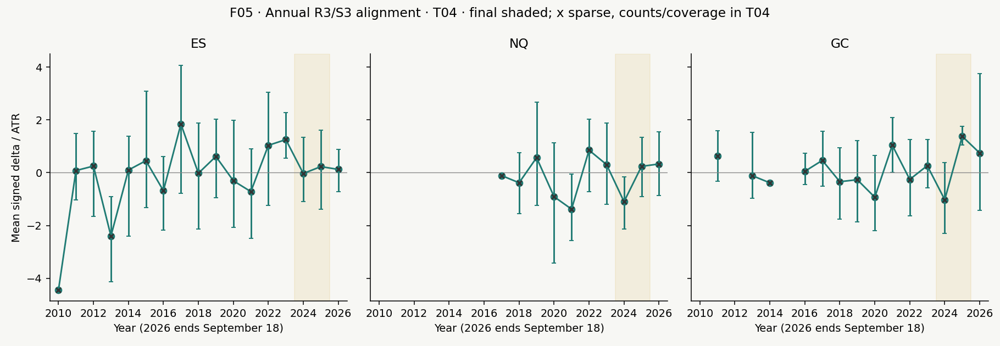

## F06: assumed policy costs — T03

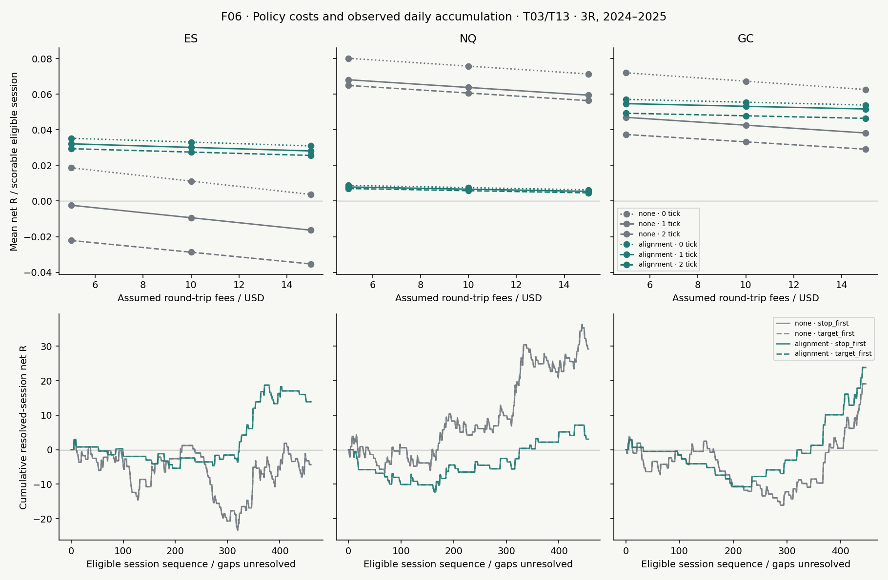

## F07: excursion quantiles

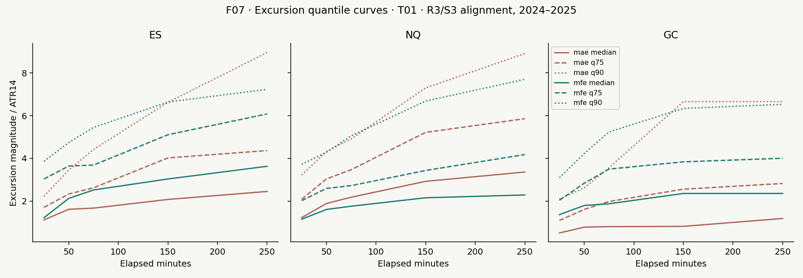

## F08: policy outcomes and observed drawdown

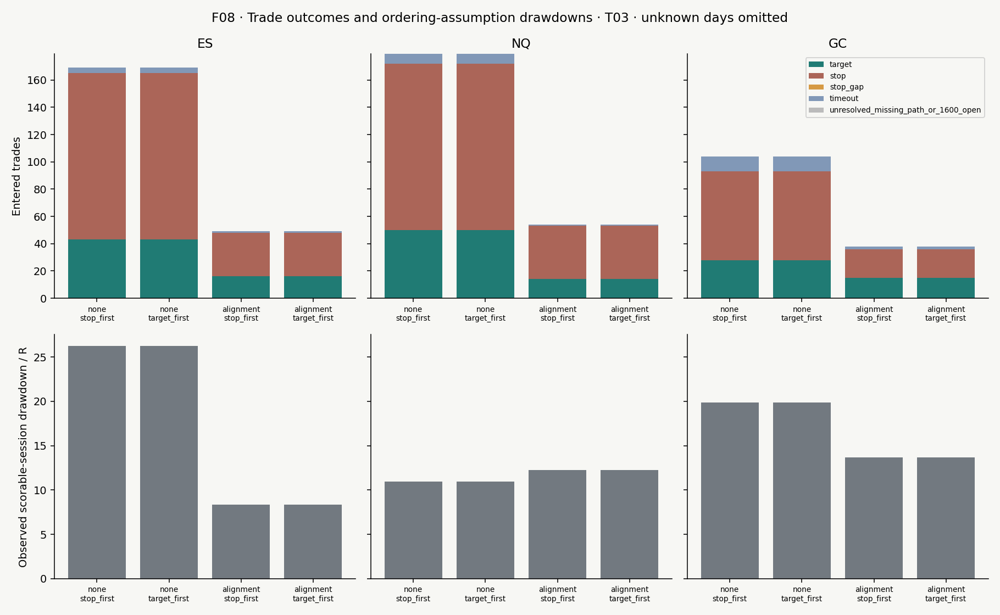

## F09: fixed ES examples, local source observations

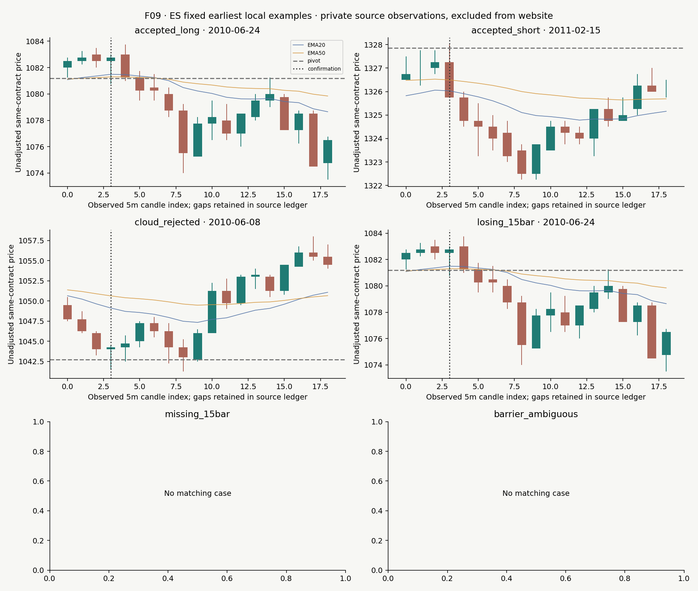

## F09: fixed NQ examples, local source observations

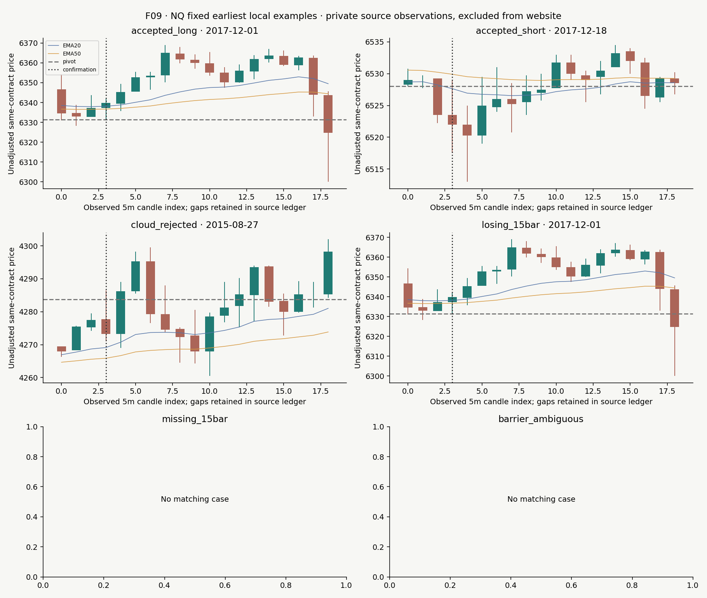

## F09: fixed GC examples, local source observations

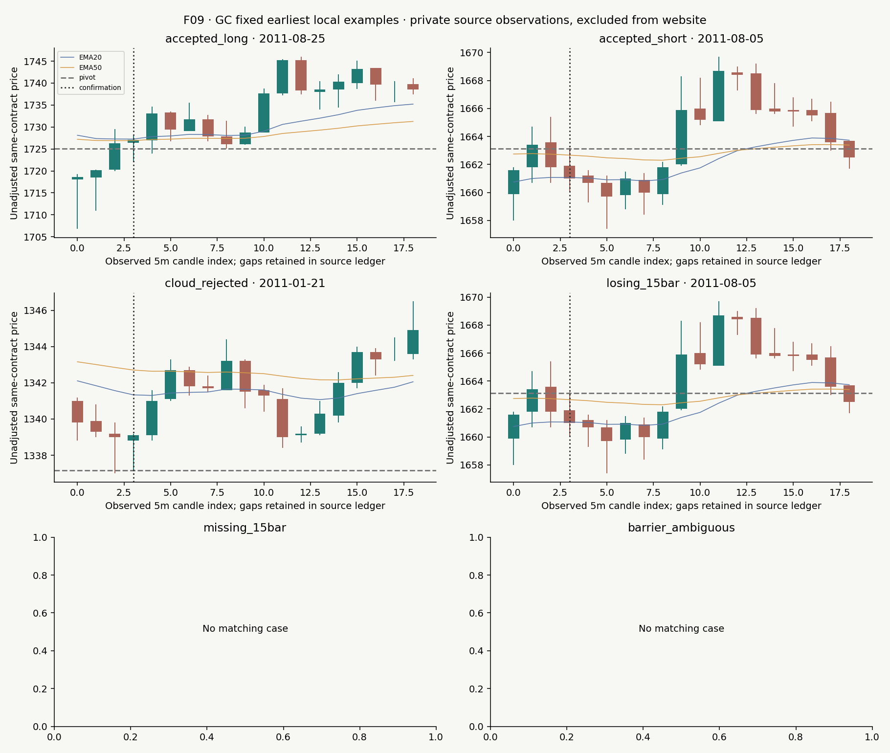

## Complete evidence tables

- [annual.csv](tables/annual.csv)

- [annual_policy.csv](tables/annual_policy.csv)

- [cloud_comparisons.csv](tables/cloud_comparisons.csv)

- [daily_reference.csv](tables/daily_reference.csv)

- [examples.csv](tables/examples.csv)

- [exclusions.csv](tables/exclusions.csv)

- [extensions.csv](tables/extensions.csv)

- [horizons.csv](tables/horizons.csv)

- [joint_excursions.csv](tables/joint_excursions.csv)

- [monthly.csv](tables/monthly.csv)

- [policy.csv](tables/policy.csv)

- [primary_contrasts.csv](tables/primary_contrasts.csv)

- [stability.csv](tables/stability.csv)

- [tail_diagnostics.csv](tables/tail_diagnostics.csv)

- [threshold_ordering.csv](tables/threshold_ordering.csv)

- [weekly.csv](tables/weekly.csv)

## Reproduction and preservation

Commands run from the workspace root after restoring configured input files. See inputs.lock.json, code-identity.json, environment.json, uv.lock, commands.json, figure-environment.json and artifact checksums. Private ledgers are retained with locators and hashes in events.manifest.json. They and raw vendor bars are excluded from the website.

```sh

task_run_dir="${1:-work/20_camarilla_ema_cloud_reversals/$(date -u +%Y%m%dT%H%M%SZ)_reproduction}"

.venv/bin/python studies/20_camarilla_ema_cloud_reversals/run.py freeze --work "$task_run_dir"

.venv/bin/python studies/20_camarilla_ema_cloud_reversals/run.py audit --work "$task_run_dir"

.venv/bin/python -m unittest discover -s studies/20_camarilla_ema_cloud_reversals/tests -v

.venv/bin/python studies/20_camarilla_ema_cloud_reversals/run.py score --work "$task_run_dir"

.venv/bin/python studies/20_camarilla_ema_cloud_reversals/run.py summarize --work "$task_run_dir"

.venv/bin/python studies/20_camarilla_ema_cloud_reversals/examples.py --work "$task_run_dir"

./scripts/uv run --with matplotlib==3.10.8 python studies/20_camarilla_ema_cloud_reversals/figures.py --work "$task_run_dir"

.venv/bin/python studies/20_camarilla_ema_cloud_reversals/run.py report --work "$task_run_dir"

.venv/bin/python studies/20_camarilla_ema_cloud_reversals/run.py verify --work "$task_run_dir"

```

Hosted deployment has not been authorized. Narada preparation and local preview use selected saved-source content; no research code runs in the web app.
