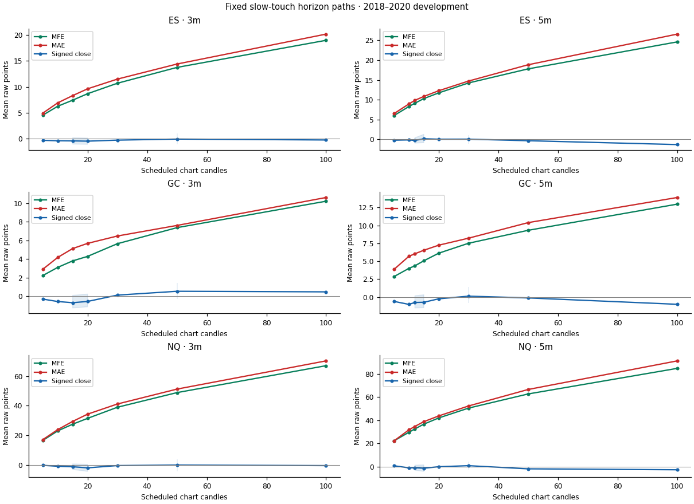
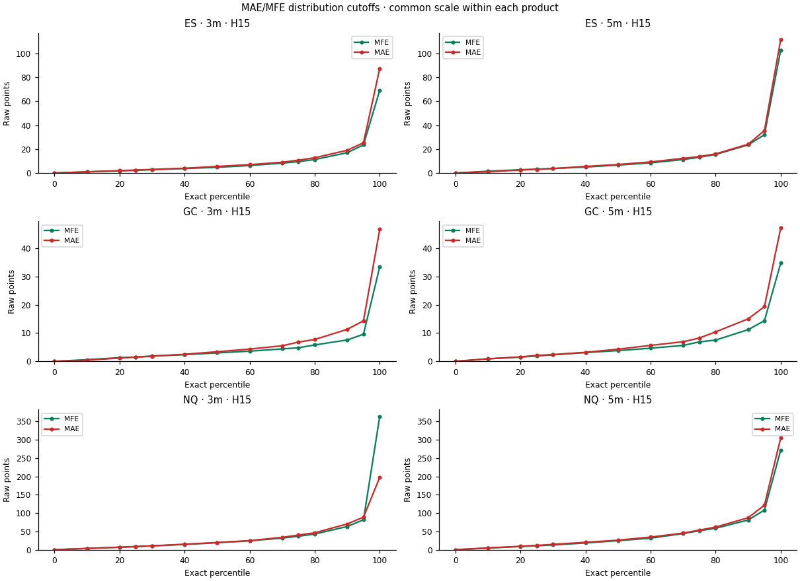
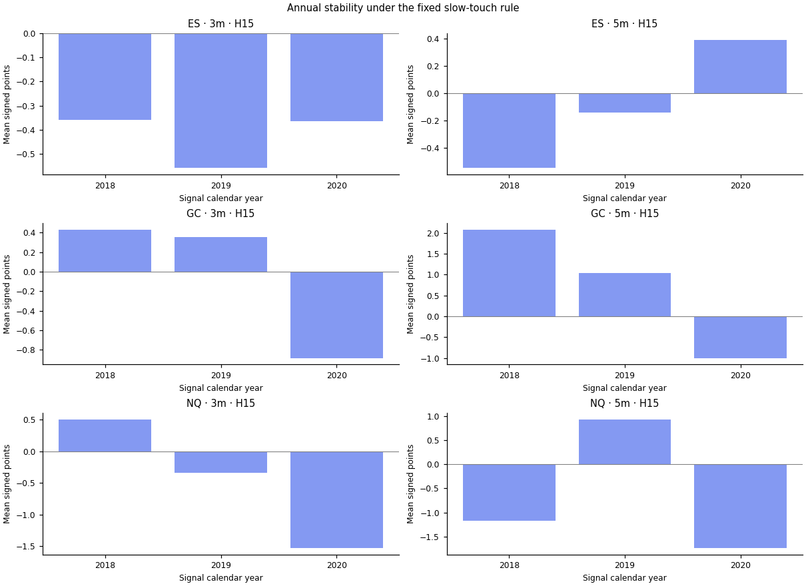
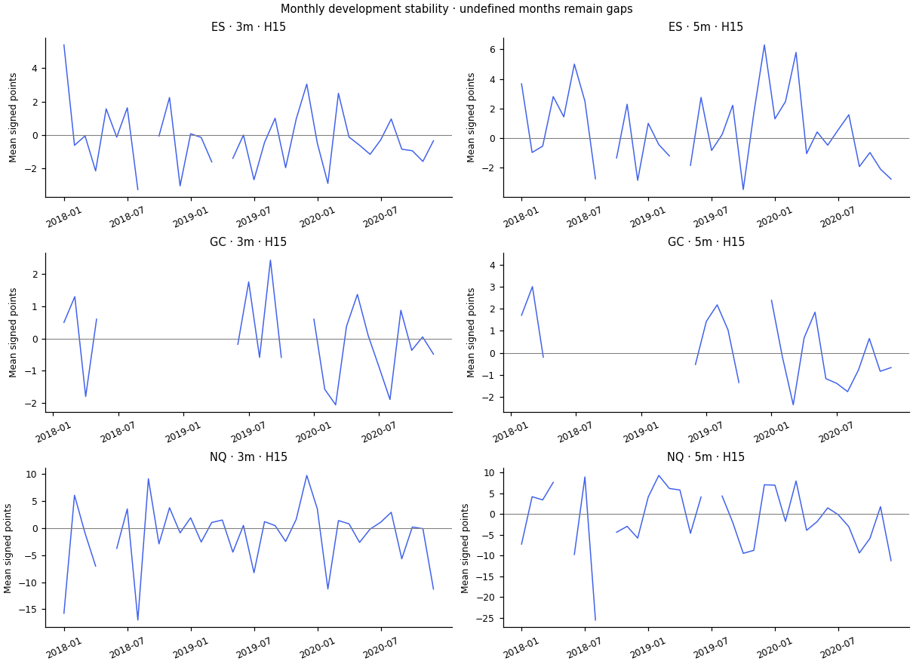
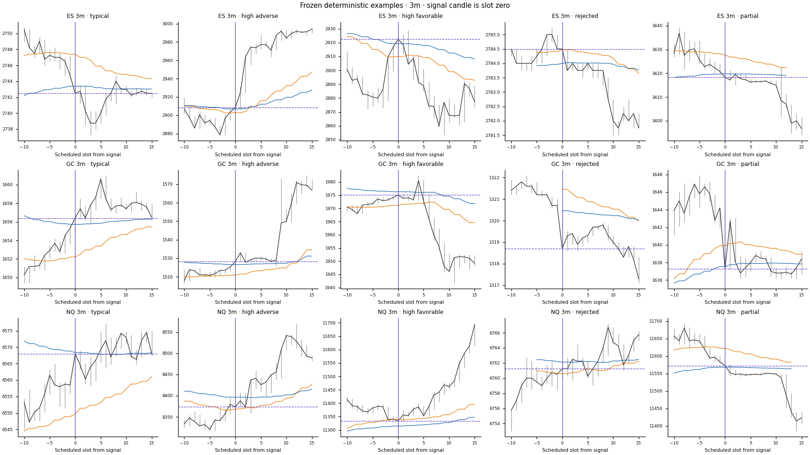
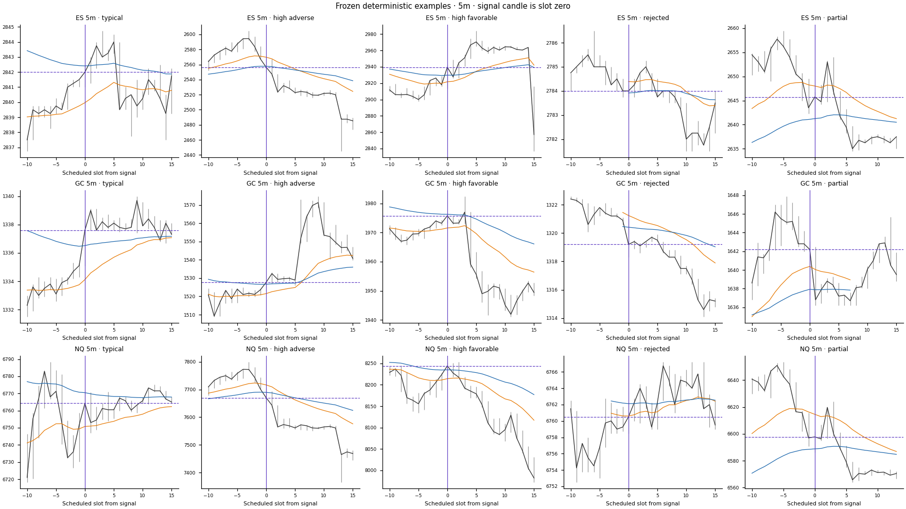

# 20/50 5minEMA Cloud Trend Follow Opportunity Study — Stage 1

Run 20261010T221954Z_s1_8c6e_r3 · 2018–2020 development only · prepared 2026-10-10T22:19:54Z

## Findings

The pooled H15 signed terminal means do not establish positive continuation under the prespecified four-week uncertainty calculation. Mean adverse excursion exceeds mean favorable excursion in every pooled primary cell. Pooled intervals do not describe every side or session: negative subgroup findings and block-length sensitivities remain in the saved tables. Equal-active terminal contrasts are inconclusive; some excursion contrasts differ. Coverage improves markedly toward 2020, and early GC annual cohorts are sparse, so pooled evidence does not establish stability across years. Exact review references: provenance/reviews/interpretation-review.json; coverage S1-T00, primary and side scorecards S1-T02, annual/session S1-T04, uncertainty S1-bootstrap and contrasts S1-comparisons.

ES 3m H15: 1365 completed of 1366 accepted paths; 1 censored. Mean signed terminal movement -0.38772893772893874 points; 95% interval [-0.99268828771818951, 0.20639310771304745], includes zero. Mean MFE 7.4415750915750918, MAE 8.3190476190476197 points. Sparse support: False. Evidence row 1|ES|3|All|slow|fixed|15|points|development|all.

ES 5m H15: 1138 completed of 1143 accepted paths; 5 censored. Mean signed terminal movement 0.13224956063268772 points; 95% interval [-0.8444924298303319, 1.2556104470426404], includes zero. Mean MFE 10.286906854130052, MAE 10.82535149384886 points. Sparse support: False. Evidence row 1|ES|5|All|slow|fixed|15|points|development|all.

GC 3m H15: 345 completed of 347 accepted paths; 2 censored. Mean signed terminal movement -0.70608695652173359 points; 95% interval [-1.270002602369616, 0.082877988963847279], includes zero. Mean MFE 3.7872463768115927, MAE 5.1118840579710181 points. Sparse support: False. Evidence row 1|GC|3|All|slow|fixed|15|points|development|all.

GC 5m H15: 270 completed of 275 accepted paths; 5 censored. Mean signed terminal movement -0.72555555555554574 points; 95% interval [-1.4803223395775043, 0.32250856598985644], includes zero. Mean MFE 5.0607407407407443, MAE 6.5325925925925823 points. Sparse support: False. Evidence row 1|GC|5|All|slow|fixed|15|points|development|all.

NQ 3m H15: 1164 completed of 1165 accepted paths; 1 censored. Mean signed terminal movement -1.0178264604810934 points; 95% interval [-2.8742024289703925, 0.88275490967849246], includes zero. Mean MFE 27.598367697594501, MAE 29.46284364261167 points. Sparse support: False. Evidence row 1|NQ|3|All|slow|fixed|15|points|development|all.

NQ 5m H15: 956 completed of 961 accepted paths; 5 censored. Mean signed terminal movement -1.3559100418409975 points; 95% interval [-4.0505152214060569, 1.5173263912253574], includes zero. Mean MFE 36.697437238493727, MAE 38.839696652719653 points. Sparse support: False. Evidence row 1|NQ|5|All|slow|fixed|15|points|development|all.

## Definitions and uncertainty

EMA20/EMA50 cloud stays on five-minute closes. Fixed inclusive widths: ES 2.4, GC 2.0, NQ 10 points. Slow touches only, both directions, one signal per pullback, zero cooldown. A five-minute signal uses its current completed close-derived cloud; a three-minute signal freezes the latest scheduled cloud completed at its open. Missing latest features clear state. Features reset on rolls/unknown gaps and require 250 consecutive usable five-minute observations; known scheduled closures preserve same-contract state. Overlapping observations are retained. H counts scheduled active chart slots. H15 means 45 active minutes on 3m and 75 on 5m. Equal-active comparisons are 3m H20 versus 5m H12 (60 minutes), and 3m H50 versus 5m H30 (150). Actual elapsed minutes and closure-crossing support remain separate. Quantiles interpolate at p(n−1); top-tail cutoffs are percentiles, not tail averages. Terminal signs use strict zero; MFE>MAE uses epsilon 1e−10×max(1,MFE,MAE), with ties retained. Pointwise 95% uncertainty uses paired contiguous New York calendar-week blocks, four-week primary, 10,000 resamples, seed 20261010; one/eight-week sensitivity remains descriptive. Event means and contributing-session balanced means have different denominators. Calendar labels use signal-open New York dates; weeks start Monday. Fixed time strata are Asia 18–03, Europe 03–09, US 09–16 and Late 16–18. Session balancing uses trading-session identity. No strategy selection or profitability estimate is implied.

## Coverage and limitations

Verified published partition bytes and retained release lineage support this descriptive analysis. Original raw source reconstruction could not be certified because retained mapping/definition prerequisites are unavailable; native TradingView equivalence and off-device backup verification were not executed. These qualifications are distinct from the passed consumed-input and scientific checks.

2018–2020 development observations only; later-period outcomes remain reserved. Prior Abacus studies inspected some later market history, so this is not a pristine market holdout. Unadjusted same-contract prices; reference is confirmed signal close and the signal candle is excluded. MFE and MAE are path observations, not executable profits, stops or targets. Sparse cohorts have fewer than 100 completed events or 30 contributing sessions. Modeled completion is available_at; original vendor-receipt and mapping-arrival times are absent. Uncertified holiday/early-close sessions are excluded conservatively and reset feature history. Missing no-trade minutes cannot be distinguished reliably from source loss.

## Primary H15 scorecard

Pooled Buy/Sell; event-weighted raw points separately by product. H15 is 45 active minutes on 3m and 75 on 5m.

| Product | Candle minutes | Accepted | Completed | Censored | Sessions | Mean mfe | Mean mae | Mean signed close | Favorable share | 95% low | 95% high |

| --- | --- | --- | --- | --- | --- | --- | --- | --- | --- | --- | --- |

| ES | 3.0 | 1366.0 | 1365.0 | 1.0 | 375.0 | 7.441575091575092 | 8.31904761904762 | -0.38772893772893874 | 0.4945054945054945 | -0.9926882877181895 | 0.20639310771304745 |

| ES | 5.0 | 1143.0 | 1138.0 | 5.0 | 353.0 | 10.286906854130052 | 10.82535149384886 | 0.13224956063268772 | 0.5052724077328646 | -0.8444924298303319 | 1.2556104470426404 |

| GC | 3.0 | 347.0 | 345.0 | 2.0 | 151.0 | 3.7872463768115927 | 5.111884057971018 | -0.7060869565217336 | 0.4927536231884058 | -1.270002602369616 | 0.08287798896384728 |

| GC | 5.0 | 275.0 | 270.0 | 5.0 | 124.0 | 5.060740740740744 | 6.532592592592582 | -0.7255555555555457 | 0.5148148148148148 | -1.4803223395775043 | 0.32250856598985644 |

| NQ | 3.0 | 1165.0 | 1164.0 | 1.0 | 377.0 | 27.5983676975945 | 29.46284364261167 | -1.0178264604810934 | 0.5 | -2.8742024289703925 | 0.8827549096784925 |

| NQ | 5.0 | 961.0 | 956.0 | 5.0 | 336.0 | 36.69743723849373 | 38.83969665271965 | -1.3559100418409975 | 0.4884937238493724 | -4.050515221406057 | 1.5173263912253574 |

## Input coverage and quality

Primary buckets require every expected source minute and one contract. Development readiness counts usable signal slots with a valid mapped cloud for both intervals. Warmup-only native 5m readiness is retained; warmup-only 3m readiness is undefined. Unknown missingness is not compressed.

| Product | Interval minutes | Year | Scheduled slots | Usable slots | Feature ready slots | Missing slots | Empty slots | Mixed slots | Calendar invalid slots | Expected source minutes | Observed source minutes |

| --- | --- | --- | --- | --- | --- | --- | --- | --- | --- | --- | --- |

| ES | 3.0 | 2018.0 | 118755.0 | 112052.0 | 45541.0 | 806.0 | 2178.0 | 0.0 | 5915.0 | 356265.0 | 348873.0 |

| ES | 3.0 | 2019.0 | 118755.0 | 112817.0 | 55595.0 | 464.0 | 2086.0 | 0.0 | 5460.0 | 356265.0 | 349528.0 |

| ES | 3.0 | 2020.0 | 119210.0 | 113501.0 | 98445.0 | 489.0 | 2191.0 | 0.0 | 5005.0 | 357630.0 | 350344.0 |

| ES | 5.0 | 2018.0 | 71253.0 | 66958.0 | 27370.0 | 767.0 | 1306.0 | 0.0 | 3549.0 | 356265.0 | 348873.0 |

| ES | 5.0 | 2019.0 | 71253.0 | 67540.0 | 33407.0 | 446.0 | 1251.0 | 0.0 | 3276.0 | 356265.0 | 349528.0 |

| ES | 5.0 | 2020.0 | 71526.0 | 68041.0 | 59093.0 | 410.0 | 1265.0 | 0.0 | 3003.0 | 357630.0 | 350344.0 |

| GC | 3.0 | 2018.0 | 120060.0 | 111191.0 | 32623.0 | 2064.0 | 3316.0 | 0.0 | 5520.0 | 360180.0 | 347466.0 |

| GC | 3.0 | 2019.0 | 120060.0 | 112333.0 | 41299.0 | 1956.0 | 3058.0 | 0.0 | 5060.0 | 360180.0 | 348353.0 |

| GC | 3.0 | 2020.0 | 120520.0 | 113306.0 | 68330.0 | 1138.0 | 3233.0 | 0.0 | 5060.0 | 361560.0 | 350272.0 |

| GC | 5.0 | 2018.0 | 72036.0 | 66311.0 | 19639.0 | 1828.0 | 1818.0 | 0.0 | 3312.0 | 360180.0 | 347466.0 |

| GC | 5.0 | 2019.0 | 72036.0 | 67053.0 | 24833.0 | 1711.0 | 1677.0 | 0.0 | 3036.0 | 360180.0 | 348353.0 |

| GC | 5.0 | 2020.0 | 72312.0 | 67825.0 | 41057.0 | 996.0 | 1821.0 | 0.0 | 3036.0 | 361560.0 | 350272.0 |

| NQ | 3.0 | 2018.0 | 118755.0 | 112283.0 | 52816.0 | 594.0 | 2182.0 | 0.0 | 5915.0 | 356265.0 | 349089.0 |

| NQ | 3.0 | 2019.0 | 118755.0 | 113093.0 | 79780.0 | 149.0 | 2086.0 | 0.0 | 5460.0 | 356265.0 | 349855.0 |

| NQ | 3.0 | 2020.0 | 119210.0 | 113300.0 | 99874.0 | 454.0 | 2413.0 | 0.0 | 5005.0 | 357630.0 | 349672.0 |

| NQ | 5.0 | 2018.0 | 71253.0 | 67180.0 | 31741.0 | 563.0 | 1307.0 | 0.0 | 3549.0 | 356265.0 | 349089.0 |

| NQ | 5.0 | 2019.0 | 71253.0 | 67800.0 | 47910.0 | 149.0 | 1251.0 | 0.0 | 3276.0 | 356265.0 | 349855.0 |

| NQ | 5.0 | 2020.0 | 71526.0 | 67938.0 | 59949.0 | 382.0 | 1382.0 | 0.0 | 3003.0 | 357630.0 | 349672.0 |

## Signal flow before future exclusions

Technical candidates, pre-armed setups and accepted signals are saved before any future-path exclusions. Missing-path results do not change pullback state.

| Product | Interval minutes | Reason | Count |

| --- | --- | --- | --- |

| ES | 3.0 | scheduled_slots | 356720.0 |

| ES | 3.0 | usable_slots | 338370.0 |

| ES | 3.0 | feature_valid_slots | 199772.0 |

| ES | 3.0 | eligible_slots | 199581.0 |

| ES | 3.0 | technical_candidates | 25287.0 |

| ES | 3.0 | setup_candidates | 5550.0 |

| ES | 3.0 | accepted | 1366.0 |

| ES | 5.0 | scheduled_slots | 214032.0 |

| ES | 5.0 | usable_slots | 202539.0 |

| ES | 5.0 | feature_valid_slots | 119870.0 |

| ES | 5.0 | eligible_slots | 119870.0 |

| ES | 5.0 | technical_candidates | 20829.0 |

| ES | 5.0 | setup_candidates | 4957.0 |

| ES | 5.0 | accepted | 1143.0 |

| GC | 3.0 | scheduled_slots | 360640.0 |

| GC | 3.0 | usable_slots | 336830.0 |

| GC | 3.0 | feature_valid_slots | 142555.0 |

| GC | 3.0 | eligible_slots | 142252.0 |

| GC | 3.0 | technical_candidates | 18614.0 |

| GC | 3.0 | setup_candidates | 4215.0 |

| GC | 3.0 | accepted | 347.0 |

| GC | 5.0 | scheduled_slots | 216384.0 |

| GC | 5.0 | usable_slots | 201189.0 |

| GC | 5.0 | feature_valid_slots | 85529.0 |

| GC | 5.0 | eligible_slots | 85529.0 |

| GC | 5.0 | technical_candidates | 15431.0 |

| GC | 5.0 | setup_candidates | 3702.0 |

| GC | 5.0 | accepted | 275.0 |

| NQ | 3.0 | scheduled_slots | 356720.0 |

| NQ | 3.0 | usable_slots | 338676.0 |

| NQ | 3.0 | feature_valid_slots | 232649.0 |

| NQ | 3.0 | eligible_slots | 232470.0 |

| NQ | 3.0 | technical_candidates | 28748.0 |

| NQ | 3.0 | setup_candidates | 6454.0 |

| NQ | 3.0 | accepted | 1165.0 |

| NQ | 5.0 | scheduled_slots | 214032.0 |

| NQ | 5.0 | usable_slots | 202918.0 |

| NQ | 5.0 | feature_valid_slots | 139600.0 |

| NQ | 5.0 | eligible_slots | 139600.0 |

| NQ | 5.0 | technical_candidates | 23816.0 |

| NQ | 5.0 | setup_candidates | 5785.0 |

| NQ | 5.0 | accepted | 961.0 |

## Annual and fixed session-time stability

All years and every prespecified time stratum retained. Individual trading-session and hour rows remain in the complete saved table; no favorable hour is selected.

| Product | Interval minutes | Period kind | Period | Accepted | Completed | Censored | Mean terminal delta | Mean mae | Favorable share | Contributing sessions | Sparse warning |

| --- | --- | --- | --- | --- | --- | --- | --- | --- | --- | --- | --- |

| ES | 3.0 | year | 2018 | 278.0 | 278.0 | 0.0 | -0.35881294964028776 | 7.473021582733813 | 0.49280575539568344 | 83.0 | False |

| ES | 3.0 | year | 2019 | 178.0 | 178.0 | 0.0 | -0.5575842696629213 | 5.859550561797753 | 0.4943820224719101 | 85.0 | False |

| ES | 3.0 | year | 2020 | 910.0 | 909.0 | 1.0 | -0.3633113311331148 | 9.059405940594061 | 0.49504950495049505 | 207.0 | False |

| ES | 3.0 | time_stratum | Asia | 370.0 | 370.0 | 0.0 | -0.046621621621621624 | 6.041216216216218 | 0.4756756756756757 | 223.0 | False |

| ES | 3.0 | time_stratum | Europe | 311.0 | 311.0 | 0.0 | -0.41077170418006576 | 7.361736334405146 | 0.5048231511254019 | 199.0 | False |

| ES | 3.0 | time_stratum | US | 668.0 | 668.0 | 0.0 | -0.5812125748503008 | 10.100299401197606 | 0.5 | 327.0 | False |

| ES | 3.0 | time_stratum | Late | 17.0 | 16.0 | 1.0 | 0.25 | 5.234375 | 0.5 | 16.0 | True |

| ES | 5.0 | year | 2018 | 233.0 | 232.0 | 1.0 | -0.5495689655172413 | 10.068965517241379 | 0.46551724137931033 | 80.0 | False |

| ES | 5.0 | year | 2019 | 147.0 | 147.0 | 0.0 | -0.13945578231292516 | 7.387755102040816 | 0.4897959183673469 | 75.0 | False |

| ES | 5.0 | year | 2020 | 763.0 | 759.0 | 4.0 | 0.3932806324110654 | 11.722332015810279 | 0.5204216073781291 | 198.0 | False |

| ES | 5.0 | time_stratum | Asia | 294.0 | 294.0 | 0.0 | 0.3681972789115646 | 7.750850340136054 | 0.4965986394557823 | 198.0 | False |

| ES | 5.0 | time_stratum | Europe | 252.0 | 252.0 | 0.0 | 0.1974206349206331 | 10.039682539682541 | 0.5079365079365079 | 175.0 | False |

| ES | 5.0 | time_stratum | US | 581.0 | 577.0 | 4.0 | 0.009532062391679533 | 12.83145580589255 | 0.5095320623916811 | 302.0 | False |

| ES | 5.0 | time_stratum | Late | 16.0 | 15.0 | 1.0 | -0.8666666666666667 | 7.116666666666666 | 0.4666666666666667 | 15.0 | True |

| GC | 3.0 | year | 2018 | 10.0 | 10.0 | 0.0 | 0.4300000000000182 | 1.4299999999999726 | 0.6 | 10.0 | True |

| GC | 3.0 | year | 2019 | 39.0 | 39.0 | 0.0 | 0.3512820512820758 | 2.6923076923076925 | 0.5641025641025641 | 27.0 | True |

| GC | 3.0 | year | 2020 | 298.0 | 296.0 | 2.0 | -0.8837837837837812 | 5.555067567567573 | 0.4797297297297297 | 114.0 | False |

| GC | 3.0 | time_stratum | Asia | 90.0 | 90.0 | 0.0 | -1.2044444444444429 | 5.252222222222228 | 0.5111111111111111 | 62.0 | True |

| GC | 3.0 | time_stratum | Europe | 83.0 | 83.0 | 0.0 | -0.875903614457821 | 5.042168674698787 | 0.42168674698795183 | 64.0 | True |

| GC | 3.0 | time_stratum | US | 159.0 | 158.0 | 1.0 | -0.2424050632911332 | 5.083544303797474 | 0.5063291139240507 | 116.0 | False |

| GC | 3.0 | time_stratum | Late | 15.0 | 14.0 | 1.0 | -1.7285714285714318 | 4.942857142857179 | 0.6428571428571429 | 12.0 | True |

| GC | 5.0 | year | 2018 | 5.0 | 5.0 | 0.0 | 2.0799999999999725 | 1.9399999999999635 | 0.8 | 5.0 | True |

| GC | 5.0 | year | 2019 | 29.0 | 29.0 | 0.0 | 1.0413793103448605 | 2.85862068965516 | 0.6551724137931034 | 21.0 | True |

| GC | 5.0 | year | 2020 | 241.0 | 236.0 | 5.0 | -1.002118644067789 | 7.0813559322033806 | 0.4915254237288136 | 98.0 | False |

| GC | 5.0 | time_stratum | Asia | 69.0 | 67.0 | 2.0 | -1.7985074626865605 | 7.229850746268651 | 0.47761194029850745 | 49.0 | True |

| GC | 5.0 | time_stratum | Europe | 64.0 | 64.0 | 0.0 | -0.1203124999999936 | 6.21718749999998 | 0.484375 | 51.0 | True |

| GC | 5.0 | time_stratum | US | 130.0 | 128.0 | 2.0 | -0.6757812499999876 | 6.3179687499999915 | 0.53125 | 100.0 | False |

| GC | 5.0 | time_stratum | Late | 12.0 | 11.0 | 1.0 | 1.7090909090909256 | 6.618181818181814 | 0.7272727272727273 | 10.0 | True |

| NQ | 3.0 | year | 2018 | 216.0 | 216.0 | 0.0 | 0.5034722222222222 | 24.71643518518519 | 0.5138888888888888 | 85.0 | False |

| NQ | 3.0 | year | 2019 | 133.0 | 133.0 | 0.0 | -0.34398496240601506 | 19.289473684210527 | 0.49624060150375937 | 88.0 | False |

| NQ | 3.0 | year | 2020 | 816.0 | 815.0 | 1.0 | -1.5309815950920156 | 32.38098159509201 | 0.49693251533742333 | 204.0 | False |

| NQ | 3.0 | time_stratum | Asia | 294.0 | 294.0 | 0.0 | 1.227891156462588 | 19.952380952380945 | 0.47959183673469385 | 183.0 | False |

| NQ | 3.0 | time_stratum | Europe | 224.0 | 224.0 | 0.0 | -3.6171874999999836 | 26.642857142857128 | 0.5267857142857143 | 147.0 | False |

| NQ | 3.0 | time_stratum | US | 625.0 | 625.0 | 0.0 | -1.0431999999999957 | 35.13239999999999 | 0.5056 | 334.0 | False |

| NQ | 3.0 | time_stratum | Late | 22.0 | 21.0 | 1.0 | -3.9761904761904763 | 23.952380952380953 | 0.3333333333333333 | 21.0 | True |

| NQ | 5.0 | year | 2018 | 166.0 | 165.0 | 1.0 | -1.1712121212121211 | 33.73333333333334 | 0.47878787878787876 | 71.0 | False |

| NQ | 5.0 | year | 2019 | 102.0 | 102.0 | 0.0 | 0.926470588235303 | 23.458333333333332 | 0.5098039215686274 | 71.0 | False |

| NQ | 5.0 | year | 2020 | 693.0 | 689.0 | 4.0 | -1.7380261248185698 | 42.339622641509415 | 0.4876632801161103 | 194.0 | False |

| NQ | 5.0 | time_stratum | Asia | 233.0 | 232.0 | 1.0 | 2.4094827586206935 | 24.689655172413783 | 0.49137931034482757 | 157.0 | False |

| NQ | 5.0 | time_stratum | Europe | 187.0 | 186.0 | 1.0 | -5.594086021505362 | 39.85215053763439 | 0.44623655913978494 | 124.0 | False |

| NQ | 5.0 | time_stratum | US | 526.0 | 524.0 | 2.0 | -1.6588740458015214 | 45.14503816793893 | 0.5038167938931297 | 298.0 | False |

| NQ | 5.0 | time_stratum | Late | 15.0 | 14.0 | 1.0 | 3.892857142857143 | 23.875 | 0.42857142857142855 | 14.0 | True |

## All, Buy and Sell

Every fixed side view retained at H15; these strata do not choose a preferred side.

| Product | Interval minutes | Direction | Completed | Mean terminal delta | Mean mfe | Mean mae | Favorable share | Mfe gt mae share | Session balanced close | Contributing sessions | Sparse warning |

| --- | --- | --- | --- | --- | --- | --- | --- | --- | --- | --- | --- |

| ES | 3.0 | All | 1365.0 | -0.38772893772893874 | 7.441575091575092 | 8.31904761904762 | 0.4945054945054945 | 0.4608058608058608 | -0.29700890405890495 | 375.0 | False |

| ES | 3.0 | Buy | 663.0 | -0.2526395173453997 | 6.83182503770739 | 8.355580693815988 | 0.5203619909502263 | 0.4555052790346908 | -0.7025860682110682 | 296.0 | False |

| ES | 3.0 | Sell | 702.0 | -0.5153133903133923 | 8.017450142450143 | 8.284544159544161 | 0.4700854700854701 | 0.4658119658119658 | -1.3307023404599958 | 294.0 | False |

| ES | 5.0 | All | 1138.0 | 0.13224956063268772 | 10.286906854130052 | 10.82535149384886 | 0.5052724077328646 | 0.46836555360281196 | 0.10450858749371392 | 353.0 | False |

| ES | 5.0 | Buy | 548.0 | -0.04242700729927007 | 9.30109489051095 | 10.626368613138686 | 0.541970802919708 | 0.4762773722627737 | -0.9177429274292743 | 271.0 | False |

| ES | 5.0 | Sell | 590.0 | 0.2944915254237265 | 11.202542372881355 | 11.010169491525426 | 0.4711864406779661 | 0.4610169491525424 | -0.8116464510332463 | 265.0 | False |

| GC | 3.0 | All | 345.0 | -0.7060869565217336 | 3.7872463768115927 | 5.111884057971018 | 0.4927536231884058 | 0.4492753623188406 | -0.24875748975086137 | 151.0 | False |

| GC | 3.0 | Buy | 176.0 | -0.4312500000000031 | 4.029545454545455 | 5.306250000000008 | 0.5056818181818182 | 0.45454545454545453 | -0.464150943396227 | 106.0 | False |

| GC | 3.0 | Sell | 169.0 | -0.9923076923076778 | 3.5349112426035467 | 4.909467455621301 | 0.47928994082840237 | 0.4437869822485207 | -0.8244107744107613 | 99.0 | False |

| GC | 5.0 | All | 270.0 | -0.7255555555555457 | 5.060740740740744 | 6.532592592592582 | 0.5148148148148148 | 0.45925925925925926 | -0.00920026881719493 | 124.0 | False |

| GC | 5.0 | Buy | 135.0 | -0.7125925925925811 | 5.013333333333345 | 6.822222222222212 | 0.5333333333333333 | 0.4666666666666667 | -0.9001984126984075 | 84.0 | False |

| GC | 5.0 | Sell | 135.0 | -0.7385185185185105 | 5.108148148148144 | 6.242962962962952 | 0.4962962962962963 | 0.45185185185185184 | -0.505200803212841 | 83.0 | False |

| NQ | 3.0 | All | 1164.0 | -1.0178264604810934 | 27.5983676975945 | 29.46284364261167 | 0.5 | 0.4853951890034364 | -0.4984998717757308 | 377.0 | False |

| NQ | 3.0 | Buy | 558.0 | -0.5398745519713164 | 26.267473118279575 | 30.686379928315407 | 0.4982078853046595 | 0.45698924731182794 | -3.3895768633540326 | 276.0 | False |

| NQ | 3.0 | Sell | 606.0 | -1.457920792079205 | 28.823844884488445 | 28.3362211221122 | 0.5016501650165016 | 0.5115511551155115 | -3.0157255747126412 | 290.0 | False |

| NQ | 5.0 | All | 956.0 | -1.3559100418409975 | 36.69743723849373 | 38.83969665271965 | 0.4884937238493724 | 0.4780334728033473 | -0.793630045136738 | 336.0 | False |

| NQ | 5.0 | Buy | 451.0 | -0.3786031042128482 | 34.383037694013304 | 39.89024390243902 | 0.5232815964523282 | 0.49445676274944567 | -3.9401859504132175 | 242.0 | False |

| NQ | 5.0 | Sell | 505.0 | -2.2287128712871267 | 38.764356435643556 | 37.90148514851484 | 0.45742574257425744 | 0.4633663366336634 | -4.5122939265796385 | 259.0 | False |

## Entry-ATR-normalized H15 paths

Each path metric divided by its positive valid entry ATR14. No ratio of cohort averages.

| Product | Interval minutes | Completed | Mean mfe | Mean mae | Mean terminal delta | Session mean terminal delta | Sparse warning |

| --- | --- | --- | --- | --- | --- | --- | --- |

| ES | 3.0 | 1365.0 | 1.5888240512627012 | 1.785296072545633 | -0.0754524731463752 | -0.04472415241978233 | False |

| ES | 5.0 | 1138.0 | 1.992564193767007 | 2.115359119360856 | 0.011412594044425092 | 0.05720236168934029 | False |

| GC | 3.0 | 345.0 | 1.4524469338108663 | 1.7851364523737883 | -0.13676330880901152 | 0.0030855162335647955 | False |

| GC | 5.0 | 270.0 | 1.767596699987085 | 2.061679181554504 | -0.06980802861837475 | 0.16177033578383324 | False |

| NQ | 3.0 | 1164.0 | 1.644746961546916 | 1.7804566835674593 | -0.04952765381725045 | -0.043774794347471994 | False |

| NQ | 5.0 | 956.0 | 1.9944633957120272 | 2.1160452762192694 | -0.06438531543629089 | -0.05083690153961234 | False |

## Equal active durations

60 active minutes: 3m H20 and 5m H12; 150: 3m H50 and 5m H30. Closure-crossing paths can have longer clock elapsed time.

| Product | Interval minutes | Horizon | Horizon minutes | Completed | Mean mfe | Mean mae | Mean terminal delta | Favorable share |

| --- | --- | --- | --- | --- | --- | --- | --- | --- |

| ES | 3.0 | 20.0 | 60.0 | 1363.0 | 8.684886280264124 | 9.624174614820252 | -0.43690388848129225 | 0.4900953778429934 |

| ES | 3.0 | 50.0 | 150.0 | 1347.0 | 13.74090571640683 | 14.391610987379362 | -0.03470675575352703 | 0.4914625092798812 |

| ES | 5.0 | 12.0 | 60.0 | 1141.0 | 9.111305872042069 | 9.846625766871167 | -0.2914110429447865 | 0.4802804557405784 |

| ES | 5.0 | 30.0 | 150.0 | 1127.0 | 14.233362910381544 | 14.713176574977817 | 0.03615794143744373 | 0.4835847382431233 |

| GC | 3.0 | 20.0 | 60.0 | 343.0 | 4.270845481049562 | 5.668513119533528 | -0.5717201166180729 | 0.5043731778425656 |

| GC | 3.0 | 50.0 | 150.0 | 338.0 | 7.358579881656802 | 7.596745562130177 | 0.521005917159759 | 0.5266272189349113 |

| GC | 5.0 | 12.0 | 60.0 | 271.0 | 4.35904059040591 | 6.0391143911439045 | -0.752767527675281 | 0.5018450184501845 |

| GC | 5.0 | 30.0 | 150.0 | 266.0 | 7.507142857142863 | 8.21466165413533 | 0.12631578947368816 | 0.48120300751879697 |

| NQ | 3.0 | 20.0 | 60.0 | 1163.0 | 31.51440240756664 | 34.35060189165949 | -1.7613929492691245 | 0.4926913155631986 |

| NQ | 3.0 | 50.0 | 150.0 | 1149.0 | 48.84334203655352 | 51.19952132288945 | 0.12510879025239893 | 0.4926022628372498 |

| NQ | 5.0 | 12.0 | 60.0 | 959.0 | 32.58706986444212 | 34.74165797705943 | -0.9648070907194967 | 0.48279457768508866 |

| NQ | 5.0 | 30.0 | 150.0 | 949.0 | 50.54241306638566 | 52.386986301369845 | 0.8403582718651269 | 0.4857744994731296 |

## Horizon paths

Event-weighted means; 15 candles represents different active durations. Undefined paths are omitted from means, with counts retained in S1-T02.

## Common-scale MAE and MFE cutoffs

Exact p(n−1) interpolation. Both metrics and both candle intervals share a product-specific scale; raw points are never pooled across products.

## Annual stability

Every development year retained. These descriptive strata do not select a preferred year, side or session.

## Calendar stability

All modeled months remain on the axis, including zero-event support. Undefined averages remain gaps rather than zero price outcomes. Weekly rows are retained in S1-T05.

## Deterministic 3m event illustrations

Typical, highest adverse, highest favorable, earliest rejected and earliest censored H15 cases. Ranking is frozen, ties use timestamp/event ID. OHLC does not establish intrabar ordering; unavailable cases are explicit.

## Deterministic 5m event illustrations

Typical, highest adverse, highest favorable, earliest rejected and earliest censored H15 cases. Ranking is frozen, ties use timestamp/event ID. OHLC does not establish intrabar ordering; unavailable cases are explicit.

## Complete saved evidence

- [S1-T00: S1-T00_coverage](tables/S1-T00_coverage.csv)

- [S1-T01: S1-T01_signal_flow](tables/S1-T01_signal_flow.csv)

- [S1-T02: S1-T02_horizon_scorecard](tables/S1-T02_horizon_scorecard.csv)

- [S1-T03: S1-T03_quantiles](tables/S1-T03_quantiles.csv)

- [S1-T04: S1-T04_stability](tables/S1-T04_stability.csv)

- [S1-T05: S1-T05_calendar](tables/S1-T05_calendar.csv)

- [S1-T06: S1-T06_examples](tables/S1-T06_examples.csv)

## Stage 2 handoff

Reuse the sealed slow baseline, frozen settings, reusable 1m→3m/5m aggregation and 5m EMA/ATR delivery. Stage 2 must reproduce these exact slow event IDs and outcomes before adding an independent fast branch.

## Reproducibility

Retain frozen config, inputs.lock.json, exact commands, execution snapshots, environment lock, check receipts and external-ledger hashes. Byte integrity, numerical fixtures and scientific reconciliation establish separate facts.

Exact saved uncertainty and contrasts: [S1-bootstrap](tables/S1-bootstrap.csv), [S1-comparisons](tables/S1-comparisons.csv).
