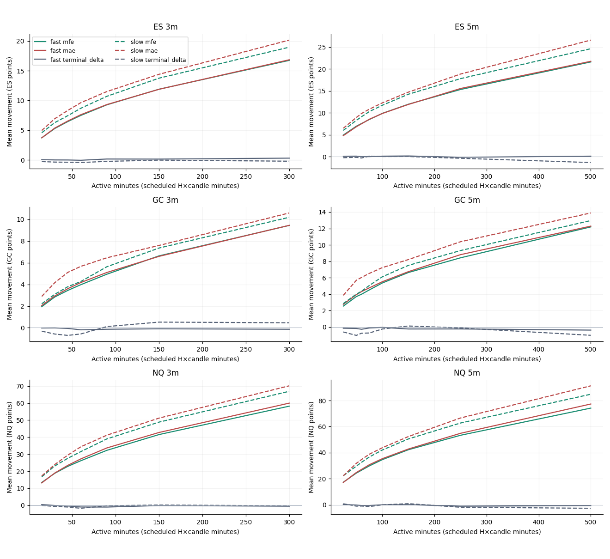
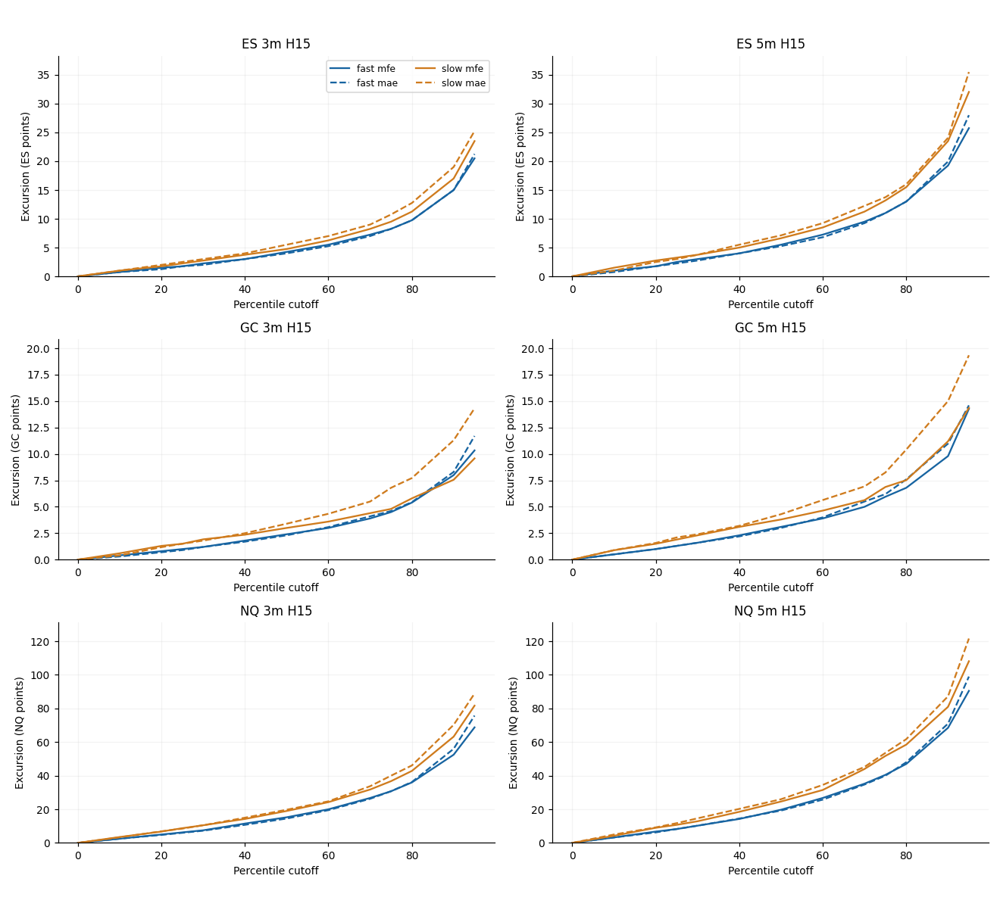
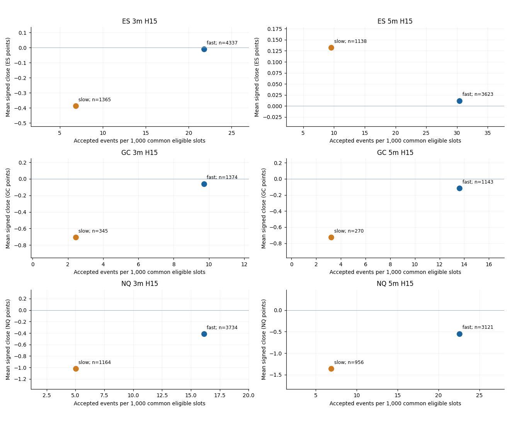
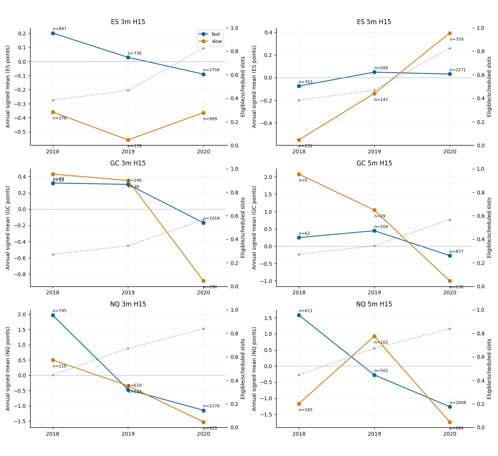
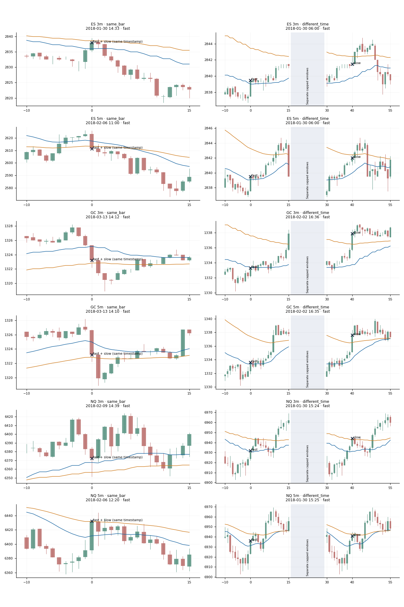
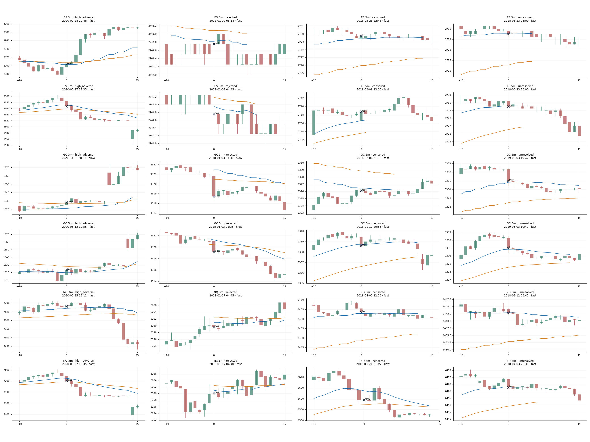

# 20/50 5minEMA Cloud Trend Follow Opportunity Study — Stage 2
Run 20261011T002602Z_s2_c1b4 · 2018–2020 development only

## Primary development findings

All six primary familywise intervals include zero; the prespecified comparison does not establish a pooled fast-versus-slow signed-terminal advantage.

ES 3m H15: fast-minus-slow mean signed terminal movement 0.37810246781886275 points; four-week pointwise 95% interval [-0.02281508090884251, 0.80675802954243014], six-contrast familywise interval [-0.13969391272801138, 0.95734088457826194]; familywise interval includes zero. Fast: 4345 accepted, 4337 completed, 8 censored; slow: 1366 accepted, 1365 completed, 1 censored. Evidence rows S2-T08|ES|3|All|fast_minus_slow|all|15|points|terminal_delta|event|fast_minus_slow|4|pointwise95 and S2-T08|ES|3|All|fast_minus_slow|all|15|points|terminal_delta|event|fast_minus_slow|4|bonferroni.

ES 5m H15: fast-minus-slow mean signed terminal movement -0.12017393270003497 points; four-week pointwise 95% interval [-1.1198111057834046, 0.73150137613284072], six-contrast familywise interval [-1.5102983195984414, 0.93187463907618395]; familywise interval includes zero. Fast: 3642 accepted, 3623 completed, 19 censored; slow: 1143 accepted, 1138 completed, 5 censored. Evidence rows S2-T08|ES|5|All|fast_minus_slow|all|15|points|terminal_delta|event|fast_minus_slow|4|pointwise95 and S2-T08|ES|5|All|fast_minus_slow|all|15|points|terminal_delta|event|fast_minus_slow|4|bonferroni.

GC 3m H15: fast-minus-slow mean signed terminal movement 0.64677109043730951 points; four-week pointwise 95% interval [-0.081348045609843947, 1.1457435375266964], six-contrast familywise interval [-0.27537768529193279, 1.3018040806667475]; familywise interval includes zero. Fast: 1382 accepted, 1374 completed, 8 censored; slow: 347 accepted, 345 completed, 2 censored. Evidence rows S2-T08|GC|3|All|fast_minus_slow|all|15|points|terminal_delta|event|fast_minus_slow|4|pointwise95 and S2-T08|GC|3|All|fast_minus_slow|all|15|points|terminal_delta|event|fast_minus_slow|4|bonferroni.

GC 5m H15: fast-minus-slow mean signed terminal movement 0.61076990376201834 points; four-week pointwise 95% interval [-0.33636927438390596, 1.3155149670991013], six-contrast familywise interval [-0.6530429584293298, 1.5686122348750171]; familywise interval includes zero. Fast: 1164 accepted, 1143 completed, 21 censored; slow: 275 accepted, 270 completed, 5 censored. Evidence rows S2-T08|GC|5|All|fast_minus_slow|all|15|points|terminal_delta|event|fast_minus_slow|4|pointwise95 and S2-T08|GC|5|All|fast_minus_slow|all|15|points|terminal_delta|event|fast_minus_slow|4|bonferroni.

NQ 3m H15: fast-minus-slow mean signed terminal movement 0.60493144173444269 points; four-week pointwise 95% interval [-0.99949482176622773, 2.2142157172200694], six-contrast familywise interval [-1.6193581656723854, 2.7042254383973927]; familywise interval includes zero. Fast: 3749 accepted, 3734 completed, 15 censored; slow: 1165 accepted, 1164 completed, 1 censored. Evidence rows S2-T08|NQ|3|All|fast_minus_slow|all|15|points|terminal_delta|event|fast_minus_slow|4|pointwise95 and S2-T08|NQ|3|All|fast_minus_slow|all|15|points|terminal_delta|event|fast_minus_slow|4|bonferroni.

NQ 5m H15: fast-minus-slow mean signed terminal movement 0.80848934334692657 points; four-week pointwise 95% interval [-1.810475343485654, 3.4539829321031497], six-contrast familywise interval [-2.7306433817965559, 4.5057476955632492]; familywise interval includes zero. Fast: 3148 accepted, 3121 completed, 27 censored; slow: 961 accepted, 956 completed, 5 censored. Evidence rows S2-T08|NQ|5|All|fast_minus_slow|all|15|points|terminal_delta|event|fast_minus_slow|4|pointwise95 and S2-T08|NQ|5|All|fast_minus_slow|all|15|points|terminal_delta|event|fast_minus_slow|4|bonferroni.

## Fixed definitions and paired uncertainty

The six primary comparisons are pooled-direction H15 event-weighted fast-minus-slow mean signed terminal movement in each product’s raw points. The branches use the same eligible bar/feature/calendar roster and retain their different accepted timestamps. These are observational population comparisons. Circular calendar-week blocks share sampled weeks across branches and cells, with 157 Monday weeks from 2018-01-01 through 2020-12-28, 10,000 replicates and seed 20261010. Four-week blocks are primary; one/eight-week blocks are sensitivities. Pointwise intervals have nominal 95% confidence; Bonferroni intervals target nominal 95% familywise confidence for these six primary contrasts and use exact tails .05/12 and 1−.05/12, equivalent to 99.1666667% marginal coverage. Other sides, units, sessions, metrics and horizons are descriptive. Undefined draws remain explicit; a zero-event week has no invented outcome mean. Session balancing first averages whole contributing sessions and assigns each to its trading-date Monday week. Quantiles interpolate at p(n−1). Terminal signs use strict zero; MFE>MAE ties use 1e−10×max(1,MFE,MAE). Cohorts below 100 evaluable events or 30 contributing sessions are sparse. Changing readiness and early GC support limit pooled stability claims.

## Coverage, timing and evidence qualifications

Signals opened in New York 2018–2020 only; 2017 is causal warmup and later outcomes remain reserved. All cells use a five-minute EMA20/50 cloud, inclusive widths ES 2.4, GC 2, NQ 10 points, and independent selected-boundary states. Five-minute candles use the current completed cloud; three-minute candles use the latest scheduled completed five-minute cloud at open. This difference changes feature staleness as well as candle aggregation. Missing latest slots invalidate features immediately. The reference is unadjusted confirmed signal close, and the signal candle is excluded. Overlapping H15 observations are retained. H15 spans 45 active minutes for 3m and 75 for 5m; 60/150 active-minute and uninterrupted views are secondary. MFE/MAE and signed terminal movement describe price paths, not executable profits, fills, stops or targets. Modeled completion is available_at; original vendor receipt and mapping arrival evidence are absent. Uncertified holiday/early-close sessions are unusable and reset features. Missing minutes cannot reliably distinguish no trades from source loss. Published input bytes and inherited definitions are checked; original raw reconstruction, native TradingView equivalence and off-device backup remain uncertified. Earlier Abacus work inspected some later history, so reserved periods are not pristine market holdouts.

## Standalone H15 branch scorecards

Pooled sides. Event and session means have different denominators. Raw points remain separate by product.

| Product | Interval minutes | Touch mode | Accepted | Completed | Censored | Contributing sessions | Mean mfe | Mean mae | Mean terminal delta | Session mean terminal delta | Sparse warning |
| --- | --- | --- | --- | --- | --- | --- | --- | --- | --- | --- | --- |
| ES | 3.0 | fast | 4345.0 | 4337.0 | 8.0 | 455.0 | 6.449331335024211 | 6.543405579893936 | -0.009626469910075985 | -0.01848995939902391 | False |
| ES | 5.0 | fast | 3642.0 | 3623.0 | 19.0 | 447.0 | 8.478263869721227 | 8.541333149323766 | 0.012075627932652749 | 0.01866143019602371 | False |
| GC | 3.0 | fast | 1382.0 | 1374.0 | 8.0 | 250.0 | 3.446797671033476 | 3.6069868995633203 | -0.059315866084424046 | -0.15998925687299476 | False |
| GC | 5.0 | fast | 1164.0 | 1143.0 | 21.0 | 239.0 | 4.521522309711286 | 4.771916010498691 | -0.11478565179352744 | -0.1922212476806142 | False |
| NQ | 3.0 | fast | 3749.0 | 3734.0 | 15.0 | 490.0 | 22.853709159078736 | 23.45480717728977 | -0.4128950187466507 | -0.6882639161046444 | False |
| NQ | 5.0 | fast | 3148.0 | 3121.0 | 27.0 | 483.0 | 29.842598526113424 | 30.762415892342194 | -0.5474206984940709 | -0.9104255117267586 | False |
| ES | 3.0 | slow | 1366.0 | 1365.0 | 1.0 | 375.0 | 7.441575091575092 | 8.31904761904762 | -0.38772893772893874 | -0.29700890405890495 | False |
| ES | 5.0 | slow | 1143.0 | 1138.0 | 5.0 | 353.0 | 10.286906854130052 | 10.82535149384886 | 0.13224956063268772 | 0.10450858749371392 | False |
| GC | 3.0 | slow | 347.0 | 345.0 | 2.0 | 151.0 | 3.7872463768115927 | 5.111884057971018 | -0.7060869565217336 | -0.24875748975086137 | False |
| GC | 5.0 | slow | 275.0 | 270.0 | 5.0 | 124.0 | 5.060740740740744 | 6.532592592592582 | -0.7255555555555457 | -0.00920026881719493 | False |
| NQ | 3.0 | slow | 1165.0 | 1164.0 | 1.0 | 377.0 | 27.5983676975945 | 29.46284364261167 | -1.0178264604810934 | -0.4984998717757308 | False |
| NQ | 5.0 | slow | 961.0 | 956.0 | 5.0 | 336.0 | 36.69743723849373 | 38.83969665271965 | -1.3559100418409975 | -0.793630045136738 | False |

## Six primary paired effects and block sensitivities

Fast-minus-slow event-weighted H15 terminal means in raw points. Four-week blocks are primary; one/eight are sensitivities.

| Product | Interval minutes | Block weeks | Interval type | Estimate | Ci low | Ci high | Undefined draws | Fast evaluable | Slow evaluable |
| --- | --- | --- | --- | --- | --- | --- | --- | --- | --- |
| ES | 3.0 | 4.0 | pointwise95 | 0.37810246781886275 | -0.02281508090884251 | 0.8067580295424301 | 0.0 | 4337.0 | 1365.0 |
| ES | 3.0 | 4.0 | bonferroni | 0.37810246781886275 | -0.13969391272801138 | 0.9573408845782619 | 0.0 | 4337.0 | 1365.0 |
| ES | 5.0 | 4.0 | pointwise95 | -0.12017393270003497 | -1.1198111057834046 | 0.7315013761328407 | 0.0 | 3623.0 | 1138.0 |
| ES | 5.0 | 4.0 | bonferroni | -0.12017393270003497 | -1.5102983195984414 | 0.931874639076184 | 0.0 | 3623.0 | 1138.0 |
| GC | 3.0 | 4.0 | pointwise95 | 0.6467710904373095 | -0.08134804560984395 | 1.1457435375266964 | 0.0 | 1374.0 | 345.0 |
| GC | 3.0 | 4.0 | bonferroni | 0.6467710904373095 | -0.2753776852919328 | 1.3018040806667475 | 0.0 | 1374.0 | 345.0 |
| GC | 5.0 | 4.0 | pointwise95 | 0.6107699037620183 | -0.33636927438390596 | 1.3155149670991013 | 0.0 | 1143.0 | 270.0 |
| GC | 5.0 | 4.0 | bonferroni | 0.6107699037620183 | -0.6530429584293298 | 1.568612234875017 | 0.0 | 1143.0 | 270.0 |
| NQ | 3.0 | 4.0 | pointwise95 | 0.6049314417344427 | -0.9994948217662277 | 2.2142157172200694 | 0.0 | 3734.0 | 1164.0 |
| NQ | 3.0 | 4.0 | bonferroni | 0.6049314417344427 | -1.6193581656723854 | 2.7042254383973927 | 0.0 | 3734.0 | 1164.0 |
| NQ | 5.0 | 4.0 | pointwise95 | 0.8084893433469266 | -1.810475343485654 | 3.4539829321031497 | 0.0 | 3121.0 | 956.0 |
| NQ | 5.0 | 4.0 | bonferroni | 0.8084893433469266 | -2.730643381796556 | 4.505747695563249 | 0.0 | 3121.0 | 956.0 |
| ES | 3.0 | 1.0 | pointwise95 | 0.37810246781886275 | -0.03758845427166822 | 0.819184670820545 | 0.0 | 4337.0 | 1365.0 |
| ES | 3.0 | 1.0 | bonferroni | 0.37810246781886275 | -0.16745866253623473 | 1.0098720296483819 | 0.0 | 4337.0 | 1365.0 |
| ES | 5.0 | 1.0 | pointwise95 | -0.12017393270003497 | -0.8772672743284263 | 0.6063893637164064 | 0.0 | 3623.0 | 1138.0 |
| ES | 5.0 | 1.0 | bonferroni | -0.12017393270003497 | -1.131572680770375 | 0.8077608088193801 | 0.0 | 3623.0 | 1138.0 |
| GC | 3.0 | 1.0 | pointwise95 | 0.6467710904373095 | 0.08396201569895086 | 1.2217675673742672 | 0.0 | 1374.0 | 345.0 |
| GC | 3.0 | 1.0 | bonferroni | 0.6467710904373095 | -0.09288584542466151 | 1.4160931390111484 | 0.0 | 1374.0 | 345.0 |
| GC | 5.0 | 1.0 | pointwise95 | 0.6107699037620183 | -0.12000829238330785 | 1.3496537980097294 | 0.0 | 1143.0 | 270.0 |
| GC | 5.0 | 1.0 | bonferroni | 0.6107699037620183 | -0.37415886701501744 | 1.6339332503116681 | 0.0 | 1143.0 | 270.0 |
| NQ | 3.0 | 1.0 | pointwise95 | 0.6049314417344427 | -1.3896480612335143 | 2.5994970349600384 | 0.0 | 3734.0 | 1164.0 |
| NQ | 3.0 | 1.0 | bonferroni | 0.6049314417344427 | -2.110322902375176 | 3.2588652787223715 | 0.0 | 3734.0 | 1164.0 |
| NQ | 5.0 | 1.0 | pointwise95 | 0.8084893433469266 | -2.3598913846157745 | 3.894760409304115 | 0.0 | 3121.0 | 956.0 |
| NQ | 5.0 | 1.0 | bonferroni | 0.8084893433469266 | -3.48004407429158 | 4.995426837788123 | 0.0 | 3121.0 | 956.0 |
| ES | 3.0 | 8.0 | pointwise95 | 0.37810246781886275 | 0.057450648514736136 | 0.790519317175758 | 0.0 | 4337.0 | 1365.0 |
| ES | 3.0 | 8.0 | bonferroni | 0.37810246781886275 | -0.03864454769265186 | 0.9886499110040492 | 0.0 | 4337.0 | 1365.0 |
| ES | 5.0 | 8.0 | pointwise95 | -0.12017393270003497 | -1.1810417209227415 | 0.792360642299033 | 0.0 | 3623.0 | 1138.0 |
| ES | 5.0 | 8.0 | bonferroni | -0.12017393270003497 | -1.5775659239073225 | 1.0485300061054788 | 0.0 | 3623.0 | 1138.0 |
| GC | 3.0 | 8.0 | pointwise95 | 0.6467710904373095 | -0.08726320029707978 | 1.0923500228383123 | 0.0 | 1374.0 | 345.0 |
| GC | 3.0 | 8.0 | bonferroni | 0.6467710904373095 | -0.2633470819813895 | 1.228951210052567 | 0.0 | 1374.0 | 345.0 |
| GC | 5.0 | 8.0 | pointwise95 | 0.6107699037620183 | -0.3660923586274103 | 1.3513481237594833 | 0.0 | 1143.0 | 270.0 |
| GC | 5.0 | 8.0 | bonferroni | 0.6107699037620183 | -0.6608658939744624 | 1.6094055933979368 | 0.0 | 1143.0 | 270.0 |
| NQ | 3.0 | 8.0 | pointwise95 | 0.6049314417344427 | -0.6151509417358403 | 1.780036863117517 | 0.0 | 3734.0 | 1164.0 |
| NQ | 3.0 | 8.0 | bonferroni | 0.6049314417344427 | -1.0875034580637755 | 2.2428569250456376 | 0.0 | 3734.0 | 1164.0 |
| NQ | 5.0 | 8.0 | pointwise95 | 0.8084893433469266 | -1.6362830571436735 | 3.2807031766104426 | 0.0 | 3121.0 | 956.0 |
| NQ | 5.0 | 8.0 | bonferroni | 0.8084893433469266 | -2.531440309771219 | 4.143335773337903 | 0.0 | 3121.0 | 956.0 |

## Opportunity frequency and deduplicated union

Union=fast+slow−same-bar dual. Incremental opportunities are fast-only accepted timestamps. Rates use the common usable feature-valid roster; no combined execution policy is tested.

| Product | Interval minutes | Fast accepted | Slow accepted | Both accepted | Union accepted | Incremental vs slow | Eligible slots | Fast rate per 1000 | Slow rate per 1000 |
| --- | --- | --- | --- | --- | --- | --- | --- | --- | --- |
| ES | 3.0 | 4345.0 | 1366.0 | 197.0 | 5514.0 | 4148.0 | 199581.0 | 21.77060942674904 | 6.844338889974496 |
| ES | 5.0 | 3642.0 | 1143.0 | 207.0 | 4578.0 | 3435.0 | 119870.0 | 30.382914824393094 | 9.535329940769167 |
| GC | 3.0 | 1382.0 | 347.0 | 42.0 | 1687.0 | 1340.0 | 142252.0 | 9.715153389759019 | 2.4393330146500576 |
| GC | 5.0 | 1164.0 | 275.0 | 46.0 | 1393.0 | 1118.0 | 85529.0 | 13.60941902746437 | 3.215283704942183 |
| NQ | 3.0 | 3749.0 | 1165.0 | 152.0 | 4762.0 | 3597.0 | 232470.0 | 16.12681206177141 | 5.011399320342409 |
| NQ | 5.0 | 3148.0 | 961.0 | 142.0 | 3967.0 | 3006.0 | 139600.0 | 22.550143266475644 | 6.883954154727793 |

## Geometry and acceptance remain separate

Five geometric classes include undefined candles. Four accepted-membership classes reflect independent arm/gateway decisions.

| Product | Interval minutes | Dimension | Category | Count | Eligible count | Scheduled slots | Eligible slots |
| --- | --- | --- | --- | --- | --- | --- | --- |
| ES | 3.0 | geometry | fast_only | 28367.0 | 28367.0 | 356720.0 | 199581.0 |
| ES | 3.0 | geometry | slow_only | 13007.0 | 13007.0 | 356720.0 | 199581.0 |
| ES | 3.0 | geometry | both | 12280.0 | 12280.0 | 356720.0 | 199581.0 |
| ES | 3.0 | geometry | neither | 145927.0 | 145927.0 | 356720.0 | 199581.0 |
| ES | 3.0 | geometry | undefined | 157139.0 | 0.0 | 356720.0 | 199581.0 |
| ES | 3.0 | accepted_membership | fast_only | 4148.0 | 4148.0 | 356720.0 | 199581.0 |
| ES | 3.0 | accepted_membership | slow_only | 1169.0 | 1169.0 | 356720.0 | 199581.0 |
| ES | 3.0 | accepted_membership | both | 197.0 | 197.0 | 356720.0 | 199581.0 |
| ES | 3.0 | accepted_membership | neither | 351206.0 | 194067.0 | 356720.0 | 199581.0 |
| ES | 5.0 | geometry | fast_only | 22610.0 | 22610.0 | 214032.0 | 119870.0 |
| ES | 5.0 | geometry | slow_only | 7480.0 | 7480.0 | 214032.0 | 119870.0 |
| ES | 5.0 | geometry | both | 13349.0 | 13349.0 | 214032.0 | 119870.0 |
| ES | 5.0 | geometry | neither | 76431.0 | 76431.0 | 214032.0 | 119870.0 |
| ES | 5.0 | geometry | undefined | 94162.0 | 0.0 | 214032.0 | 119870.0 |
| ES | 5.0 | accepted_membership | fast_only | 3435.0 | 3435.0 | 214032.0 | 119870.0 |
| ES | 5.0 | accepted_membership | slow_only | 936.0 | 936.0 | 214032.0 | 119870.0 |
| ES | 5.0 | accepted_membership | both | 207.0 | 207.0 | 214032.0 | 119870.0 |
| ES | 5.0 | accepted_membership | neither | 209454.0 | 115292.0 | 214032.0 | 119870.0 |
| GC | 3.0 | geometry | fast_only | 20511.0 | 20511.0 | 360640.0 | 142252.0 |
| GC | 3.0 | geometry | slow_only | 9652.0 | 9652.0 | 360640.0 | 142252.0 |
| GC | 3.0 | geometry | both | 8962.0 | 8962.0 | 360640.0 | 142252.0 |
| GC | 3.0 | geometry | neither | 103127.0 | 103127.0 | 360640.0 | 142252.0 |
| GC | 3.0 | geometry | undefined | 218388.0 | 0.0 | 360640.0 | 142252.0 |
| GC | 3.0 | accepted_membership | fast_only | 1340.0 | 1340.0 | 360640.0 | 142252.0 |
| GC | 3.0 | accepted_membership | slow_only | 305.0 | 305.0 | 360640.0 | 142252.0 |
| GC | 3.0 | accepted_membership | both | 42.0 | 42.0 | 360640.0 | 142252.0 |
| GC | 3.0 | accepted_membership | neither | 358953.0 | 140565.0 | 360640.0 | 142252.0 |
| GC | 5.0 | geometry | fast_only | 16406.0 | 16406.0 | 216384.0 | 85529.0 |
| GC | 5.0 | geometry | slow_only | 5634.0 | 5634.0 | 216384.0 | 85529.0 |
| GC | 5.0 | geometry | both | 9797.0 | 9797.0 | 216384.0 | 85529.0 |
| GC | 5.0 | geometry | neither | 53692.0 | 53692.0 | 216384.0 | 85529.0 |
| GC | 5.0 | geometry | undefined | 130855.0 | 0.0 | 216384.0 | 85529.0 |
| GC | 5.0 | accepted_membership | fast_only | 1118.0 | 1118.0 | 216384.0 | 85529.0 |
| GC | 5.0 | accepted_membership | slow_only | 229.0 | 229.0 | 216384.0 | 85529.0 |
| GC | 5.0 | accepted_membership | both | 46.0 | 46.0 | 216384.0 | 85529.0 |
| GC | 5.0 | accepted_membership | neither | 214991.0 | 84136.0 | 216384.0 | 85529.0 |
| NQ | 3.0 | geometry | fast_only | 32005.0 | 32005.0 | 356720.0 | 232470.0 |
| NQ | 3.0 | geometry | slow_only | 14999.0 | 14999.0 | 356720.0 | 232470.0 |
| NQ | 3.0 | geometry | both | 13749.0 | 13749.0 | 356720.0 | 232470.0 |
| NQ | 3.0 | geometry | neither | 171717.0 | 171717.0 | 356720.0 | 232470.0 |
| NQ | 3.0 | geometry | undefined | 124250.0 | 0.0 | 356720.0 | 232470.0 |
| NQ | 3.0 | accepted_membership | fast_only | 3597.0 | 3597.0 | 356720.0 | 232470.0 |
| NQ | 3.0 | accepted_membership | slow_only | 1013.0 | 1013.0 | 356720.0 | 232470.0 |
| NQ | 3.0 | accepted_membership | both | 152.0 | 152.0 | 356720.0 | 232470.0 |
| NQ | 3.0 | accepted_membership | neither | 351958.0 | 227708.0 | 356720.0 | 232470.0 |
| NQ | 5.0 | geometry | fast_only | 25509.0 | 25509.0 | 214032.0 | 139600.0 |
| NQ | 5.0 | geometry | slow_only | 8739.0 | 8739.0 | 214032.0 | 139600.0 |
| NQ | 5.0 | geometry | both | 15077.0 | 15077.0 | 214032.0 | 139600.0 |
| NQ | 5.0 | geometry | neither | 90275.0 | 90275.0 | 214032.0 | 139600.0 |
| NQ | 5.0 | geometry | undefined | 74432.0 | 0.0 | 214032.0 | 139600.0 |
| NQ | 5.0 | accepted_membership | fast_only | 3006.0 | 3006.0 | 214032.0 | 139600.0 |
| NQ | 5.0 | accepted_membership | slow_only | 819.0 | 819.0 | 214032.0 | 139600.0 |
| NQ | 5.0 | accepted_membership | both | 142.0 | 142.0 | 214032.0 | 139600.0 |
| NQ | 5.0 | accepted_membership | neither | 210065.0 | 135633.0 | 214032.0 | 139600.0 |

## Retrospective first-event episode membership

Episode relation counts include causal warmup counterparts where present; later-contact denominators include scoped first fast events only. Null absent contact is unresolved.

| Product | Interval minutes | Summary kind | Category | Count | Episodes | Descriptor eligible | Share |
| --- | --- | --- | --- | --- | --- | --- | --- |
| ES | 3.0 | pair_relation | same_bar | 197.0 | 11036.0 | undefined | 0.01785067053280174 |
| ES | 3.0 | pair_relation | fast_before_slow | 1158.0 | 11036.0 | undefined | 0.104929322218195 |
| ES | 3.0 | pair_relation | slow_before_fast | 0.0 | 11036.0 | undefined | 0.0 |
| ES | 3.0 | pair_relation | fast_only | 2990.0 | 11036.0 | undefined | 0.2709314969191736 |
| ES | 3.0 | pair_relation | slow_only | 11.0 | 11036.0 | undefined | 0.0009967379485320768 |
| ES | 3.0 | pair_relation | neither | 6680.0 | 11036.0 | undefined | 0.6052917723812976 |
| ES | 3.0 | strictly_later_slow_contact | true | 1517.0 | 11036.0 | 4345.0 | 0.34913693901035675 |
| ES | 3.0 | strictly_later_slow_contact | false | 2810.0 | 11036.0 | 4345.0 | 0.6467203682393556 |
| ES | 3.0 | strictly_later_slow_contact | unresolved | 18.0 | 11036.0 | 4345.0 | 0.004142692750287687 |
| ES | 5.0 | pair_relation | same_bar | 207.0 | 9249.0 | undefined | 0.0223807979240999 |
| ES | 5.0 | pair_relation | fast_before_slow | 930.0 | 9249.0 | undefined | 0.1005514109633474 |
| ES | 5.0 | pair_relation | slow_before_fast | 0.0 | 9249.0 | undefined | 0.0 |
| ES | 5.0 | pair_relation | fast_only | 2505.0 | 9249.0 | undefined | 0.27084009082062926 |
| ES | 5.0 | pair_relation | slow_only | 6.0 | 9249.0 | undefined | 0.0006487187804086928 |
| ES | 5.0 | pair_relation | neither | 5601.0 | 9249.0 | undefined | 0.6055789815115148 |
| ES | 5.0 | strictly_later_slow_contact | true | 1408.0 | 9249.0 | 3642.0 | 0.38660076880834704 |
| ES | 5.0 | strictly_later_slow_contact | false | 2222.0 | 9249.0 | 3642.0 | 0.6101043382756727 |
| ES | 5.0 | strictly_later_slow_contact | unresolved | 12.0 | 9249.0 | 3642.0 | 0.0032948929159802307 |
| GC | 3.0 | pair_relation | same_bar | 42.0 | 8305.0 | undefined | 0.005057194461167971 |
| GC | 3.0 | pair_relation | fast_before_slow | 304.0 | 8305.0 | undefined | 0.036604455147501505 |
| GC | 3.0 | pair_relation | slow_before_fast | 0.0 | 8305.0 | undefined | 0.0 |
| GC | 3.0 | pair_relation | fast_only | 1036.0 | 8305.0 | undefined | 0.12474413004214328 |
| GC | 3.0 | pair_relation | slow_only | 1.0 | 8305.0 | undefined | 0.00012040939193257074 |
| GC | 3.0 | pair_relation | neither | 6922.0 | 8305.0 | undefined | 0.8334738109572547 |
| GC | 3.0 | strictly_later_slow_contact | true | 438.0 | 8305.0 | 1382.0 | 0.31693198263386396 |
| GC | 3.0 | strictly_later_slow_contact | false | 939.0 | 8305.0 | 1382.0 | 0.6794500723589001 |
| GC | 3.0 | strictly_later_slow_contact | unresolved | 5.0 | 8305.0 | 1382.0 | 0.00361794500723589 |
| GC | 5.0 | pair_relation | same_bar | 46.0 | 6881.0 | undefined | 0.006685074843772707 |
| GC | 5.0 | pair_relation | fast_before_slow | 228.0 | 6881.0 | undefined | 0.03313471879087342 |
| GC | 5.0 | pair_relation | slow_before_fast | 0.0 | 6881.0 | undefined | 0.0 |
| GC | 5.0 | pair_relation | fast_only | 890.0 | 6881.0 | undefined | 0.12934166545560238 |
| GC | 5.0 | pair_relation | slow_only | 1.0 | 6881.0 | undefined | 0.00014532771399505885 |
| GC | 5.0 | pair_relation | neither | 5716.0 | 6881.0 | undefined | 0.8306932131957564 |
| GC | 5.0 | strictly_later_slow_contact | true | 407.0 | 6881.0 | 1164.0 | 0.34965635738831613 |
| GC | 5.0 | strictly_later_slow_contact | false | 750.0 | 6881.0 | 1164.0 | 0.6443298969072165 |
| GC | 5.0 | strictly_later_slow_contact | unresolved | 7.0 | 6881.0 | 1164.0 | 0.006013745704467354 |
| NQ | 3.0 | pair_relation | same_bar | 152.0 | 12644.0 | undefined | 0.012021512179689971 |
| NQ | 3.0 | pair_relation | fast_before_slow | 1005.0 | 12644.0 | undefined | 0.07948434039860804 |
| NQ | 3.0 | pair_relation | slow_before_fast | 0.0 | 12644.0 | undefined | 0.0 |
| NQ | 3.0 | pair_relation | fast_only | 2592.0 | 12644.0 | undefined | 0.20499841822208162 |
| NQ | 3.0 | pair_relation | slow_only | 8.0 | 12644.0 | undefined | 0.0006327111673521037 |
| NQ | 3.0 | pair_relation | neither | 8887.0 | 12644.0 | undefined | 0.7028630180322682 |
| NQ | 3.0 | strictly_later_slow_contact | true | 1305.0 | 12644.0 | 3749.0 | 0.3480928247532675 |
| NQ | 3.0 | strictly_later_slow_contact | false | 2422.0 | 12644.0 | 3749.0 | 0.6460389437183249 |
| NQ | 3.0 | strictly_later_slow_contact | unresolved | 22.0 | 12644.0 | 3749.0 | 0.005868231528407575 |
| NQ | 5.0 | pair_relation | same_bar | 142.0 | 10651.0 | undefined | 0.013332081494695334 |
| NQ | 5.0 | pair_relation | fast_before_slow | 814.0 | 10651.0 | undefined | 0.07642474884987326 |
| NQ | 5.0 | pair_relation | slow_before_fast | 0.0 | 10651.0 | undefined | 0.0 |
| NQ | 5.0 | pair_relation | fast_only | 2192.0 | 10651.0 | undefined | 0.20580227208712798 |
| NQ | 5.0 | pair_relation | slow_only | 5.0 | 10651.0 | undefined | 0.0004694394892498357 |
| NQ | 5.0 | pair_relation | neither | 7498.0 | 10651.0 | undefined | 0.7039714580790536 |
| NQ | 5.0 | strictly_later_slow_contact | true | 1207.0 | 10651.0 | 3148.0 | 0.38341804320203304 |
| NQ | 5.0 | strictly_later_slow_contact | false | 1924.0 | 10651.0 | 3148.0 | 0.6111817026683609 |
| NQ | 5.0 | strictly_later_slow_contact | unresolved | 17.0 | 10651.0 | 3148.0 | 0.0054002541296060995 |

## Annual support and movement under the fixed rule

No annual, side or hour was selected. Small counts and changing mapped readiness limit stability interpretation.

| Product | Interval minutes | Touch mode | Period | Completed | Contributing sessions | Mean mfe | Mean mae | Mean terminal delta | Sparse warning | Eligible slots |
| --- | --- | --- | --- | --- | --- | --- | --- | --- | --- | --- |
| ES | 3.0 | fast | 2018 | 897.0 | 102.0 | 5.780100334448161 | 5.596153846153846 | 0.20178372352285395 | False | 45541.0 |
| ES | 3.0 | fast | 2019 | 736.0 | 126.0 | 4.163383152173913 | 4.106657608695652 | 0.029211956521739132 | False | 55595.0 |
| ES | 3.0 | fast | 2020 | 2704.0 | 227.0 | 7.293546597633138 | 7.520894970414201 | -0.09032914201183415 | False | 98445.0 |
| ES | 5.0 | fast | 2018 | 763.0 | 101.0 | 7.6225425950196595 | 7.477064220183486 | -0.07437745740498033 | False | 27370.0 |
| ES | 5.0 | fast | 2019 | 589.0 | 120.0 | 5.490662139219015 | 5.453310696095077 | 0.04838709677419355 | False | 33407.0 |
| ES | 5.0 | fast | 2020 | 2271.0 | 226.0 | 9.540620871862616 | 9.69980184940555 | 0.03170409511228574 | False | 59093.0 |
| GC | 3.0 | fast | 2018 | 69.0 | 37.0 | 1.6507246376811542 | 1.242028985507247 | 0.32028985507244595 | True | 32623.0 |
| GC | 3.0 | fast | 2019 | 246.0 | 60.0 | 2.3540650406504025 | 2.1735772357723673 | 0.3032520325203239 | False | 41299.0 |
| GC | 3.0 | fast | 2020 | 1059.0 | 153.0 | 3.8176581680830948 | 4.094050991501416 | -0.1682719546742182 | False | 68330.0 |
| GC | 5.0 | fast | 2018 | 62.0 | 34.0 | 1.966129032258077 | 1.5709677419354853 | 0.2483870967741877 | True | 19639.0 |
| GC | 5.0 | fast | 2019 | 204.0 | 58.0 | 3.1632352941176536 | 2.8504901960784346 | 0.44607843137254344 | False | 24833.0 |
| GC | 5.0 | fast | 2020 | 877.0 | 147.0 | 5.018129988597489 | 5.445153933865454 | -0.2709236031927028 | False | 41057.0 |
| NQ | 3.0 | fast | 2018 | 745.0 | 115.0 | 20.582885906040268 | 18.08758389261745 | 1.9734899328859061 | False | 52816.0 |
| NQ | 3.0 | fast | 2019 | 619.0 | 146.0 | 14.32794830371567 | 14.767770597738297 | -0.47011308562197385 | False | 79780.0 |
| NQ | 3.0 | fast | 2020 | 2370.0 | 229.0 | 25.794303797468356 | 27.410864978902946 | -1.1481012658227814 | False | 99874.0 |
| NQ | 5.0 | fast | 2018 | 611.0 | 114.0 | 27.479950900163665 | 24.689034369885434 | 1.5838788870703764 | False | 31741.0 |
| NQ | 5.0 | fast | 2019 | 502.0 | 140.0 | 18.73256972111554 | 19.09462151394423 | -0.2768924302788899 | False | 47910.0 |
| NQ | 5.0 | fast | 2020 | 2008.0 | 229.0 | 33.33901892430279 | 35.527390438247004 | -1.2635707171314705 | False | 59949.0 |
| ES | 3.0 | slow | 2018 | 278.0 | 83.0 | 6.948741007194244 | 7.473021582733813 | -0.35881294964028776 | False | 45541.0 |
| ES | 3.0 | slow | 2019 | 178.0 | 85.0 | 4.841292134831461 | 5.859550561797753 | -0.5575842696629213 | False | 55595.0 |
| ES | 3.0 | slow | 2020 | 909.0 | 207.0 | 8.101485148514852 | 9.059405940594061 | -0.3633113311331148 | False | 98445.0 |
| ES | 5.0 | slow | 2018 | 232.0 | 80.0 | 9.252155172413794 | 10.068965517241379 | -0.5495689655172413 | False | 27370.0 |
| ES | 5.0 | slow | 2019 | 147.0 | 75.0 | 6.787414965986395 | 7.387755102040816 | -0.13945578231292516 | False | 33407.0 |
| ES | 5.0 | slow | 2020 | 759.0 | 198.0 | 11.280961791831357 | 11.722332015810279 | 0.3932806324110654 | False | 59093.0 |
| GC | 3.0 | slow | 2018 | 10.0 | 10.0 | 2.2799999999999954 | 1.4299999999999726 | 0.4300000000000182 | True | 32623.0 |
| GC | 3.0 | slow | 2019 | 39.0 | 27.0 | 2.964102564102585 | 2.6923076923076925 | 0.3512820512820758 | True | 41299.0 |
| GC | 3.0 | slow | 2020 | 296.0 | 114.0 | 3.9466216216216172 | 5.555067567567573 | -0.8837837837837812 | False | 68330.0 |
| GC | 5.0 | slow | 2018 | 5.0 | 5.0 | 3.260000000000036 | 1.9399999999999635 | 2.0799999999999725 | True | 19639.0 |
| GC | 5.0 | slow | 2019 | 29.0 | 21.0 | 4.003448275862097 | 2.85862068965516 | 1.0413793103448605 | True | 24833.0 |
| GC | 5.0 | slow | 2020 | 236.0 | 98.0 | 5.228813559322034 | 7.0813559322033806 | -1.002118644067789 | False | 41057.0 |
| NQ | 3.0 | slow | 2018 | 216.0 | 85.0 | 25.600694444444443 | 24.71643518518519 | 0.5034722222222222 | False | 52816.0 |
| NQ | 3.0 | slow | 2019 | 133.0 | 88.0 | 17.95112781954888 | 19.289473684210527 | -0.34398496240601506 | False | 79780.0 |
| NQ | 3.0 | slow | 2020 | 815.0 | 204.0 | 29.702147239263805 | 32.38098159509201 | -1.5309815950920156 | False | 99874.0 |
| NQ | 5.0 | slow | 2018 | 165.0 | 71.0 | 35.096969696969694 | 33.73333333333334 | -1.1712121212121211 | False | 31741.0 |
| NQ | 5.0 | slow | 2019 | 102.0 | 71.0 | 24.82598039215688 | 23.458333333333332 | 0.926470588235303 | False | 47910.0 |
| NQ | 5.0 | slow | 2020 | 689.0 | 194.0 | 38.83817126269956 | 42.339622641509415 | -1.7380261248185698 | False | 59949.0 |

## Overlap and episode interpretation

Geometry, accepted membership, union and episode pairing describe different populations. Geometry can touch both boundaries while only one stream accepts. A same-bar accepted dual has one union observation and exactly equal reference/ATR/forward paths. Different timestamps remain separate observations. The descriptive union has no combined position policy. Shared geometric episodes start on strict full-cloud departure, retain consecutive departures, and restart at a departure after any non-departure; resets terminate them. Only the first accepted event of each stream is paired. Warmup first events are retained and never replaced with later development counterparts. Later slow geometry and later accepted slow signal are separate retrospective descriptors. No later contact is false only after an observed new departure; absent contacts at resets or the endpoint remain unresolved. These labels never filter a fast signal.

## Horizon responses of independent streams

All completed evaluable paths, pooled sides, event means. H15 is 45/75 active minutes; secondary horizons describe duration rather than a selected exit.

## H15 adverse and favorable excursion distributions

A common vertical scale is used across both candle intervals within each product. Raw points are never combined across ES, GC and NQ. Curves show percentile cutoffs, not tail averages.

## Frequency and subsequent signed movement

Frequency uses usable feature-valid signal slots; mean movement uses completed H15 events. These denominators differ. No linear frequency-quality relation or causal advantage is implied; uncertainty appears in the contrast table.

## Annual movement and changing eligible coverage

Annual event means and completed supports are descriptive. Dotted lines are common usable mapped-feature readiness shares. Zero events describe eligible observed support; unknown signal coverage cannot establish zero opportunities. Early GC counts are sparse.

## Prespecified same-bar and different-time episodes

First accepted stream events only, both in development. Same-bar signals share one displayed window. Different-time order is retained, with separate −10/+15 scheduled-slot windows and omitted intervals labeled. Blue=EMA20; orange=EMA50. X marks confirmed-close references. Pairing is retrospective.

## Prespecified adverse, rejected, censored and unresolved cases

Largest completed H15 MAE across streams and earliest remaining classes, using frozen timestamp/ID ties. No favorable replacement is allowed. Rejected cases have no forward score; interrupted absent slow contact remains unresolved. Blue=EMA20; orange=EMA50. X marks confirmed close; windows contain development candles only.

## Preserved baseline and next-stage boundary

Slow parity is checked against the immutable Stage 1 run 20261010T221954Z_s1_8c6e_r3, protocol 0.1.0-stage1.2. Its pooled H15 four-week terminal intervals included zero, and mean adverse excursion exceeded mean favorable excursion in all six cells. Negative side/session findings and block sensitivities remain retained; Stage 2 does not replace that record. The baseline input release is same_contract_ema_cloud 1.0.0. Current maintained Stage 1 verifier/caption repairs are distinct from its frozen executed source. The slow scientific parity gate precedes fast outcome execution. Stage 3 requires a separate frozen instruction; later outcomes and all gateway optimization remain reserved.

## Detailed evidence and verification

Full saved S2-T00–S2-T10 tables, cohort/duration uncertainty, complete weekly sufficient statistics and episode metrics remain in the private research run. Numerical fixtures, exact slow parity, full scalar/path/table uncertainty reconciliation, input bytes and selected-source transfer are separately recorded. Publication validation checks selected content and assets; it does not establish research correctness.

## Exact saved evidence

- [S2-T00](tables/S2-T00_coverage.csv)
- [S2-T01](tables/S2-T01_signal_flow.csv)
- [S2-T02](tables/S2-T02_horizon_scorecard.csv)
- [S2-T03](tables/S2-T03_quantiles.csv)
- [S2-T04](tables/S2-T04_stability.csv)
- [S2-T05](tables/S2-T05_calendar.csv)
- [S2-T06](tables/S2-T06_examples.csv)
- [S2-T07](tables/S2-T07_geometry_membership.csv)
- [S2-T08](tables/S2-T08_branch_contrasts.csv)
- [S2-T09](tables/S2-T09_episode_pairing.csv)
- [S2-T10](tables/S2-T10_union_overlap.csv)
- [Cohort uncertainty](tables/S2-bootstrap.csv)
- [Duration comparisons](tables/S2-duration-comparisons.csv)
- [Weekly sufficient statistics](tables/S2-calendar-sufficient-statistics.csv)
- [First-pair metrics](tables/S2-episode-pair-metrics.csv)
