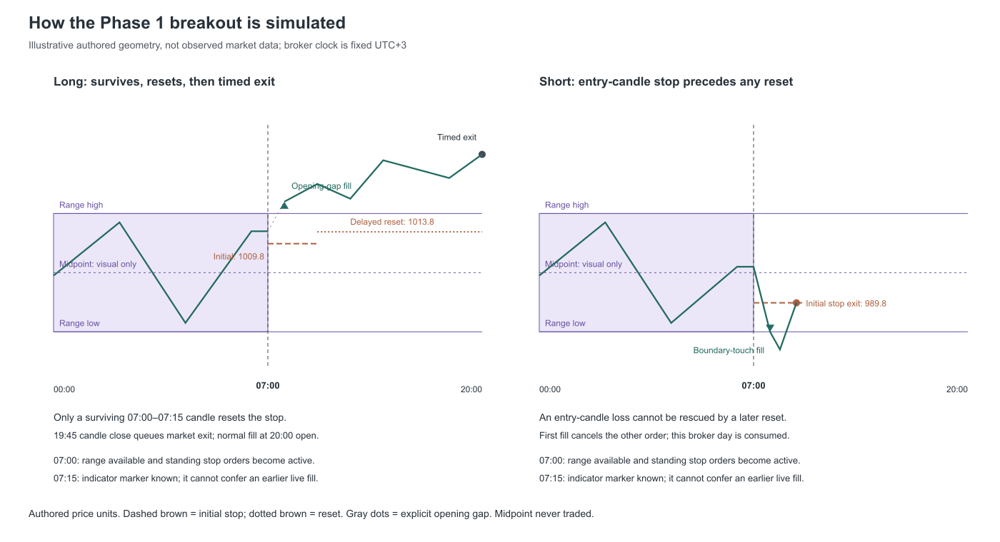
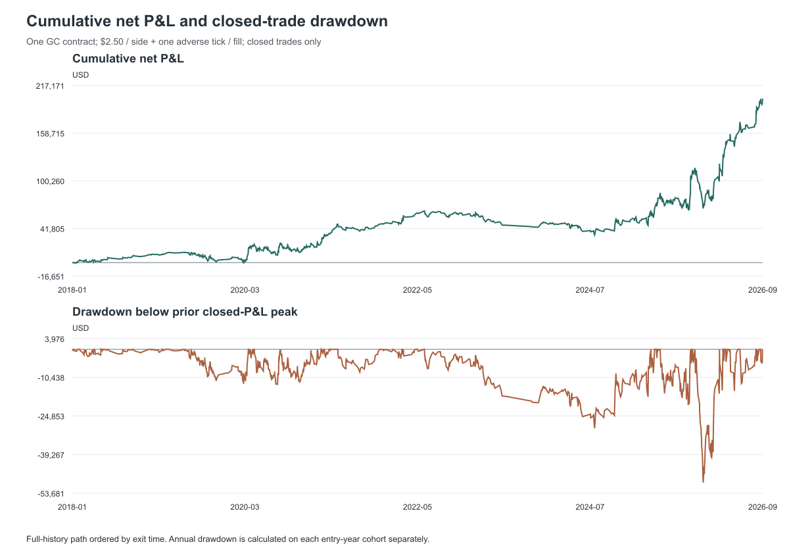
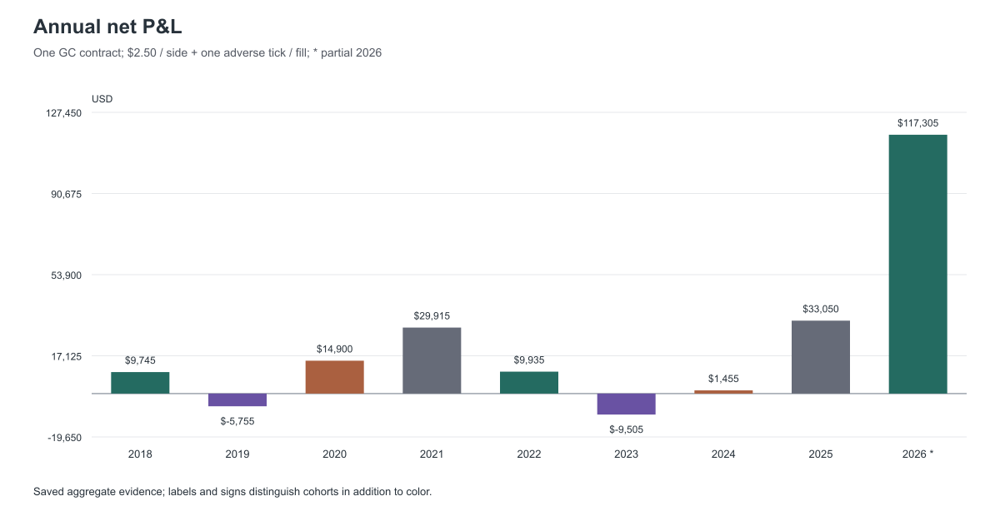
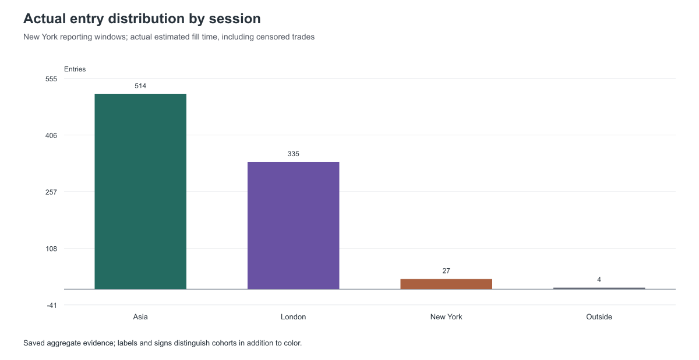
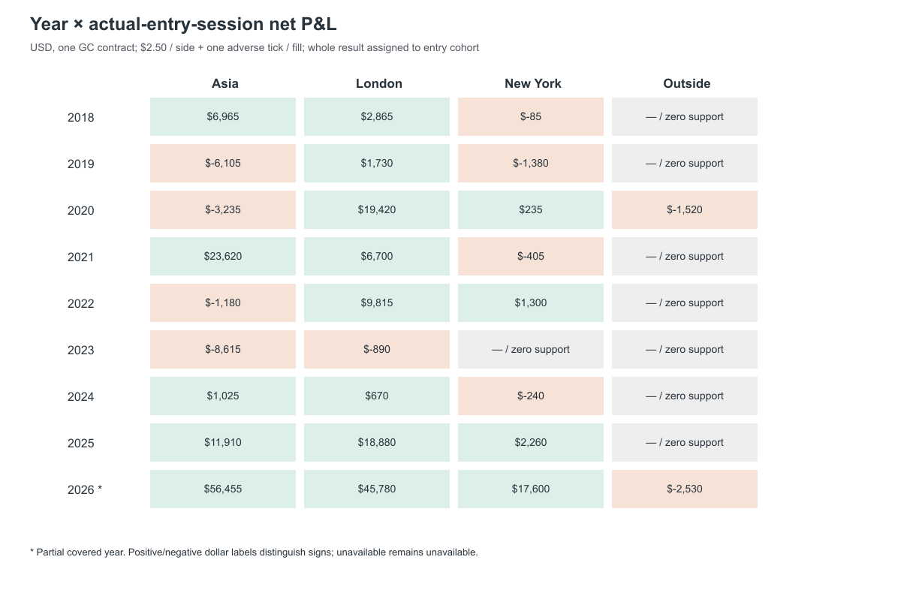
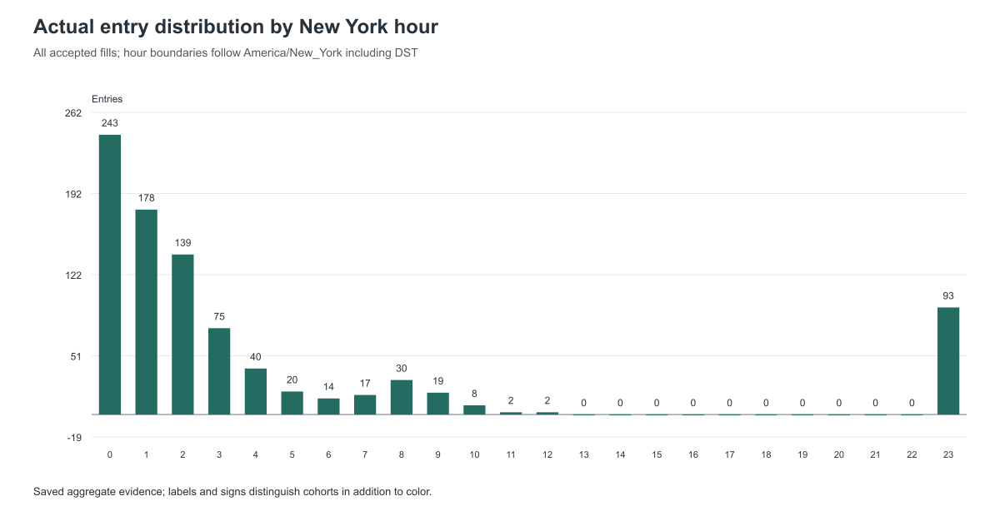
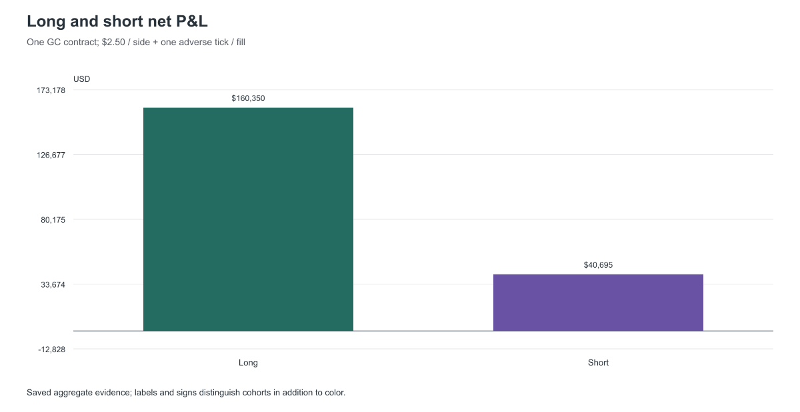
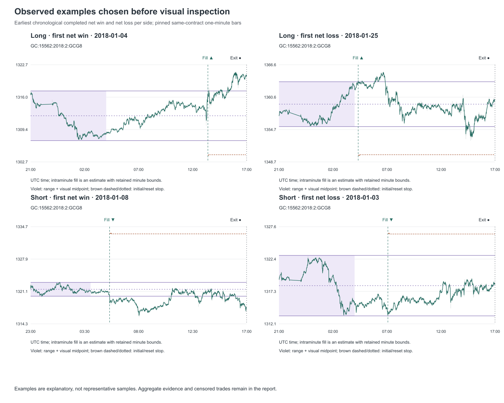

# GC- Overnight Breakout 15M — Phase 1

Fixed overnight-boundary breakout on pinned GC bars: standardized one-contract net results, annual and actual-entry-session cohorts, independent source-account sizing and explicit execution/input limitations.

Source run: `20261013T142537Z_phase1_gc_ob15m_v1`. Executed protocol: `1.0.0`.

## Overview

The fixed standardized baseline completed 863 trades and saved net P&L of $201,045 under the assumed costs. Net winners were 435 of 863 completed trades (50.4%). 17 accepted fills have censored or open outcomes and are excluded from closed-P&L statistics.

The overnight range is built in fixed UTC+3 from 00:00 inclusive to 07:00 exclusive. Two boundary-touch stop orders become active after the final 06:45–07:00 signal candle closes. First fill cancels the opposite side and consumes the broker day. The primary result uses one executable GC contract; it is descriptive historical evidence under an authored fill model, with important input-quality limits.

## Illustrative entry and exit guide

Illustrative only. Violet shading denotes the overnight range; dotted midpoint is never traded. Actual estimated fills can precede the indicator's confirmed-close marker. Initial and delayed reset stops have distinct line styles. No screenshot prices or unexplained markings are inferred.

## Baseline breakout results

- Eligible days: 994 days
- Executable fills: 880 trades
- Completed: 863 trades
- Censored / open: 17 trades
- Net P&L: 201045.00000000664 USD
- Mean net study R: 0.0738462349996131 R / trade
- Net win rate: 0.5040556199304751
- Closed-P&L drawdown: 49705.00000000092 USD

## Eligible days, accepted fills and unknown evidence

Exact saved evidence rows; controls select existing cohorts without pooling or recalculating results.

| Entry year | Entry session | Side | Eligible days | Valid complete ranges | Accepted breakouts | Executable fills | Completed | Censored / open | Known no-trade days | Unknown days | Excluded calendar days |
| --- | --- | --- | --- | --- | --- | --- | --- | --- | --- | --- | --- |
| all | all | combined | 994 | 1106 | 880 | 880 | 863 | 17 | 28 | 103 | 2189 |
| all | all | long | Unavailable | Unavailable | 443 | 443 | 436 | 7 | Unavailable | Unavailable | Unavailable |
| all | all | short | Unavailable | Unavailable | 437 | 437 | 427 | 10 | Unavailable | Unavailable | Unavailable |
| all | Asia | combined | Unavailable | Unavailable | 514 | 514 | 498 | 16 | Unavailable | Unavailable | Unavailable |
| all | Asia | long | Unavailable | Unavailable | 249 | 249 | 242 | 7 | Unavailable | Unavailable | Unavailable |
| all | Asia | short | Unavailable | Unavailable | 265 | 265 | 256 | 9 | Unavailable | Unavailable | Unavailable |
| all | London | combined | Unavailable | Unavailable | 335 | 335 | 334 | 1 | Unavailable | Unavailable | Unavailable |
| all | London | long | Unavailable | Unavailable | 174 | 174 | 174 | 0 | Unavailable | Unavailable | Unavailable |
| all | London | short | Unavailable | Unavailable | 161 | 161 | 160 | 1 | Unavailable | Unavailable | Unavailable |
| all | New York | combined | Unavailable | Unavailable | 27 | 27 | 27 | 0 | Unavailable | Unavailable | Unavailable |
| all | New York | long | Unavailable | Unavailable | 19 | 19 | 19 | 0 | Unavailable | Unavailable | Unavailable |
| all | New York | short | Unavailable | Unavailable | 8 | 8 | 8 | 0 | Unavailable | Unavailable | Unavailable |
| all | Outside | combined | Unavailable | Unavailable | 4 | 4 | 4 | 0 | Unavailable | Unavailable | Unavailable |
| all | Outside | long | Unavailable | Unavailable | 1 | 1 | 1 | 0 | Unavailable | Unavailable | Unavailable |
| all | Outside | short | Unavailable | Unavailable | 3 | 3 | 3 | 0 | Unavailable | Unavailable | Unavailable |
| 2018 | all | combined | 93 | 103 | 82 | 82 | 79 | 3 | 2 | 12 | 272 |
| 2018 | all | long | Unavailable | Unavailable | 38 | 38 | 37 | 1 | Unavailable | Unavailable | Unavailable |
| 2018 | all | short | Unavailable | Unavailable | 44 | 44 | 42 | 2 | Unavailable | Unavailable | Unavailable |
| 2018 | Asia | combined | Unavailable | Unavailable | 48 | 48 | 45 | 3 | Unavailable | Unavailable | Unavailable |
| 2018 | Asia | long | Unavailable | Unavailable | 21 | 21 | 20 | 1 | Unavailable | Unavailable | Unavailable |
| 2018 | Asia | short | Unavailable | Unavailable | 27 | 27 | 25 | 2 | Unavailable | Unavailable | Unavailable |
| 2018 | London | combined | Unavailable | Unavailable | 33 | 33 | 33 | 0 | Unavailable | Unavailable | Unavailable |
| 2018 | London | long | Unavailable | Unavailable | 16 | 16 | 16 | 0 | Unavailable | Unavailable | Unavailable |
| 2018 | London | short | Unavailable | Unavailable | 17 | 17 | 17 | 0 | Unavailable | Unavailable | Unavailable |
| 2018 | New York | combined | Unavailable | Unavailable | 1 | 1 | 1 | 0 | Unavailable | Unavailable | Unavailable |
| 2018 | New York | long | Unavailable | Unavailable | 1 | 1 | 1 | 0 | Unavailable | Unavailable | Unavailable |
| 2018 | New York | short | Unavailable | Unavailable | 0 | 0 | 0 | 0 | Unavailable | Unavailable | Unavailable |
| 2018 | Outside | combined | Unavailable | Unavailable | 0 | 0 | 0 | 0 | Unavailable | Unavailable | Unavailable |
| 2018 | Outside | long | Unavailable | Unavailable | 0 | 0 | 0 | 0 | Unavailable | Unavailable | Unavailable |
| 2018 | Outside | short | Unavailable | Unavailable | 0 | 0 | 0 | 0 | Unavailable | Unavailable | Unavailable |
| 2019 | all | combined | 117 | 127 | 97 | 97 | 95 | 2 | 3 | 19 | 248 |
| 2019 | all | long | Unavailable | Unavailable | 50 | 50 | 49 | 1 | Unavailable | Unavailable | Unavailable |
| 2019 | all | short | Unavailable | Unavailable | 47 | 47 | 46 | 1 | Unavailable | Unavailable | Unavailable |
| 2019 | Asia | combined | Unavailable | Unavailable | 41 | 41 | 39 | 2 | Unavailable | Unavailable | Unavailable |
| 2019 | Asia | long | Unavailable | Unavailable | 21 | 21 | 20 | 1 | Unavailable | Unavailable | Unavailable |
| 2019 | Asia | short | Unavailable | Unavailable | 20 | 20 | 19 | 1 | Unavailable | Unavailable | Unavailable |
| 2019 | London | combined | Unavailable | Unavailable | 52 | 52 | 52 | 0 | Unavailable | Unavailable | Unavailable |
| 2019 | London | long | Unavailable | Unavailable | 27 | 27 | 27 | 0 | Unavailable | Unavailable | Unavailable |
| 2019 | London | short | Unavailable | Unavailable | 25 | 25 | 25 | 0 | Unavailable | Unavailable | Unavailable |
| 2019 | New York | combined | Unavailable | Unavailable | 4 | 4 | 4 | 0 | Unavailable | Unavailable | Unavailable |
| 2019 | New York | long | Unavailable | Unavailable | 2 | 2 | 2 | 0 | Unavailable | Unavailable | Unavailable |
| 2019 | New York | short | Unavailable | Unavailable | 2 | 2 | 2 | 0 | Unavailable | Unavailable | Unavailable |
| 2019 | Outside | combined | Unavailable | Unavailable | 0 | 0 | 0 | 0 | Unavailable | Unavailable | Unavailable |
| 2019 | Outside | long | Unavailable | Unavailable | 0 | 0 | 0 | 0 | Unavailable | Unavailable | Unavailable |
| 2019 | Outside | short | Unavailable | Unavailable | 0 | 0 | 0 | 0 | Unavailable | Unavailable | Unavailable |
| 2020 | all | combined | 169 | 180 | 158 | 158 | 158 | 0 | 7 | 4 | 197 |
| 2020 | all | long | Unavailable | Unavailable | 84 | 84 | 84 | 0 | Unavailable | Unavailable | Unavailable |
| 2020 | all | short | Unavailable | Unavailable | 74 | 74 | 74 | 0 | Unavailable | Unavailable | Unavailable |
| 2020 | Asia | combined | Unavailable | Unavailable | 89 | 89 | 89 | 0 | Unavailable | Unavailable | Unavailable |
| 2020 | Asia | long | Unavailable | Unavailable | 45 | 45 | 45 | 0 | Unavailable | Unavailable | Unavailable |
| 2020 | Asia | short | Unavailable | Unavailable | 44 | 44 | 44 | 0 | Unavailable | Unavailable | Unavailable |
| 2020 | London | combined | Unavailable | Unavailable | 64 | 64 | 64 | 0 | Unavailable | Unavailable | Unavailable |
| 2020 | London | long | Unavailable | Unavailable | 35 | 35 | 35 | 0 | Unavailable | Unavailable | Unavailable |
| 2020 | London | short | Unavailable | Unavailable | 29 | 29 | 29 | 0 | Unavailable | Unavailable | Unavailable |
| 2020 | New York | combined | Unavailable | Unavailable | 3 | 3 | 3 | 0 | Unavailable | Unavailable | Unavailable |
| 2020 | New York | long | Unavailable | Unavailable | 3 | 3 | 3 | 0 | Unavailable | Unavailable | Unavailable |
| 2020 | New York | short | Unavailable | Unavailable | 0 | 0 | 0 | 0 | Unavailable | Unavailable | Unavailable |
| 2020 | Outside | combined | Unavailable | Unavailable | 2 | 2 | 2 | 0 | Unavailable | Unavailable | Unavailable |
| 2020 | Outside | long | Unavailable | Unavailable | 1 | 1 | 1 | 0 | Unavailable | Unavailable | Unavailable |
| 2020 | Outside | short | Unavailable | Unavailable | 1 | 1 | 1 | 0 | Unavailable | Unavailable | Unavailable |
| 2021 | all | combined | 102 | 115 | 96 | 96 | 91 | 5 | 2 | 9 | 263 |
| 2021 | all | long | Unavailable | Unavailable | 51 | 51 | 50 | 1 | Unavailable | Unavailable | Unavailable |
| 2021 | all | short | Unavailable | Unavailable | 45 | 45 | 41 | 4 | Unavailable | Unavailable | Unavailable |
| 2021 | Asia | combined | Unavailable | Unavailable | 58 | 58 | 54 | 4 | Unavailable | Unavailable | Unavailable |
| 2021 | Asia | long | Unavailable | Unavailable | 28 | 28 | 27 | 1 | Unavailable | Unavailable | Unavailable |
| 2021 | Asia | short | Unavailable | Unavailable | 30 | 30 | 27 | 3 | Unavailable | Unavailable | Unavailable |
| 2021 | London | combined | Unavailable | Unavailable | 37 | 37 | 36 | 1 | Unavailable | Unavailable | Unavailable |
| 2021 | London | long | Unavailable | Unavailable | 22 | 22 | 22 | 0 | Unavailable | Unavailable | Unavailable |
| 2021 | London | short | Unavailable | Unavailable | 15 | 15 | 14 | 1 | Unavailable | Unavailable | Unavailable |
| 2021 | New York | combined | Unavailable | Unavailable | 1 | 1 | 1 | 0 | Unavailable | Unavailable | Unavailable |
| 2021 | New York | long | Unavailable | Unavailable | 1 | 1 | 1 | 0 | Unavailable | Unavailable | Unavailable |
| 2021 | New York | short | Unavailable | Unavailable | 0 | 0 | 0 | 0 | Unavailable | Unavailable | Unavailable |
| 2021 | Outside | combined | Unavailable | Unavailable | 0 | 0 | 0 | 0 | Unavailable | Unavailable | Unavailable |
| 2021 | Outside | long | Unavailable | Unavailable | 0 | 0 | 0 | 0 | Unavailable | Unavailable | Unavailable |
| 2021 | Outside | short | Unavailable | Unavailable | 0 | 0 | 0 | 0 | Unavailable | Unavailable | Unavailable |
| 2022 | all | combined | 81 | 95 | 69 | 69 | 69 | 0 | 0 | 12 | 284 |
| 2022 | all | long | Unavailable | Unavailable | 28 | 28 | 28 | 0 | Unavailable | Unavailable | Unavailable |
| 2022 | all | short | Unavailable | Unavailable | 41 | 41 | 41 | 0 | Unavailable | Unavailable | Unavailable |
| 2022 | Asia | combined | Unavailable | Unavailable | 46 | 46 | 46 | 0 | Unavailable | Unavailable | Unavailable |
| 2022 | Asia | long | Unavailable | Unavailable | 19 | 19 | 19 | 0 | Unavailable | Unavailable | Unavailable |
| 2022 | Asia | short | Unavailable | Unavailable | 27 | 27 | 27 | 0 | Unavailable | Unavailable | Unavailable |
| 2022 | London | combined | Unavailable | Unavailable | 21 | 21 | 21 | 0 | Unavailable | Unavailable | Unavailable |
| 2022 | London | long | Unavailable | Unavailable | 8 | 8 | 8 | 0 | Unavailable | Unavailable | Unavailable |
| 2022 | London | short | Unavailable | Unavailable | 13 | 13 | 13 | 0 | Unavailable | Unavailable | Unavailable |
| 2022 | New York | combined | Unavailable | Unavailable | 2 | 2 | 2 | 0 | Unavailable | Unavailable | Unavailable |
| 2022 | New York | long | Unavailable | Unavailable | 1 | 1 | 1 | 0 | Unavailable | Unavailable | Unavailable |
| 2022 | New York | short | Unavailable | Unavailable | 1 | 1 | 1 | 0 | Unavailable | Unavailable | Unavailable |
| 2022 | Outside | combined | Unavailable | Unavailable | 0 | 0 | 0 | 0 | Unavailable | Unavailable | Unavailable |
| 2022 | Outside | long | Unavailable | Unavailable | 0 | 0 | 0 | 0 | Unavailable | Unavailable | Unavailable |
| 2022 | Outside | short | Unavailable | Unavailable | 0 | 0 | 0 | 0 | Unavailable | Unavailable | Unavailable |
| 2023 | all | combined | 57 | 69 | 48 | 48 | 47 | 1 | 0 | 10 | 308 |
| 2023 | all | long | Unavailable | Unavailable | 21 | 21 | 21 | 0 | Unavailable | Unavailable | Unavailable |
| 2023 | all | short | Unavailable | Unavailable | 27 | 27 | 26 | 1 | Unavailable | Unavailable | Unavailable |
| 2023 | Asia | combined | Unavailable | Unavailable | 24 | 24 | 23 | 1 | Unavailable | Unavailable | Unavailable |
| 2023 | Asia | long | Unavailable | Unavailable | 8 | 8 | 8 | 0 | Unavailable | Unavailable | Unavailable |
| 2023 | Asia | short | Unavailable | Unavailable | 16 | 16 | 15 | 1 | Unavailable | Unavailable | Unavailable |
| 2023 | London | combined | Unavailable | Unavailable | 24 | 24 | 24 | 0 | Unavailable | Unavailable | Unavailable |
| 2023 | London | long | Unavailable | Unavailable | 13 | 13 | 13 | 0 | Unavailable | Unavailable | Unavailable |
| 2023 | London | short | Unavailable | Unavailable | 11 | 11 | 11 | 0 | Unavailable | Unavailable | Unavailable |
| 2023 | New York | combined | Unavailable | Unavailable | 0 | 0 | 0 | 0 | Unavailable | Unavailable | Unavailable |
| 2023 | New York | long | Unavailable | Unavailable | 0 | 0 | 0 | 0 | Unavailable | Unavailable | Unavailable |
| 2023 | New York | short | Unavailable | Unavailable | 0 | 0 | 0 | 0 | Unavailable | Unavailable | Unavailable |
| 2023 | Outside | combined | Unavailable | Unavailable | 0 | 0 | 0 | 0 | Unavailable | Unavailable | Unavailable |
| 2023 | Outside | long | Unavailable | Unavailable | 0 | 0 | 0 | 0 | Unavailable | Unavailable | Unavailable |
| 2023 | Outside | short | Unavailable | Unavailable | 0 | 0 | 0 | 0 | Unavailable | Unavailable | Unavailable |
| 2024 | all | combined | 89 | 104 | 76 | 76 | 73 | 3 | 1 | 15 | 277 |
| 2024 | all | long | Unavailable | Unavailable | 38 | 38 | 36 | 2 | Unavailable | Unavailable | Unavailable |
| 2024 | all | short | Unavailable | Unavailable | 38 | 38 | 37 | 1 | Unavailable | Unavailable | Unavailable |
| 2024 | Asia | combined | Unavailable | Unavailable | 48 | 48 | 45 | 3 | Unavailable | Unavailable | Unavailable |
| 2024 | Asia | long | Unavailable | Unavailable | 26 | 26 | 24 | 2 | Unavailable | Unavailable | Unavailable |
| 2024 | Asia | short | Unavailable | Unavailable | 22 | 22 | 21 | 1 | Unavailable | Unavailable | Unavailable |
| 2024 | London | combined | Unavailable | Unavailable | 26 | 26 | 26 | 0 | Unavailable | Unavailable | Unavailable |
| 2024 | London | long | Unavailable | Unavailable | 11 | 11 | 11 | 0 | Unavailable | Unavailable | Unavailable |
| 2024 | London | short | Unavailable | Unavailable | 15 | 15 | 15 | 0 | Unavailable | Unavailable | Unavailable |
| 2024 | New York | combined | Unavailable | Unavailable | 2 | 2 | 2 | 0 | Unavailable | Unavailable | Unavailable |
| 2024 | New York | long | Unavailable | Unavailable | 1 | 1 | 1 | 0 | Unavailable | Unavailable | Unavailable |
| 2024 | New York | short | Unavailable | Unavailable | 1 | 1 | 1 | 0 | Unavailable | Unavailable | Unavailable |
| 2024 | Outside | combined | Unavailable | Unavailable | 0 | 0 | 0 | 0 | Unavailable | Unavailable | Unavailable |
| 2024 | Outside | long | Unavailable | Unavailable | 0 | 0 | 0 | 0 | Unavailable | Unavailable | Unavailable |
| 2024 | Outside | short | Unavailable | Unavailable | 0 | 0 | 0 | 0 | Unavailable | Unavailable | Unavailable |
| 2025 | all | combined | 178 | 195 | 168 | 168 | 168 | 0 | 5 | 5 | 187 |
| 2025 | all | long | Unavailable | Unavailable | 90 | 90 | 90 | 0 | Unavailable | Unavailable | Unavailable |
| 2025 | all | short | Unavailable | Unavailable | 78 | 78 | 78 | 0 | Unavailable | Unavailable | Unavailable |
| 2025 | Asia | combined | Unavailable | Unavailable | 114 | 114 | 114 | 0 | Unavailable | Unavailable | Unavailable |
| 2025 | Asia | long | Unavailable | Unavailable | 62 | 62 | 62 | 0 | Unavailable | Unavailable | Unavailable |
| 2025 | Asia | short | Unavailable | Unavailable | 52 | 52 | 52 | 0 | Unavailable | Unavailable | Unavailable |
| 2025 | London | combined | Unavailable | Unavailable | 46 | 46 | 46 | 0 | Unavailable | Unavailable | Unavailable |
| 2025 | London | long | Unavailable | Unavailable | 23 | 23 | 23 | 0 | Unavailable | Unavailable | Unavailable |
| 2025 | London | short | Unavailable | Unavailable | 23 | 23 | 23 | 0 | Unavailable | Unavailable | Unavailable |
| 2025 | New York | combined | Unavailable | Unavailable | 8 | 8 | 8 | 0 | Unavailable | Unavailable | Unavailable |
| 2025 | New York | long | Unavailable | Unavailable | 5 | 5 | 5 | 0 | Unavailable | Unavailable | Unavailable |
| 2025 | New York | short | Unavailable | Unavailable | 3 | 3 | 3 | 0 | Unavailable | Unavailable | Unavailable |
| 2025 | Outside | combined | Unavailable | Unavailable | 0 | 0 | 0 | 0 | Unavailable | Unavailable | Unavailable |
| 2025 | Outside | long | Unavailable | Unavailable | 0 | 0 | 0 | 0 | Unavailable | Unavailable | Unavailable |
| 2025 | Outside | short | Unavailable | Unavailable | 0 | 0 | 0 | 0 | Unavailable | Unavailable | Unavailable |
| 2026 | all | combined | 108 | 118 | 86 | 86 | 83 | 3 | 8 | 17 | 152 |
| 2026 | all | long | Unavailable | Unavailable | 43 | 43 | 41 | 2 | Unavailable | Unavailable | Unavailable |
| 2026 | all | short | Unavailable | Unavailable | 43 | 43 | 42 | 1 | Unavailable | Unavailable | Unavailable |
| 2026 | Asia | combined | Unavailable | Unavailable | 46 | 46 | 43 | 3 | Unavailable | Unavailable | Unavailable |
| 2026 | Asia | long | Unavailable | Unavailable | 19 | 19 | 17 | 2 | Unavailable | Unavailable | Unavailable |
| 2026 | Asia | short | Unavailable | Unavailable | 27 | 27 | 26 | 1 | Unavailable | Unavailable | Unavailable |
| 2026 | London | combined | Unavailable | Unavailable | 32 | 32 | 32 | 0 | Unavailable | Unavailable | Unavailable |
| 2026 | London | long | Unavailable | Unavailable | 19 | 19 | 19 | 0 | Unavailable | Unavailable | Unavailable |
| 2026 | London | short | Unavailable | Unavailable | 13 | 13 | 13 | 0 | Unavailable | Unavailable | Unavailable |
| 2026 | New York | combined | Unavailable | Unavailable | 6 | 6 | 6 | 0 | Unavailable | Unavailable | Unavailable |
| 2026 | New York | long | Unavailable | Unavailable | 5 | 5 | 5 | 0 | Unavailable | Unavailable | Unavailable |
| 2026 | New York | short | Unavailable | Unavailable | 1 | 1 | 1 | 0 | Unavailable | Unavailable | Unavailable |
| 2026 | Outside | combined | Unavailable | Unavailable | 2 | 2 | 2 | 0 | Unavailable | Unavailable | Unavailable |
| 2026 | Outside | long | Unavailable | Unavailable | 0 | 0 | 0 | 0 | Unavailable | Unavailable | Unavailable |
| 2026 | Outside | short | Unavailable | Unavailable | 2 | 2 | 2 | 0 | Unavailable | Unavailable | Unavailable |

Day metrics apply only to the all-session combined row. The day roster is anchored at broker 07:00 converted to New York, rather than inventing a session for an unfilled day.
Unknown days include censored accepted trades and opportunities whose fill/outcome is unobserved. Do not add these overlapping counts to censored fills.
Valid ranges can include weekends with no entry window and the first loaded day; they are not synonymous with eligible days.

## Every eligible day has a saved disposition

Exact saved evidence rows; controls select existing cohorts without pooling or recalculating results.

| Entry year | Eligible days | Completed-fill days | Censored-fill days | Known no-trade days | Unobserved first-fill days | Disposition total | Excluded calendar days |
| --- | --- | --- | --- | --- | --- | --- | --- |
| all | 994 | 863.0 | 17.0 | 28.0 | 86.0 | 994.0 | 2189.0 |
| 2018 | 93 | 79.0 | 3.0 | 2.0 | 9.0 | 93.0 | 272.0 |
| 2019 | 117 | 95.0 | 2.0 | 3.0 | 17.0 | 117.0 | 248.0 |
| 2020 | 169 | 158.0 | 0.0 | 7.0 | 4.0 | 169.0 | 197.0 |
| 2021 | 102 | 91.0 | 5.0 | 2.0 | 4.0 | 102.0 | 263.0 |
| 2022 | 81 | 69.0 | 0.0 | 0.0 | 12.0 | 81.0 | 284.0 |
| 2023 | 57 | 47.0 | 1.0 | 0.0 | 9.0 | 57.0 | 308.0 |
| 2024 | 89 | 73.0 | 3.0 | 1.0 | 12.0 | 89.0 | 277.0 |
| 2025 | 178 | 168.0 | 0.0 | 5.0 | 5.0 | 178.0 | 187.0 |
| 2026 | 108 | 83.0 | 3.0 | 8.0 | 14.0 | 108.0 | 152.0 |

These mutually exclusive eligible-day classes sum to eligible days: completed fill, censored accepted fill, fully observed no trade, or an unobserved first-fill opportunity.
Unknown days in the cohort table overlap two classes here: censored-fill days plus unobserved first-fill days. They are not an additional disjoint class.
Annual day disposition uses the New York broker-07:00 decision-year anchor; trade performance uses actual fill year.

## P&L and net outcome denominators

Exact saved evidence rows; controls select existing cohorts without pooling or recalculating results.

| Entry year | Entry session | Side | Net wins | Net losses | Net breakevens | Net win rate | Raw-price P&L | Raw-price P&L | Net P&L | Net P&L | Slip + fees |
| --- | --- | --- | --- | --- | --- | --- | --- | --- | --- | --- | --- |
| all | all | combined | 435 | 428 | 0 | 0.5040556199304751 | 2226.2000000000116 | 222620.00000000102 | 2010.4500000000778 | 201045.00000000664 | 21574.999999994485 |
| all | all | long | 238 | 198 | 0 | 0.5458715596330275 | 1712.4999999999961 | 171249.99999999956 | 1603.5000000000268 | 160350.0000000025 | 10899.999999997117 |
| all | all | short | 197 | 230 | 0 | 0.4613583138173302 | 513.7000000000153 | 51370.00000000155 | 406.9500000000392 | 40695.000000004184 | 10674.999999997372 |
| all | Asia | combined | 245 | 253 | 0 | 0.4919678714859438 | 932.9000000000119 | 93290.0000000012 | 808.4000000000451 | 80840.00000000457 | 12449.999999996671 |
| all | Asia | long | 131 | 111 | 0 | 0.5413223140495868 | 931.4999999999989 | 93149.99999999988 | 871.0000000000174 | 87100.00000000172 | 6049.999999998145 |
| all | Asia | short | 114 | 142 | 0 | 0.4453125 | 1.4000000000130512 | 140.00000000130967 | -62.59999999997213 | -6259.999999997213 | 6399.999999998527 |
| all | London | combined | 175 | 159 | 0 | 0.5239520958083832 | 1133.1999999999987 | 113319.99999999988 | 1049.7000000000241 | 104970.00000000249 | 8349.99999999738 |
| all | London | long | 97 | 77 | 0 | 0.5574712643678161 | 674.9999999999961 | 67499.99999999962 | 631.5000000000072 | 63150.000000000844 | 4349.99999999879 |
| all | London | short | 78 | 82 | 0 | 0.4875 | 458.20000000000255 | 45820.00000000027 | 418.200000000016 | 41820.000000001666 | 3999.9999999985903 |
| all | New York | combined | 14 | 13 | 0 | 0.5185185185185185 | 199.60000000000082 | 19960.00000000008 | 192.84999999999752 | 19284.999999999753 | 675.0000000003274 |
| all | New York | long | 10 | 9 | 0 | 0.5263157894736842 | 112.70000000000095 | 11270.000000000095 | 107.94999999999897 | 10794.999999999894 | 475.0000000002001 |
| all | New York | short | 4 | 4 | 0 | 0.5 | 86.89999999999986 | 8689.999999999985 | 84.8999999999986 | 8489.999999999858 | 200.00000000012733 |
| all | Outside | combined | 1 | 3 | 0 | 0.25 | -39.5 | -3950.0 | -40.500000000001094 | -4050.000000000109 | 100.00000000010914 |
| all | Outside | long | 0 | 1 | 0 | 0.0 | -6.699999999999818 | -669.9999999999818 | -6.949999999999636 | -694.9999999999636 | 24.99999999998181 |
| all | Outside | short | 1 | 2 | 0 | 0.3333333333333333 | -32.80000000000018 | -3280.000000000018 | -33.550000000001454 | -3355.0000000001455 | 75.00000000012733 |
| 2018 | all | combined | 39 | 40 | 0 | 0.4936708860759494 | 117.2000000000005 | 11720.000000000051 | 97.45000000001492 | 9745.000000001488 | 1974.999999998563 |
| 2018 | all | long | 24 | 13 | 0 | 0.6486486486486487 | 102.40000000000032 | 10240.000000000031 | 93.15000000000705 | 9315.000000000706 | 924.999999999327 |
| 2018 | all | short | 15 | 27 | 0 | 0.35714285714285715 | 14.800000000000182 | 1480.0000000000182 | 4.30000000000781 | 430.00000000078217 | 1049.999999999236 |
| 2018 | Asia | combined | 23 | 22 | 0 | 0.5111111111111111 | 80.89999999999986 | 8089.999999999986 | 69.65000000000809 | 6965.000000000805 | 1124.9999999991815 |
| 2018 | Asia | long | 13 | 7 | 0 | 0.65 | 42.69999999999982 | 4269.999999999982 | 37.700000000003456 | 3770.0000000003456 | 499.9999999996362 |
| 2018 | Asia | short | 10 | 15 | 0 | 0.4 | 38.200000000000045 | 3820.0000000000045 | 31.950000000004597 | 3195.0000000004593 | 624.9999999995453 |
| 2018 | London | combined | 16 | 17 | 0 | 0.48484848484848486 | 36.900000000000546 | 3690.0000000000546 | 28.650000000006536 | 2865.000000000655 | 824.9999999993997 |
| 2018 | London | long | 11 | 5 | 0 | 0.6875 | 60.30000000000041 | 6030.000000000041 | 56.30000000000332 | 5630.000000000332 | 399.99999999970896 |
| 2018 | London | short | 5 | 12 | 0 | 0.29411764705882354 | -23.399999999999864 | -2339.9999999999864 | -27.649999999996773 | -2764.999999999677 | 424.9999999996908 |
| 2018 | New York | combined | 0 | 1 | 0 | 0.0 | -0.599999999999909 | -59.999999999990905 | -0.8499999999997272 | -84.99999999997272 | 24.99999999998181 |
| 2018 | New York | long | 0 | 1 | 0 | 0.0 | -0.599999999999909 | -59.999999999990905 | -0.8499999999997272 | -84.99999999997272 | 24.99999999998181 |
| 2018 | New York | short | 0 | 0 | 0 | Unavailable | Unavailable | Unavailable | Unavailable | Unavailable | Unavailable |
| 2018 | Outside | combined | 0 | 0 | 0 | Unavailable | Unavailable | Unavailable | Unavailable | Unavailable | Unavailable |
| 2018 | Outside | long | 0 | 0 | 0 | Unavailable | Unavailable | Unavailable | Unavailable | Unavailable | Unavailable |
| 2018 | Outside | short | 0 | 0 | 0 | Unavailable | Unavailable | Unavailable | Unavailable | Unavailable | Unavailable |
| 2019 | all | combined | 44 | 51 | 0 | 0.4631578947368421 | -33.80000000000018 | -3380.000000000018 | -57.54999999998286 | -5754.99999999829 | 2374.999999998272 |
| 2019 | all | long | 25 | 24 | 0 | 0.5102040816326531 | 7.900000000000091 | 790.0000000000091 | -4.349999999991025 | -434.9999999990996 | 1224.9999999991087 |
| 2019 | all | short | 19 | 27 | 0 | 0.41304347826086957 | -41.70000000000027 | -4170.000000000027 | -53.19999999999189 | -5319.999999999191 | 1149.9999999991633 |
| 2019 | Asia | combined | 17 | 22 | 0 | 0.4358974358974359 | -51.2999999999995 | -5129.99999999995 | -61.04999999999238 | -6104.999999999241 | 974.9999999992906 |
| 2019 | Asia | long | 8 | 12 | 0 | 0.4 | -22.299999999999272 | -2229.9999999999272 | -27.29999999999564 | -2729.9999999995634 | 499.9999999996362 |
| 2019 | Asia | short | 9 | 10 | 0 | 0.47368421052631576 | -29.000000000000227 | -2900.0000000000227 | -33.749999999996774 | -3374.999999999677 | 474.9999999996544 |
| 2019 | London | combined | 26 | 26 | 0 | 0.5 | 30.299999999999272 | 3029.9999999999272 | 17.300000000008716 | 1730.0000000008731 | 1299.9999999990541 |
| 2019 | London | long | 16 | 11 | 0 | 0.5925925925925926 | 34.99999999999932 | 3499.999999999932 | 28.25000000000422 | 2825.000000000423 | 674.9999999995089 |
| 2019 | London | short | 10 | 15 | 0 | 0.4 | -4.7000000000000455 | -470.00000000000455 | -10.949999999995509 | -1094.9999999995498 | 624.9999999995453 |
| 2019 | New York | combined | 1 | 3 | 0 | 0.25 | -12.799999999999955 | -1279.9999999999955 | -13.799999999999226 | -1379.9999999999227 | 99.99999999992724 |
| 2019 | New York | long | 1 | 1 | 0 | 0.5 | -4.7999999999999545 | -479.99999999999545 | -5.299999999999591 | -529.9999999999591 | 49.99999999996362 |
| 2019 | New York | short | 0 | 2 | 0 | 0.0 | -8.0 | -800.0 | -8.499999999999636 | -849.9999999999636 | 49.99999999996362 |
| 2019 | Outside | combined | 0 | 0 | 0 | Unavailable | Unavailable | Unavailable | Unavailable | Unavailable | Unavailable |
| 2019 | Outside | long | 0 | 0 | 0 | Unavailable | Unavailable | Unavailable | Unavailable | Unavailable | Unavailable |
| 2019 | Outside | short | 0 | 0 | 0 | Unavailable | Unavailable | Unavailable | Unavailable | Unavailable | Unavailable |
| 2020 | all | combined | 81 | 77 | 0 | 0.5126582278481012 | 188.49999999999886 | 18849.999999999884 | 149.00000000002717 | 14900.000000002761 | 3949.999999997126 |
| 2020 | all | long | 45 | 39 | 0 | 0.5357142857142857 | 133.0999999999965 | 13309.999999999647 | 112.10000000001197 | 11210.000000001175 | 2099.999999998472 |
| 2020 | all | short | 36 | 38 | 0 | 0.4864864864864865 | 55.400000000002365 | 5540.000000000237 | 36.90000000001595 | 3690.0000000015834 | 1849.999999998654 |
| 2020 | Asia | combined | 46 | 43 | 0 | 0.5168539325842697 | -10.100000000000591 | -1010.00000000006 | -32.349999999984355 | -3234.999999998441 | 2224.999999998381 |
| 2020 | Asia | long | 26 | 19 | 0 | 0.5777777777777777 | 25.4999999999975 | 2549.99999999975 | 14.250000000005716 | 1425.0000000005684 | 1124.9999999991815 |
| 2020 | Asia | short | 20 | 24 | 0 | 0.45454545454545453 | -35.59999999999809 | -3559.999999999809 | -46.59999999999009 | -4659.999999999009 | 1099.9999999991996 |
| 2020 | London | combined | 34 | 30 | 0 | 0.53125 | 210.19999999999936 | 21019.999999999945 | 194.20000000001073 | 19420.0000000011 | 1599.9999999988358 |
| 2020 | London | long | 18 | 17 | 0 | 0.5142857142857142 | 111.19999999999891 | 11119.999999999894 | 102.45000000000536 | 10245.000000000531 | 874.9999999993634 |
| 2020 | London | short | 16 | 13 | 0 | 0.5517241379310345 | 99.00000000000045 | 9900.000000000047 | 91.75000000000576 | 9175.000000000575 | 724.9999999994725 |
| 2020 | New York | combined | 1 | 2 | 0 | 0.3333333333333333 | 3.099999999999909 | 309.9999999999909 | 2.3500000000004544 | 235.00000000004547 | 74.99999999994543 |
| 2020 | New York | long | 1 | 2 | 0 | 0.3333333333333333 | 3.099999999999909 | 309.9999999999909 | 2.3500000000004544 | 235.00000000004547 | 74.99999999994543 |
| 2020 | New York | short | 0 | 0 | 0 | Unavailable | Unavailable | Unavailable | Unavailable | Unavailable | Unavailable |
| 2020 | Outside | combined | 0 | 2 | 0 | 0.0 | -14.699999999999818 | -1469.9999999999818 | -15.199999999999456 | -1519.9999999999454 | 49.99999999996362 |
| 2020 | Outside | long | 0 | 1 | 0 | 0.0 | -6.699999999999818 | -669.9999999999818 | -6.949999999999636 | -694.9999999999636 | 24.99999999998181 |
| 2020 | Outside | short | 0 | 1 | 0 | 0.0 | -8.0 | -800.0 | -8.249999999999819 | -824.9999999999818 | 24.99999999998181 |
| 2021 | all | combined | 47 | 44 | 0 | 0.5164835164835165 | 321.9000000000001 | 32190.000000000015 | 299.15000000001595 | 29915.000000001666 | 2274.9999999983447 |
| 2021 | all | long | 26 | 24 | 0 | 0.52 | 91.19999999999936 | 9119.999999999935 | 78.7000000000085 | 7870.000000000844 | 1249.9999999990905 |
| 2021 | all | short | 21 | 20 | 0 | 0.5121951219512195 | 230.70000000000073 | 23070.000000000065 | 220.4500000000079 | 22045.00000000081 | 1024.9999999992542 |
| 2021 | Asia | combined | 29 | 25 | 0 | 0.5370370370370371 | 249.70000000000005 | 24970.000000000007 | 236.20000000000954 | 23620.000000000982 | 1349.9999999990177 |
| 2021 | Asia | long | 15 | 12 | 0 | 0.5555555555555556 | 73.19999999999959 | 7319.999999999959 | 66.45000000000452 | 6645.00000000045 | 674.9999999995089 |
| 2021 | Asia | short | 14 | 13 | 0 | 0.5185185185185185 | 176.50000000000045 | 17650.000000000044 | 169.75000000000534 | 16975.000000000535 | 674.9999999995089 |
| 2021 | London | combined | 18 | 18 | 0 | 0.5 | 76.0 | 7600.0 | 67.00000000000661 | 6700.000000000656 | 899.9999999993452 |
| 2021 | London | long | 11 | 11 | 0 | 0.5 | 21.799999999999727 | 2179.9999999999727 | 16.300000000003728 | 1630.000000000373 | 549.9999999995998 |
| 2021 | London | short | 7 | 7 | 0 | 0.5 | 54.20000000000027 | 5420.000000000027 | 50.70000000000282 | 5070.000000000282 | 349.99999999974534 |
| 2021 | New York | combined | 0 | 1 | 0 | 0.0 | -3.7999999999999545 | -379.99999999999545 | -4.0499999999997724 | -404.99999999997726 | 24.99999999998181 |
| 2021 | New York | long | 0 | 1 | 0 | 0.0 | -3.7999999999999545 | -379.99999999999545 | -4.0499999999997724 | -404.99999999997726 | 24.99999999998181 |
| 2021 | New York | short | 0 | 0 | 0 | Unavailable | Unavailable | Unavailable | Unavailable | Unavailable | Unavailable |
| 2021 | Outside | combined | 0 | 0 | 0 | Unavailable | Unavailable | Unavailable | Unavailable | Unavailable | Unavailable |
| 2021 | Outside | long | 0 | 0 | 0 | Unavailable | Unavailable | Unavailable | Unavailable | Unavailable | Unavailable |
| 2021 | Outside | short | 0 | 0 | 0 | Unavailable | Unavailable | Unavailable | Unavailable | Unavailable | Unavailable |
| 2022 | all | combined | 37 | 32 | 0 | 0.5362318840579711 | 116.60000000000059 | 11660.000000000058 | 99.35000000001327 | 9935.000000001313 | 1724.999999998745 |
| 2022 | all | long | 13 | 15 | 0 | 0.4642857142857143 | 66.2999999999995 | 6629.999999999951 | 59.300000000004644 | 5930.000000000459 | 699.9999999994907 |
| 2022 | all | short | 24 | 17 | 0 | 0.5853658536585366 | 50.30000000000109 | 5030.00000000011 | 40.05000000000858 | 4005.000000000855 | 1024.9999999992542 |
| 2022 | Asia | combined | 21 | 25 | 0 | 0.45652173913043476 | -0.2999999999992724 | -29.99999999992724 | -11.799999999990934 | -1179.9999999990905 | 1149.9999999991633 |
| 2022 | Asia | long | 8 | 11 | 0 | 0.42105263157894735 | 28.499999999999773 | 2849.9999999999773 | 23.750000000003222 | 2375.000000000323 | 474.9999999996544 |
| 2022 | Asia | short | 13 | 14 | 0 | 0.48148148148148145 | -28.799999999999045 | -2879.9999999999045 | -35.549999999994114 | -3554.9999999994134 | 674.9999999995089 |
| 2022 | London | combined | 14 | 7 | 0 | 0.6666666666666666 | 103.39999999999986 | 10339.999999999987 | 98.15000000000373 | 9815.00000000037 | 524.999999999618 |
| 2022 | London | long | 4 | 4 | 0 | 0.5 | 26.399999999999864 | 2639.9999999999864 | 24.400000000001317 | 2440.000000000132 | 199.99999999985448 |
| 2022 | London | short | 10 | 3 | 0 | 0.7692307692307693 | 77.0 | 7699.999999999999 | 73.75000000000239 | 7375.000000000236 | 324.99999999976353 |
| 2022 | New York | combined | 2 | 0 | 0 | 1.0 | 13.5 | 1350.0 | 13.000000000000362 | 1300.0000000000364 | 49.99999999996362 |
| 2022 | New York | long | 1 | 0 | 0 | 1.0 | 11.399999999999864 | 1139.9999999999864 | 11.150000000000045 | 1115.0000000000045 | 24.99999999998181 |
| 2022 | New York | short | 1 | 0 | 0 | 1.0 | 2.1000000000001364 | 210.00000000001364 | 1.8500000000003183 | 185.00000000003183 | 24.99999999998181 |
| 2022 | Outside | combined | 0 | 0 | 0 | Unavailable | Unavailable | Unavailable | Unavailable | Unavailable | Unavailable |
| 2022 | Outside | long | 0 | 0 | 0 | Unavailable | Unavailable | Unavailable | Unavailable | Unavailable | Unavailable |
| 2022 | Outside | short | 0 | 0 | 0 | Unavailable | Unavailable | Unavailable | Unavailable | Unavailable | Unavailable |
| 2023 | all | combined | 17 | 30 | 0 | 0.3617021276595745 | -83.2999999999995 | -8329.999999999944 | -95.04999999999096 | -9504.999999999092 | 1174.999999999145 |
| 2023 | all | long | 7 | 14 | 0 | 0.3333333333333333 | -73.90000000000009 | -7390.000000000009 | -79.14999999999625 | -7914.999999999627 | 524.999999999618 |
| 2023 | all | short | 10 | 16 | 0 | 0.38461538461538464 | -9.399999999999409 | -939.9999999999409 | -15.899999999994684 | -1589.999999999468 | 649.9999999995271 |
| 2023 | Asia | combined | 9 | 14 | 0 | 0.391304347826087 | -80.40000000000009 | -8040.000000000009 | -86.14999999999587 | -8614.99999999959 | 574.9999999995816 |
| 2023 | Asia | long | 3 | 5 | 0 | 0.375 | -19.90000000000009 | -1990.000000000009 | -21.89999999999864 | -2189.9999999998636 | 199.99999999985448 |
| 2023 | Asia | short | 6 | 9 | 0 | 0.4 | -60.5 | -6050.0 | -64.24999999999726 | -6424.999999999727 | 374.99999999972715 |
| 2023 | London | combined | 8 | 16 | 0 | 0.3333333333333333 | -2.899999999999409 | -289.9999999999409 | -8.899999999995023 | -889.9999999995043 | 599.9999999995634 |
| 2023 | London | long | 4 | 9 | 0 | 0.3076923076923077 | -54.0 | -5400.0 | -57.24999999999763 | -5724.9999999997635 | 324.99999999976353 |
| 2023 | London | short | 4 | 7 | 0 | 0.36363636363636365 | 51.10000000000059 | 5110.000000000059 | 48.35000000000261 | 4835.000000000259 | 274.9999999997999 |
| 2023 | New York | combined | 0 | 0 | 0 | Unavailable | Unavailable | Unavailable | Unavailable | Unavailable | Unavailable |
| 2023 | New York | long | 0 | 0 | 0 | Unavailable | Unavailable | Unavailable | Unavailable | Unavailable | Unavailable |
| 2023 | New York | short | 0 | 0 | 0 | Unavailable | Unavailable | Unavailable | Unavailable | Unavailable | Unavailable |
| 2023 | Outside | combined | 0 | 0 | 0 | Unavailable | Unavailable | Unavailable | Unavailable | Unavailable | Unavailable |
| 2023 | Outside | long | 0 | 0 | 0 | Unavailable | Unavailable | Unavailable | Unavailable | Unavailable | Unavailable |
| 2023 | Outside | short | 0 | 0 | 0 | Unavailable | Unavailable | Unavailable | Unavailable | Unavailable | Unavailable |
| 2024 | all | combined | 37 | 36 | 0 | 0.5068493150684932 | 32.80000000000041 | 3280.00000000004 | 14.550000000013721 | 1455.0000000013679 | 1824.9999999986721 |
| 2024 | all | long | 18 | 18 | 0 | 0.5 | 14.300000000000637 | 1430.0000000000637 | 5.300000000007195 | 530.0000000007185 | 899.9999999993452 |
| 2024 | all | short | 19 | 18 | 0 | 0.5135135135135135 | 18.499999999999773 | 1849.9999999999764 | 9.250000000006526 | 925.0000000006503 | 924.999999999327 |
| 2024 | Asia | combined | 23 | 22 | 0 | 0.5111111111111111 | 21.500000000000455 | 2150.0000000000455 | 10.250000000008637 | 1025.000000000864 | 1124.9999999991815 |
| 2024 | Asia | long | 13 | 11 | 0 | 0.5416666666666666 | 34.10000000000082 | 3410.000000000082 | 28.100000000005178 | 2810.0000000005184 | 599.9999999995634 |
| 2024 | Asia | short | 10 | 11 | 0 | 0.47619047619047616 | -12.600000000000364 | -1260.0000000000364 | -17.849999999996548 | -1784.9999999996544 | 524.999999999618 |
| 2024 | London | combined | 13 | 13 | 0 | 0.5 | 13.200000000000045 | 1320.0000000000036 | 6.700000000004821 | 670.0000000004766 | 649.9999999995271 |
| 2024 | London | long | 5 | 6 | 0 | 0.45454545454545453 | -9.900000000000091 | -990.0000000000091 | -12.64999999999809 | -1264.999999999809 | 274.9999999997999 |
| 2024 | London | short | 8 | 7 | 0 | 0.5333333333333333 | 23.100000000000136 | 2310.0000000000136 | 19.350000000002876 | 1935.0000000002865 | 374.99999999972715 |
| 2024 | New York | combined | 1 | 1 | 0 | 0.5 | -1.900000000000091 | -190.0000000000091 | -2.3999999999997277 | -239.99999999997272 | 49.99999999996362 |
| 2024 | New York | long | 0 | 1 | 0 | 0.0 | -9.900000000000091 | -990.0000000000091 | -10.14999999999991 | -1014.9999999999909 | 24.99999999998181 |
| 2024 | New York | short | 1 | 0 | 0 | 1.0 | 8.0 | 800.0 | 7.750000000000182 | 775.0000000000182 | 24.99999999998181 |
| 2024 | Outside | combined | 0 | 0 | 0 | Unavailable | Unavailable | Unavailable | Unavailable | Unavailable | Unavailable |
| 2024 | Outside | long | 0 | 0 | 0 | Unavailable | Unavailable | Unavailable | Unavailable | Unavailable | Unavailable |
| 2024 | Outside | short | 0 | 0 | 0 | Unavailable | Unavailable | Unavailable | Unavailable | Unavailable | Unavailable |
| 2025 | all | combined | 84 | 84 | 0 | 0.5 | 372.5000000000059 | 37250.000000000604 | 330.5000000000071 | 33050.00000000074 | 4199.9999999998545 |
| 2025 | all | long | 52 | 38 | 0 | 0.5777777777777777 | 605.9999999999986 | 60599.99999999985 | 583.5000000000008 | 58350.00000000004 | 2249.999999999818 |
| 2025 | all | short | 32 | 46 | 0 | 0.41025641025641024 | -233.49999999999272 | -23349.999999999272 | -252.99999999999318 | -25299.99999999931 | 1950.0000000000364 |
| 2025 | Asia | combined | 53 | 61 | 0 | 0.4649122807017544 | 147.60000000000537 | 14760.000000000535 | 119.10000000000612 | 11910.000000000724 | 2849.9999999998363 |
| 2025 | Asia | long | 33 | 29 | 0 | 0.532258064516129 | 355.09999999999945 | 35509.99999999995 | 339.60000000000025 | 33960.000000000065 | 1549.9999999998727 |
| 2025 | Asia | short | 20 | 32 | 0 | 0.38461538461538464 | -207.4999999999941 | -20749.99999999941 | -220.49999999999375 | -22049.999999999374 | 1299.9999999999636 |
| 2025 | London | combined | 28 | 18 | 0 | 0.6086956521739131 | 200.30000000000064 | 20030.000000000062 | 188.80000000000175 | 18880.00000000017 | 1149.9999999998909 |
| 2025 | London | long | 17 | 6 | 0 | 0.7391304347826086 | 260.8999999999992 | 26089.999999999916 | 255.14999999999964 | 25514.999999999975 | 574.9999999999454 |
| 2025 | London | short | 11 | 12 | 0 | 0.4782608695652174 | -60.599999999998545 | -6059.9999999998545 | -66.34999999999798 | -6634.9999999998 | 574.9999999999454 |
| 2025 | New York | combined | 3 | 5 | 0 | 0.375 | 24.59999999999991 | 2459.999999999991 | 22.59999999999864 | 2259.9999999998636 | 200.00000000012733 |
| 2025 | New York | long | 2 | 3 | 0 | 0.4 | -10.0 | -1000.0 | -11.250000000000004 | -1125.0 | 125.0 |
| 2025 | New York | short | 1 | 2 | 0 | 0.3333333333333333 | 34.59999999999991 | 3459.999999999991 | 33.849999999998644 | 3384.9999999998636 | 75.00000000012733 |
| 2025 | Outside | combined | 0 | 0 | 0 | Unavailable | Unavailable | Unavailable | Unavailable | Unavailable | Unavailable |
| 2025 | Outside | long | 0 | 0 | 0 | Unavailable | Unavailable | Unavailable | Unavailable | Unavailable | Unavailable |
| 2025 | Outside | short | 0 | 0 | 0 | Unavailable | Unavailable | Unavailable | Unavailable | Unavailable | Unavailable |
| 2026 | all | combined | 49 | 34 | 0 | 0.5903614457831325 | 1193.8000000000047 | 119380.00000000044 | 1173.0499999999493 | 117304.9999999947 | 2075.000000005766 |
| 2026 | all | long | 28 | 13 | 0 | 0.6829268292682927 | 765.2000000000012 | 76520.00000000015 | 754.9499999999729 | 75494.9999999973 | 1025.0000000028467 |
| 2026 | all | short | 21 | 21 | 0 | 0.5 | 428.60000000000355 | 42860.00000000037 | 418.09999999997393 | 41809.99999999746 | 1050.0000000029195 |
| 2026 | Asia | combined | 24 | 19 | 0 | 0.5581395348837209 | 575.3000000000056 | 57530.00000000059 | 564.5499999999753 | 56454.99999999755 | 1075.0000000030377 |
| 2026 | Asia | long | 12 | 5 | 0 | 0.7058823529411765 | 414.6000000000013 | 41460.000000000124 | 410.3499999999888 | 41034.99999999889 | 425.0000000012369 |
| 2026 | Asia | short | 12 | 14 | 0 | 0.46153846153846156 | 160.70000000000437 | 16070.000000000437 | 154.19999999998623 | 15419.999999998636 | 650.0000000018008 |
| 2026 | London | combined | 18 | 14 | 0 | 0.5625 | 465.79999999999836 | 46579.999999999825 | 457.79999999997676 | 45779.999999997686 | 800.0000000021464 |
| 2026 | London | long | 11 | 8 | 0 | 0.5789473684210527 | 223.29999999999882 | 22329.99999999988 | 218.5499999999863 | 21854.999999998636 | 475.000000001246 |
| 2026 | London | short | 7 | 6 | 0 | 0.5384615384615384 | 242.49999999999955 | 24249.999999999956 | 239.24999999999045 | 23924.999999999054 | 325.0000000009004 |
| 2026 | New York | combined | 6 | 0 | 0 | 1.0 | 177.5000000000009 | 17750.00000000009 | 175.99999999999653 | 17599.999999999654 | 150.00000000043656 |
| 2026 | New York | long | 5 | 0 | 0 | 1.0 | 127.30000000000109 | 12730.00000000011 | 126.04999999999747 | 12604.999999999745 | 125.0000000003638 |
| 2026 | New York | short | 1 | 0 | 0 | 1.0 | 50.19999999999982 | 5019.999999999982 | 49.94999999999909 | 4994.999999999909 | 25.00000000007276 |
| 2026 | Outside | combined | 1 | 1 | 0 | 0.5 | -24.800000000000182 | -2480.000000000018 | -25.30000000000164 | -2530.0000000001637 | 50.00000000014552 |
| 2026 | Outside | long | 0 | 0 | 0 | Unavailable | Unavailable | Unavailable | Unavailable | Unavailable | Unavailable |
| 2026 | Outside | short | 1 | 1 | 0 | 0.5 | -24.800000000000182 | -2480.000000000018 | -25.30000000000164 | -2530.0000000001637 | 50.00000000014552 |

Gross here is the raw-price movement along the primary scenario's reset-stop path. It is not the independent zero-cost backtest; that separately executed scenario is below.
Net win rate = saved net wins / all completed trades, including breakevens. Net points = net dollars / $100 per point.

## Risk-normalized results and payoff

Exact saved evidence rows; controls select existing cohorts without pooling or recalculating results.

| Entry year | Entry session | Side | Net study R | Valid study R | Undefined study R | Mean net study R | Source-style net R | Valid source-style R | Profit factor | Payoff ratio | Maximum losing streak |
| --- | --- | --- | --- | --- | --- | --- | --- | --- | --- | --- | --- |
| all | all | combined | 63.72930080466601 | 863 | 0 | 0.0738462349996131 | 64.00399803898651 | 863 | 1.3316753278891473 | 1.310246069739209 | 9 |
| all | all | long | 52.35937428673418 | 436 | 0 | 0.12009030799709675 | 52.58701108272801 | 436 | 1.6314483736315788 | 1.3572553696598848 | 7 |
| all | all | short | 11.369926517931917 | 427 | 0 | 0.026627462571269137 | 11.416986956258533 | 427 | 1.1155418642287402 | 1.3024092831096963 | 7 |
| all | Asia | combined | 23.184092715062413 | 498 | 0 | 0.04655440304229399 | 23.283689429861013 | 498 | 1.2104413697952725 | 1.249965985951853 | 8 |
| all | Asia | long | 26.741432100594125 | 242 | 0 | 0.11050178553964506 | 26.848139224029644 | 242 | 1.5713161260700015 | 1.3314205343035883 | 6 |
| all | Asia | short | -3.5573393855316997 | 256 | 0 | -0.013895856974733195 | -3.5644497941686293 | 256 | 0.9729811385903697 | 1.2119589621037936 | 7 |
| all | London | combined | 38.386065229114955 | 334 | 0 | 0.11492833900932618 | 38.56240389292054 | 334 | 1.5079726100317121 | 1.3701008285430987 | 7 |
| all | London | long | 24.205188694239318 | 174 | 0 | 0.13911027985195004 | 24.3262076590041 | 174 | 1.6661041084331105 | 1.322577488137624 | 4 |
| all | London | short | 14.180876534875635 | 160 | 0 | 0.08863047834297272 | 14.236196233916486 | 160 | 1.3739270386266271 | 1.4443848354792754 | 6 |
| all | New York | combined | 3.466346561692661 | 27 | 0 | 0.12838320598861705 | 3.4702053580521515 | 27 | 2.784821841739941 | 2.5859059959013737 | 5 |
| all | New York | long | 1.7655453700733368 | 19 | 0 | 0.09292344053017561 | 1.7672560364289662 | 19 | 2.8036758563074833 | 2.523308270676735 | 4 |
| all | New York | short | 1.7008011916193237 | 8 | 0 | 0.2126001489524155 | 1.702949321623186 | 8 | 2.761410788381697 | 2.761410788381697 | 2 |
| all | Outside | combined | -1.30720370120391 | 4 | 0 | -0.32680092530097743 | -1.3123006418471868 | 4 | 0.11086717892424575 | 0.33260153677273724 | 2 |
| all | Outside | long | -0.3527918781725696 | 1 | 0 | -0.3527918781725696 | -0.354591836734677 | 1 | 0.0 | Unavailable | 1 |
| all | Outside | short | -0.9544118230313402 | 3 | 0 | -0.31813727434378003 | -0.9577088051125098 | 3 | 0.13082901554402424 | 0.26165803108804847 | 1 |
| 2018 | all | combined | 7.587148809996182 | 79 | 0 | 0.09603985835438207 | 7.646828463457264 | 79 | 1.5665697674419707 | 1.606738223017406 | 4 |
| 2018 | all | long | 7.491800489567283 | 37 | 0 | 0.20248109431262928 | 7.55264055739389 | 37 | 2.6768676867688694 | 1.4499699969998046 | 4 |
| 2018 | all | short | 0.0953483204288999 | 42 | 0 | 0.002270198105449997 | 0.0941879060633728 | 42 | 1.0369257191928551 | 1.8664662945471397 | 5 |
| 2018 | Asia | combined | 5.499490095504248 | 45 | 0 | 0.12221089101120554 | 5.543328323984648 | 45 | 1.7878959276019375 | 1.7101613220540277 | 4 |
| 2018 | Asia | long | 3.1573163124504737 | 20 | 0 | 0.15786581562252366 | 3.183914473730189 | 20 | 2.140695915280021 | 1.1526824159200115 | 4 |
| 2018 | Asia | short | 2.3421737830537754 | 25 | 0 | 0.09368695132215103 | 2.359413850254458 | 25 | 1.577235772357838 | 2.3658536585367576 | 3 |
| 2018 | London | combined | 2.150158714491914 | 33 | 0 | 0.06515632468157317 | 2.1664631024355594 | 33 | 1.3462235649547742 | 1.430362537764447 | 3 |
| 2018 | London | long | 4.39698417711679 | 16 | 0 | 0.27481151106979945 | 4.431689046626644 | 16 | 3.600461893764686 | 1.636573588074857 | 1 |
| 2018 | London | short | -2.246825462624876 | 17 | 0 | -0.13216620368381624 | -2.265225944191085 | 17 | 0.5474631751227873 | 1.3139116202946894 | 6 |
| 2018 | New York | combined | -0.062499999999980356 | 1 | 0 | -0.062499999999980356 | -0.06296296296294275 | 1 | 0.0 | Unavailable | 1 |
| 2018 | New York | long | -0.062499999999980356 | 1 | 0 | -0.062499999999980356 | -0.06296296296294275 | 1 | 0.0 | Unavailable | 1 |
| 2018 | New York | short | Unavailable | 0 | 0 | Unavailable | Unavailable | 0 | Unavailable | Unavailable | Unavailable |
| 2018 | Outside | combined | Unavailable | 0 | 0 | Unavailable | Unavailable | 0 | Unavailable | Unavailable | Unavailable |
| 2018 | Outside | long | Unavailable | 0 | 0 | Unavailable | Unavailable | 0 | Unavailable | Unavailable | Unavailable |
| 2018 | Outside | short | Unavailable | 0 | 0 | Unavailable | Unavailable | 0 | Unavailable | Unavailable | Unavailable |
| 2019 | all | combined | -3.761827812868999 | 95 | 0 | -0.03959818750388419 | -3.785316261215399 | 95 | 0.8508874206503836 | 0.986255873935672 | 5 |
| 2019 | all | long | -0.14069892794905703 | 49 | 0 | -0.002871406692837902 | -0.14051611669202224 | 49 | 0.9754237288136096 | 0.9364067796610651 | 3 |
| 2019 | all | short | -3.6211288849199406 | 46 | 0 | -0.07872019315043349 | -3.6448001445233773 | 46 | 0.745393634840903 | 1.0592435863528622 | 6 |
| 2019 | Asia | combined | -3.9459304691346553 | 39 | 0 | -0.10117770433678602 | -3.9703515982212245 | 39 | 0.6313405797101808 | 0.8170289855072926 | 5 |
| 2019 | Asia | long | -1.6895782496318184 | 20 | 0 | -0.08447891248159091 | -1.699948195769022 | 20 | 0.6504481434059346 | 0.9756722151089019 | 3 |
| 2019 | Asia | short | -2.256352219502836 | 19 | 0 | -0.1187553799738335 | -2.270403402452203 | 19 | 0.6142857142857421 | 0.6825396825397135 | 3 |
| 2019 | London | combined | 1.0924606992604313 | 52 | 0 | 0.02100885960116213 | 1.0994123037992685 | 52 | 1.085263676688069 | 1.0852636766880688 | 5 |
| 2019 | London | long | 1.8806528576352992 | 27 | 0 | 0.06965380954204811 | 1.8932820626381077 | 27 | 1.3140633685381298 | 0.9034185658699643 | 3 |
| 2019 | London | short | -0.7881921583748682 | 25 | 0 | -0.03152768633499474 | -0.793869758838839 | 25 | 0.903054448871219 | 1.3545816733068285 | 5 |
| 2019 | New York | combined | -0.9083580429947741 | 4 | 0 | -0.22708951074869352 | -0.914376966793443 | 4 | 0.20916905444127207 | 0.6275071633238162 | 3 |
| 2019 | New York | long | -0.33177353595253817 | 2 | 0 | -0.16588676797626908 | -0.3338499835611079 | 2 | 0.407821229050301 | 0.407821229050301 | 1 |
| 2019 | New York | short | -0.576584507042236 | 2 | 0 | -0.288292253521118 | -0.5805269832323352 | 2 | 0.0 | Unavailable | 2 |
| 2019 | Outside | combined | Unavailable | 0 | 0 | Unavailable | Unavailable | 0 | Unavailable | Unavailable | Unavailable |
| 2019 | Outside | long | Unavailable | 0 | 0 | Unavailable | Unavailable | 0 | Unavailable | Unavailable | Unavailable |
| 2019 | Outside | short | Unavailable | 0 | 0 | Unavailable | Unavailable | 0 | Unavailable | Unavailable | Unavailable |
| 2020 | all | combined | 9.104700956013104 | 158 | 0 | 0.05762468959501963 | 9.159915495447926 | 158 | 1.148458127833438 | 1.0917441462120332 | 5 |
| 2020 | all | long | 7.320789414527741 | 84 | 0 | 0.08715225493485403 | 7.372409393771047 | 84 | 1.2218264569110768 | 1.0589162626562667 | 6 |
| 2020 | all | short | 1.7839115414853635 | 74 | 0 | 0.024106912722775178 | 1.7875061016768812 | 74 | 1.0740517760385642 | 1.1337213191518178 | 7 |
| 2020 | Asia | combined | -1.677497376351984 | 89 | 0 | -0.018848285127550383 | -1.6912513843321904 | 89 | 0.9485650687654269 | 0.8867021294981164 | 5 |
| 2020 | Asia | long | 1.1281093045687585 | 45 | 0 | 0.025069095657083523 | 1.1363010934559246 | 45 | 1.0471776195994231 | 0.7652451835534245 | 4 |
| 2020 | Asia | short | -2.805606680920744 | 44 | 0 | -0.06376378820274414 | -2.827552477788114 | 44 | 0.8574487610890453 | 1.0289385133068547 | 4 |
| 2020 | London | combined | 11.425623803049525 | 64 | 0 | 0.17852537192264878 | 11.497834613570031 | 64 | 1.5542237442922782 | 1.371373892022598 | 5 |
| 2020 | London | long | 6.413028657566496 | 35 | 0 | 0.18322939021618564 | 6.457518302146275 | 35 | 1.5471295060080468 | 1.4611778667853772 | 3 |
| 2020 | London | short | 5.012595145483024 | 29 | 0 | 0.17284810846493187 | 5.040316311423754 | 29 | 1.5623659209317036 | 1.2694223107570088 | 3 |
| 2020 | New York | combined | 0.13244333056505148 | 3 | 0 | 0.044147776855017154 | 0.13318183490352642 | 3 | 1.2582417582418146 | 2.5164835164836292 | 2 |
| 2020 | New York | long | 0.13244333056505148 | 3 | 0 | 0.044147776855017154 | 0.13318183490352642 | 3 | 1.2582417582418146 | 2.5164835164836292 | 2 |
| 2020 | New York | short | Unavailable | 0 | 0 | Unavailable | Unavailable | 0 | Unavailable | Unavailable | Unavailable |
| 2020 | Outside | combined | -0.7758688012494883 | 2 | 0 | -0.38793440062474416 | -0.7798495686934335 | 2 | 0.0 | Unavailable | 2 |
| 2020 | Outside | long | -0.3527918781725696 | 1 | 0 | -0.3527918781725696 | -0.354591836734677 | 1 | 0.0 | Unavailable | 1 |
| 2020 | Outside | short | -0.4230769230769187 | 1 | 0 | -0.4230769230769187 | -0.4252577319587565 | 1 | 0.0 | Unavailable | 1 |
| 2021 | all | combined | 16.790201371302206 | 91 | 0 | 0.18450770737694733 | 16.894244074000085 | 91 | 1.8834908446545273 | 1.7632680247829617 | 6 |
| 2021 | all | long | 4.631465126551844 | 50 | 0 | 0.09262930253103689 | 4.658816342995964 | 50 | 1.3653667595172225 | 1.260338547246667 | 6 |
| 2021 | all | short | 12.158736244750358 | 41 | 0 | 0.29655454255488684 | 12.23542773100412 | 41 | 2.7893668831170024 | 2.656539888682859 | 6 |
| 2021 | Asia | combined | 13.016500185138753 | 54 | 0 | 0.24104629972479172 | 13.097890834978573 | 54 | 2.1777611568188195 | 1.8773803076024316 | 5 |
| 2021 | Asia | long | 3.7796792819198903 | 27 | 0 | 0.13998812155258852 | 3.801314238655462 | 27 | 1.5290605095541823 | 1.2232484076433463 | 5 |
| 2021 | Asia | short | 9.236820903218863 | 27 | 0 | 0.34210447789699494 | 9.29657659632311 | 27 | 3.2648432288193545 | 3.0316401410465437 | 4 |
| 2021 | London | combined | 3.9914431216473085 | 36 | 0 | 0.1108734200457586 | 4.0152721579404185 | 36 | 1.5000000000000608 | 1.5000000000000602 | 5 |
| 2021 | London | long | 1.0695277801158118 | 22 | 0 | 0.04861489909617326 | 1.076421023259408 | 22 | 1.190087463556899 | 1.1900874635568985 | 4 |
| 2021 | London | short | 2.921915341531498 | 14 | 0 | 0.20870823868082128 | 2.93885113468101 | 14 | 2.050777202072625 | 2.050777202072625 | 4 |
| 2021 | New York | combined | -0.21774193548385715 | 1 | 0 | -0.21774193548385715 | -0.21891891891890664 | 1 | 0.0 | Unavailable | 1 |
| 2021 | New York | long | -0.21774193548385715 | 1 | 0 | -0.21774193548385715 | -0.21891891891890664 | 1 | 0.0 | Unavailable | 1 |
| 2021 | New York | short | Unavailable | 0 | 0 | Unavailable | Unavailable | 0 | Unavailable | Unavailable | Unavailable |
| 2021 | Outside | combined | Unavailable | 0 | 0 | Unavailable | Unavailable | 0 | Unavailable | Unavailable | Unavailable |
| 2021 | Outside | long | Unavailable | 0 | 0 | Unavailable | Unavailable | 0 | Unavailable | Unavailable | Unavailable |
| 2021 | Outside | short | Unavailable | 0 | 0 | Unavailable | Unavailable | 0 | Unavailable | Unavailable | Unavailable |
| 2022 | all | combined | 5.154357855516823 | 69 | 0 | 0.07470083848575103 | 5.181249136870865 | 69 | 1.2848337155963732 | 1.1112075378130792 | 8 |
| 2022 | all | long | 3.1996958852374076 | 28 | 0 | 0.11427485304419309 | 3.2171560459959925 | 28 | 1.374486896116232 | 1.585946418595652 | 3 |
| 2022 | all | short | 1.9546619702794146 | 41 | 0 | 0.04767468220193694 | 1.9640930908748733 | 41 | 1.2102914150696216 | 0.8572897523409818 | 5 |
| 2022 | Asia | combined | -0.8278562704878136 | 46 | 0 | -0.017996875445387257 | -0.8333010003722242 | 46 | 0.9564655967533994 | 1.138649519944523 | 6 |
| 2022 | Asia | long | 1.1912737130336768 | 19 | 0 | 0.06269861647545671 | 1.1973623171692034 | 19 | 1.207695671184989 | 1.6605815478793602 | 4 |
| 2022 | Asia | short | -2.019129983521491 | 27 | 0 | -0.07478259198227746 | -2.0306633175414275 | 27 | 0.7731333758775056 | 0.8326051740219294 | 4 |
| 2022 | London | combined | 5.313336574984211 | 21 | 0 | 0.25301602738020046 | 5.342211787187333 | 21 | 2.262379421221933 | 1.1311897106109665 | 2 |
| 2022 | London | long | 1.4395446211833227 | 8 | 0 | 0.1799430776479153 | 1.4479988570319202 | 8 | 1.5545454545454909 | 1.5545454545454909 | 2 |
| 2022 | London | short | 3.8737919538008874 | 13 | 0 | 0.29798399644622214 | 3.894212930155413 | 13 | 3.1851851851853046 | 0.9555555555555916 | 2 |
| 2022 | New York | combined | 0.6688775510204249 | 2 | 0 | 0.33443877551021245 | 0.6723383500557563 | 2 | Unavailable | Unavailable | 0 |
| 2022 | New York | long | 0.5688775510204065 | 1 | 0 | 0.5688775510204065 | 0.5717948717948674 | 1 | Unavailable | Unavailable | 0 |
| 2022 | New York | short | 0.10000000000001844 | 1 | 0 | 0.10000000000001844 | 0.10054347826088886 | 1 | Unavailable | Unavailable | 0 |
| 2022 | Outside | combined | Unavailable | 0 | 0 | Unavailable | Unavailable | 0 | Unavailable | Unavailable | Unavailable |
| 2022 | Outside | long | Unavailable | 0 | 0 | Unavailable | Unavailable | 0 | Unavailable | Unavailable | Unavailable |
| 2022 | Outside | short | Unavailable | 0 | 0 | Unavailable | Unavailable | 0 | Unavailable | Unavailable | Unavailable |
| 2023 | all | combined | -5.085981192207989 | 47 | 0 | -0.1082123657916594 | -5.113301769052514 | 47 | 0.686510554089733 | 1.211489213099529 | 8 |
| 2023 | all | long | -3.967279387561399 | 21 | 0 | -0.18891806607435235 | -3.987265797978401 | 21 | 0.35122950819673826 | 0.7024590163934766 | 5 |
| 2023 | all | short | -1.1187018046465924 | 26 | 0 | -0.0430269924864074 | -1.1260359710741137 | 26 | 0.9122516556291665 | 1.4596026490066667 | 6 |
| 2023 | Asia | combined | -4.561023039295105 | 23 | 0 | -0.19830534953456985 | -4.585316243099902 | 23 | 0.4704978488014921 | 0.7318855425800989 | 4 |
| 2023 | Asia | long | -1.0816491515121278 | 8 | 0 | -0.13520614393901598 | -1.0870132802954267 | 8 | 0.5365079365079587 | 0.8941798941799312 | 3 |
| 2023 | Asia | short | -3.4793738877829776 | 15 | 0 | -0.2319582591855319 | -3.498302962804476 | 15 | 0.4434820268514657 | 0.6652230402771986 | 4 |
| 2023 | London | combined | -0.5249581529128851 | 24 | 0 | -0.02187325637137022 | -0.5279855259526136 | 24 | 0.9366548042704961 | 1.8733096085409922 | 6 |
| 2023 | London | long | -2.8856302360492716 | 13 | 0 | -0.22197155661917473 | -2.900252517682975 | 13 | 0.23411371237459447 | 0.5267558528428375 | 3 |
| 2023 | London | short | 2.3606720831363863 | 11 | 0 | 0.21460655301239873 | 2.3722669917303625 | 11 | 1.7353612167300994 | 3.0368821292776738 | 4 |
| 2023 | New York | combined | Unavailable | 0 | 0 | Unavailable | Unavailable | 0 | Unavailable | Unavailable | Unavailable |
| 2023 | New York | long | Unavailable | 0 | 0 | Unavailable | Unavailable | 0 | Unavailable | Unavailable | Unavailable |
| 2023 | New York | short | Unavailable | 0 | 0 | Unavailable | Unavailable | 0 | Unavailable | Unavailable | Unavailable |
| 2023 | Outside | combined | Unavailable | 0 | 0 | Unavailable | Unavailable | 0 | Unavailable | Unavailable | Unavailable |
| 2023 | Outside | long | Unavailable | 0 | 0 | Unavailable | Unavailable | 0 | Unavailable | Unavailable | Unavailable |
| 2023 | Outside | short | Unavailable | 0 | 0 | Unavailable | Unavailable | 0 | Unavailable | Unavailable | Unavailable |
| 2024 | all | combined | -0.10880190057373379 | 73 | 0 | -0.0014904369941607645 | -0.1079418411169229 | 73 | 1.0277618775043196 | 0.9999845294636622 | 4 |
| 2024 | all | long | 0.19550579565271226 | 36 | 0 | 0.005430716545908673 | 0.2005108690884146 | 36 | 1.0216591744994166 | 1.0216591744994166 | 5 |
| 2024 | all | short | -0.3043076962264477 | 37 | 0 | -0.008224532330444541 | -0.30845271020533804 | 37 | 1.0331066571224288 | 0.9787326225370379 | 4 |
| 2024 | Asia | combined | 0.38250644283044494 | 45 | 0 | 0.00850014317400987 | 0.38816930899315766 | 45 | 1.0321417372217272 | 0.9872660095164346 | 3 |
| 2024 | Asia | long | 1.2298140114228011 | 24 | 0 | 0.05124225047595006 | 1.2394587123048046 | 24 | 1.1871461871462248 | 1.0045083122006517 | 4 |
| 2024 | Asia | short | -0.8473075685923572 | 21 | 0 | -0.04034797945677892 | -0.8512894033116463 | 21 | 0.8942222222222417 | 0.9836444444444659 | 4 |
| 2024 | London | combined | -0.42929535639120375 | 26 | 0 | -0.01651135986120019 | -0.4340088220915288 | 26 | 1.0343501666239674 | 1.0343501666239674 | 6 |
| 2024 | London | long | -0.6200225014843785 | 11 | 0 | -0.05636568195312533 | -0.6229642366590177 | 11 | 0.850118483412344 | 1.0201421800948127 | 2 |
| 2024 | London | short | 0.19072714509317357 | 15 | 0 | 0.012715143006211578 | 0.18895541456748965 | 15 | 1.1748757342973621 | 1.0280162675101918 | 4 |
| 2024 | New York | combined | -0.06201298701297503 | 2 | 0 | -0.031006493506487515 | -0.062102328018552144 | 2 | 0.7635467980295814 | 0.7635467980295814 | 1 |
| 2024 | New York | long | -0.4142857142857106 | 1 | 0 | -0.4142857142857106 | -0.41598360655737177 | 1 | 0.0 | Unavailable | 1 |
| 2024 | New York | short | 0.35227272727273556 | 1 | 0 | 0.35227272727273556 | 0.3538812785388196 | 1 | Unavailable | Unavailable | 0 |
| 2024 | Outside | combined | Unavailable | 0 | 0 | Unavailable | Unavailable | 0 | Unavailable | Unavailable | Unavailable |
| 2024 | Outside | long | Unavailable | 0 | 0 | Unavailable | Unavailable | 0 | Unavailable | Unavailable | Unavailable |
| 2024 | Outside | short | Unavailable | 0 | 0 | Unavailable | Unavailable | 0 | Unavailable | Unavailable | Unavailable |
| 2025 | all | combined | 9.292030140324593 | 168 | 0 | 0.05530970321621784 | 9.318338257987671 | 168 | 1.1701415701415747 | 1.1701415701415743 | 9 |
| 2025 | all | long | 17.00515857227789 | 90 | 0 | 0.18894620635864326 | 17.053584899232803 | 90 | 1.792260692464357 | 1.3097289675701071 | 7 |
| 2025 | all | short | -7.713128431953294 | 78 | 0 | -0.09888626194811918 | -7.735246641245133 | 78 | 0.7902155887230564 | 1.1359349087893933 | 7 |
| 2025 | Asia | combined | 4.356718609229197 | 114 | 0 | 0.03821682990551922 | 4.372208556432674 | 114 | 1.0873839832715857 | 1.2515174147088055 | 8 |
| 2025 | Asia | long | 10.412912804681284 | 62 | 0 | 0.1679502065271175 | 10.445024903444226 | 62 | 1.6089841298305367 | 1.4139557504571385 | 6 |
| 2025 | Asia | short | -6.056194195452093 | 52 | 0 | -0.11646527298946334 | -6.072816347011548 | 52 | 0.726188997888992 | 1.1619023966223871 | 7 |
| 2025 | London | combined | 4.650921731119215 | 46 | 0 | 0.10110699415476554 | 4.661856503080337 | 46 | 1.367959462093164 | 0.8794025113456055 | 3 |
| 2025 | London | long | 7.058775390622144 | 23 | 0 | 0.3069032778531368 | 7.076829724680112 | 23 | 2.6775147928994096 | 0.945005221023321 | 2 |
| 2025 | London | short | -2.4078536595029307 | 23 | 0 | -0.1046892895436057 | -2.4149732215997775 | 23 | 0.8162049861495893 | 0.8904054394359154 | 4 |
| 2025 | New York | combined | 0.28438979997618996 | 8 | 0 | 0.03554872499702375 | 0.2842731984746567 | 8 | 1.3401053423626592 | 2.233508903937765 | 4 |
| 2025 | New York | long | -0.46652962302553846 | 5 | 0 | -0.0933059246051077 | -0.46826972889153295 | 5 | 0.5794392523364329 | 0.8691588785046493 | 3 |
| 2025 | New York | short | 0.7509194230017285 | 3 | 0 | 0.2503064743339095 | 0.7525429273661897 | 3 | 1.8526448362719883 | 3.7052896725439766 | 1 |
| 2025 | Outside | combined | Unavailable | 0 | 0 | Unavailable | Unavailable | 0 | Unavailable | Unavailable | Unavailable |
| 2025 | Outside | long | Unavailable | 0 | 0 | Unavailable | Unavailable | 0 | Unavailable | Unavailable | Unavailable |
| 2025 | Outside | short | Unavailable | 0 | 0 | Unavailable | Unavailable | 0 | Unavailable | Unavailable | Unavailable |
| 2026 | all | combined | 24.757472577163917 | 83 | 0 | 0.29828280213450503 | 24.809982482607552 | 83 | 2.1250119881077243 | 1.4744981141971967 | 5 |
| 2026 | all | long | 16.62293731842976 | 41 | 0 | 0.40543749557145753 | 16.659674888920335 | 41 | 3.326143891541976 | 1.5442810925016315 | 5 |
| 2026 | all | short | 8.134535258734156 | 42 | 0 | 0.19367941092224192 | 8.150307593687225 | 42 | 1.5821903502053458 | 1.5821903502053456 | 7 |
| 2026 | Asia | combined | 10.941184537629324 | 43 | 0 | 0.25444615203789134 | 10.962312631497499 | 43 | 1.8788822293141885 | 1.4874484315403984 | 6 |
| 2026 | Asia | long | 8.613554073661163 | 17 | 0 | 0.5066796513918332 | 8.631724961334282 | 17 | 4.526858616243874 | 1.8861910901016146 | 3 |
| 2026 | Asia | short | 2.3276304639681644 | 26 | 0 | 0.08952424861416013 | 2.3305876701632178 | 26 | 1.2931558935360938 | 1.508681875792109 | 4 |
| 2026 | London | combined | 10.716374093866433 | 32 | 0 | 0.33488669043332603 | 10.741347772951762 | 32 | 2.2372972972971983 | 1.7401201201200427 | 4 |
| 2026 | London | long | 5.452327947533091 | 19 | 0 | 0.2869646288175311 | 5.465685396963622 | 19 | 2.049711815561861 | 1.4906995022268081 | 4 |
| 2026 | London | short | 5.264046146333342 | 13 | 0 | 0.4049266266410263 | 5.2756623759881425 | 13 | 2.478677379480741 | 2.1245806109834917 | 3 |
| 2026 | New York | combined | 3.631248845622581 | 6 | 0 | 0.6052081409370967 | 3.6387731513120576 | 6 | Unavailable | Unavailable | 0 |
| 2026 | New York | long | 2.557055297235504 | 5 | 0 | 0.5114110594471006 | 2.5622645306224343 | 5 | Unavailable | Unavailable | 0 |
| 2026 | New York | short | 1.0741935483870773 | 1 | 0 | 1.0741935483870773 | 1.0765086206896228 | 1 | Unavailable | Unavailable | 0 |
| 2026 | Outside | combined | -0.5313348999544215 | 2 | 0 | -0.26566744997721076 | -0.5324510731537533 | 2 | 0.16639209225697768 | 0.16639209225697768 | 1 |
| 2026 | Outside | long | Unavailable | 0 | 0 | Unavailable | Unavailable | 0 | Unavailable | Unavailable | Unavailable |
| 2026 | Outside | short | -0.5313348999544215 | 2 | 0 | -0.26566744997721076 | -0.5324510731537533 | 2 | 0.16639209225697768 | 0.16639209225697768 | 1 |

Study R uses positive directional actual-fill to initial boundary stop risk frozen at fill; source-style R uses the active stop risk separately.
Undefined R stays unavailable and affects only R denominators. Executed dollars and costs remain retained. Profit factor is winning dollars / absolute losing dollars; with no losses it is unavailable.
Breakeven is |net dollars| ≤ 1e-8 and resets the primary losing streak.

## Trade excursions, holding time and exits

Exact saved evidence rows; controls select existing cohorts without pooling or recalculating results.

| Entry year | Entry session | Side | Mean trade MFE | Mean trade MAE | Mean holding time | Median holding time | Stop exits | Timed exits | Ambiguous fills | Mean time from 07:00 broker | Distinct broker days |
| --- | --- | --- | --- | --- | --- | --- | --- | --- | --- | --- | --- |
| all | all | combined | 19.13383545770571 | 12.380069524913049 | 582.9907300115875 | 638.0 | 153 | 710 | 0 | 153.55 | 880 |
| all | all | long | 17.584862385321134 | 11.483486238532091 | 578.947247706422 | 636.0 | 69 | 367 | 0 | 164.1489841986456 | 443 |
| all | all | short | 20.715456674473103 | 13.295550351287984 | 587.1194379391101 | 640.0 | 84 | 343 | 0 | 142.8054919908467 | 437 |
| all | Asia | combined | 19.553012048192816 | 13.22148594377505 | 671.6265060240963 | 707.5 | 97 | 401 | 0 | 57.74513618677043 | 514 |
| all | Asia | long | 18.04917355371905 | 12.216942148760316 | 674.6363636363636 | 704.0 | 44 | 198 | 0 | 59.16465863453815 | 249 |
| all | Asia | short | 20.974609375000046 | 14.171093749999917 | 668.78125 | 708.0 | 53 | 203 | 0 | 56.41132075471698 | 265 |
| all | London | combined | 18.682335329341345 | 11.18622754491013 | 489.8532934131737 | 537.5 | 56 | 278 | 0 | 257.6208955223881 | 335 |
| all | London | long | 17.409770114942557 | 10.678735632183878 | 495.264367816092 | 536.5 | 25 | 149 | 0 | 260.7413793103448 | 174 |
| all | London | short | 20.066250000000032 | 11.738124999999929 | 483.96875 | 540.0 | 31 | 129 | 0 | 254.24844720496895 | 161 |
| all | New York | combined | 18.14074074074063 | 9.84814814814822 | 152.77777777777777 | 156.0 | 0 | 27 | 0 | 627.2222222222222 | 27 |
| all | New York | long | 13.878947368420995 | 9.715789473684254 | 145.0 | 148.0 | 0 | 19 | 0 | 635.0 | 19 |
| all | New York | short | 28.26249999999976 | 10.162500000000136 | 171.25 | 180.0 | 0 | 8 | 0 | 608.75 | 8 |
| all | Outside | combined | 11.35000000000008 | 24.40000000000009 | 228.75 | 231.5 | 0 | 4 | 0 | 551.25 | 4 |
| all | Outside | long | 6.100000000000136 | 7.599999999999909 | 228.0 | 228.0 | 0 | 1 | 0 | 552.0 | 1 |
| all | Outside | short | 13.10000000000006 | 30.000000000000153 | 229.0 | 235.0 | 0 | 3 | 0 | 551.0 | 3 |
| 2018 | all | combined | 6.401265822784912 | 4.5772151898733275 | 628.6708860759494 | 659.0 | 1 | 78 | 0 | 145.08536585365854 | 82 |
| 2018 | all | long | 7.218918918919021 | 3.85945945945936 | 633.0 | 655.0 | 0 | 37 | 0 | 143.92105263157896 | 38 |
| 2018 | all | short | 5.680952380952482 | 5.209523809523727 | 624.8571428571429 | 664.5 | 1 | 41 | 0 | 146.0909090909091 | 44 |
| 2018 | Asia | combined | 6.388888888888995 | 4.875555555555452 | 715.6 | 729.0 | 0 | 45 | 0 | 62.5625 | 48 |
| 2018 | Asia | long | 6.7150000000001 | 4.609999999999888 | 709.35 | 713.0 | 0 | 20 | 0 | 68.71428571428571 | 21 |
| 2018 | Asia | short | 6.128000000000111 | 5.0879999999999015 | 720.6 | 731.0 | 0 | 25 | 0 | 57.77777777777778 | 27 |
| 2018 | London | combined | 6.55454545454555 | 4.236363636363566 | 523.5454545454545 | 561.0 | 1 | 32 | 0 | 251.5151515151515 | 33 |
| 2018 | London | long | 8.181250000000105 | 3.0124999999999176 | 565.5 | 593.0 | 0 | 16 | 0 | 214.5 | 16 |
| 2018 | London | short | 5.023529411764791 | 5.388235294117588 | 484.05882352941177 | 549.0 | 1 | 16 | 0 | 286.3529411764706 | 17 |
| 2018 | New York | combined | 1.900000000000091 | 2.3999999999998636 | 186.0 | 186.0 | 0 | 1 | 0 | 594.0 | 1 |
| 2018 | New York | long | 1.900000000000091 | 2.3999999999998636 | 186.0 | 186.0 | 0 | 1 | 0 | 594.0 | 1 |
| 2018 | New York | short | Unavailable | Unavailable | Unavailable | Unavailable | 0 | 0 | 0 | Unavailable | 0 |
| 2018 | Outside | combined | Unavailable | Unavailable | Unavailable | Unavailable | 0 | 0 | 0 | Unavailable | 0 |
| 2018 | Outside | long | Unavailable | Unavailable | Unavailable | Unavailable | 0 | 0 | 0 | Unavailable | 0 |
| 2018 | Outside | short | Unavailable | Unavailable | Unavailable | Unavailable | 0 | 0 | 0 | Unavailable | 0 |
| 2019 | all | combined | 7.87789473684219 | 6.403157894736765 | 573.1052631578947 | 623.0 | 13 | 82 | 0 | 176.70103092783506 | 97 |
| 2019 | all | long | 7.64285714285725 | 6.051020408163182 | 571.1020408163265 | 617.0 | 7 | 42 | 0 | 175.48 | 50 |
| 2019 | all | short | 8.12826086956528 | 6.778260869565147 | 575.2391304347826 | 624.5 | 6 | 40 | 0 | 178.0 | 47 |
| 2019 | Asia | combined | 6.594871794871913 | 6.192307692307611 | 684.5128205128206 | 708.0 | 6 | 33 | 0 | 56.609756097560975 | 41 |
| 2019 | Asia | long | 6.285000000000139 | 5.944999999999891 | 669.75 | 696.0 | 3 | 17 | 0 | 65.28571428571429 | 21 |
| 2019 | Asia | short | 6.921052631579043 | 6.452631578947316 | 700.0526315789474 | 720.0 | 3 | 16 | 0 | 47.5 | 20 |
| 2019 | London | combined | 9.221153846153907 | 6.623076923076855 | 521.1153846153846 | 579.5 | 7 | 45 | 0 | 237.5 | 52 |
| 2019 | London | long | 8.951851851851938 | 6.192592592592535 | 529.1851851851852 | 561.0 | 4 | 23 | 0 | 227.55555555555554 | 27 |
| 2019 | London | short | 9.512000000000034 | 7.08799999999992 | 512.4 | 585.0 | 3 | 22 | 0 | 248.24 | 25 |
| 2019 | New York | combined | 2.925000000000068 | 5.599999999999852 | 162.75 | 175.0 | 0 | 4 | 0 | 617.25 | 4 |
| 2019 | New York | long | 3.550000000000068 | 5.199999999999818 | 150.5 | 150.5 | 0 | 2 | 0 | 629.5 | 2 |
| 2019 | New York | short | 2.300000000000068 | 5.999999999999886 | 175.0 | 175.0 | 0 | 2 | 0 | 605.0 | 2 |
| 2019 | Outside | combined | Unavailable | Unavailable | Unavailable | Unavailable | 0 | 0 | 0 | Unavailable | 0 |
| 2019 | Outside | long | Unavailable | Unavailable | Unavailable | Unavailable | 0 | 0 | 0 | Unavailable | 0 |
| 2019 | Outside | short | Unavailable | Unavailable | Unavailable | Unavailable | 0 | 0 | 0 | Unavailable | 0 |
| 2020 | all | combined | 15.008227848101365 | 10.699367088607499 | 555.8481012658228 | 595.5 | 44 | 114 | 0 | 153.68354430379748 | 158 |
| 2020 | all | long | 14.230952380952477 | 10.140476190476127 | 547.7261904761905 | 590.5 | 23 | 61 | 0 | 169.27380952380952 | 84 |
| 2020 | all | short | 15.890540540540643 | 11.33378378378365 | 565.0675675675676 | 607.0 | 21 | 53 | 0 | 135.98648648648648 | 74 |
| 2020 | Asia | combined | 13.705617977528188 | 11.246067415730241 | 633.0786516853933 | 689.0 | 29 | 60 | 0 | 55.79775280898876 | 89 |
| 2020 | Asia | long | 13.680000000000094 | 10.362222222222176 | 641.7777777777778 | 689.0 | 16 | 29 | 0 | 50.977777777777774 | 45 |
| 2020 | Asia | short | 13.731818181818285 | 12.149999999999853 | 624.1818181818181 | 689.0 | 13 | 31 | 0 | 60.72727272727273 | 44 |
| 2020 | London | combined | 17.332812500000102 | 10.154687499999902 | 477.875 | 514.5 | 15 | 49 | 0 | 254.875 | 64 |
| 2020 | London | long | 15.497142857142963 | 10.282857142857061 | 470.51428571428573 | 511.0 | 7 | 28 | 0 | 270.45714285714286 | 35 |
| 2020 | London | short | 19.54827586206906 | 9.999999999999883 | 486.7586206896552 | 518.0 | 8 | 21 | 0 | 236.06896551724137 | 29 |
| 2020 | New York | combined | 10.433333333333318 | 5.9999999999999245 | 144.33333333333334 | 179.0 | 0 | 3 | 0 | 635.6666666666666 | 3 |
| 2020 | New York | long | 10.433333333333318 | 5.9999999999999245 | 144.33333333333334 | 179.0 | 0 | 3 | 0 | 635.6666666666666 | 3 |
| 2020 | New York | short | Unavailable | Unavailable | Unavailable | Unavailable | 0 | 0 | 0 | Unavailable | 0 |
| 2020 | Outside | combined | 5.450000000000159 | 10.849999999999909 | 231.5 | 231.5 | 0 | 2 | 0 | 548.5 | 2 |
| 2020 | Outside | long | 6.100000000000136 | 7.599999999999909 | 228.0 | 228.0 | 0 | 1 | 0 | 552.0 | 1 |
| 2020 | Outside | short | 4.800000000000182 | 14.099999999999909 | 235.0 | 235.0 | 0 | 1 | 0 | 545.0 | 1 |
| 2021 | all | combined | 13.023076923077015 | 8.028571428571345 | 615.1098901098901 | 650.0 | 7 | 84 | 0 | 143.58333333333334 | 96 |
| 2021 | all | long | 10.380000000000086 | 8.735999999999922 | 581.98 | 633.0 | 6 | 44 | 0 | 171.9607843137255 | 51 |
| 2021 | all | short | 16.246341463414733 | 7.165853658536496 | 655.5121951219512 | 690.0 | 1 | 40 | 0 | 111.42222222222222 | 45 |
| 2021 | Asia | combined | 14.30000000000009 | 8.26851851851843 | 690.0925925925926 | 690.0 | 4 | 50 | 0 | 70.53448275862068 | 58 |
| 2021 | Asia | long | 11.174074074074152 | 9.162962962962881 | 658.5185185185185 | 681.0 | 4 | 23 | 0 | 89.35714285714286 | 28 |
| 2021 | Asia | short | 17.425925925926027 | 7.374074074073978 | 721.6666666666666 | 728.0 | 0 | 27 | 0 | 52.96666666666667 | 30 |
| 2021 | London | combined | 11.461111111111203 | 7.580555555555482 | 515.7222222222222 | 533.5 | 3 | 33 | 0 | 244.78378378378378 | 37 |
| 2021 | London | long | 9.863636363636457 | 8.09999999999993 | 507.95454545454544 | 527.0 | 2 | 20 | 0 | 256.0 | 22 |
| 2021 | London | short | 13.971428571428662 | 6.764285714285636 | 527.9285714285714 | 539.5 | 1 | 13 | 0 | 228.33333333333334 | 15 |
| 2021 | New York | combined | 0.3000000000001819 | 11.199999999999818 | 144.0 | 144.0 | 0 | 1 | 0 | 636.0 | 1 |
| 2021 | New York | long | 0.3000000000001819 | 11.199999999999818 | 144.0 | 144.0 | 0 | 1 | 0 | 636.0 | 1 |
| 2021 | New York | short | Unavailable | Unavailable | Unavailable | Unavailable | 0 | 0 | 0 | Unavailable | 0 |
| 2021 | Outside | combined | Unavailable | Unavailable | Unavailable | Unavailable | 0 | 0 | 0 | Unavailable | 0 |
| 2021 | Outside | long | Unavailable | Unavailable | Unavailable | Unavailable | 0 | 0 | 0 | Unavailable | 0 |
| 2021 | Outside | short | Unavailable | Unavailable | Unavailable | Unavailable | 0 | 0 | 0 | Unavailable | 0 |
| 2022 | all | combined | 13.253623188405893 | 9.259420289854981 | 617.2463768115942 | 674.0 | 13 | 56 | 0 | 125.91304347826087 | 69 |
| 2022 | all | long | 14.407142857142967 | 9.31785714285708 | 600.7142857142857 | 654.5 | 6 | 22 | 0 | 138.96428571428572 | 28 |
| 2022 | all | short | 12.465853658536671 | 9.21951219512184 | 628.5365853658536 | 696.0 | 7 | 34 | 0 | 117.0 | 41 |
| 2022 | Asia | combined | 12.941304347826179 | 10.058695652173816 | 698.4782608695652 | 722.0 | 9 | 37 | 0 | 48.369565217391305 | 46 |
| 2022 | Asia | long | 14.54736842105272 | 9.152631578947302 | 675.0 | 690.0 | 4 | 15 | 0 | 63.78947368421053 | 19 |
| 2022 | Asia | short | 11.811111111111208 | 10.696296296296177 | 715.0 | 738.0 | 5 | 22 | 0 | 37.51851851851852 | 27 |
| 2022 | London | combined | 14.271428571428672 | 7.790476190476121 | 482.3333333333333 | 538.0 | 4 | 17 | 0 | 249.23809523809524 | 21 |
| 2022 | London | long | 14.07500000000016 | 9.737499999999955 | 480.625 | 511.0 | 2 | 6 | 0 | 256.125 | 8 |
| 2022 | London | short | 14.392307692307755 | 6.5923076923076085 | 483.38461538461536 | 571.0 | 2 | 11 | 0 | 245.0 | 13 |
| 2022 | New York | combined | 9.750000000000114 | 6.299999999999841 | 165.5 | 165.5 | 0 | 2 | 0 | 614.5 | 2 |
| 2022 | New York | long | 14.400000000000091 | 9.099999999999909 | 150.0 | 150.0 | 0 | 1 | 0 | 630.0 | 1 |
| 2022 | New York | short | 5.100000000000136 | 3.4999999999997726 | 181.0 | 181.0 | 0 | 1 | 0 | 599.0 | 1 |
| 2022 | Outside | combined | Unavailable | Unavailable | Unavailable | Unavailable | 0 | 0 | 0 | Unavailable | 0 |
| 2022 | Outside | long | Unavailable | Unavailable | Unavailable | Unavailable | 0 | 0 | 0 | Unavailable | 0 |
| 2022 | Outside | short | Unavailable | Unavailable | Unavailable | Unavailable | 0 | 0 | 0 | Unavailable | 0 |
| 2023 | all | combined | 10.112765957446904 | 10.725531914893484 | 571.2553191489362 | 589.0 | 9 | 38 | 0 | 166.0625 | 48 |
| 2023 | all | long | 8.280952380952494 | 9.723809523809408 | 563.0952380952381 | 559.0 | 3 | 18 | 0 | 195.66666666666666 | 21 |
| 2023 | all | short | 11.592307692307774 | 11.53461538461524 | 577.8461538461538 | 630.5 | 6 | 20 | 0 | 143.03703703703704 | 27 |
| 2023 | Asia | combined | 7.965217391304429 | 11.226086956521623 | 678.1304347826087 | 698.0 | 4 | 19 | 0 | 61.625 | 24 |
| 2023 | Asia | long | 7.837500000000119 | 8.962499999999892 | 697.25 | 705.0 | 1 | 7 | 0 | 65.375 | 8 |
| 2023 | Asia | short | 8.033333333333394 | 12.433333333333213 | 667.9333333333333 | 698.0 | 3 | 12 | 0 | 59.75 | 16 |
| 2023 | London | combined | 12.170833333333443 | 10.245833333333186 | 468.8333333333333 | 517.5 | 5 | 19 | 0 | 270.5 | 24 |
| 2023 | London | long | 8.553846153846262 | 10.192307692307569 | 480.53846153846155 | 512.0 | 2 | 11 | 0 | 275.84615384615387 | 13 |
| 2023 | London | short | 16.445454545454655 | 10.309090909090731 | 455.0 | 557.0 | 3 | 8 | 0 | 264.1818181818182 | 11 |
| 2023 | New York | combined | Unavailable | Unavailable | Unavailable | Unavailable | 0 | 0 | 0 | Unavailable | 0 |
| 2023 | New York | long | Unavailable | Unavailable | Unavailable | Unavailable | 0 | 0 | 0 | Unavailable | 0 |
| 2023 | New York | short | Unavailable | Unavailable | Unavailable | Unavailable | 0 | 0 | 0 | Unavailable | 0 |
| 2023 | Outside | combined | Unavailable | Unavailable | Unavailable | Unavailable | 0 | 0 | 0 | Unavailable | 0 |
| 2023 | Outside | long | Unavailable | Unavailable | Unavailable | Unavailable | 0 | 0 | 0 | Unavailable | 0 |
| 2023 | Outside | short | Unavailable | Unavailable | Unavailable | Unavailable | 0 | 0 | 0 | Unavailable | 0 |
| 2024 | all | combined | 15.586301369863085 | 11.930136986301257 | 594.986301369863 | 650.0 | 13 | 60 | 0 | 148.10526315789474 | 76 |
| 2024 | all | long | 15.400000000000091 | 11.791666666666515 | 603.1111111111111 | 680.5 | 6 | 30 | 0 | 137.0 | 38 |
| 2024 | all | short | 15.76756756756762 | 12.064864864864788 | 587.081081081081 | 616.0 | 7 | 30 | 0 | 159.21052631578948 | 38 |
| 2024 | Asia | combined | 14.964444444444537 | 11.733333333333233 | 671.9333333333333 | 706.0 | 8 | 37 | 0 | 61.291666666666664 | 48 |
| 2024 | Asia | long | 14.837500000000091 | 10.974999999999852 | 677.9583333333334 | 716.0 | 4 | 20 | 0 | 50.80769230769231 | 26 |
| 2024 | Asia | short | 15.109523809523905 | 12.599999999999952 | 665.047619047619 | 681.0 | 4 | 17 | 0 | 73.68181818181819 | 22 |
| 2024 | London | combined | 16.980769230769265 | 12.549999999999859 | 496.1923076923077 | 549.5 | 5 | 21 | 0 | 271.15384615384613 | 26 |
| 2024 | London | long | 17.918181818181893 | 13.263636363636207 | 484.0 | 556.0 | 2 | 9 | 0 | 292.90909090909093 | 11 |
| 2024 | London | short | 16.29333333333334 | 12.026666666666536 | 505.1333333333333 | 534.0 | 3 | 12 | 0 | 255.2 | 15 |
| 2024 | New York | combined | 11.450000000000045 | 8.299999999999955 | 148.0 | 148.0 | 0 | 2 | 0 | 632.0 | 2 |
| 2024 | New York | long | 1.2000000000002728 | 15.199999999999818 | 117.0 | 117.0 | 0 | 1 | 0 | 663.0 | 1 |
| 2024 | New York | short | 21.699999999999818 | 1.400000000000091 | 179.0 | 179.0 | 0 | 1 | 0 | 601.0 | 1 |
| 2024 | Outside | combined | Unavailable | Unavailable | Unavailable | Unavailable | 0 | 0 | 0 | Unavailable | 0 |
| 2024 | Outside | long | Unavailable | Unavailable | Unavailable | Unavailable | 0 | 0 | 0 | Unavailable | 0 |
| 2024 | Outside | short | Unavailable | Unavailable | Unavailable | Unavailable | 0 | 0 | 0 | Unavailable | 0 |
| 2025 | all | combined | 27.91666666666666 | 19.56011904761902 | 592.4464285714286 | 673.0 | 36 | 132 | 0 | 136.5952380952381 | 168 |
| 2025 | all | long | 26.209999999999987 | 16.52666666666668 | 604.4333333333333 | 697.0 | 14 | 76 | 0 | 138.8 | 90 |
| 2025 | all | short | 29.88589743589744 | 23.060256410256326 | 578.6153846153846 | 651.5 | 22 | 56 | 0 | 134.05128205128204 | 78 |
| 2025 | Asia | combined | 27.767543859649148 | 20.359649122806985 | 677.8157894736842 | 722.0 | 25 | 89 | 0 | 48.70175438596491 | 114 |
| 2025 | Asia | long | 26.766129032258085 | 17.704838709677446 | 689.9516129032259 | 740.5 | 11 | 51 | 0 | 42.91935483870968 | 62 |
| 2025 | Asia | short | 28.96153846153849 | 23.5249999999999 | 663.3461538461538 | 699.0 | 14 | 38 | 0 | 55.59615384615385 | 52 |
| 2025 | London | combined | 30.154347826086926 | 18.07173913043473 | 458.39130434782606 | 510.5 | 11 | 35 | 0 | 268.04347826086956 | 46 |
| 2025 | London | long | 28.830434782608613 | 13.84347826086955 | 474.7391304347826 | 511.0 | 3 | 20 | 0 | 288.4347826086956 | 23 |
| 2025 | London | short | 31.478260869565236 | 22.299999999999905 | 442.04347826086956 | 510.0 | 8 | 15 | 0 | 247.65217391304347 | 23 |
| 2025 | New York | combined | 17.174999999999727 | 16.725000000000136 | 146.75 | 143.0 | 0 | 8 | 0 | 633.25 | 8 |
| 2025 | New York | long | 7.259999999999854 | 14.260000000000037 | 140.6 | 141.0 | 0 | 5 | 0 | 639.4 | 5 |
| 2025 | New York | short | 33.69999999999951 | 20.833333333333638 | 157.0 | 145.0 | 0 | 3 | 0 | 623.0 | 3 |
| 2025 | Outside | combined | Unavailable | Unavailable | Unavailable | Unavailable | 0 | 0 | 0 | Unavailable | 0 |
| 2025 | Outside | long | Unavailable | Unavailable | Unavailable | Unavailable | 0 | 0 | 0 | Unavailable | 0 |
| 2025 | Outside | short | Unavailable | Unavailable | Unavailable | Unavailable | 0 | 0 | 0 | Unavailable | 0 |
| 2026 | all | combined | 54.02891566265029 | 24.012048192771374 | 515.7590361445783 | 590.0 | 17 | 66 | 0 | 199.51162790697674 | 86 |
| 2026 | all | long | 44.39999999999965 | 21.99756097561017 | 515.9024390243902 | 615.0 | 4 | 37 | 0 | 227.62790697674419 | 43 |
| 2026 | all | short | 63.42857142857116 | 25.9785714285716 | 515.6190476190476 | 566.5 | 13 | 29 | 0 | 171.3953488372093 | 43 |
| 2026 | Asia | combined | 60.0767441860462 | 25.72325581395376 | 621.5813953488372 | 690.0 | 12 | 31 | 0 | 67.43478260869566 | 46 |
| 2026 | Asia | long | 49.17058823529372 | 25.000000000000536 | 680.5294117647059 | 704.0 | 1 | 16 | 0 | 73.94736842105263 | 19 |
| 2026 | Asia | short | 67.20769230769204 | 26.196153846153948 | 583.0384615384615 | 688.5 | 11 | 15 | 0 | 62.851851851851855 | 27 |
| 2026 | London | combined | 50.056249999999665 | 23.815625000000296 | 459.9375 | 502.0 | 5 | 27 | 0 | 286.8125 | 32 |
| 2026 | London | long | 42.80526315789439 | 22.626315789474 | 466.42105263157896 | 508.0 | 3 | 16 | 0 | 273.89473684210526 | 19 |
| 2026 | London | short | 60.65384615384584 | 25.55384615384642 | 450.46153846153845 | 459.0 | 2 | 11 | 0 | 305.6923076923077 | 13 |
| 2026 | New York | combined | 44.13333333333306 | 8.150000000000395 | 151.66666666666666 | 156.0 | 0 | 6 | 0 | 628.3333333333334 | 6 |
| 2026 | New York | long | 34.23999999999978 | 9.400000000000365 | 144.2 | 148.0 | 0 | 5 | 0 | 635.8 | 5 |
| 2026 | New York | short | 93.59999999999945 | 1.9000000000005457 | 189.0 | 189.0 | 0 | 1 | 0 | 591.0 | 1 |
| 2026 | Outside | combined | 17.25 | 37.95000000000027 | 226.0 | 226.0 | 0 | 2 | 0 | 554.0 | 2 |
| 2026 | Outside | long | Unavailable | Unavailable | Unavailable | Unavailable | 0 | 0 | 0 | Unavailable | 0 |
| 2026 | Outside | short | 17.25 | 37.95000000000027 | 226.0 | 226.0 | 0 | 2 | 0 | 554.0 | 2 |

MFE and MAE include only the chosen OHLC path after actual estimated fill and before exit. Censored paths are incomplete and excluded from completed-trade means.
Intraminute fill time is bounded by its observed minute; exact tick timing and native TradingView parity are unavailable.

## Trade size, drawdown and uncertainty

Exact saved evidence rows; controls select existing cohorts without pooling or recalculating results.

| Entry year | Entry session | Side | Mean net trade | Median net trade | Average net win | Average net loss | Closed-P&L drawdown | Mean trade 95% lower | Mean trade 95% upper | Mean R 95% lower | Mean R 95% upper |
| --- | --- | --- | --- | --- | --- | --- | --- | --- | --- | --- | --- |
| all | all | combined | 232.96060254925453 | 25.00000000001819 | 1855.6206896551787 | -1416.2383177570002 | 49705.00000000092 | 53.304572629824676 | 416.5065936587428 | 0.02032149641532081 | 0.12755768391747047 |
| all | all | long | 367.7752293578039 | 140.00000000002728 | 1740.714285714292 | -1282.5252525252474 | 24094.99999999888 | 145.86964900111946 | 616.8867436634661 | 0.046663256859757814 | 0.19736878156137802 |
| all | all | short | 95.30444964872167 | -154.99999999997726 | 1994.4416243654885 | -1531.3478260869438 | 52559.99999999972 | -187.3888406773912 | 383.35743678629797 | -0.05974189133065322 | 0.11257123910262666 |
| all | Asia | combined | 162.32931726908538 | -44.999999999997726 | 1897.8979591836821 | -1518.359683794457 | 45410.00000000134 | -50.13459056223229 | 372.4209813997143 | -0.016990201524533077 | 0.10965827603885772 |
| all | Asia | long | 359.917355371908 | 125.00000000001819 | 1828.664122137415 | -1373.468468468465 | 13459.999999999314 | 98.38891046805725 | 646.9156945561837 | 0.023997543923830786 | 0.1968714288803033 |
| all | Asia | short | -24.453124999989146 | -249.99999999997044 | 1977.456140350884 | -1631.619718309845 | 47700.00000000053 | -367.08033022745354 | 337.415200994193 | -0.11764710362048146 | 0.09164422906023133 |
| all | London | combined | 314.28143712575593 | 125.00000000001819 | 1780.657142857149 | -1299.6540880503055 | 28100.00000000077 | 37.10458941027997 | 616.0765873015936 | 0.02231899708786262 | 0.21236484752304938 |
| all | London | long | 362.9310344827633 | 215.00000000001592 | 1628.402061855675 | -1231.2337662337616 | 15695.000000000382 | 42.00270128964446 | 704.7663865546203 | 0.017981165864835894 | 0.2798657896929424 |
| all | London | short | 261.3750000000104 | -54.99999999998863 | 1970.0000000000075 | -1363.9024390243771 | 20024.999999999796 | -141.3245073891536 | 738.138402457761 | -0.04387982457644592 | 0.23162291304069532 |
| all | New York | combined | 714.2592592592501 | 65.00000000002728 | 2149.285714285684 | -831.1538461538329 | 4724.999999999864 | -177.29924242424093 | 1681.326388888868 | -0.09722471697044967 | 0.36689644505853886 |
| all | New York | long | 568.1578947368366 | 65.00000000002728 | 1677.9999999999677 | -664.9999999999758 | 3689.999999999891 | -181.1666666666466 | 1371.666666666629 | -0.10924281597183254 | 0.2848965093821985 |
| all | New York | short | 1061.2499999999823 | -94.99999999997499 | 3327.4999999999764 | -1205.0000000000114 | 2935.000000000109 | -1065.000000000008 | 3638.9999999999695 | -0.29521197497484286 | 0.8159785627837438 |
| all | Outside | combined | -1012.5000000000273 | -759.9999999999727 | 504.99999999994543 | -1518.3333333333514 | 4050.000000000109 | -1265.0000000000819 | -759.9999999999727 | -0.3879344006247442 | -0.26566744997721076 |
| all | Outside | long | -694.9999999999636 | -694.9999999999636 | Unavailable | -694.9999999999636 | 694.9999999999636 | -694.9999999999636 | -694.9999999999636 | -0.3527918781725696 | -0.3527918781725696 |
| all | Outside | short | -1118.333333333382 | -824.9999999999818 | 504.99999999994543 | -1930.0000000000455 | 3355.0000000001455 | -1265.0000000000819 | -824.9999999999818 | -0.4230769230769187 | -0.26566744997721076 |
| 2018 | all | combined | 123.35443037976566 | -34.99999999999545 | 690.8974358974554 | -429.9999999999818 | 2714.9999999997726 | 27.784155390677345 | 246.76283783785487 | 0.020410479132185785 | 0.19389889750078343 |
| 2018 | all | long | 251.75675675677581 | 125.00000000001819 | 619.5833333333536 | -427.3076923076755 | 3244.999999999841 | 43.979060374167716 | 523.8922764227834 | 0.03866896097492887 | 0.4261858503221183 |
| 2018 | all | short | 10.23809523811386 | -204.99999999998863 | 805.0000000000182 | -431.29629629627743 | 3749.9999999997453 | -186.715770509961 | 194.74342105264793 | -0.1499764262916128 | 0.14228196388499204 |
| 2018 | Asia | combined | 154.77777777779568 | 5.000000000013642 | 687.1739130434953 | -401.818181818163 | 3474.9999999997362 | -6.951352067851649 | 369.78271943575743 | -0.0038209982325424696 | 0.2870990646109313 |
| 2018 | Asia | long | 188.50000000001728 | 110.00000000002046 | 544.2307692307875 | -472.14285714284154 | 3209.999999999868 | -126.8181818181651 | 560.8402777777954 | -0.08814292571872774 | 0.4508731435773473 |
| 2018 | Asia | short | 127.80000000001837 | -174.9999999999818 | 873.0000000000155 | -368.9999999999797 | 1599.9999999999636 | -81.80391304346116 | 358.15849282298564 | -0.06452077942627964 | 0.2679580809911733 |
| 2018 | London | combined | 86.81818181820167 | -84.99999999997272 | 696.250000000023 | -486.7647058823361 | 2954.999999999759 | -98.75624999998013 | 286.4323308270884 | -0.08562283989196232 | 0.22817001045637456 |
| 2018 | London | long | 351.87500000002075 | 220.00000000002274 | 708.6363636363864 | -432.99999999998363 | 744.9999999999864 | 90.0000000000224 | 736.1333333333563 | 0.06751225827445377 | 0.5924607988572802 |
| 2018 | London | short | -162.6470588235104 | -244.99999999998636 | 669.0000000000236 | -509.16666666664963 | 4499.999999999782 | -413.33653846152515 | 100.33461538463625 | -0.3353657675287148 | 0.06865383255451268 |
| 2018 | New York | combined | -84.99999999997272 | -84.99999999997272 | Unavailable | -84.99999999997272 | 84.99999999997272 | -84.99999999997272 | -84.99999999997272 | -0.062499999999980356 | -0.062499999999980356 |
| 2018 | New York | long | -84.99999999997272 | -84.99999999997272 | Unavailable | -84.99999999997272 | 84.99999999997272 | -84.99999999997272 | -84.99999999997272 | -0.062499999999980356 | -0.062499999999980356 |
| 2018 | New York | short | Unavailable | Unavailable | Unavailable | Unavailable | Unavailable | Unavailable | Unavailable | Unavailable | Unavailable |
| 2018 | Outside | combined | Unavailable | Unavailable | Unavailable | Unavailable | Unavailable | Unavailable | Unavailable | Unavailable | Unavailable |
| 2018 | Outside | long | Unavailable | Unavailable | Unavailable | Unavailable | Unavailable | Unavailable | Unavailable | Unavailable | Unavailable |
| 2018 | Outside | short | Unavailable | Unavailable | Unavailable | Unavailable | Unavailable | Unavailable | Unavailable | Unavailable | Unavailable |
| 2019 | all | combined | -60.57894736840306 | -124.99999999998181 | 746.3636363636522 | -756.764705882333 | 11764.999999998741 | -171.41464920947 | 72.47130074205387 | -0.11594201287569418 | 0.05474870476783399 |
| 2019 | all | long | -8.877551020389788 | 35.00000000003183 | 690.6000000000176 | -737.4999999999809 | 6734.999999999623 | -131.15322014049704 | 138.57788753801853 | -0.08731677946112681 | 0.10264275216025086 |
| 2019 | all | short | -115.65217391302588 | -269.99999999998636 | 819.7368421052765 | -773.8888888888683 | 8359.999999999469 | -257.6758928571258 | 31.25208333335146 | -0.17469928426032733 | 0.025085127183282444 |
| 2019 | Asia | combined | -156.53846153844208 | -154.99999999997726 | 615.000000000018 | -752.7272727272521 | 8734.999999999513 | -377.34999999998183 | 88.55058651028583 | -0.2540519459528675 | 0.07563121436008144 |
| 2019 | Asia | long | -136.49999999997817 | -159.99999999997272 | 635.0000000000233 | -650.8333333333125 | 4084.9999999997317 | -410.9113636363428 | 146.36704545456894 | -0.2753863517271074 | 0.1201053347681612 |
| 2019 | Asia | short | -177.63157894735141 | -154.99999999997726 | 597.2222222222354 | -874.9999999999795 | 5319.9999999998 | -417.2222222222048 | 111.67187500001333 | -0.28162337864358056 | 0.08358704175033296 |
| 2019 | London | combined | 33.26923076924756 | 15.000000000015916 | 846.9230769230918 | -780.3846153845967 | 5219.999999999736 | -103.84085534093907 | 171.25072674420701 | -0.06985620987246267 | 0.11372998136177588 |
| 2019 | London | long | 104.6296296296453 | 125.00000000001819 | 738.7500000000157 | -817.7272727272571 | 4029.9999999998363 | -63.485962566829706 | 287.50000000001256 | -0.04106294978946813 | 0.19140358958115225 |
| 2019 | London | short | -43.79999999998199 | -274.9999999999818 | 1020.0000000000136 | -752.9999999999791 | 3854.999999999868 | -277.43892931391133 | 198.343750000018 | -0.18879675993833747 | 0.13624123478786157 |
| 2019 | New York | combined | -344.9999999999807 | -424.9999999999818 | 365.00000000000455 | -581.6666666666424 | 1744.9999999999272 | -894.9999999999636 | -4.999999999988631 | -0.5888157894736673 | -0.0035211267605574914 |
| 2019 | New York | long | -264.99999999997954 | -264.99999999997954 | 365.00000000000455 | -894.9999999999636 | 894.9999999999636 | -894.9999999999636 | 365.00000000000455 | -0.5888157894736673 | 0.25704225352112914 |
| 2019 | New York | short | -424.9999999999818 | -424.9999999999818 | Unavailable | -424.9999999999818 | 849.9999999999636 | -474.9999999999818 | -374.9999999999818 | -0.3124999999999918 | -0.2640845070422441 |
| 2019 | Outside | combined | Unavailable | Unavailable | Unavailable | Unavailable | Unavailable | Unavailable | Unavailable | Unavailable | Unavailable |
| 2019 | Outside | long | Unavailable | Unavailable | Unavailable | Unavailable | Unavailable | Unavailable | Unavailable | Unavailable | Unavailable |
| 2019 | Outside | short | Unavailable | Unavailable | Unavailable | Unavailable | Unavailable | Unavailable | Unavailable | Unavailable | Unavailable |
| 2020 | all | combined | 94.3037974683719 | 30.000000000013642 | 1423.0246913580418 | -1303.4415584415406 | 13254.999999999212 | -149.51160071940592 | 373.3240939597488 | -0.08614736593660392 | 0.229480172951769 |
| 2020 | all | long | 133.45238095239498 | 190.00000000002728 | 1372.1111111111275 | -1295.7692307692193 | 10279.999999999924 | -96.92294232921222 | 387.4038901601957 | -0.04532991439383414 | 0.24192456380181776 |
| 2020 | all | short | 49.86486486488625 | -174.99999999999318 | 1486.666666666685 | -1311.3157894736598 | 12029.999999999422 | -344.4682812499786 | 441.2209231703811 | -0.20165149046288183 | 0.2561677861164235 |
| 2020 | Asia | combined | -36.348314606724045 | 35.000000000009095 | 1296.9565217391485 | -1462.6744186046342 | 17409.999999998985 | -346.3697753395862 | 264.2908163265473 | -0.19195067359624432 | 0.14961969440411096 |
| 2020 | Asia | long | 31.666666666679298 | 265.00000000000455 | 1216.5384615384787 | -1589.7368421052568 | 12939.999999999713 | -412.60895445133633 | 368.20695652175255 | -0.20798574983054813 | 0.20604501824003132 |
| 2020 | Asia | short | -105.90909090906838 | -374.9999999999818 | 1401.500000000019 | -1362.083333333308 | 11524.999999999614 | -642.7519021738891 | 433.33695652176266 | -0.360189147963522 | 0.24847959079481752 |
| 2020 | London | combined | 303.43750000001717 | 90.00000000001592 | 1601.7647058823688 | -1167.9999999999814 | 8829.9999999998 | -117.09866868889556 | 739.9166666666832 | -0.07021022199433266 | 0.44638348606440204 |
| 2020 | London | long | 292.7142857143008 | 145.00000000002274 | 1609.4444444444591 | -1101.4705882352787 | 5634.999999999889 | -183.2851817334436 | 936.8643790849787 | -0.10949220949810687 | 0.5923924457379302 |
| 2020 | London | short | 316.37931034484734 | 35.000000000009095 | 1593.1250000000173 | -1254.9999999999773 | 3624.9999999999454 | -174.58593749998212 | 816.8728632478792 | -0.10172986869266094 | 0.4443887366067653 |
| 2020 | New York | combined | 78.33333333334849 | -214.9999999999909 | 1145.0000000000227 | -454.99999999998863 | 909.9999999999773 | -454.99999999998863 | 1145.0000000000227 | -0.2258701714521719 | 0.5841836734693953 |
| 2020 | New York | long | 78.33333333334849 | -214.9999999999909 | 1145.0000000000227 | -454.99999999998863 | 909.9999999999773 | -454.99999999998863 | 1145.0000000000227 | -0.2258701714521719 | 0.5841836734693953 |
| 2020 | New York | short | Unavailable | Unavailable | Unavailable | Unavailable | Unavailable | Unavailable | Unavailable | Unavailable | Unavailable |
| 2020 | Outside | combined | -759.9999999999727 | -759.9999999999727 | Unavailable | -759.9999999999727 | 1519.9999999999454 | -759.9999999999727 | -759.9999999999727 | -0.3879344006247442 | -0.38793440062474416 |
| 2020 | Outside | long | -694.9999999999636 | -694.9999999999636 | Unavailable | -694.9999999999636 | 694.9999999999636 | -694.9999999999636 | -694.9999999999636 | -0.3527918781725696 | -0.3527918781725696 |
| 2020 | Outside | short | -824.9999999999818 | -824.9999999999818 | Unavailable | -824.9999999999818 | 824.9999999999818 | -824.9999999999818 | -824.9999999999818 | -0.4230769230769187 | -0.4230769230769187 |
| 2021 | all | combined | 328.736263736282 | 125.00000000001819 | 1356.9148936170413 | -769.5454545454382 | 8464.9999999996 | 68.27199017200608 | 579.1955705705894 | 0.03915826338556505 | 0.3242179621910472 |
| 2021 | all | long | 157.40000000001692 | 110.00000000002046 | 1131.1538461538648 | -897.499999999985 | 8684.999999999767 | -267.42136548911174 | 581.9597505669107 | -0.14302202437346714 | 0.3322316013844104 |
| 2021 | all | short | 537.6829268292882 | 125.00000000001819 | 1636.4285714285934 | -615.999999999982 | 3799.9999999999163 | 140.54901960786108 | 939.0013513513732 | 0.07852806639002351 | 0.5139687102036037 |
| 2021 | Asia | combined | 437.4074074074257 | 270.00000000002274 | 1506.0344827586412 | -802.1999999999844 | 6964.9999999998 | -61.777837837820606 | 925.0100000000201 | -0.035575039162512034 | 0.5122548845642686 |
| 2021 | Asia | long | 246.1111111111278 | 145.00000000002274 | 1280.3333333333528 | -1046.6666666666533 | 4949.99999999995 | -335.505357142843 | 796.5462962963134 | -0.18253780164923786 | 0.4456833381280994 |
| 2021 | Asia | short | 628.7037037037236 | 395.00000000002274 | 1747.8571428571647 | -576.5384615384437 | 3029.9999999997053 | -121.38932806322309 | 1414.1396739130664 | -0.06983210309298427 | 0.7738603075623982 |
| 2021 | London | combined | 186.1111111111293 | 35.000000000020464 | 1116.666666666686 | -744.4444444444275 | 5704.99999999995 | -128.90773809522017 | 506.7411067193885 | -0.06886161515238685 | 0.2927807246473858 |
| 2021 | London | long | 74.09090909092605 | 125.00000000001819 | 927.7272727272905 | -779.5454545454385 | 5034.99999999985 | -359.45833333331535 | 465.00000000001313 | -0.19346465729254653 | 0.27258622937946203 |
| 2021 | London | short | 362.1428571428773 | 5.000000000025011 | 1413.5714285714507 | -689.2857142856961 | 2739.9999999999363 | -401.0230769230556 | 1155.769230769249 | -0.21917246949249777 | 0.6516476447529285 |
| 2021 | New York | combined | -404.99999999997726 | -404.99999999997726 | Unavailable | -404.99999999997726 | 404.99999999997726 | -404.99999999997726 | -404.99999999997726 | -0.21774193548385715 | -0.21774193548385715 |
| 2021 | New York | long | -404.99999999997726 | -404.99999999997726 | Unavailable | -404.99999999997726 | 404.99999999997726 | -404.99999999997726 | -404.99999999997726 | -0.21774193548385715 | -0.21774193548385715 |
| 2021 | New York | short | Unavailable | Unavailable | Unavailable | Unavailable | Unavailable | Unavailable | Unavailable | Unavailable | Unavailable |
| 2021 | Outside | combined | Unavailable | Unavailable | Unavailable | Unavailable | Unavailable | Unavailable | Unavailable | Unavailable | Unavailable |
| 2021 | Outside | long | Unavailable | Unavailable | Unavailable | Unavailable | Unavailable | Unavailable | Unavailable | Unavailable | Unavailable |
| 2021 | Outside | short | Unavailable | Unavailable | Unavailable | Unavailable | Unavailable | Unavailable | Unavailable | Unavailable | Unavailable |
| 2022 | all | combined | 143.98550724639585 | 145.00000000002274 | 1211.2162162162358 | -1089.9999999999816 | 7764.999999999513 | -143.46376811592177 | 444.2818181818368 | -0.08477821423219357 | 0.24049225196510343 |
| 2022 | all | long | 211.78571428573068 | -129.99999999998863 | 1674.23076923079 | -1055.666666666654 | 5969.999999999832 | -336.3357142856994 | 590.4059845559987 | -0.17985537403037835 | 0.31313027534622345 |
| 2022 | all | short | 97.68292682928914 | 185.00000000003183 | 960.4166666666858 | -1120.2941176470356 | 6104.999999999859 | -257.0048780487621 | 455.00609756099925 | -0.15175506919304083 | 0.25110588166700004 |
| 2022 | Asia | combined | -25.652173913023706 | -249.9999999999818 | 1234.523809523831 | -1084.1999999999816 | 6474.999999999659 | -415.2892156862546 | 365.26162790699675 | -0.22942933015074723 | 0.1965373442007946 |
| 2022 | Asia | long | 125.000000000017 | -234.99999999999545 | 1726.2500000000227 | -1039.5454545454418 | 5869.9999999999045 | -565.8352272727117 | 833.7186454849638 | -0.3062891071485686 | 0.42498625736137513 |
| 2022 | Asia | short | -131.66666666664494 | -334.9999999999727 | 931.9230769230976 | -1119.2857142856915 | 5249.9999999997135 | -623.9285714285486 | 317.31250000002166 | -0.34096713227259773 | 0.17184463174638412 |
| 2022 | London | combined | 467.3809523809699 | 425.0000000000182 | 1256.4285714285886 | -1110.7142857142676 | 3359.999999999932 | -97.38961038958917 | 1168.0291666666815 | -0.07268904489686784 | 0.6381834547618944 |
| 2022 | London | long | 305.0000000000165 | 395.00000000001137 | 1710.0000000000205 | -1099.9999999999875 | 3029.9999999999227 | -637.4999999999903 | 1573.0000000000155 | -0.33238429092945654 | 0.8654156643008938 |
| 2022 | London | short | 567.3076923077105 | 425.0000000000182 | 1075.000000000016 | -1124.9999999999743 | 3359.999999999932 | -332.99999999997607 | 1496.6666666666804 | -0.21778809619589756 | 0.808313312207081 |
| 2022 | New York | combined | 650.0000000000182 | 650.0000000000182 | 650.0000000000182 | Unavailable | -0.0 | 185.00000000003183 | 1115.0000000000045 | 0.10000000000001844 | 0.5688775510204065 |
| 2022 | New York | long | 1115.0000000000045 | 1115.0000000000045 | 1115.0000000000045 | Unavailable | -0.0 | 1115.0000000000045 | 1115.0000000000045 | 0.5688775510204065 | 0.5688775510204065 |
| 2022 | New York | short | 185.00000000003183 | 185.00000000003183 | 185.00000000003183 | Unavailable | -0.0 | 185.00000000003183 | 185.00000000003183 | 0.10000000000001844 | 0.10000000000001845 |
| 2022 | Outside | combined | Unavailable | Unavailable | Unavailable | Unavailable | Unavailable | Unavailable | Unavailable | Unavailable | Unavailable |
| 2022 | Outside | long | Unavailable | Unavailable | Unavailable | Unavailable | Unavailable | Unavailable | Unavailable | Unavailable | Unavailable |
| 2022 | Outside | short | Unavailable | Unavailable | Unavailable | Unavailable | Unavailable | Unavailable | Unavailable | Unavailable | Unavailable |
| 2023 | all | combined | -202.23404255317223 | -244.99999999996362 | 1224.4117647058983 | -1010.6666666666456 | 17799.999999999392 | -532.9629067843167 | 200.52815789475812 | -0.2732307900349829 | 0.09290785115238348 |
| 2023 | all | long | -376.90476190474413 | -414.99999999996817 | 612.142857142874 | -871.4285714285533 | 9424.999999999676 | -808.489583333319 | -74.37931034480074 | -0.4145295016983444 | -0.032165213836375856 |
| 2023 | all | short | -61.15384615382569 | -154.99999999997726 | 1653.0000000000155 | -1132.4999999999764 | 11874.999999999585 | -655.5392241379068 | 605.5291666666852 | -0.3393572568580827 | 0.2848657112185039 |
| 2023 | Asia | combined | -374.5652173912866 | -394.99999999998636 | 850.5555555555733 | -1162.1428571428394 | 11354.999999999673 | -752.6854636591296 | 36.176470588252684 | -0.3986992921460665 | 0.015101940172588398 |
| 2023 | Asia | long | -273.74999999998295 | -279.99999999998863 | 845.0000000000227 | -944.9999999999864 | 3699.9999999999136 | -1258.999999999983 | 541.2500000000148 | -0.655314801449094 | 0.2930034008663118 |
| 2023 | Asia | short | -428.3333333333151 | -514.9999999999909 | 853.3333333333485 | -1282.7777777777576 | 7819.99999999975 | -892.0314685314507 | 216.11111111113235 | -0.47200362815760466 | 0.10318791915298842 |
| 2023 | London | combined | -37.08333333331268 | -204.9999999999659 | 1645.000000000014 | -878.1249999999761 | 8969.999999999669 | -581.6666666666481 | 631.3245614035235 | -0.29554975677409734 | 0.3126444182789552 |
| 2023 | London | long | -440.38461538459717 | -464.99999999996817 | 437.5000000000125 | -830.5555555555349 | 5724.9999999997635 | -934.5272727272612 | 26.428571428594815 | -0.4711156177432363 | 0.015083825127509767 |
| 2023 | London | short | 439.5454545454781 | -144.99999999998636 | 2852.500000000016 | -939.2857142856864 | 5909.999999999777 | -740.3863636363333 | 2100.555555555576 | -0.3772117664015091 | 1.0464423040471629 |
| 2023 | New York | combined | Unavailable | Unavailable | Unavailable | Unavailable | Unavailable | Unavailable | Unavailable | Unavailable | Unavailable |
| 2023 | New York | long | Unavailable | Unavailable | Unavailable | Unavailable | Unavailable | Unavailable | Unavailable | Unavailable | Unavailable |
| 2023 | New York | short | Unavailable | Unavailable | Unavailable | Unavailable | Unavailable | Unavailable | Unavailable | Unavailable | Unavailable |
| 2023 | Outside | combined | Unavailable | Unavailable | Unavailable | Unavailable | Unavailable | Unavailable | Unavailable | Unavailable | Unavailable |
| 2023 | Outside | long | Unavailable | Unavailable | Unavailable | Unavailable | Unavailable | Unavailable | Unavailable | Unavailable | Unavailable |
| 2023 | Outside | short | Unavailable | Unavailable | Unavailable | Unavailable | Unavailable | Unavailable | Unavailable | Unavailable | Unavailable |
| 2024 | all | combined | 19.931506849333818 | 175.0000000000182 | 1455.8108108108318 | -1455.833333333317 | 15254.999999999205 | -339.50468749998066 | 330.36662795201096 | -0.14515061417129058 | 0.12001548918828817 |
| 2024 | all | long | 14.72222222224218 | 55.00000000003638 | 1388.888888888912 | -1359.4444444444277 | 13764.999999999645 | -399.3481047937344 | 455.02343750002376 | -0.16045783920051657 | 0.1813168935130765 |
| 2024 | all | short | 25.000000000017575 | 175.0000000000182 | 1519.2105263158082 | -1552.2222222222058 | 8929.9999999999 | -376.0006410256247 | 411.6687500000185 | -0.16919149060149946 | 0.14839049788829975 |
| 2024 | Asia | combined | 22.777777777796977 | 175.0000000000182 | 1431.0869565217597 | -1449.5454545454368 | 8304.999999999809 | -263.2298588039687 | 233.87500000001978 | -0.10591217420653547 | 0.09562334912161166 |
| 2024 | Asia | long | 117.08333333335493 | 350.0000000000182 | 1371.1538461538678 | -1364.9999999999784 | 9069.999999999754 | -328.3571428571216 | 569.5724431818447 | -0.12908291353840062 | 0.23588571513728768 |
| 2024 | Asia | short | -84.99999999998354 | -5.0 | 1509.000000000019 | -1534.0909090908951 | 8929.9999999999 | -408.84615384613636 | 417.926339285725 | -0.17384231556806828 | 0.176451857588807 |
| 2024 | London | combined | 25.769230769249134 | -89.99999999996817 | 1551.9230769230985 | -1500.3846153846002 | 10389.999999999724 | -694.5568181818037 | 770.3898809523989 | -0.3081282888701035 | 0.2759164679916754 |
| 2024 | London | long | -114.99999999998263 | -424.9999999999818 | 1435.0000000000273 | -1406.6666666666576 | 4664.999999999873 | -1024.9999999999727 | 635.0000000000091 | -0.4187422938992234 | 0.23942094728715446 |
| 2024 | London | short | 129.0000000000191 | 335.00000000005457 | 1625.0000000000182 | -1580.7142857142655 | 6709.999999999823 | -744.3499999999808 | 1310.0073529411945 | -0.34733319471420404 | 0.46854955436753826 |
| 2024 | New York | combined | -119.99999999998636 | -119.99999999998636 | 775.0000000000182 | -1014.9999999999909 | 1014.9999999999909 | -1014.9999999999909 | 775.0000000000182 | -0.4142857142857106 | 0.35227272727273556 |
| 2024 | New York | long | -1014.9999999999909 | -1014.9999999999909 | Unavailable | -1014.9999999999909 | 1014.9999999999909 | -1014.9999999999909 | -1014.9999999999909 | -0.4142857142857106 | -0.4142857142857106 |
| 2024 | New York | short | 775.0000000000182 | 775.0000000000182 | 775.0000000000182 | Unavailable | -0.0 | 775.0000000000182 | 775.0000000000182 | 0.35227272727273556 | 0.35227272727273556 |
| 2024 | Outside | combined | Unavailable | Unavailable | Unavailable | Unavailable | Unavailable | Unavailable | Unavailable | Unavailable | Unavailable |
| 2024 | Outside | long | Unavailable | Unavailable | Unavailable | Unavailable | Unavailable | Unavailable | Unavailable | Unavailable | Unavailable |
| 2024 | Outside | short | Unavailable | Unavailable | Unavailable | Unavailable | Unavailable | Unavailable | Unavailable | Unavailable | Unavailable |
| 2025 | all | combined | 196.72619047619486 | -10.00000000001819 | 2705.952380952386 | -2312.4999999999964 | 49705.00000000091 | -356.1608928844029 | 760.7565616106231 | -0.0836997606997389 | 0.1945353704015887 |
| 2025 | all | long | 648.3333333333338 | 570.0 | 2538.4615384615427 | -1938.1578947368466 | 15385.00000000032 | 289.46304964537836 | 915.7844460227351 | 0.0900608586826053 | 0.2672658586750647 |
| 2025 | all | short | -324.3589743589655 | -889.9999999999682 | 2978.125000000007 | -2621.7391304347725 | 42514.99999999978 | -1153.221754599066 | 683.996506657919 | -0.30909137505888423 | 0.147201633129059 |
| 2025 | Asia | combined | 104.47368421053245 | -184.99999999994998 | 2796.3207547169927 | -2234.3442622950806 | 43545.00000000057 | -523.9059359531996 | 678.385901622091 | -0.11933761128116382 | 0.17992122238478264 |
| 2025 | Asia | long | 547.7419354838721 | 420.00000000002274 | 2718.9393939394054 | -1922.931034482769 | 12090.000000000258 | 269.29887820512124 | 815.1848484848621 | 0.08397439340741064 | 0.2512778417542045 |
| 2025 | Asia | short | -424.0384615384495 | -849.9999999999591 | 2924.0000000000123 | -2516.562499999988 | 35015.00000000023 | -1584.43749999999 | 791.9003831417839 | -0.4006082067058456 | 0.17985031388765738 |
| 2025 | London | combined | 410.43478260869944 | 605.0000000000136 | 2506.7857142857133 | -2850.5555555555443 | 13044.999999999627 | -373.9499454446097 | 1257.4930501930442 | -0.11346734327626888 | 0.33040268975458653 |
| 2025 | London | long | 1109.3478260869554 | 1715.0000000000273 | 2395.5882352941144 | -2534.9999999999955 | 4469.999999999945 | -81.60511982569422 | 1840.1632104454725 | -0.026954547975260743 | 0.5162424870707758 |
| 2025 | London | short | -288.4782608695565 | -914.9999999999909 | 2678.6363636363662 | -3008.333333333319 | 20024.9999999998 | -1451.1847826086741 | 1153.4105882352856 | -0.4145203830412931 | 0.2676922414011897 |
| 2025 | New York | combined | 282.49999999998295 | -504.99999999997726 | 2968.3333333332816 | -1328.9999999999964 | 3709.9999999998727 | -1037.5000000000387 | 3230.468749999984 | -0.3093539287636157 | 0.722593860568296 |
| 2025 | New York | long | -225.0 | -114.9999999999909 | 774.99999999995 | -891.6666666666333 | 2674.9999999999 | -1196.4285714285272 | 774.99999999995 | -0.36738055188432545 | 0.17899576660408278 |
| 2025 | New York | short | 1128.3333333332878 | -1034.9999999999727 | 7354.999999999945 | -1985.000000000041 | 2935.000000000109 | -2935.000000000109 | 7354.999999999945 | -0.6551339285714503 | 1.7104651162790572 |
| 2025 | Outside | combined | Unavailable | Unavailable | Unavailable | Unavailable | Unavailable | Unavailable | Unavailable | Unavailable | Unavailable |
| 2025 | Outside | long | Unavailable | Unavailable | Unavailable | Unavailable | Unavailable | Unavailable | Unavailable | Unavailable | Unavailable |
| 2025 | Outside | short | Unavailable | Unavailable | Unavailable | Unavailable | Unavailable | Unavailable | Unavailable | Unavailable | Unavailable |
| 2026 | all | combined | 1413.3132530119844 | 695.0 | 4521.938775510137 | -3066.764705882412 | 15525.000000000276 | 641.0773423004941 | 2336.225151515085 | 0.13498706273192967 | 0.4870354313357935 |
| 2026 | all | long | 1841.3414634145677 | 1634.9999999999636 | 3855.357142857083 | -2496.538461538543 | 15695.000000000378 | -114.68045112788467 | 3457.613970588174 | 0.007989088698151792 | 0.7365098963334378 |
| 2026 | all | short | 995.4761904761294 | 169.99999999995453 | 5410.714285714209 | -3419.7619047619496 | 20495.00000000049 | -1082.3526592455842 | 3482.508152173842 | -0.23766569639298687 | 0.6999514564566783 |
| 2026 | Asia | combined | 1312.9069767441285 | 1014.9999999999818 | 5028.749999999929 | -3380.789473684252 | 16280.000000000175 | 21.236842105207653 | 3402.1969696969118 | -0.013587124375007618 | 0.6731593191233008 |
| 2026 | Asia | long | 2413.8235294116994 | 1954.9999999999454 | 4389.166666666608 | -2327.00000000008 | 4475.000000000073 | 449.4444444443899 | 6723.749999999934 | 0.09815914451939627 | 1.3992941220409525 |
| 2026 | Asia | short | 593.0769230768706 | -230.00000000004547 | 5668.333333333251 | -3757.1428571428846 | 16280.000000000182 | -1458.3500000000502 | 3279.284482758561 | -0.33441887227777517 | 0.629446701062047 |
| 2026 | London | combined | 1430.6249999999277 | 379.99999999996817 | 4598.888888888822 | -2642.8571428572222 | 28100.000000000764 | 188.41885964903193 | 2766.0128787878125 | 0.06305142844375933 | 0.6242388011885348 |
| 2026 | London | long | 1150.263157894665 | 385.0000000000091 | 3879.54545454539 | -2602.500000000082 | 15695.000000000382 | -1552.2360248448051 | 3501.6749999999274 | -0.27156281801268156 | 0.7893566792860794 |
| 2026 | London | short | 1840.3846153845427 | 374.99999999992724 | 5729.285714285644 | -2696.6666666667425 | 12405.000000000382 | -1106.2184873950373 | 5317.49999999993 | -0.23080088640308494 | 1.149698950249186 |
| 2026 | New York | combined | 2933.3333333332757 | 3029.9999999999454 | 2933.3333333332757 | Unavailable | -0.0 | 1571.6666666666424 | 4181.666666666588 | 0.33963857807070413 | 0.8769648597716176 |
| 2026 | New York | long | 2520.999999999949 | 2854.9999999999454 | 2520.999999999949 | Unavailable | -0.0 | 1104.9999999999454 | 3476.9999999999345 | 0.24245933284792964 | 0.7024445136400181 |
| 2026 | New York | short | 4994.999999999909 | 4994.999999999909 | 4994.999999999909 | Unavailable | -0.0 | 4994.999999999909 | 4994.999999999909 | 1.0741935483870773 | 1.0741935483870773 |
| 2026 | Outside | combined | -1265.0000000000819 | -1265.0000000000819 | 504.99999999994543 | -3035.000000000109 | 3035.000000000109 | -3035.000000000109 | 504.99999999994543 | -0.6485042735042943 | 0.11716937354987282 |
| 2026 | Outside | long | Unavailable | Unavailable | Unavailable | Unavailable | Unavailable | Unavailable | Unavailable | Unavailable | Unavailable |
| 2026 | Outside | short | -1265.0000000000819 | -1265.0000000000819 | 504.99999999994543 | -3035.000000000109 | 3035.000000000109 | -3035.000000000109 | 504.99999999994543 | -0.6485042735042943 | 0.11716937354987282 |

95% intervals for mean net dollars and mean valid R use frozen four-calendar-week block resampling. They are historical uncertainty summaries, not forward guarantees.
An annual row has its own within-entry-year closed-P&L path. The all-year row has full-history drawdown. No subgroup profit factor or percentage is averaged.

## Win-rate uncertainty and saved numerator support

Exact saved evidence rows; controls select existing cohorts without pooling or recalculating results.

| Entry year | Entry session | Side | Net wins | Completed | Net win rate | Win rate 95% lower | Win rate 95% upper | Net winning sum | Net losing sum | Share of all entries | Quantity skips |
| --- | --- | --- | --- | --- | --- | --- | --- | --- | --- | --- | --- |
| all | all | combined | 435 | 863 | 0.5040556199304751 | 0.4707537605546123 | 0.5373215338706488 | 807195.0000000023 | -606149.9999999967 | 1.0 | 0 |
| all | all | long | 238 | 436 | 0.5458715596330275 | 0.49893903972933634 | 0.5920028194288435 | 414290.0000000014 | -253939.99999999895 | 0.5034090909090909 | Unavailable |
| all | all | short | 197 | 427 | 0.4613583138173302 | 0.4146300386268234 | 0.5087756612556159 | 392905.00000000116 | -352209.9999999969 | 0.4965909090909091 | Unavailable |
| all | Asia | combined | 245 | 498 | 0.4919678714859438 | 0.44828931162974295 | 0.5357693988267433 | 464985.00000000204 | -384144.99999999756 | 0.5840909090909091 | Unavailable |
| all | Asia | long | 131 | 242 | 0.5413223140495868 | 0.4783855742186106 | 0.6029676690298648 | 239555.00000000143 | -152454.9999999996 | 0.28295454545454546 | Unavailable |
| all | Asia | short | 114 | 256 | 0.4453125 | 0.38568587527356124 | 0.5065561090230184 | 225430.00000000076 | -231689.99999999793 | 0.30113636363636365 | Unavailable |
| all | London | combined | 175 | 334 | 0.5239520958083832 | 0.4704237616530839 | 0.5769357307427024 | 311615.00000000105 | -206644.9999999986 | 0.3806818181818182 | Unavailable |
| all | London | long | 97 | 174 | 0.5574712643678161 | 0.48322086542439296 | 0.6292388508455049 | 157955.00000000047 | -94804.99999999965 | 0.19772727272727272 | Unavailable |
| all | London | short | 78 | 160 | 0.4875 | 0.4112556929842917 | 0.564330461894996 | 153660.00000000052 | -111839.99999999894 | 0.18295454545454545 | Unavailable |
| all | New York | combined | 14 | 27 | 0.5185185185185185 | 0.3398561575495229 | 0.6925677302378153 | 30089.99999999958 | -10804.999999999827 | 0.03068181818181818 | Unavailable |
| all | New York | long | 10 | 19 | 0.5263157894736842 | 0.3170780924511316 | 0.7267019483882042 | 16779.999999999676 | -5984.999999999782 | 0.02159090909090909 | Unavailable |
| all | New York | short | 4 | 8 | 0.5 | 0.21521606221387757 | 0.7847839377861224 | 13309.999999999905 | -4820.0000000000455 | 0.00909090909090909 | Unavailable |
| all | Outside | combined | 1 | 4 | 0.25 | 0.04558726080970055 | 0.6993581574175981 | 504.99999999994543 | -4555.000000000055 | 0.004545454545454545 | Unavailable |
| all | Outside | long | 0 | 1 | 0.0 | 0.0 | 0.7934506856227626 | 0.0 | -694.9999999999636 | 0.0011363636363636363 | Unavailable |
| all | Outside | short | 1 | 3 | 0.3333333333333333 | 0.06149194472039621 | 0.7923403991979522 | 504.99999999994543 | -3860.000000000091 | 0.003409090909090909 | Unavailable |
| 2018 | all | combined | 39 | 79 | 0.4936708860759494 | 0.38630272176150804 | 0.6016260277530987 | 26945.000000000757 | -17199.999999999272 | 0.09318181818181819 | 0 |
| 2018 | all | long | 24 | 37 | 0.6486486486486487 | 0.4875902312255084 | 0.7817439286607287 | 14870.000000000486 | -5554.999999999782 | 0.04318181818181818 | Unavailable |
| 2018 | all | short | 15 | 42 | 0.35714285714285715 | 0.22989188315618772 | 0.5083363428054419 | 12075.000000000273 | -11644.999999999493 | 0.05 | Unavailable |
| 2018 | Asia | combined | 23 | 45 | 0.5111111111111111 | 0.3700446464458318 | 0.650429762471215 | 15805.00000000039 | -8839.999999999587 | 0.05454545454545454 | Unavailable |
| 2018 | Asia | long | 13 | 20 | 0.65 | 0.43285427668523624 | 0.818808175898918 | 7075.0000000002365 | -3304.999999999891 | 0.023863636363636365 | Unavailable |
| 2018 | Asia | short | 10 | 25 | 0.4 | 0.23403302377747973 | 0.5926054264103301 | 8730.000000000153 | -5534.999999999695 | 0.03068181818181818 | Unavailable |
| 2018 | London | combined | 16 | 33 | 0.48484848484848486 | 0.32504042108133696 | 0.6478162455108585 | 11140.00000000037 | -8274.999999999713 | 0.0375 | Unavailable |
| 2018 | London | long | 11 | 16 | 0.6875 | 0.44404355834740666 | 0.8583535614521796 | 7795.00000000025 | -2164.999999999918 | 0.01818181818181818 | Unavailable |
| 2018 | London | short | 5 | 17 | 0.29411764705882354 | 0.1327998961029523 | 0.5313311006653985 | 3345.0000000001182 | -6109.999999999795 | 0.019318181818181818 | Unavailable |
| 2018 | New York | combined | 0 | 1 | 0.0 | 0.0 | 0.7934506856227626 | 0.0 | -84.99999999997272 | 0.0011363636363636363 | Unavailable |
| 2018 | New York | long | 0 | 1 | 0.0 | 0.0 | 0.7934506856227626 | 0.0 | -84.99999999997272 | 0.0011363636363636363 | Unavailable |
| 2018 | New York | short | 0 | 0 | Unavailable | Unavailable | Unavailable | 0.0 | 0.0 | 0.0 | Unavailable |
| 2018 | Outside | combined | 0 | 0 | Unavailable | Unavailable | Unavailable | 0.0 | 0.0 | 0.0 | Unavailable |
| 2018 | Outside | long | 0 | 0 | Unavailable | Unavailable | Unavailable | 0.0 | 0.0 | 0.0 | Unavailable |
| 2018 | Outside | short | 0 | 0 | Unavailable | Unavailable | Unavailable | 0.0 | 0.0 | 0.0 | Unavailable |
| 2019 | all | combined | 44 | 95 | 0.4631578947368421 | 0.3662764282064395 | 0.5629030873175216 | 32840.0000000007 | -38594.999999998996 | 0.11022727272727273 | 0 |
| 2019 | all | long | 25 | 49 | 0.5102040816326531 | 0.37467563740468035 | 0.6442488968969421 | 17265.00000000044 | -17699.999999999538 | 0.056818181818181816 | Unavailable |
| 2019 | all | short | 19 | 46 | 0.41304347826086957 | 0.2828860322481277 | 0.5566050222015385 | 15575.000000000255 | -20894.999999999443 | 0.053409090909090906 | Unavailable |
| 2019 | Asia | combined | 17 | 39 | 0.4358974358974359 | 0.2930475387568963 | 0.5902430835133052 | 10455.000000000306 | -16559.999999999545 | 0.04659090909090909 | Unavailable |
| 2019 | Asia | long | 8 | 20 | 0.4 | 0.21880653237281705 | 0.6134184992377469 | 5080.000000000186 | -7809.99999999975 | 0.023863636363636365 | Unavailable |
| 2019 | Asia | short | 9 | 19 | 0.47368421052631576 | 0.2732980516117956 | 0.6829219075488682 | 5375.000000000118 | -8749.999999999796 | 0.022727272727272728 | Unavailable |
| 2019 | London | combined | 26 | 52 | 0.5 | 0.36885862959780547 | 0.6311413704021945 | 22020.000000000386 | -20289.99999999951 | 0.05909090909090909 | Unavailable |
| 2019 | London | long | 16 | 27 | 0.5925925925925926 | 0.4072670096806468 | 0.7548524292560443 | 11820.000000000251 | -8994.999999999827 | 0.03068181818181818 | Unavailable |
| 2019 | London | short | 10 | 25 | 0.4 | 0.23403302377747973 | 0.5926054264103301 | 10200.000000000136 | -11294.999999999687 | 0.028409090909090908 | Unavailable |
| 2019 | New York | combined | 1 | 4 | 0.25 | 0.04558726080970055 | 0.6993581574175981 | 365.00000000000455 | -1744.9999999999272 | 0.004545454545454545 | Unavailable |
| 2019 | New York | long | 1 | 2 | 0.5 | 0.09453120573423074 | 0.9054687942657693 | 365.00000000000455 | -894.9999999999636 | 0.0022727272727272726 | Unavailable |
| 2019 | New York | short | 0 | 2 | 0.0 | 0.0 | 0.6576197724933469 | 0.0 | -849.9999999999636 | 0.0022727272727272726 | Unavailable |
| 2019 | Outside | combined | 0 | 0 | Unavailable | Unavailable | Unavailable | 0.0 | 0.0 | 0.0 | Unavailable |
| 2019 | Outside | long | 0 | 0 | Unavailable | Unavailable | Unavailable | 0.0 | 0.0 | 0.0 | Unavailable |
| 2019 | Outside | short | 0 | 0 | Unavailable | Unavailable | Unavailable | 0.0 | 0.0 | 0.0 | Unavailable |
| 2020 | all | combined | 81 | 158 | 0.5126582278481012 | 0.43534951670259586 | 0.5893660291726528 | 115265.00000000144 | -100364.99999999863 | 0.17954545454545454 | 0 |
| 2020 | all | long | 45 | 84 | 0.5357142857142857 | 0.42984715937637186 | 0.6384577171654381 | 61745.00000000072 | -50534.99999999955 | 0.09545454545454546 | Unavailable |
| 2020 | all | short | 36 | 74 | 0.4864864864864865 | 0.3761178964834877 | 0.5981888543110093 | 53520.00000000066 | -49829.999999999076 | 0.08409090909090909 | Unavailable |
| 2020 | Asia | combined | 46 | 89 | 0.5168539325842697 | 0.4145058525044388 | 0.6178072976561371 | 59660.00000000083 | -62894.999999999265 | 0.10113636363636364 | Unavailable |
| 2020 | Asia | long | 26 | 45 | 0.5777777777777777 | 0.4330078870920313 | 0.710312975327297 | 31630.000000000444 | -30204.999999999873 | 0.05113636363636364 | Unavailable |
| 2020 | Asia | short | 20 | 44 | 0.45454545454545453 | 0.31705234142220895 | 0.5993381680103802 | 28030.00000000038 | -32689.9999999994 | 0.05 | Unavailable |
| 2020 | London | combined | 34 | 64 | 0.53125 | 0.41072087051471007 | 0.6482401257482395 | 54460.000000000546 | -35039.99999999943 | 0.07272727272727272 | Unavailable |
| 2020 | London | long | 18 | 35 | 0.5142857142857142 | 0.35568804595868564 | 0.6700576399749026 | 28970.00000000027 | -18724.999999999738 | 0.03977272727272727 | Unavailable |
| 2020 | London | short | 16 | 29 | 0.5517241379310345 | 0.37547963210970914 | 0.7158683197696281 | 25490.00000000028 | -16314.999999999704 | 0.03295454545454545 | Unavailable |
| 2020 | New York | combined | 1 | 3 | 0.3333333333333333 | 0.06149194472039621 | 0.7923403991979522 | 1145.0000000000227 | -909.9999999999773 | 0.003409090909090909 | Unavailable |
| 2020 | New York | long | 1 | 3 | 0.3333333333333333 | 0.06149194472039621 | 0.7923403991979522 | 1145.0000000000227 | -909.9999999999773 | 0.003409090909090909 | Unavailable |
| 2020 | New York | short | 0 | 0 | Unavailable | Unavailable | Unavailable | 0.0 | 0.0 | 0.0 | Unavailable |
| 2020 | Outside | combined | 0 | 2 | 0.0 | 0.0 | 0.6576197724933469 | 0.0 | -1519.9999999999454 | 0.0022727272727272726 | Unavailable |
| 2020 | Outside | long | 0 | 1 | 0.0 | 0.0 | 0.7934506856227626 | 0.0 | -694.9999999999636 | 0.0011363636363636363 | Unavailable |
| 2020 | Outside | short | 0 | 1 | 0.0 | 0.0 | 0.7934506856227626 | 0.0 | -824.9999999999818 | 0.0011363636363636363 | Unavailable |
| 2021 | all | combined | 47 | 91 | 0.5164835164835165 | 0.4152403166495234 | 0.6163914194846896 | 63775.00000000095 | -33859.99999999929 | 0.10909090909090909 | 0 |
| 2021 | all | long | 26 | 50 | 0.52 | 0.38511744890044614 | 0.6520286471342196 | 29410.000000000487 | -21539.999999999643 | 0.05795454545454545 | Unavailable |
| 2021 | all | short | 21 | 41 | 0.5121951219512195 | 0.3648450865154381 | 0.6574557044556734 | 34365.000000000466 | -12319.99999999964 | 0.05113636363636364 | Unavailable |
| 2021 | Asia | combined | 29 | 54 | 0.5370370370370371 | 0.40605356021011496 | 0.6631009888201891 | 43675.00000000059 | -20054.999999999614 | 0.0659090909090909 | Unavailable |
| 2021 | Asia | long | 15 | 27 | 0.5555555555555556 | 0.3731302451322448 | 0.72414141822977 | 19205.00000000029 | -12559.999999999844 | 0.031818181818181815 | Unavailable |
| 2021 | Asia | short | 14 | 27 | 0.5185185185185185 | 0.3398561575495229 | 0.6925677302378153 | 24470.000000000306 | -7494.999999999768 | 0.03409090909090909 | Unavailable |
| 2021 | London | combined | 18 | 36 | 0.5 | 0.34474325409626827 | 0.6552567459037317 | 20100.000000000357 | -13399.999999999694 | 0.042045454545454546 | Unavailable |
| 2021 | London | long | 11 | 22 | 0.5 | 0.3072210627372502 | 0.6927789372627497 | 10205.000000000196 | -8574.999999999822 | 0.025 | Unavailable |
| 2021 | London | short | 7 | 14 | 0.5 | 0.26799202452413634 | 0.7320079754758637 | 9895.000000000155 | -4824.999999999873 | 0.017045454545454544 | Unavailable |
| 2021 | New York | combined | 0 | 1 | 0.0 | 0.0 | 0.7934506856227626 | 0.0 | -404.99999999997726 | 0.0011363636363636363 | Unavailable |
| 2021 | New York | long | 0 | 1 | 0.0 | 0.0 | 0.7934506856227626 | 0.0 | -404.99999999997726 | 0.0011363636363636363 | Unavailable |
| 2021 | New York | short | 0 | 0 | Unavailable | Unavailable | Unavailable | 0.0 | 0.0 | 0.0 | Unavailable |
| 2021 | Outside | combined | 0 | 0 | Unavailable | Unavailable | Unavailable | 0.0 | 0.0 | 0.0 | Unavailable |
| 2021 | Outside | long | 0 | 0 | Unavailable | Unavailable | Unavailable | 0.0 | 0.0 | 0.0 | Unavailable |
| 2021 | Outside | short | 0 | 0 | Unavailable | Unavailable | Unavailable | 0.0 | 0.0 | 0.0 | Unavailable |
| 2022 | all | combined | 37 | 69 | 0.5362318840579711 | 0.4197840683642111 | 0.648858159303249 | 44815.00000000073 | -34879.9999999994 | 0.07840909090909091 | 0 |
| 2022 | all | long | 13 | 28 | 0.4642857142857143 | 0.2953156998279538 | 0.6418731076553209 | 21765.00000000027 | -15834.999999999807 | 0.031818181818181815 | Unavailable |
| 2022 | all | short | 24 | 41 | 0.5853658536585366 | 0.4336710313403013 | 0.7224345054574786 | 23050.000000000466 | -19044.999999999607 | 0.04659090909090909 | Unavailable |
| 2022 | Asia | combined | 21 | 46 | 0.45652173913043476 | 0.32154733782284584 | 0.5981981894019872 | 25925.00000000045 | -27104.99999999954 | 0.05227272727272727 | Unavailable |
| 2022 | Asia | long | 8 | 19 | 0.42105263157894735 | 0.23141891282454238 | 0.6372409646574496 | 13810.000000000182 | -11434.99999999986 | 0.02159090909090909 | Unavailable |
| 2022 | Asia | short | 13 | 27 | 0.48148148148148145 | 0.3074322697621846 | 0.6601438424504771 | 12115.00000000027 | -15669.999999999683 | 0.03068181818181818 | Unavailable |
| 2022 | London | combined | 14 | 21 | 0.6666666666666666 | 0.4537345197425524 | 0.8280524739491653 | 17590.00000000024 | -7774.999999999873 | 0.023863636363636365 | Unavailable |
| 2022 | London | long | 4 | 8 | 0.5 | 0.21521606221387757 | 0.7847839377861224 | 6840.000000000082 | -4399.99999999995 | 0.00909090909090909 | Unavailable |
| 2022 | London | short | 10 | 13 | 0.7692307692307693 | 0.49743624053272495 | 0.9182047128150143 | 10750.000000000156 | -3374.9999999999227 | 0.014772727272727272 | Unavailable |
| 2022 | New York | combined | 2 | 2 | 1.0 | 0.34238022750665303 | 1.0 | 1300.0000000000364 | 0.0 | 0.0022727272727272726 | Unavailable |
| 2022 | New York | long | 1 | 1 | 1.0 | 0.20654931437723745 | 1.0 | 1115.0000000000045 | 0.0 | 0.0011363636363636363 | Unavailable |
| 2022 | New York | short | 1 | 1 | 1.0 | 0.20654931437723745 | 1.0 | 185.00000000003183 | 0.0 | 0.0011363636363636363 | Unavailable |
| 2022 | Outside | combined | 0 | 0 | Unavailable | Unavailable | Unavailable | 0.0 | 0.0 | 0.0 | Unavailable |
| 2022 | Outside | long | 0 | 0 | Unavailable | Unavailable | Unavailable | 0.0 | 0.0 | 0.0 | Unavailable |
| 2022 | Outside | short | 0 | 0 | Unavailable | Unavailable | Unavailable | 0.0 | 0.0 | 0.0 | Unavailable |
| 2023 | all | combined | 17 | 47 | 0.3617021276595745 | 0.23966213245714155 | 0.5046410346520489 | 20815.000000000273 | -30319.999999999367 | 0.05454545454545454 | 0 |
| 2023 | all | long | 7 | 21 | 0.3333333333333333 | 0.17194752605083477 | 0.5462654802574476 | 4285.000000000118 | -12199.999999999747 | 0.023863636363636365 | Unavailable |
| 2023 | all | short | 10 | 26 | 0.38461538461538464 | 0.22428594435712798 | 0.5746514991488447 | 16530.000000000153 | -18119.99999999962 | 0.03068181818181818 | Unavailable |
| 2023 | Asia | combined | 9 | 23 | 0.391304347826087 | 0.22157622792477952 | 0.592144776086183 | 7655.000000000159 | -16269.99999999975 | 0.02727272727272727 | Unavailable |
| 2023 | Asia | long | 3 | 8 | 0.375 | 0.13684428582359742 | 0.6942576053973727 | 2535.000000000068 | -4724.999999999932 | 0.00909090909090909 | Unavailable |
| 2023 | Asia | short | 6 | 15 | 0.4 | 0.1982449614134158 | 0.6425316987937539 | 5120.000000000091 | -11544.999999999818 | 0.01818181818181818 | Unavailable |
| 2023 | London | combined | 8 | 24 | 0.3333333333333333 | 0.1797219032729775 | 0.5329368316186824 | 13160.000000000113 | -14049.999999999618 | 0.02727272727272727 | Unavailable |
| 2023 | London | long | 4 | 13 | 0.3076923076923077 | 0.12680703655710515 | 0.5763065681945096 | 1750.00000000005 | -7474.999999999814 | 0.014772727272727272 | Unavailable |
| 2023 | London | short | 4 | 11 | 0.36363636363636365 | 0.15166471095367573 | 0.6461988254921511 | 11410.000000000064 | -6574.9999999998045 | 0.0125 | Unavailable |
| 2023 | New York | combined | 0 | 0 | Unavailable | Unavailable | Unavailable | 0.0 | 0.0 | 0.0 | Unavailable |
| 2023 | New York | long | 0 | 0 | Unavailable | Unavailable | Unavailable | 0.0 | 0.0 | 0.0 | Unavailable |
| 2023 | New York | short | 0 | 0 | Unavailable | Unavailable | Unavailable | 0.0 | 0.0 | 0.0 | Unavailable |
| 2023 | Outside | combined | 0 | 0 | Unavailable | Unavailable | Unavailable | 0.0 | 0.0 | 0.0 | Unavailable |
| 2023 | Outside | long | 0 | 0 | Unavailable | Unavailable | Unavailable | 0.0 | 0.0 | 0.0 | Unavailable |
| 2023 | Outside | short | 0 | 0 | Unavailable | Unavailable | Unavailable | 0.0 | 0.0 | 0.0 | Unavailable |
| 2024 | all | combined | 37 | 73 | 0.5068493150684932 | 0.39472240623307775 | 0.6182914018771178 | 53865.00000000077 | -52409.9999999994 | 0.08636363636363636 | 0 |
| 2024 | all | long | 18 | 36 | 0.5 | 0.34474325409626827 | 0.6552567459037317 | 25000.000000000415 | -24469.999999999698 | 0.04318181818181818 | Unavailable |
| 2024 | all | short | 19 | 37 | 0.5135135135135135 | 0.358948966656188 | 0.6655359569698336 | 28865.000000000353 | -27939.999999999705 | 0.04318181818181818 | Unavailable |
| 2024 | Asia | combined | 23 | 45 | 0.5111111111111111 | 0.3700446464458318 | 0.650429762471215 | 32915.00000000047 | -31889.999999999607 | 0.05454545454545454 | Unavailable |
| 2024 | Asia | long | 13 | 24 | 0.5416666666666666 | 0.3507486535891948 | 0.72108666268789 | 17825.000000000284 | -15014.999999999764 | 0.029545454545454545 | Unavailable |
| 2024 | Asia | short | 10 | 21 | 0.47619047619047616 | 0.2834400610153417 | 0.6763046541715557 | 15090.000000000191 | -16874.999999999847 | 0.025 | Unavailable |
| 2024 | London | combined | 13 | 26 | 0.5 | 0.3206059352575905 | 0.6793940647424095 | 20175.00000000028 | -19504.999999999804 | 0.029545454545454545 | Unavailable |
| 2024 | London | long | 5 | 11 | 0.45454545454545453 | 0.21271271622459764 | 0.719908462590678 | 7175.000000000136 | -8439.999999999945 | 0.0125 | Unavailable |
| 2024 | London | short | 8 | 15 | 0.5333333333333333 | 0.30116980025498397 | 0.7519046463426261 | 13000.000000000146 | -11064.999999999858 | 0.017045454545454544 | Unavailable |
| 2024 | New York | combined | 1 | 2 | 0.5 | 0.09453120573423074 | 0.9054687942657693 | 775.0000000000182 | -1014.9999999999909 | 0.0022727272727272726 | Unavailable |
| 2024 | New York | long | 0 | 1 | 0.0 | 0.0 | 0.7934506856227626 | 0.0 | -1014.9999999999909 | 0.0011363636363636363 | Unavailable |
| 2024 | New York | short | 1 | 1 | 1.0 | 0.20654931437723745 | 1.0 | 775.0000000000182 | 0.0 | 0.0011363636363636363 | Unavailable |
| 2024 | Outside | combined | 0 | 0 | Unavailable | Unavailable | Unavailable | 0.0 | 0.0 | 0.0 | Unavailable |
| 2024 | Outside | long | 0 | 0 | Unavailable | Unavailable | Unavailable | 0.0 | 0.0 | 0.0 | Unavailable |
| 2024 | Outside | short | 0 | 0 | Unavailable | Unavailable | Unavailable | 0.0 | 0.0 | 0.0 | Unavailable |
| 2025 | all | combined | 84 | 168 | 0.5 | 0.4252426118201885 | 0.5747573881798115 | 227300.00000000047 | -194249.99999999965 | 0.19090909090909092 | 0 |
| 2025 | all | long | 52 | 90 | 0.5777777777777777 | 0.4746118562531433 | 0.6745759353257391 | 132000.0000000002 | -73650.00000000017 | 0.10227272727272728 | Unavailable |
| 2025 | all | short | 32 | 78 | 0.41025641025641024 | 0.3078190544752023 | 0.5211185011141659 | 95300.00000000022 | -120599.9999999995 | 0.08863636363636364 | Unavailable |
| 2025 | Asia | combined | 53 | 114 | 0.4649122807017544 | 0.37599606329422863 | 0.5561161145414797 | 148205.00000000064 | -136294.99999999988 | 0.12954545454545455 | Unavailable |
| 2025 | Asia | long | 33 | 62 | 0.532258064516129 | 0.40984032508164014 | 0.6509116702666583 | 89725.00000000038 | -55765.000000000306 | 0.07045454545454545 | Unavailable |
| 2025 | Asia | short | 20 | 52 | 0.38461538461538464 | 0.26470463780216213 | 0.5204012628418061 | 58480.00000000025 | -80529.9999999996 | 0.05909090909090909 | Unavailable |
| 2025 | London | combined | 28 | 46 | 0.6086956521739131 | 0.46456843231620754 | 0.7360677496217098 | 70189.99999999997 | -51309.999999999796 | 0.05227272727272727 | Unavailable |
| 2025 | London | long | 17 | 23 | 0.7391304347826086 | 0.5352999516257462 | 0.8745138395501366 | 40724.99999999995 | -15209.999999999973 | 0.026136363636363635 | Unavailable |
| 2025 | London | short | 11 | 23 | 0.4782608695652174 | 0.29237157416646653 | 0.6703726266357259 | 29465.00000000003 | -36099.999999999825 | 0.026136363636363635 | Unavailable |
| 2025 | New York | combined | 3 | 8 | 0.375 | 0.13684428582359742 | 0.6942576053973727 | 8904.999999999845 | -6644.999999999982 | 0.00909090909090909 | Unavailable |
| 2025 | New York | long | 2 | 5 | 0.4 | 0.11762077423264783 | 0.769275718723987 | 1549.9999999999 | -2674.9999999999 | 0.005681818181818182 | Unavailable |
| 2025 | New York | short | 1 | 3 | 0.3333333333333333 | 0.06149194472039621 | 0.7923403991979522 | 7354.999999999945 | -3970.000000000082 | 0.003409090909090909 | Unavailable |
| 2025 | Outside | combined | 0 | 0 | Unavailable | Unavailable | Unavailable | 0.0 | 0.0 | 0.0 | Unavailable |
| 2025 | Outside | long | 0 | 0 | Unavailable | Unavailable | Unavailable | 0.0 | 0.0 | 0.0 | Unavailable |
| 2025 | Outside | short | 0 | 0 | Unavailable | Unavailable | Unavailable | 0.0 | 0.0 | 0.0 | Unavailable |
| 2026 | all | combined | 49 | 83 | 0.5903614457831325 | 0.48285768523824363 | 0.6898708732601949 | 221574.99999999668 | -104270.00000000201 | 0.09772727272727273 | 0 |
| 2026 | all | long | 28 | 41 | 0.6829268292682927 | 0.5301580035565572 | 0.8043538610101142 | 107949.99999999834 | -32455.000000001055 | 0.048863636363636366 | Unavailable |
| 2026 | all | short | 21 | 42 | 0.5 | 0.3552598959637448 | 0.6447401040362553 | 113624.99999999841 | -71815.00000000095 | 0.048863636363636366 | Unavailable |
| 2026 | Asia | combined | 24 | 43 | 0.5581395348837209 | 0.41107614452824104 | 0.6956669016082949 | 120689.99999999834 | -64235.00000000077 | 0.05227272727272727 | Unavailable |
| 2026 | Asia | long | 12 | 17 | 0.7058823529411765 | 0.4686688993346016 | 0.8672001038970478 | 52669.999999999294 | -11635.0000000004 | 0.02159090909090909 | Unavailable |
| 2026 | Asia | short | 12 | 26 | 0.46153846153846156 | 0.2875585353039122 | 0.6454206125314121 | 68019.99999999903 | -52600.00000000038 | 0.03068181818181818 | Unavailable |
| 2026 | London | combined | 18 | 32 | 0.5625 | 0.3932559113685198 | 0.7183466888495963 | 82779.99999999882 | -37000.00000000111 | 0.03636363636363636 | Unavailable |
| 2026 | London | long | 11 | 19 | 0.5789473684210527 | 0.3627590353425504 | 0.7685810871754576 | 42674.99999999929 | -20820.000000000655 | 0.02159090909090909 | Unavailable |
| 2026 | London | short | 7 | 13 | 0.5384615384615384 | 0.29143795714506004 | 0.7679393219046169 | 40104.99999999951 | -16180.000000000455 | 0.014772727272727272 | Unavailable |
| 2026 | New York | combined | 6 | 6 | 1.0 | 0.6096657120978346 | 1.0 | 17599.999999999654 | 0.0 | 0.006818181818181818 | Unavailable |
| 2026 | New York | long | 5 | 5 | 1.0 | 0.5655175352168251 | 1.0 | 12604.999999999745 | 0.0 | 0.005681818181818182 | Unavailable |
| 2026 | New York | short | 1 | 1 | 1.0 | 0.20654931437723745 | 1.0 | 4994.999999999909 | 0.0 | 0.0011363636363636363 | Unavailable |
| 2026 | Outside | combined | 1 | 2 | 0.5 | 0.09453120573423074 | 0.9054687942657693 | 504.99999999994543 | -3035.000000000109 | 0.0022727272727272726 | Unavailable |
| 2026 | Outside | long | 0 | 0 | Unavailable | Unavailable | Unavailable | 0.0 | 0.0 | 0.0 | Unavailable |
| 2026 | Outside | short | 1 | 2 | 0.5 | 0.09453120573423074 | 0.9054687942657693 | 504.99999999994543 | -3035.000000000109 | 0.0022727272727272726 | Unavailable |

Win-rate limits are Wilson 95% intervals. Entry share uses all accepted actual entries over the full history, including censored outcomes, rather than a conditional-year denominator.
Quantity skips in this standardized one-contract view are separate from the source account's two skipped side orders per observed-chart opportunity day.

## Cumulative net P&L and drawdown

Full-history closed-trade net P&L and drawdown in USD, one GC contract, $2.50 per side and one adverse tick per fill. Censored/open trades have no invented endpoint P&L. Annual drawdown is distinct.

## Annual performance

Negative annual net P&L occurs in 2019, 2023. Positive full-history P&L does not imply consistent annual performance or attainable source-account returns. Read the recent partial-year result alongside its sample size and limited covered dates; the annual rows show concentration without establishing an independent forecast.

Trade year follows actual estimated entry time in America/New_York, including Asia entries after midnight. The whole result remains attributed to that entry year even when the exit is later. The table below gives annual support, coverage and within-year drawdown; the three controls above also select each annual/session/side row.

## Annual coverage and within-year drawdown

Exact saved evidence rows; controls select existing cohorts without pooling or recalculating results.

| Entry year | Completed | Censored / open | Net P&L | Closed-P&L drawdown | Eligible days | Day-roster start | Day-roster end | First entry (New York) | Last entry (New York) | Partial year |
| --- | --- | --- | --- | --- | --- | --- | --- | --- | --- | --- |
| 2018 | 79 | 3 | 9745.000000001488 | 2714.9999999997726 | 93 | 2018-01-02 | 2019-01-01 | 2018-01-03T02:05:00-05:00 | 2018-12-20T23:06:00-05:00 | False |
| 2019 | 95 | 2 | -5754.99999999829 | 11764.999999998741 | 117 | 2019-01-02 | 2020-01-01 | 2019-01-03T01:21:00-05:00 | 2019-12-22T23:27:00-05:00 | False |
| 2020 | 158 | 0 | 14900.000000002761 | 13254.999999999212 | 169 | 2020-01-02 | 2021-01-01 | 2020-01-03T00:31:00-05:00 | 2020-12-31T00:12:00-05:00 | False |
| 2021 | 91 | 5 | 29915.000000001666 | 8464.9999999996 | 102 | 2021-01-02 | 2022-01-01 | 2021-01-04T01:22:00-05:00 | 2021-12-29T23:02:00-05:00 | False |
| 2022 | 69 | 0 | 9935.000000001313 | 7764.999999999513 | 81 | 2022-01-02 | 2023-01-01 | 2022-01-13T00:17:00-05:00 | 2022-12-19T00:49:00-05:00 | False |
| 2023 | 47 | 1 | -9504.999999999092 | 17799.999999999392 | 57 | 2023-01-02 | 2024-01-01 | 2023-01-03T23:59:00-05:00 | 2023-12-20T23:01:00-05:00 | False |
| 2024 | 73 | 3 | 1455.0000000013679 | 15254.999999999205 | 89 | 2024-01-02 | 2025-01-01 | 2024-01-05T00:11:00-05:00 | 2024-12-23T00:30:00-05:00 | False |
| 2025 | 168 | 0 | 33050.00000000074 | 49705.00000000091 | 178 | 2025-01-02 | 2026-01-01 | 2025-01-05T23:12:00-05:00 | 2025-12-31T00:40:00-05:00 | False |
| 2026 | 83 | 3 | 117304.9999999947 | 15525.000000000276 | 108 | 2026-01-02 | 2026-09-18 | 2026-01-05T01:25:00-05:00 | 2026-09-18T00:44:00-04:00 | True |

Day-roster dates show declared calendar coverage, not proof of every minute. Actual-entry start/end are separate New York fill timestamps. First observed data begin January 2018; its first loaded broker day is excluded. The 2026 year is partial and ends September 18.
Eligible-day year uses the New York 07:00 broker decision anchor; trade cohorts use actual New York fill year. A broker roster date can fall in the neighboring New York decision year; these are distinct calendar anchors.

## Observed annual input coverage

Source coverage by fixed UTC+3 broker year, separate from actual New York entry-year performance.

| Broker year | First observed minute (UTC) | Last observed minute (UTC) | Partial calendar year |
| --- | --- | --- | --- |
| 2018 | 2018-01-01T23:00:00+00:00 | 2018-12-31T20:59:00+00:00 | False |
| 2019 | 2018-12-31T21:00:00+00:00 | 2019-12-31T20:59:00+00:00 | False |
| 2020 | 2019-12-31T21:00:00+00:00 | 2020-12-31T20:59:00+00:00 | False |
| 2021 | 2020-12-31T21:00:00+00:00 | 2021-12-31T20:59:00+00:00 | False |
| 2022 | 2021-12-31T21:00:00+00:00 | 2022-12-30T21:59:00+00:00 | False |
| 2023 | 2023-01-02T23:00:00+00:00 | 2023-12-29T21:59:00+00:00 | False |
| 2024 | 2024-01-01T23:00:00+00:00 | 2024-12-31T20:59:00+00:00 | False |
| 2025 | 2024-12-31T21:00:00+00:00 | 2025-12-31T20:59:00+00:00 | False |
| 2026 | 2025-12-31T21:00:00+00:00 | 2026-09-18T20:59:00+00:00 | True |

An interval between first/last observations does not imply complete data. The causal range audit removes incomplete evidence before orders and retains later missing outcomes as censored.
Annual performance follows New York actual fill year; this source-coverage table follows broker year. 2018 retains the full annual roster with first-loaded-day exclusion; 2026 ends September 18.

## Annual net P&L

Saved combined-side annual net P&L, USD, one GC contract and primary assumed costs. An asterisk identifies partial 2026; annual support is shown in the table.

## Entry sessions and timing

Reporting uses America/New_York with DST: Asia [20:00,02:00 next day), London [02:00,09:00), New York [09:30,16:00), and Outside for all remaining times, including 09:00–09:30. Starts are included and ends excluded. These analytical windows do not filter eligibility. Asia after midnight uses its actual New York date/year.

All session/hour/weekday counts use the actual estimated fill minute rather than the signal-close alert time. Whole trade P&L stays in the entry cohort. Zero-support sessions and weekdays remain visible; missing outcomes remain censored. The baseline outcome tables above select Year, Entry session and Side independently from saved rows.

## Overall entry-session counts and conditional performance

Exact saved evidence rows; controls select existing cohorts without pooling or recalculating results.

| Entry session | Executable fills | Share of all entries | Completed | Censored / open | Net P&L | Mean net trade | Net win rate | Mean net study R | Valid study R |
| --- | --- | --- | --- | --- | --- | --- | --- | --- | --- |
| Asia | 514 | 0.5840909090909091 | 498 | 16 | 80840.00000000457 | 162.32931726908538 | 0.4919678714859438 | 0.04655440304229399 | 498 |
| London | 335 | 0.3806818181818182 | 334 | 1 | 104970.00000000249 | 314.28143712575593 | 0.5239520958083832 | 0.11492833900932618 | 334 |
| New York | 27 | 0.03068181818181818 | 27 | 0 | 19284.999999999753 | 714.2592592592501 | 0.5185185185185185 | 0.12838320598861705 | 27 |
| Outside | 4 | 0.004545454545454545 | 4 | 0 | -4050.000000000109 | -1012.5000000000273 | 0.25 | -0.32680092530097743 | 4 |

Count and share include every accepted actual fill, including censored trades. Conditional net performance uses completed trades only; its R denominator uses defined R only.

## Entry distribution by session

Number of all actual accepted entries, including censored outcomes, by New York reporting session. Counts are saved evidence; percentages appear in the adjacent table.

## Year-by-session performance

Net USD assigned wholly to each actual-entry year and session, combined sides, primary assumed costs. This is a visual selection of saved rows; full conditional statistics remain available in the Year/Entry session/Side controls.

## Entry distribution by New York hour

Saved entry counts by America/New_York hour with DST, including censored entries. The separate timing tables retain conditional net performance and weekday support.

## Hour and weekday support

Exact saved evidence rows; controls select existing cohorts without pooling or recalculating results.

| Timing dimension | New York hour / weekday | Side | Executable fills | Completed | Censored / open | Share of all entries | Mean time from 07:00 broker | Net win rate | Net wins | Net losses |
| --- | --- | --- | --- | --- | --- | --- | --- | --- | --- | --- |
| hour | 0 | combined | 243 | 234 | 9 | 0.2761363636363636 | 38.522633744855966 | 0.48717948717948717 | 114 | 120 |
| hour | 0 | long | 106 | 104 | 2 | 0.12045454545454545 | 39.75471698113208 | 0.5384615384615384 | 56 | 48 |
| hour | 0 | short | 137 | 130 | 7 | 0.15568181818181817 | 37.56934306569343 | 0.4461538461538462 | 58 | 72 |
| hour | 1 | combined | 178 | 177 | 1 | 0.20227272727272727 | 103.82022471910112 | 0.519774011299435 | 92 | 85 |
| hour | 1 | long | 92 | 91 | 1 | 0.10454545454545454 | 104.54347826086956 | 0.5274725274725275 | 48 | 43 |
| hour | 1 | short | 86 | 86 | 0 | 0.09772727272727273 | 103.04651162790698 | 0.5116279069767442 | 44 | 42 |
| hour | 2 | combined | 139 | 138 | 1 | 0.15795454545454546 | 160.53956834532374 | 0.5289855072463768 | 73 | 65 |
| hour | 2 | long | 70 | 70 | 0 | 0.07954545454545454 | 161.04285714285714 | 0.5571428571428572 | 39 | 31 |
| hour | 2 | short | 69 | 68 | 1 | 0.07840909090909091 | 160.02898550724638 | 0.5 | 34 | 34 |
| hour | 3 | combined | 75 | 75 | 0 | 0.08522727272727272 | 219.41333333333333 | 0.5333333333333333 | 40 | 35 |
| hour | 3 | long | 38 | 38 | 0 | 0.04318181818181818 | 222.71052631578948 | 0.5789473684210527 | 22 | 16 |
| hour | 3 | short | 37 | 37 | 0 | 0.042045454545454546 | 216.02702702702703 | 0.4864864864864865 | 18 | 19 |
| hour | 4 | combined | 40 | 40 | 0 | 0.045454545454545456 | 277.9 | 0.5 | 20 | 20 |
| hour | 4 | long | 25 | 25 | 0 | 0.028409090909090908 | 282.64 | 0.56 | 14 | 11 |
| hour | 4 | short | 15 | 15 | 0 | 0.017045454545454544 | 270.0 | 0.4 | 6 | 9 |
| hour | 5 | combined | 20 | 20 | 0 | 0.022727272727272728 | 348.7 | 0.4 | 8 | 12 |
| hour | 5 | long | 11 | 11 | 0 | 0.0125 | 353.3636363636364 | 0.36363636363636365 | 4 | 7 |
| hour | 5 | short | 9 | 9 | 0 | 0.010227272727272727 | 343.0 | 0.4444444444444444 | 4 | 5 |
| hour | 6 | combined | 14 | 14 | 0 | 0.015909090909090907 | 397.14285714285717 | 0.5714285714285714 | 8 | 6 |
| hour | 6 | long | 4 | 4 | 0 | 0.004545454545454545 | 377.25 | 0.5 | 2 | 2 |
| hour | 6 | short | 10 | 10 | 0 | 0.011363636363636364 | 405.1 | 0.6 | 6 | 4 |
| hour | 7 | combined | 17 | 17 | 0 | 0.019318181818181818 | 462.29411764705884 | 0.5294117647058824 | 9 | 8 |
| hour | 7 | long | 9 | 9 | 0 | 0.010227272727272727 | 455.44444444444446 | 0.4444444444444444 | 4 | 5 |
| hour | 7 | short | 8 | 8 | 0 | 0.00909090909090909 | 470.0 | 0.625 | 5 | 3 |
| hour | 8 | combined | 30 | 30 | 0 | 0.03409090909090909 | 534.1 | 0.5666666666666667 | 17 | 13 |
| hour | 8 | long | 17 | 17 | 0 | 0.019318181818181818 | 533.6470588235294 | 0.7058823529411765 | 12 | 5 |
| hour | 8 | short | 13 | 13 | 0 | 0.014772727272727272 | 534.6923076923077 | 0.38461538461538464 | 5 | 8 |
| hour | 9 | combined | 19 | 19 | 0 | 0.02159090909090909 | 597.7894736842105 | 0.42105263157894735 | 8 | 11 |
| hour | 9 | long | 11 | 11 | 0 | 0.0125 | 608.6363636363636 | 0.36363636363636365 | 4 | 7 |
| hour | 9 | short | 8 | 8 | 0 | 0.00909090909090909 | 582.875 | 0.5 | 4 | 4 |
| hour | 10 | combined | 8 | 8 | 0 | 0.00909090909090909 | 621.75 | 0.75 | 6 | 2 |
| hour | 10 | long | 5 | 5 | 0 | 0.005681818181818182 | 622.8 | 1.0 | 5 | 0 |
| hour | 10 | short | 3 | 3 | 0 | 0.003409090909090909 | 620.0 | 0.3333333333333333 | 1 | 2 |
| hour | 11 | combined | 2 | 2 | 0 | 0.0022727272727272726 | 671.0 | 0.5 | 1 | 1 |
| hour | 11 | long | 2 | 2 | 0 | 0.0022727272727272726 | 671.0 | 0.5 | 1 | 1 |
| hour | 11 | short | 0 | 0 | 0 | 0.0 | Unavailable | Unavailable | 0 | 0 |
| hour | 12 | combined | 2 | 2 | 0 | 0.0022727272727272726 | 733.0 | 0.0 | 0 | 2 |
| hour | 12 | long | 2 | 2 | 0 | 0.0022727272727272726 | 733.0 | 0.0 | 0 | 2 |
| hour | 12 | short | 0 | 0 | 0 | 0.0 | Unavailable | Unavailable | 0 | 0 |
| hour | 13 | combined | 0 | 0 | 0 | 0.0 | Unavailable | Unavailable | 0 | 0 |
| hour | 13 | long | 0 | 0 | 0 | 0.0 | Unavailable | Unavailable | 0 | 0 |
| hour | 13 | short | 0 | 0 | 0 | 0.0 | Unavailable | Unavailable | 0 | 0 |
| hour | 14 | combined | 0 | 0 | 0 | 0.0 | Unavailable | Unavailable | 0 | 0 |
| hour | 14 | long | 0 | 0 | 0 | 0.0 | Unavailable | Unavailable | 0 | 0 |
| hour | 14 | short | 0 | 0 | 0 | 0.0 | Unavailable | Unavailable | 0 | 0 |
| hour | 15 | combined | 0 | 0 | 0 | 0.0 | Unavailable | Unavailable | 0 | 0 |
| hour | 15 | long | 0 | 0 | 0 | 0.0 | Unavailable | Unavailable | 0 | 0 |
| hour | 15 | short | 0 | 0 | 0 | 0.0 | Unavailable | Unavailable | 0 | 0 |
| hour | 16 | combined | 0 | 0 | 0 | 0.0 | Unavailable | Unavailable | 0 | 0 |
| hour | 16 | long | 0 | 0 | 0 | 0.0 | Unavailable | Unavailable | 0 | 0 |
| hour | 16 | short | 0 | 0 | 0 | 0.0 | Unavailable | Unavailable | 0 | 0 |
| hour | 17 | combined | 0 | 0 | 0 | 0.0 | Unavailable | Unavailable | 0 | 0 |
| hour | 17 | long | 0 | 0 | 0 | 0.0 | Unavailable | Unavailable | 0 | 0 |
| hour | 17 | short | 0 | 0 | 0 | 0.0 | Unavailable | Unavailable | 0 | 0 |
| hour | 18 | combined | 0 | 0 | 0 | 0.0 | Unavailable | Unavailable | 0 | 0 |
| hour | 18 | long | 0 | 0 | 0 | 0.0 | Unavailable | Unavailable | 0 | 0 |
| hour | 18 | short | 0 | 0 | 0 | 0.0 | Unavailable | Unavailable | 0 | 0 |
| hour | 19 | combined | 0 | 0 | 0 | 0.0 | Unavailable | Unavailable | 0 | 0 |
| hour | 19 | long | 0 | 0 | 0 | 0.0 | Unavailable | Unavailable | 0 | 0 |
| hour | 19 | short | 0 | 0 | 0 | 0.0 | Unavailable | Unavailable | 0 | 0 |
| hour | 20 | combined | 0 | 0 | 0 | 0.0 | Unavailable | Unavailable | 0 | 0 |
| hour | 20 | long | 0 | 0 | 0 | 0.0 | Unavailable | Unavailable | 0 | 0 |
| hour | 20 | short | 0 | 0 | 0 | 0.0 | Unavailable | Unavailable | 0 | 0 |
| hour | 21 | combined | 0 | 0 | 0 | 0.0 | Unavailable | Unavailable | 0 | 0 |
| hour | 21 | long | 0 | 0 | 0 | 0.0 | Unavailable | Unavailable | 0 | 0 |
| hour | 21 | short | 0 | 0 | 0 | 0.0 | Unavailable | Unavailable | 0 | 0 |
| hour | 22 | combined | 0 | 0 | 0 | 0.0 | Unavailable | Unavailable | 0 | 0 |
| hour | 22 | long | 0 | 0 | 0 | 0.0 | Unavailable | Unavailable | 0 | 0 |
| hour | 22 | short | 0 | 0 | 0 | 0.0 | Unavailable | Unavailable | 0 | 0 |
| hour | 23 | combined | 93 | 87 | 6 | 0.10568181818181818 | 19.78494623655914 | 0.4482758620689655 | 39 | 48 |
| hour | 23 | long | 51 | 47 | 4 | 0.05795454545454545 | 17.647058823529413 | 0.574468085106383 | 27 | 20 |
| hour | 23 | short | 42 | 40 | 2 | 0.04772727272727273 | 22.38095238095238 | 0.3 | 12 | 28 |
| weekday | Monday | combined | 237 | 231 | 6 | 0.26931818181818185 | 172.64978902953587 | 0.5108225108225108 | 118 | 113 |
| weekday | Monday | long | 121 | 120 | 1 | 0.1375 | 204.25619834710744 | 0.55 | 66 | 54 |
| weekday | Monday | short | 116 | 111 | 5 | 0.1318181818181818 | 139.68103448275863 | 0.46846846846846846 | 52 | 59 |
| weekday | Tuesday | combined | 140 | 138 | 2 | 0.1590909090909091 | 152.3357142857143 | 0.5144927536231884 | 71 | 67 |
| weekday | Tuesday | long | 69 | 68 | 1 | 0.07840909090909091 | 148.7826086956522 | 0.5735294117647058 | 39 | 29 |
| weekday | Tuesday | short | 71 | 70 | 1 | 0.08068181818181819 | 155.7887323943662 | 0.45714285714285713 | 32 | 38 |
| weekday | Wednesday | combined | 165 | 160 | 5 | 0.1875 | 130.96363636363637 | 0.4375 | 70 | 90 |
| weekday | Wednesday | long | 86 | 83 | 3 | 0.09772727272727273 | 136.3139534883721 | 0.5060240963855421 | 42 | 41 |
| weekday | Wednesday | short | 79 | 77 | 2 | 0.08977272727272727 | 125.13924050632912 | 0.36363636363636365 | 28 | 49 |
| weekday | Thursday | combined | 179 | 179 | 0 | 0.2034090909090909 | 149.17877094972067 | 0.5418994413407822 | 97 | 82 |
| weekday | Thursday | long | 86 | 86 | 0 | 0.09772727272727273 | 150.84883720930233 | 0.5813953488372093 | 50 | 36 |
| weekday | Thursday | short | 93 | 93 | 0 | 0.10568181818181818 | 147.63440860215053 | 0.5053763440860215 | 47 | 46 |
| weekday | Friday | combined | 139 | 136 | 3 | 0.15795454545454546 | 174.33093525179856 | 0.5147058823529411 | 70 | 66 |
| weekday | Friday | long | 70 | 69 | 1 | 0.07954545454545454 | 184.77142857142857 | 0.5217391304347826 | 36 | 33 |
| weekday | Friday | short | 69 | 67 | 2 | 0.07840909090909091 | 163.7391304347826 | 0.5074626865671642 | 34 | 33 |
| weekday | Saturday | combined | 0 | 0 | 0 | 0.0 | Unavailable | Unavailable | 0 | 0 |
| weekday | Saturday | long | 0 | 0 | 0 | 0.0 | Unavailable | Unavailable | 0 | 0 |
| weekday | Saturday | short | 0 | 0 | 0 | 0.0 | Unavailable | Unavailable | 0 | 0 |
| weekday | Sunday | combined | 20 | 19 | 1 | 0.022727272727272728 | 16.75 | 0.47368421052631576 | 9 | 10 |
| weekday | Sunday | long | 11 | 10 | 1 | 0.0125 | 9.727272727272727 | 0.5 | 5 | 5 |
| weekday | Sunday | short | 9 | 9 | 0 | 0.010227272727272727 | 25.333333333333332 | 0.4444444444444444 | 4 | 5 |

Selections reveal saved hour or weekday rows; they do not recompute the baseline. Share is relative to all actual accepted history entries; completed and valid-R denominators remain distinct.

## Hour and weekday conditional net performance

Exact saved evidence rows; controls select existing cohorts without pooling or recalculating results.

| Timing dimension | New York hour / weekday | Side | Net P&L | Mean net trade | Mean net study R | Valid study R | Profit factor | Closed-P&L drawdown | Mean holding time |
| --- | --- | --- | --- | --- | --- | --- | --- | --- | --- |
| hour | 0 | combined | 62510.000000002554 | 267.136752136763 | 0.04558689776630137 | 234 | 1.3619571511291444 | 22465.00000000049 | 681.1410256410256 |
| hour | 0 | long | 50110.00000000127 | 481.82692307693526 | 0.10593174803495725 | 104 | 1.7903785488959232 | 12089.999999999229 | 686.5576923076923 |
| hour | 0 | short | 12400.00000000127 | 95.38461538462518 | -0.002688982448623332 | 130 | 1.1134492223238925 | 41139.9999999996 | 676.8076923076923 |
| hour | 1 | combined | 31285.000000001543 | 176.7514124293873 | 0.09054861423320573 | 177 | 1.2255994231116045 | 29310.00000000037 | 633.8361581920904 |
| hour | 1 | long | 17145.000000000407 | 188.4065934065979 | 0.08856292557726944 | 91 | 1.2805366931195359 | 11645.000000000064 | 631.2197802197802 |
| hour | 1 | short | 14140.000000001135 | 164.41860465117605 | 0.09264974990402206 | 86 | 1.1823104693140956 | 24560.000000000073 | 636.6046511627907 |
| hour | 2 | combined | 69740.00000000131 | 505.36231884058924 | 0.1457656764703954 | 138 | 1.8655290102389321 | 12519.999999999709 | 582.3623188405797 |
| hour | 2 | long | 15790.000000000458 | 225.5714285714352 | 0.11875087212368793 | 70 | 1.3962856067260745 | 10480.000000000255 | 589.5 |
| hour | 2 | short | 53950.00000000085 | 793.382352941189 | 0.17357503388612366 | 68 | 2.324576479253668 | 10159.999999999482 | 575.0147058823529 |
| hour | 3 | combined | 22165.000000000826 | 295.5333333333444 | 0.1547451007710221 | 75 | 1.5119528813951029 | 14720.000000000055 | 533.5733333333334 |
| hour | 3 | long | 30100.00000000044 | 792.1052631579064 | 0.29979712085544913 | 38 | 3.617391304347915 | 4594.999999999902 | 554.1578947368421 |
| hour | 3 | short | -7934.999999999613 | -214.45945945944902 | 0.005772755819448403 | 37 | 0.7504324579336489 | 19255.000000000255 | 512.4324324324324 |
| hour | 4 | combined | 3800.0000000003183 | 95.00000000000796 | 0.03617701104440197 | 40 | 1.1172839506172945 | 10340.000000000027 | 458.95 |
| hour | 4 | long | 10185.00000000015 | 407.400000000006 | 0.059299281543410486 | 25 | 1.8393077873918668 | 5954.999999999673 | 470.12 |
| hour | 4 | short | -6384.999999999832 | -425.66666666665543 | -0.0023601064539455485 | 15 | 0.6849247471009206 | 13675.0 | 440.3333333333333 |
| hour | 5 | combined | -8890.00000000001 | -444.50000000000045 | -0.126191754642123 | 20 | 0.5901337021668962 | 13425.000000000095 | 383.65 |
| hour | 5 | long | -7105.000000000159 | -645.9090909091054 | -0.1411555744536977 | 11 | 0.5088143795368057 | 10320.0000000002 | 380.0 |
| hour | 5 | short | -1784.99999999985 | -198.33333333331666 | -0.10790264153908727 | 9 | 0.7529411764706043 | 4389.999999999927 | 388.1111111111111 |
| hour | 6 | combined | 5010.000000000109 | 357.8571428571507 | 0.12824049511823607 | 14 | 2.5656250000000873 | 1184.9999999998636 | 382.85714285714283 |
| hour | 6 | long | 2269.9999999999636 | 567.4999999999909 | 0.3083144833346495 | 4 | 10.458333333335153 | 239.99999999994998 | 402.75 |
| hour | 6 | short | 2740.0000000001455 | 274.00000000001455 | 0.05621089983167071 | 10 | 1.9256756756757434 | 1169.9999999999682 | 374.9 |
| hour | 7 | combined | -1034.9999999999309 | -60.882352941172456 | -0.0879332233933306 | 17 | 0.9249456127628761 | 9629.999999999764 | 276.70588235294116 |
| hour | 7 | long | 865.0000000000136 | 96.11111111111262 | -0.13750349601651918 | 9 | 1.0936654033567963 | 6659.999999999914 | 262.8888888888889 |
| hour | 7 | short | -1899.9999999999454 | -237.49999999999318 | -0.032166666692243454 | 8 | 0.5828759604829902 | 3384.9999999999727 | 292.25 |
| hour | 8 | combined | 14179.99999999986 | 472.66666666666197 | 0.24802572784904728 | 30 | 2.2124839675074583 | 5144.999999999907 | 237.73333333333332 |
| hour | 8 | long | 11044.999999999949 | 649.7058823529383 | 0.2691082273111514 | 17 | 2.4955991875423154 | 5064.999999999927 | 231.94117647058823 |
| hour | 8 | short | 3134.999999999909 | 241.15384615383917 | 0.2204563054755265 | 13 | 1.7273781902551755 | 2800.0000000002365 | 245.30769230769232 |
| hour | 9 | combined | 10014.999999999627 | 527.1052631578751 | 0.04813273755612889 | 19 | 1.7945259817532457 | 5334.9999999997 | 182.21052631578948 |
| hour | 9 | long | 4244.999999999977 | 385.90909090908883 | -0.004371899954265622 | 11 | 1.7956888472352686 | 4219.999999999768 | 171.36363636363637 |
| hour | 9 | short | 5769.999999999651 | 721.2499999999562 | 0.12032661413292134 | 8 | 1.7936726272351453 | 3035.000000000109 | 197.125 |
| hour | 10 | combined | 6199.999999999986 | 774.9999999999983 | 0.19380652503634055 | 8 | 5.397163120567508 | 1034.9999999999727 | 158.25 |
| hour | 10 | long | 6834.999999999923 | 1366.9999999999845 | 0.35333514895322227 | 5 | Unavailable | -0.0 | 157.2 |
| hour | 10 | short | -634.9999999999363 | -211.66666666664545 | -0.07207451482512899 | 3 | 0.5496453900709526 | 1034.9999999999727 | 160.0 |
| hour | 11 | combined | -649.9999999999864 | -324.9999999999932 | -0.07862173038229073 | 2 | 0.359605911330057 | 1014.9999999999909 | 109.0 |
| hour | 11 | long | -649.9999999999864 | -324.9999999999932 | -0.07862173038229073 | 2 | 0.359605911330057 | 1014.9999999999909 | 109.0 |
| hour | 11 | short | Unavailable | Unavailable | Unavailable | 0 | Unavailable | Unavailable | Unavailable |
| hour | 12 | combined | -329.9999999999818 | -164.9999999999909 | -0.07429394630192052 | 2 | 0.0 | 329.9999999999818 | 47.0 |
| hour | 12 | long | -329.9999999999818 | -164.9999999999909 | -0.07429394630192052 | 2 | 0.0 | 329.9999999999818 | 47.0 |
| hour | 12 | short | Unavailable | Unavailable | Unavailable | 0 | Unavailable | Unavailable | Unavailable |
| hour | 13 | combined | Unavailable | Unavailable | Unavailable | 0 | Unavailable | Unavailable | Unavailable |
| hour | 13 | long | Unavailable | Unavailable | Unavailable | 0 | Unavailable | Unavailable | Unavailable |
| hour | 13 | short | Unavailable | Unavailable | Unavailable | 0 | Unavailable | Unavailable | Unavailable |
| hour | 14 | combined | Unavailable | Unavailable | Unavailable | 0 | Unavailable | Unavailable | Unavailable |
| hour | 14 | long | Unavailable | Unavailable | Unavailable | 0 | Unavailable | Unavailable | Unavailable |
| hour | 14 | short | Unavailable | Unavailable | Unavailable | 0 | Unavailable | Unavailable | Unavailable |
| hour | 15 | combined | Unavailable | Unavailable | Unavailable | 0 | Unavailable | Unavailable | Unavailable |
| hour | 15 | long | Unavailable | Unavailable | Unavailable | 0 | Unavailable | Unavailable | Unavailable |
| hour | 15 | short | Unavailable | Unavailable | Unavailable | 0 | Unavailable | Unavailable | Unavailable |
| hour | 16 | combined | Unavailable | Unavailable | Unavailable | 0 | Unavailable | Unavailable | Unavailable |
| hour | 16 | long | Unavailable | Unavailable | Unavailable | 0 | Unavailable | Unavailable | Unavailable |
| hour | 16 | short | Unavailable | Unavailable | Unavailable | 0 | Unavailable | Unavailable | Unavailable |
| hour | 17 | combined | Unavailable | Unavailable | Unavailable | 0 | Unavailable | Unavailable | Unavailable |
| hour | 17 | long | Unavailable | Unavailable | Unavailable | 0 | Unavailable | Unavailable | Unavailable |
| hour | 17 | short | Unavailable | Unavailable | Unavailable | 0 | Unavailable | Unavailable | Unavailable |
| hour | 18 | combined | Unavailable | Unavailable | Unavailable | 0 | Unavailable | Unavailable | Unavailable |
| hour | 18 | long | Unavailable | Unavailable | Unavailable | 0 | Unavailable | Unavailable | Unavailable |
| hour | 18 | short | Unavailable | Unavailable | Unavailable | 0 | Unavailable | Unavailable | Unavailable |
| hour | 19 | combined | Unavailable | Unavailable | Unavailable | 0 | Unavailable | Unavailable | Unavailable |
| hour | 19 | long | Unavailable | Unavailable | Unavailable | 0 | Unavailable | Unavailable | Unavailable |
| hour | 19 | short | Unavailable | Unavailable | Unavailable | 0 | Unavailable | Unavailable | Unavailable |
| hour | 20 | combined | Unavailable | Unavailable | Unavailable | 0 | Unavailable | Unavailable | Unavailable |
| hour | 20 | long | Unavailable | Unavailable | Unavailable | 0 | Unavailable | Unavailable | Unavailable |
| hour | 20 | short | Unavailable | Unavailable | Unavailable | 0 | Unavailable | Unavailable | Unavailable |
| hour | 21 | combined | Unavailable | Unavailable | Unavailable | 0 | Unavailable | Unavailable | Unavailable |
| hour | 21 | long | Unavailable | Unavailable | Unavailable | 0 | Unavailable | Unavailable | Unavailable |
| hour | 21 | short | Unavailable | Unavailable | Unavailable | 0 | Unavailable | Unavailable | Unavailable |
| hour | 22 | combined | Unavailable | Unavailable | Unavailable | 0 | Unavailable | Unavailable | Unavailable |
| hour | 22 | long | Unavailable | Unavailable | Unavailable | 0 | Unavailable | Unavailable | Unavailable |
| hour | 22 | short | Unavailable | Unavailable | Unavailable | 0 | Unavailable | Unavailable | Unavailable |
| hour | 23 | combined | -12954.99999999957 | -148.9080459770066 | -0.040348805534822174 | 87 | 0.8219733406623665 | 30704.99999999968 | 722.919540229885 |
| hour | 23 | long | 19845.000000000062 | 422.23404255319286 | 0.16309157611546876 | 47 | 1.7102720114531154 | 11310.000000000236 | 732.3191489361702 |
| hour | 23 | short | -32799.999999999636 | -819.9999999999909 | -0.279391253973914 | 40 | 0.26834708900290516 | 34169.99999999981 | 711.875 |
| weekday | Monday | combined | 35545.00000000154 | 153.87445887446557 | 0.05778470373989121 | 231 | 1.2329979351709328 | 19825.000000000015 | 560.2597402597403 |
| weekday | Monday | long | 40910.00000000032 | 340.9166666666694 | 0.11616478982574538 | 120 | 1.5959213401311054 | 14789.999999999713 | 538.5666666666667 |
| weekday | Monday | short | -5364.999999998785 | -48.33333333332239 | -0.005328902839410586 | 111 | 0.9360586377450826 | 16939.999999999873 | 583.7117117117117 |
| weekday | Tuesday | combined | 61460.00000000081 | 445.36231884058566 | 0.12386396980128418 | 138 | 1.5632589469825502 | 21830.000000000455 | 576.6521739130435 |
| weekday | Tuesday | long | 23740.000000000633 | 349.1176470588328 | 0.12768300832820767 | 68 | 1.5278488048916223 | 9349.999999999927 | 567.2205882352941 |
| weekday | Tuesday | short | 37720.0000000002 | 538.8571428571455 | 0.12015404666084421 | 70 | 1.5880885562831353 | 20215.00000000042 | 585.8142857142857 |
| weekday | Wednesday | combined | -1319.9999999988431 | -8.24999999999278 | 0.007794147886589668 | 160 | 0.9887381622728535 | 44800.00000000087 | 605.0625 |
| weekday | Wednesday | long | 22465.00000000036 | 270.662650602414 | 0.08519922015207315 | 83 | 1.46333917706508 | 13015.00000000041 | 618.433734939759 |
| weekday | Wednesday | short | -23784.999999999203 | -308.89610389609356 | -0.07564248845152889 | 77 | 0.6539105129137951 | 41525.00000000021 | 590.6493506493506 |
| weekday | Thursday | combined | 58105.00000000185 | 324.60893854749634 | 0.10224894986614597 | 179 | 1.4781124002304151 | 20044.99999999941 | 597.2793296089385 |
| weekday | Thursday | long | 42830.000000000655 | 498.02325581396104 | 0.18098217236403183 | 86 | 1.9814390467461283 | 7990.00000000002 | 602.3837209302326 |
| weekday | Thursday | short | 15275.00000000119 | 164.2473118279698 | 0.029441883900359043 | 93 | 1.1961098985749306 | 16099.999999999955 | 592.5591397849462 |
| weekday | Friday | combined | 45740.00000000126 | 336.32352941177396 | 0.10340198200226541 | 136 | 1.5033010563380464 | 12674.999999999478 | 562.4926470588235 |
| weekday | Friday | long | 27765.000000000673 | 402.39130434783584 | 0.0977682974546868 | 69 | 1.7529491525424004 | 13324.999999999836 | 563.695652173913 |
| weekday | Friday | short | 17975.000000000582 | 268.2835820895609 | 0.10920383623783145 | 67 | 1.3328395518933567 | 12065.000000000227 | 561.2537313432836 |
| weekday | Saturday | combined | Unavailable | Unavailable | Unavailable | 0 | Unavailable | Unavailable | Unavailable |
| weekday | Saturday | long | Unavailable | Unavailable | Unavailable | 0 | Unavailable | Unavailable | Unavailable |
| weekday | Saturday | short | Unavailable | Unavailable | Unavailable | 0 | Unavailable | Unavailable | Unavailable |
| weekday | Sunday | combined | 1515.0000000000364 | 79.73684210526507 | -0.017078359580450297 | 19 | 1.1019515477792758 | 6500.0000000001455 | 731.6315789473684 |
| weekday | Sunday | long | 2639.99999999985 | 263.999999999985 | 0.0355140321024416 | 10 | 1.233318603623493 | 6500.0000000001455 | 719.2 |
| weekday | Sunday | short | -1124.9999999998136 | -124.99999999997928 | -0.07551435033921908 | 9 | 0.6826516220028617 | 3234.9999999999363 | 745.4444444444445 |

Selections reveal saved hour or weekday rows; they do not recompute the baseline. Share is relative to all actual accepted history entries; completed and valid-R denominators remain distinct.

## Long and short comparison

Full-history net USD by side; actual entry cohorts retain censored counts in the selectable tables. Both sides use one GC contract and the same primary assumed costs.

## Execution assumptions, robustness and methods

The primary validated-native approximation preserves 15-minute order decisions and stop-update timing while walking observed same-contract one-minute OHLC. The first boundary touch fills at its level, or an already crossed opening gap fills at the observed open, with adverse transaction slippage. The initial 1% stop is boundary-anchored and tick-rounded; only a surviving entry candle resets it from the actual slipped fill at that candle's close. A same-candle stop cannot be rescued by that reset. A crossed reset queues the following observed open. Evening exit is queued by the close preceding broker 20:00 and normally executes at the 20:00 opening. Market-first priority for competing timed/stop exits is an authored convention. No target, trailing stop, guard or extra trade is used.

One-minute OHLC cannot prove tick order. The primary nearer-extreme-first path uses the indicator's authored low-first tie; high-first and low-first alternatives retain ordering uncertainty. Their saved completed P&L totals coincide here, while excursions can differ. This is not native TradingView validation. The separate native observed-chart and whole-15-minute OHLC models preserve stale orders through gaps; the primary quality overlay can censor missing evidence. Those source-model rows have a different observed-range population and must not be interpreted as paired profit sensitivities or evidence of executable profit. The indicator's fallback exits are not silently substituted into the native baseline.

Assumed futures costs were frozen before outcomes: $2.50 per contract per side and one adverse 0.1-point tick per fill. Exact broker tariffs are unavailable. The separately executed zero-cost row uses zero fees/slippage; net zero-, one- and two-tick rows use the stated fees. Entry slippage can change the surviving-candle reset stop, so these are independent fixed executions. Raw-price gross in the primary cohort table refers to that primary path and differs from the separate zero-cost run.

## Prespecified costs and execution-model comparisons

Exact saved evidence rows; controls select existing cohorts without pooling or recalculating results.

| Execution scenario | Completed | Censored / open | Ambiguous fills | Net P&L | Mean net trade | Net study R | Valid study R | Net win rate | Profit factor | Full-history closed drawdown | Fills |
| --- | --- | --- | --- | --- | --- | --- | --- | --- | --- | --- | --- |
| primary-one-tick | 863 | 17 | 0 | 201045.00000000664 | 232.96060254925453 | 63.72930080466601 | 863 | 0.5040556199304751 | 1.3316753278891473 | 49705.00000000092 | 880.0 |
| gross-zero-cost | 863 | 17 | 0 | 221620.00000000076 | 256.8018539976835 | 74.26079809368399 | 863 | 0.5063731170336037 | 1.3715464055793998 | 49289.99999999991 | 880.0 |
| net-zero-ticks | 863 | 17 | 0 | 217305.00000000076 | 251.80185399768354 | 72.13591167802961 | 863 | 0.5063731170336037 | 1.3630159870366354 | 49394.99999999993 | 880.0 |
| net-two-ticks | 863 | 17 | 0 | 183345.00000000774 | 212.4507531865673 | 55.317662322063164 | 863 | 0.5005793742757821 | 1.2980371439021552 | 50024.999999999214 | 880.0 |
| high-first-one-tick | 863 | 17 | 0 | 201045.00000000664 | 232.96060254925453 | 63.72930080466601 | 863 | 0.5040556199304751 | 1.3316753278891473 | 49705.00000000092 | 880.0 |
| low-first-one-tick | 863 | 17 | 0 | 201045.00000000664 | 232.96060254925453 | 63.72930080466601 | 863 | 0.5040556199304751 | 1.3316753278891473 | 49705.00000000092 | 880.0 |
| native-observed-one-minute | 2202 | 0 | 1 | 293290.000000023 | 133.19255222526024 | 88.70751614443336 | 2202 | 0.49591280653950953 | 1.2226617066504797 | 48660.00000000137 | 2202.0 |
| source-fifteen-minute-ohlc | 2202 | 0 | 3 | 294110.0000000231 | 133.56494096277166 | 88.95684445865031 | 2202 | 0.49591280653950953 | 1.2233826009023197 | 48660.00000000137 | 2202.0 |
| source-account | 0 | 0 | 0 | Unavailable | Unavailable | Unavailable | 0 | Unavailable | Unavailable | Unavailable | 0.0 |

Primary, zero/one/two adverse tick costs and high-/low-first paths use the same quality population. Native observed-chart and source 15m rows deliberately use different range eligibility; compare their semantics and support before reading their totals.
The source-account row has no fills. Its unavailable trade ratios/P&L sums are not evidence of a zero-expectancy strategy; the separate account reproduction records unchanged capital and zero realized orders.

## Separate source-account reproduction

The separate source reproduction starts with $10,000, 1% equity risk, 10x leverage cap and whole-GC quantity flooring. It produced 0 executable fills, 4,478 skipped side-day quantities across 2,239 broker days, and $0 realized P&L. Capital remains $10,000 before external cashflows. No fractional GC order or silent increase in capital is invented. The source $0.40 cash-per-order setting is retained as source behavior, not presented as realistic futures costs. Standardized one-contract net dollars cannot be described as returns achievable by this source account.

## Pinned observed winning and losing examples

Selection is mechanical: earliest chronological completed net win and net loss per side, with no visual selection. Pinned same-contract observed minute bars are faint extrema plus a close trace. Violet range extrema are the selected overnight max-high/min-low; dotted midpoint is visual only. Fill and exit markers and initial/reset stop levels/timing trace to the saved primary ledger. Exact tick order remains unavailable.

## Selected example stop and fill ledger

Exact saved evidence rows; controls select existing cohorts without pooling or recalculating results.

| Trade id | Side | Entry time | Initial stop | Initial stop active at | Reset stop | Reset stop active at | Risk initial dollars | Source risk dollars | Exit reason | Net P&L |
| --- | --- | --- | --- | --- | --- | --- | --- | --- | --- | --- |
| validated_native:one_contract:source_ohlc:2018-01-04:2 | long | 2018-01-04T13:25:00Z | 1304.1 | 2018-01-04T04:00:00Z | 1304.2 | 2018-01-04T13:30:00Z | 1330.0000000000182 | 1320.0000000000045 | time | 295.0 |
| validated_native:one_contract:source_ohlc:2018-01-25:9 | long | 2018-01-25T04:20:00Z | 1349.9 | 2018-01-25T04:00:00Z | 1350.0 | 2018-01-25T04:30:00Z | 1369.9999999999818 | 1359.999999999991 | time | -364.99999999996817 |
| validated_native:one_contract:source_ohlc:2018-01-08:3 | short | 2018-01-08T05:35:00Z | 1333.3 | 2018-01-08T04:00:00Z | 1333.2 | 2018-01-08T05:45:00Z | 1329.9999999999727 | 1319.9999999999818 | time | 235.00000000003183 |
| validated_native:one_contract:source_ohlc:2018-01-03:1 | short | 2018-01-03T07:05:00Z | 1326.5 | 2018-01-03T04:00:00Z | 1326.4 | 2018-01-03T07:15:00Z | 1319.9999999999818 | 1309.999999999991 | time | -524.9999999999818 |

These are four explanatory examples, not representative performance samples. Initial and reset levels and activation instants remain separately saved. Stop risk units are USD for one contract; UTC times retain minute precision bounds in the private evidence ledger.

## Pinned inputs, coverage and material limitations

Pinned input is volume_lead_unadjusted_v1 version 1.0.0, unadjusted GC leader bars with same-contract execution and roll barriers. Observed retained minutes run from 2018-01-01T23:00:00+00:00 through 2026-09-18T20:59:00+00:00; modeled last availability is 2026-09-18T21:00:00+00:00. The retained dataset ends in September 2026 and does not extend through the October approval date. All selected partition, manifest, roll and instrument-master identities are frozen in the input lock. GC is $100 per point, 0.1-point tick worth $10, minimum and step one contract.

The input audit checks 3,046,589 observed minutes and 205,578 observed 15-minute candles. It records 41,537 missing qualified expected minutes and 51,398 missing uncertified-holiday nominal minutes. Omitted trade bars may be no-trade intervals or delivery gaps; absent evidence is never filled or silently inferred as a closure. Scheduled maintenance/weekends are separate. Historical annual holiday/early-close certification is unavailable; candidate sessions are conservatively excluded before orders. Known range evidence determines causal eligibility; later missing outcomes remain censored instead of deleting accepted fills.

This conservative completeness requirement leaves a restricted historical sample. New York and Outside entry windows have sparse support; do not turn their conditional means into broad session conclusions. Modeled available_at is candle completion, not measured vendor or roll-map receipt latency. Native TradingView compilation/replay, tick ordering and raw-source reconstruction remain unverified. The wider Bhishma raw/roll prerequisite failures persist; selected published GC bytes and aggregation passed their own input checks.

## Phase 2 planned

Midpoint, boundary reclaim, other interior-range entries, re-entry, additional trades, pyramiding, new entry filters and optimization remain unimplemented and uncomputed. The midpoint in every guide is a visual reference only. H10 signal-close diagnostics are also uncomputed and would be auxiliary price-path statistics, not realized trade returns.

Phase 2 should reuse the frozen Phase 1 protocol, input pins and baseline ledgers. All baseline years opened and published here are prior exposure and cannot later be called untouched holdouts. A new instruction and a separately frozen protocol are required for alternative-entry research.

## Selected downloads

- [Cohort Performance](downloads/cohort-performance.csv): Exact saved-cell column selection; no statistics recalculated.
- [Risk And Uncertainty](downloads/risk-and-uncertainty.csv): Exact saved-cell column selection; no statistics recalculated.
- [Entry Timing](downloads/entry-timing.csv): Exact saved-cell column selection; no statistics recalculated.
- [Execution Scenarios](downloads/execution-scenarios.csv): Exact saved-cell column selection; no statistics recalculated.
