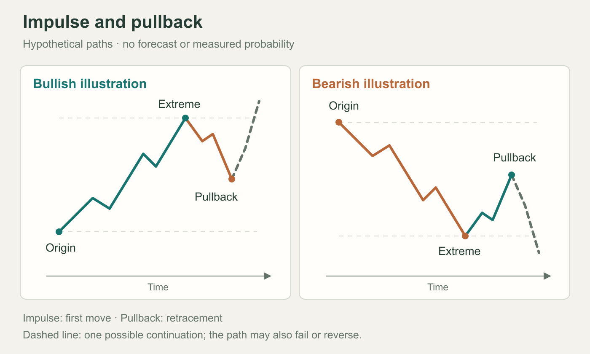
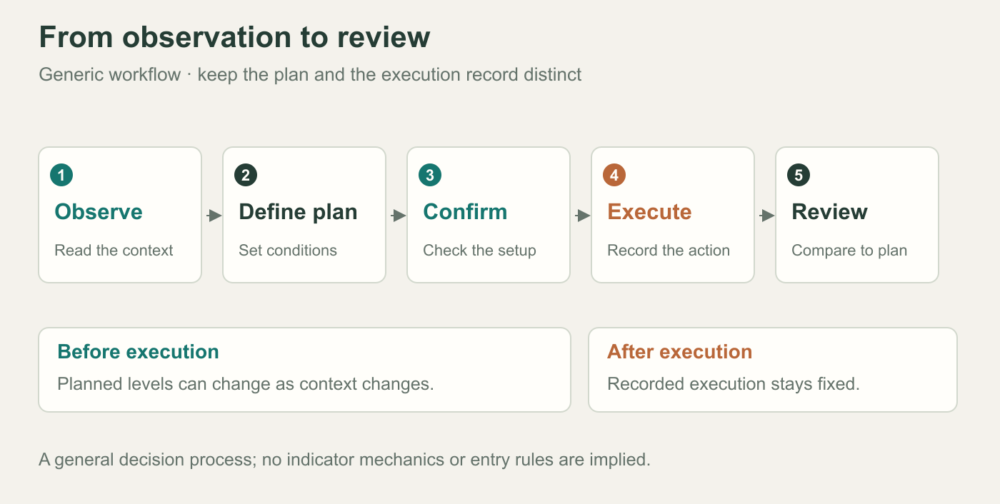
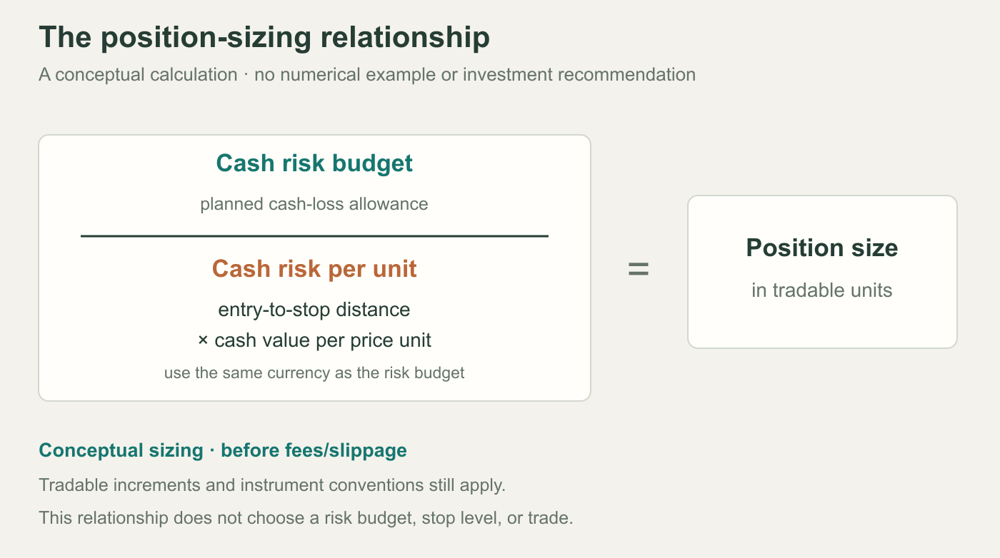

# Trader Assistant Pro: reading companion

A concise chapter guide with original illustrations and links to the author's full manual.

## Using this companion

Choose a chapter from the contents, then follow its source link for the full text and screenshots. The illustrations below are original educational schematics. This companion does not reproduce the book or establish a trading edge.

[Read the full manual](https://willyalgotrader.pro/strategy/manual/)

## Version notes

Version 2 adds presets, trade gating, revised alerts, and adaptive filters.

[Read original update](https://willyalgotrader.pro/strategy/manual/#ch-0)

## 01 · Orientation

Introduces the indicator's purpose, limitations, markets, and suggested reading routes.

[Read original chapter 01](https://willyalgotrader.pro/strategy/manual/#ch-1)

## 02 · Configuration

Covers installation, sizing, trend context, dashboard setup, and instrument presets.

[Read original chapter 02](https://willyalgotrader.pro/strategy/manual/#ch-2)

## 03 · Chart elements

Separates trend context, pattern geometry, planned levels, and entry confirmation.

[Read original chapter 03](https://willyalgotrader.pro/strategy/manual/#ch-3)

## 04 · Pattern structure

Explains impulse–pullback geometry, retracement zones, formation stages, scoring, and invalidation.

[Read original chapter 04](https://willyalgotrader.pro/strategy/manual/#ch-4)

## Illustration · Price structure

Original schematic; dashed paths represent possibilities, not forecasts.

## 05 · Trade lifecycle

Follows setup assessment, pullback, reversal confirmation, execution, exits, and journaling.

[Read original chapter 05](https://willyalgotrader.pro/strategy/manual/#ch-5)

## Illustration · Decision sequence

General workflow. Planning and recorded execution are distinct.

## 06 · Configuration choices

Compares three approaches; presets override selected inputs. Optimization is in-sample.

[Read original chapter 06](https://willyalgotrader.pro/strategy/manual/#ch-6)

## 07 · Risk controls

Distinguishes risk sizing, margin, leverage, portfolio exposure, and loss-streak rules.

[Read original chapter 07](https://willyalgotrader.pro/strategy/manual/#ch-7)

## Illustration · Position sizing

Conceptual sizing before costs. Instrument specifications and execution matter.

## 08 · Notifications

Separates preparatory armed alerts from confirmed-trade events and webhook messages.

[Read original chapter 08](https://willyalgotrader.pro/strategy/manual/#ch-8)

## 09 · Statistics

Dashboard trades are virtual; preset results omit costs and count breakeven as wins.

[Read original chapter 09](https://willyalgotrader.pro/strategy/manual/#ch-9)

## 10 · Process errors

Reviews confirmation, trend, overexposure, stop changes, emotional trading, and recordkeeping.

[Read original chapter 10](https://willyalgotrader.pro/strategy/manual/#ch-10)

## 11 · Optional tools

Adds gap, structure, volume, and volatility tools; anchors lock at Entry touch.

[Read original chapter 11](https://willyalgotrader.pro/strategy/manual/#ch-11)

## 12 · Troubleshooting

Clarifies signal, preset, access, and replay questions; concludes with checklists.

[Read original chapter 12](https://willyalgotrader.pro/strategy/manual/#ch-12)

## Review notes

Reviewed October 13, 2026. The author's live manual may change; its text and screenshots are not archived here.

The chapter descriptions summarize the author's material. Abacus has not verified the indicator, its code, or its claimed performance.

Original source: Willy Collins. Reproduction permission was not established; the user selected this brief companion instead of a full copy.
