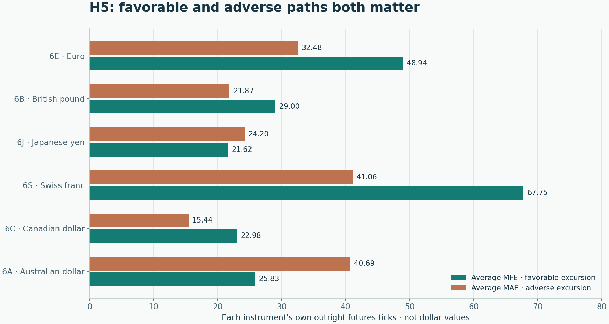
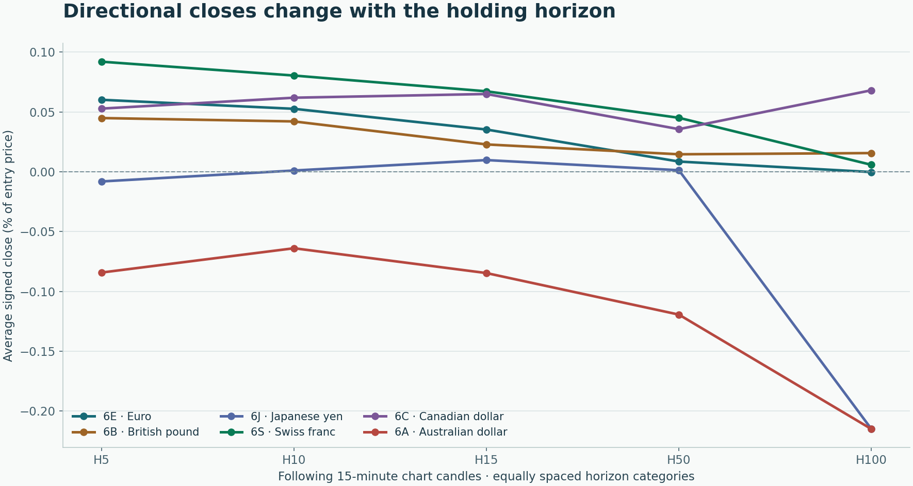
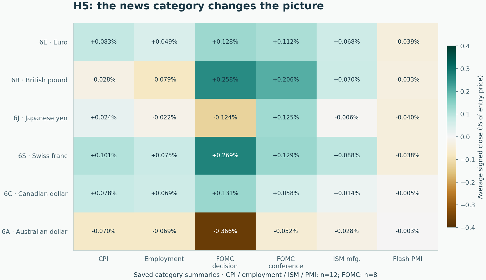

# Forex News: does the pre-release EMA direction carry through?

Across 64 shared U.S. release timestamps, six currency futures show different directional paths. Swiss franc, euro and Canadian dollar have favorable H5 averages; Australian dollar is negative and longer horizons weaken several results. Imported descriptive evidence from a reconstructed year; costs and executable fills were not tested.

## A mixed result, not a general news-trading edge

The saved final analysis follows EMA20/50 direction immediately before scheduled U.S. news. At H5, Swiss franc (6S), euro (6E), Canadian dollar (6C) and British pound (6B) have positive average signed closes. Japanese yen (6J) is slightly negative; Australian dollar (6A) is negative at every saved horizon. The horizon and category views preserve these contrary outcomes.

These are descriptive price paths around selected news timestamps. Favorable excursions are not realized profits, the MFE/MAE ratio is not profit factor, and these results do not establish event causality or future profitability. The Abacus work imported saved evidence and checked presentation transfers; it did not rerun the research.

## The same event clock across six currencies

## One precise entry convention

The 15-minute candle that closes exactly at the scheduled release supplies both the benchmark entry close and EMA direction: EMA20 above EMA50 means long; EMA20 below EMA50 means short. The side is then frozen. The next candle—the candle opening at the release—is the first measured candle. The entry candle's earlier high and low are excluded. The retained source code uses bars[i+1:i+1+h].

H5, H10, H15, H50 and H100 count actual following chart candles, rather than fixed wall-clock intervals. H5 is 75 trading minutes when bars are contiguous; exchange breaks and weekends can extend elapsed time. Independent observations do not truncate one another. Simultaneous components count once per timestamp. Monthly rows use the release's America/Chicago month.

MFE is the largest favorable price excursion from the entry benchmark; MAE is the largest adverse excursion. Signed close is the directional change at the last candle close; positive favors the frozen side. Each percentage distance is divided by its own entry price before averaging. A favorable-close percentage is a frequency, not a net trading win rate.

## H5 overview: same 64 events, six different outcomes

Exact saved common-event summary rows. H counts following 15-minute chart candles; positive signed close favors the frozen entry direction.

See publication.json for exact saved rows and filters.

## H5: opportunity and risk in the same window

Exact saved average excursions for the common 64-event cohort at H5. Values use each instrument's own outright futures ticks, so lengths compare favorable versus adverse paths within an instrument; they do not rank dollar returns across currencies. No uncertainty intervals or executable exit rule were supplied.

## Longer horizons do not guarantee a better close

Exact saved average signed close as a percentage of each entry price, on the same 64 timestamps for every currency and horizon. Horizon positions are categorical. These are signed benchmark price changes, without costs, portfolio sizing or confidence intervals; they are not account returns.

## Inspect each saved horizon

Exact saved common-event summary rows. H counts following 15-minute chart candles; positive signed close favors the frozen entry direction. Offline view shows authored default rows. The published report can select all saved rows.

See publication.json for exact saved rows and filters.

## The release type matters—and groups are small

The source's six U.S. groups are CPI, the employment report, FOMC decision/projections, FOMC press conference, ISM manufacturing and flash PMI. They are U.S. releases applied to every supplied currency, rather than domestic-release studies for each country.

At H5, every currency's flash-PMI average signed close is negative. FOMC decisions are favorable on average in several currencies but adverse in 6J and 6A. Decisions and conferences have only eight observations each; the other selected category groups have twelve each. These exploratory contrasts have no multiple-comparison adjustment, independent holdout or uncertainty intervals in the supplied evidence. Decision and conference windows can overlap.

## H5 news-category map

Saved common-event H5 category averages, normalized by each event's entry price. Both color and signed labels show direction. FOMC groups have eight events each; CPI, employment, ISM and flash PMI have twelve each. Small, dependent exploratory groups do not establish reliable category effects.

## Inspect the news categories

Exact saved common-event summary rows. H counts following 15-minute chart candles; positive signed close favors the frozen entry direction. Offline view shows authored default rows. The published report can select all saved rows.

See publication.json for exact saved rows and filters.

## Inspect monthly consistency

Exact saved common-event summary rows. H counts following 15-minute chart candles; positive signed close favors the frozen entry direction. Offline view shows authored default rows. The published report can select all saved rows.

See publication.json for exact saved rows and filters.

## A reconstructed year with retained native-subset context

The final year continues older native EMA20/50 seeds through merged native OHLC; overlap prices anchor constant adjustment offsets. The reconstructed CSVs are analytical inputs, rather than direct full-year native indicator exports. EMA values can differ from later exports even when selected directions agree.

The original saved validation states that all 1,920 event/horizon rows are complete, that the earlier native57 subset's 5,130 selected price-value comparisons have zero maximum difference, and that all its directions are unchanged. It also records agreement with an earlier full-year 6E aggregate check. These original receipts are retained as imported evidence; Abacus verified their bytes and relevant transfer identities without repeating those numerical checks.

The earlier native57 summary download remains a separate shorter cohort. It must not be pooled with or substituted for the final common64 results. Original indicator/native checks are retained privately as context; native subset agreement does not independently validate the reconstructed year's other observations.

## What the evidence does and does not support

No commissions, bid/ask spreads, slippage, financing, targets, stops or contract sizing were modeled. The pre-news close and back-adjusted continuous prices are analytical benchmarks; they do not guarantee a fill immediately before or at a news release. Tick distances are not dollar P&L. MFE/MAE is a ratio of average excursions, not profit factor.

The calendar is an audited corrected historical schedule, rather than an as-announced historical vintage. Event selection and available history are retrospective. Shared macro shocks link currencies; overlapping windows link observations. The 64 timestamps are not 384 independent macro experiments, and category/month rows should not be treated as independent confirmations.

The retained source provides no confidence intervals, prespecified holdout, event-causality design or cost-tested execution strategy. Positive sample averages therefore remain candidates for further investigation. Negative and inconclusive currency/category/horizon outcomes are part of the finding, not exclusions. The practical next step would require a separate frozen protocol, point-in-time timing and executable cost assumptions.
