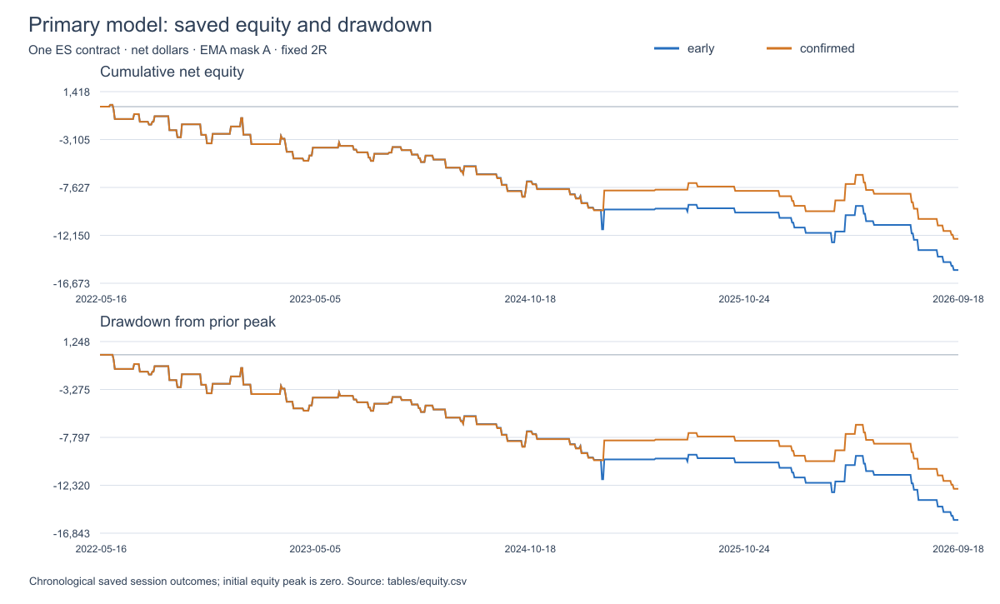
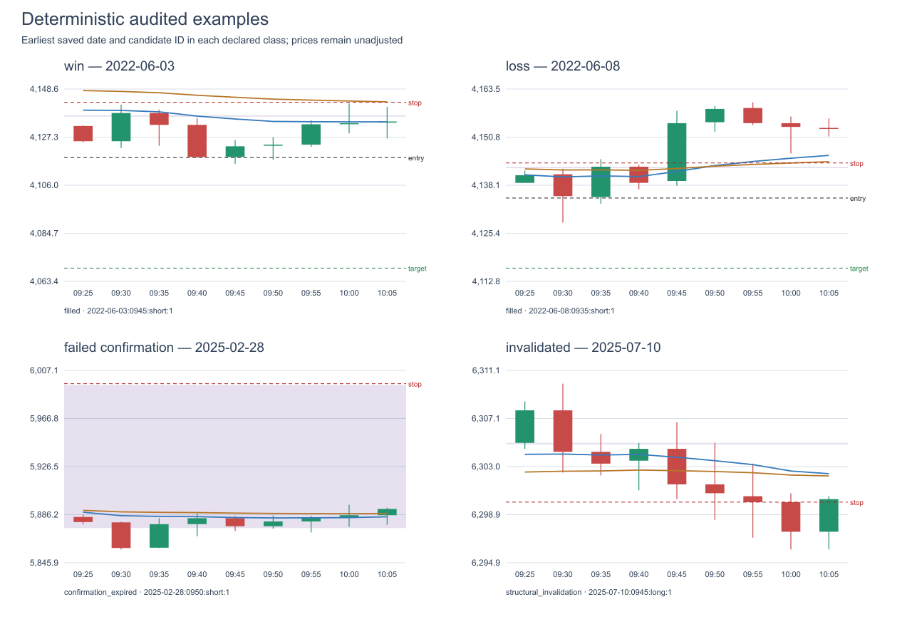

# ES Opening Pivot–Cloud Rejection/Support

Run: `20261021T042230Z_opening_pivot_v1`

## What was tested and what the evidence means

Standard ES 5-minute pivot/cloud reaction candidates between 09:30 and 10:00 New York; early next-open versus pivot-and-cloud-confirmed next-open entries, four frozen EMA masks and two exits. No CVD is used. Primary inference uses mask A, fixed 2R, one contract and the first daily candidate. All saved Verne historical available_at values are unverified/null: this is conditional retrospective research, not evidence that the levels were obtainable before each historical open. The verified availability cohort is empty. The inspiration chart date 2026-09-15 was visually exposed before this study. Regular input gates exclude it because its quoted contract does not match the stitched price contract and published feature readiness is below 250 bars; no date-specific exclusion is applied. Native TradingView parity has not been established.

## Coverage and exclusion waterfall by year

| year | stage | sessions | removed | ambiguous_duplicate_dates | partial_year |
| --- | --- | --- | --- | --- | --- |
| 2022 | exchange_sessions_in_scope | 251.0 | 9.0 | 2.0 | True |
| 2022 | calendar_certified_sessions | 250.0 | 1.0 | 2.0 | True |
| 2022 | dates_with_source_levels | 155.0 | 95.0 | 2.0 | True |
| 2022 | unique_complete_daily_plans | 146.0 | 9.0 | 2.0 | True |
| 2022 | quote_contract_matches | 139.0 | 7.0 | 2.0 | True |
| 2022 | usable_opening_bars | 139.0 | 0.0 | 2.0 | True |
| 2022 | ema_atr_readiness | 128.0 | 11.0 | 2.0 | True |
| 2022 | complete_execution_data | 128.0 | 0.0 | 2.0 | True |
| 2022 | final_input_eligible_sessions | 128.0 | 0.0 | 2.0 | True |
| 2023 | exchange_sessions_in_scope | 250.0 | 10.0 | 3.0 | False |
| 2023 | calendar_certified_sessions | 248.0 | 2.0 | 3.0 | False |
| 2023 | dates_with_source_levels | 242.0 | 6.0 | 3.0 | False |
| 2023 | unique_complete_daily_plans | 235.0 | 7.0 | 3.0 | False |
| 2023 | quote_contract_matches | 230.0 | 5.0 | 3.0 | False |
| 2023 | usable_opening_bars | 230.0 | 0.0 | 3.0 | False |
| 2023 | ema_atr_readiness | 136.0 | 94.0 | 3.0 | False |
| 2023 | complete_execution_data | 136.0 | 0.0 | 3.0 | False |
| 2023 | final_input_eligible_sessions | 136.0 | 0.0 | 3.0 | False |
| 2024 | exchange_sessions_in_scope | 252.0 | 10.0 | 4.0 | False |
| 2024 | calendar_certified_sessions | 249.0 | 3.0 | 4.0 | False |
| 2024 | dates_with_source_levels | 243.0 | 6.0 | 4.0 | False |
| 2024 | unique_complete_daily_plans | 236.0 | 7.0 | 4.0 | False |
| 2024 | quote_contract_matches | 231.0 | 5.0 | 4.0 | False |
| 2024 | usable_opening_bars | 231.0 | 0.0 | 4.0 | False |
| 2024 | ema_atr_readiness | 147.0 | 84.0 | 4.0 | False |
| 2024 | complete_execution_data | 147.0 | 0.0 | 4.0 | False |
| 2024 | final_input_eligible_sessions | 147.0 | 0.0 | 4.0 | False |
| 2025 | exchange_sessions_in_scope | 250.0 | 11.0 | 4.0 | False |
| 2025 | calendar_certified_sessions | 247.0 | 3.0 | 4.0 | False |
| 2025 | dates_with_source_levels | 239.0 | 8.0 | 4.0 | False |
| 2025 | unique_complete_daily_plans | 233.0 | 6.0 | 4.0 | False |
| 2025 | quote_contract_matches | 228.0 | 5.0 | 4.0 | False |
| 2025 | usable_opening_bars | 228.0 | 0.0 | 4.0 | False |
| 2025 | ema_atr_readiness | 194.0 | 34.0 | 4.0 | False |
| 2025 | complete_execution_data | 194.0 | 0.0 | 4.0 | False |
| 2025 | final_input_eligible_sessions | 194.0 | 0.0 | 4.0 | False |
| 2026 | exchange_sessions_in_scope | 179.0 | 8.0 | 2.0 | True |
| 2026 | calendar_certified_sessions | 179.0 | 0.0 | 2.0 | True |
| 2026 | dates_with_source_levels | 171.0 | 8.0 | 2.0 | True |
| 2026 | unique_complete_daily_plans | 169.0 | 2.0 | 2.0 | True |
| 2026 | quote_contract_matches | 166.0 | 3.0 | 2.0 | True |
| 2026 | usable_opening_bars | 166.0 | 0.0 | 2.0 | True |
| 2026 | ema_atr_readiness | 149.0 | 17.0 | 2.0 | True |
| 2026 | complete_execution_data | 149.0 | 0.0 | 2.0 | True |
| 2026 | final_input_eligible_sessions | 149.0 | 0.0 | 2.0 | True |

## Actual eligible coverage

The regular audited gates retain 754 input-eligible sessions from 2022-05-16 through 2026-09-18. Partial years are 2022 and 2026. The waterfall preserves source-level coverage, unique plans, duplicate exclusions, contract matches, opening bars, readiness, execution completeness and final eligibility. All exclusion checks are retrospective input-quality rules; unverified historical level availability remains a separate qualification.

## Primary comparison

Input-eligible pooled sessions: 754. Early trades: 85; confirmed trades: 82. Early net dollars/session: -20.46; confirmed: -16.56. Net dollars/trade: early -181.47, confirmed -152.26. Pooled exploratory early-minus-confirmed net dollars/session: -3.90, day bootstrap 95% interval [-9.99, 0.05]. Locked 2026 temporal-test mean dollars/session: early -33.04, confirmed -27.05; difference -5.99, interval [-17.97, 0.00]. Intervals use 4,000 fixed-seed session resamples; week-cluster intervals are saved separately. This comparison includes zero on genuine no-trade days. Undefined outcomes remain unavailable. A positive point estimate alone does not establish a profitable strategy; annual consistency, temporal test, costs and uncertainty must agree.

## Primary paired comparison and temporal splits

| cohort | paired_sessions | both_filled | left_mean | right_mean | difference_dollars | ci_low | ci_high | week_ci_low | week_ci_high | coincident_rate | confirmation_rate |
| --- | --- | --- | --- | --- | --- | --- | --- | --- | --- | --- | --- |
| pooled_exploratory | 754.0 | 82.0 | -20.457559681697465 | -16.558355437665632 | -3.8992042440318304 | -9.986737400530505 | 0.04973474801061008 | -9.872124843533317 | 0.04947392934197273 | 0.9878048780487805 | 0.9647058823529412 |
| development | 411.0 | 54.0 | -18.87469586374646 | -18.96593673965887 | 0.09124087591240876 | 0.0 | 0.2737226277372263 | 0.0 | 0.28553299492385786 | 0.9814814814814815 | 1.0 |
| validation | 194.0 | 12.0 | -14.149484536082474 | -3.402061855670103 | -10.74742268041237 | -30.927835051546392 | 0.0 | -31.222826086956523 | 0.0 | 1.0 | 0.8571428571428571 |
| temporal_test | 149.0 | 16.0 | -33.036912751678464 | -27.04697986577242 | -5.989932885906041 | -17.969798657718123 | 0.0 | -18.72707266325224 | 0.0 | 1.0 | 0.9411764705882353 |

## Sixteen declared variants

| entry_policy | mask | exit_policy | eligible_sessions | unavailable_sessions | trades | participation | net_per_session | expectancy_r | win_rate | profit_factor | max_drawdown_dollars |
| --- | --- | --- | --- | --- | --- | --- | --- | --- | --- | --- | --- |
| early | A | fixed_2r | 754.0 | 0.0 | 85.0 | 0.11273209549071618 | -20.457559681697465 | -0.2511546238736348 | 0.3058823529411765 | 0.5354964992848036 | 15594.999999999887 |
| early | A | verne | 754.0 | 1.0 | 84.0 | 0.11140583554376658 | undefined | -0.27551660410038914 | 0.44047619047619047 | 0.4712966680048154 | undefined |
| early | B | fixed_2r | 754.0 | 0.0 | 68.0 | 0.09018567639257294 | -11.840185676392482 | -0.12033810061030283 | 0.3382352941176471 | 0.6551424432641269 | 9097.499999999933 |
| early | B | verne | 754.0 | 1.0 | 67.0 | 0.08885941644562334 | undefined | -0.2041035175875742 | 0.47761194029850745 | 0.5033854166666625 | undefined |
| early | C | fixed_2r | 754.0 | 0.0 | 65.0 | 0.08620689655172414 | -15.881962864721485 | -0.2892109276278944 | 0.27692307692307694 | 0.5378232342724818 | 12250.000000000022 |
| early | C | verne | 754.0 | 1.0 | 64.0 | 0.08488063660477453 | undefined | -0.3468602676282142 | 0.40625 | 0.38943099733874004 | undefined |
| early | D | fixed_2r | 754.0 | 0.0 | 53.0 | 0.07029177718832891 | -7.562997347480167 | -0.11919440097735683 | 0.33962264150943394 | 0.7096117122851671 | 6695.0000000000455 |
| early | D | verne | 754.0 | 1.0 | 52.0 | 0.06896551724137931 | undefined | -0.24244107304765825 | 0.46153846153846156 | 0.4624958513109834 | undefined |
| confirmed | A | fixed_2r | 754.0 | 0.0 | 82.0 | 0.10875331564986737 | -16.558355437665632 | -0.23100415358580648 | 0.3170731707317073 | 0.587511357066164 | 12654.999999999887 |
| confirmed | A | verne | 754.0 | 1.0 | 81.0 | 0.10742705570291777 | undefined | -0.27736004614544796 | 0.4444444444444444 | 0.48638600328047904 | undefined |
| confirmed | B | fixed_2r | 754.0 | 0.0 | 66.0 | 0.08753315649867374 | -9.124668435013172 | -0.10298770312542063 | 0.3484848484848485 | 0.7114093959731578 | 7049.999999999932 |
| confirmed | B | verne | 754.0 | 1.0 | 65.0 | 0.08620689655172414 | undefined | -0.18906358835607145 | 0.49230769230769234 | 0.5634747121410827 | undefined |
| confirmed | C | fixed_2r | 754.0 | 0.0 | 63.0 | 0.08355437665782493 | -12.320954907161804 | -0.2772474931923274 | 0.2857142857142857 | 0.6000000000000002 | 9565.000000000022 |
| confirmed | C | verne | 754.0 | 1.0 | 62.0 | 0.08222811671087533 | undefined | -0.3644437150335584 | 0.4032258064516129 | 0.393783105659325 | undefined |
| confirmed | D | fixed_2r | 754.0 | 0.0 | 52.0 | 0.06896551724137931 | -5.185676392573004 | -0.11548432744429611 | 0.34615384615384615 | 0.7808910058839992 | 4902.5000000000455 |
| confirmed | D | verne | 754.0 | 1.0 | 51.0 | 0.06763925729442971 | undefined | -0.24107485438787682 | 0.47058823529411764 | 0.5249576191373115 | undefined |

## EMA filters: participation and uncertainty

| entry_policy | mask | trades | participation | net_per_session | session_ci_low | session_ci_high | expectancy_dollars | expectancy_r | weak_evidence |
| --- | --- | --- | --- | --- | --- | --- | --- | --- | --- |
| early | A | 85.0 | 0.11273209549071618 | -20.457559681697465 | -37.85237068965501 | -3.90915119363401 | -181.47058823529278 | -0.2511546238736348 | False |
| early | B | 68.0 | 0.09018567639257294 | -11.840185676392482 | -27.3939820954908 | 3.339937002652757 | -131.28676470588135 | -0.12033810061030283 | False |
| early | C | 65.0 | 0.08620689655172414 | -15.881962864721485 | -30.754724801060945 | -1.5179045092838195 | -184.23076923076923 | -0.2892109276278944 | False |
| early | D | 53.0 | 0.07029177718832891 | -7.562997347480167 | -21.44612068965535 | 6.4689157824932195 | -107.59433962264237 | -0.11919440097735683 | False |
| confirmed | A | 82.0 | 0.10875331564986737 | -16.558355437665632 | -32.534980106100875 | -0.9971816976128498 | -152.25609756097424 | -0.23100415358580648 | False |
| confirmed | B | 66.0 | 0.08753315649867374 | -9.124668435013172 | -24.002238063659917 | 5.773126657825174 | -104.24242424242321 | -0.10298770312542063 | False |
| confirmed | C | 63.0 | 0.08355437665782493 | -12.320954907161804 | -26.572612732095582 | 1.366462201591215 | -147.46031746031747 | -0.2772474931923274 | False |
| confirmed | D | 52.0 | 0.06896551724137931 | -5.185676392573004 | -18.49900530503961 | 7.90193965517218 | -75.19230769230856 | -0.11548432744429611 | False |

## Do trend filters improve daily results?

early — B: 68/754 sessions traded, -11.84 dollars/session (8.62 versus A), 95% interval [-27.39, 3.34]; C: 65/754 sessions traded, -15.88 dollars/session (4.58 versus A), 95% interval [-30.75, -1.52]; D: 53/754 sessions traded, -7.56 dollars/session (12.89 versus A), 95% interval [-21.45, 6.47]. confirmed — B: 66/754 sessions traded, -9.12 dollars/session (7.43 versus A), 95% interval [-24.00, 5.77]; C: 63/754 sessions traded, -12.32 dollars/session (4.24 versus A), 95% interval [-26.57, 1.37]; D: 52/754 sessions traded, -5.19 dollars/session (11.37 versus A), 95% interval [-18.50, 7.90]. These are observed pooled point estimates, not demonstrated filter superiority. Filtering always acts on the common first candidate, so participation and dollars/session must be assessed together. The temporal-test source table tables/splits.csv and the fifteen-contrast secondary Holm family qualify any apparent gain; no filter is selected from the most favorable cut. Held-out temporal results may differ from pooled results.

## Verne minus 2R on common defined days

| entry_policy | mask | population | paired_sessions | verne_unavailable | difference_dollars | ci_low | ci_high | week_ci_low | week_ci_high |
| --- | --- | --- | --- | --- | --- | --- | --- | --- | --- |
| early | A | common_defined_days | 753.0 | 1.0 | 0.9130146082335807 | -9.911188579017594 | 12.234810756972342 | -9.996953663044932 | 12.193741123960324 |
| early | A | both_filled | 84.0 | 1.0 | 8.184523809522457 | -93.16964285714371 | 110.42410714285691 | -91.20450191571084 | 109.10568019942995 |
| early | B | common_defined_days | 753.0 | 1.0 | -2.8884462151395933 | -13.015023240372194 | 7.420733731739648 | -12.797638783630287 | 7.390235581776881 |
| early | B | both_filled | 67.0 | 1.0 | -32.462686567165875 | -139.5569029850787 | 82.2854477611903 | -139.58333333333238 | 86.50832403273877 |
| early | C | common_defined_days | 753.0 | 1.0 | -2.174634794156646 | -12.07005312084993 | 8.085159362549838 | -11.891478997975621 | 7.3717227236549245 |
| early | C | both_filled | 64.0 | 1.0 | -25.58593749999929 | -138.691406250003 | 88.4765624999962 | -131.95833333333084 | 91.74211149513327 |
| early | D | common_defined_days | 753.0 | 1.0 | -5.262284196547085 | -14.260043160690541 | 3.436254980079562 | -13.879746232269444 | 3.0076098060624674 |
| early | D | both_filled | 52.0 | 1.0 | -76.2019230769222 | -202.175480769232 | 46.64062500000172 | -200.25076304106364 | 44.751533018871086 |
| confirmed | A | common_defined_days | 753.0 | 1.0 | -1.095617529880629 | -11.554199867198143 | 9.462566401062567 | -11.168215524540727 | 9.203489115698371 |
| confirmed | A | both_filled | 81.0 | 1.0 | -10.185185185186588 | -107.87422839506485 | 85.49768518518658 | -105.3571428571426 | 88.11053783614621 |
| confirmed | B | common_defined_days | 753.0 | 1.0 | -2.8884462151395933 | -13.015023240372194 | 7.420733731739648 | -12.797638783630287 | 7.390235581776881 |
| confirmed | B | both_filled | 65.0 | 1.0 | -33.46153846154021 | -146.15865384615705 | 81.34615384614841 | -144.78361035730487 | 89.83572232521153 |
| confirmed | C | common_defined_days | 753.0 | 1.0 | -4.183266932270856 | -13.215886454182904 | 4.731490703851327 | -13.075902523317612 | 4.360050667115715 |
| confirmed | C | both_filled | 62.0 | 1.0 | -50.80645161290249 | -162.30342741935615 | 61.89516129032295 | -155.48084077380744 | 57.330888487208796 |
| confirmed | D | common_defined_days | 753.0 | 1.0 | -5.262284196547085 | -14.260043160690541 | 3.436254980079562 | -13.879746232269444 | 3.0076098060624674 |
| confirmed | D | both_filled | 51.0 | 1.0 | -77.69607843137166 | -206.37254901960526 | 48.54166666666542 | -200.7552884615398 | 49.018750000001 |

## Annual results: partial 2022 and partial 2026

| entry_policy | year | split | eligible_sessions | trades | net_per_session | session_ci_low | session_ci_high | expectancy_r | weak_evidence |
| --- | --- | --- | --- | --- | --- | --- | --- | --- | --- |
| early | 2022 | development | 128.0 | 17.0 | -20.68359374999858 | -75.47460937499791 | 30.118652343750874 | 0.1184682255104194 | True |
| early | 2023 | development | 136.0 | 18.0 | -8.566176470588069 | -41.49172794117647 | 23.827205882353443 | -0.007928411664438103 | True |
| early | 2024 | development | 147.0 | 19.0 | -26.836734693877553 | -58.53826530612245 | 3.470663265306127 | -0.4522387197578666 | True |
| early | 2025 | validation | 194.0 | 14.0 | -14.149484536082474 | -45.05186855670103 | 16.61275773195877 | -0.4377338003866213 | True |
| early | 2026 | temporal_test | 149.0 | 17.0 | -33.036912751678464 | -73.45679530201548 | 8.196308724833703 | -0.4999166218920024 | True |
| confirmed | 2022 | development | 128.0 | 17.0 | -20.68359374999858 | -75.47460937499791 | 30.118652343750874 | 0.1184682255104194 | True |
| confirmed | 2023 | development | 136.0 | 18.0 | -8.566176470588069 | -41.49172794117647 | 23.827205882353443 | -0.007928411664438103 | True |
| confirmed | 2024 | development | 147.0 | 19.0 | -27.091836734693878 | -59.08290816326531 | 3.269982993197296 | -0.45189758915357814 | True |
| confirmed | 2025 | validation | 194.0 | 12.0 | -3.402061855670103 | -24.253865979381445 | 22.310244845360838 | -0.39574602097261263 | True |
| confirmed | 2026 | temporal_test | 149.0 | 16.0 | -27.04697986577242 | -64.91862416107531 | 13.28859060402625 | -0.46741141076025267 | True |

## Prespecified descriptive cuts: early, A, fixed 2R

| cut | cell | eligible_sessions | trades | net_per_session | expectancy_dollars | trade_ci_low | trade_ci_high | expectancy_r | weak_evidence |
| --- | --- | --- | --- | --- | --- | --- | --- | --- | --- |
| cloud_width_atr | [0, 0.25) | 12.0 | 12.0 | -196.6666666666572 | -196.6666666666572 | -534.1666666666515 | 189.79166666666865 | -0.37270286135146397 | True |
| cloud_width_atr | [0.25, 0.5) | 15.0 | 15.0 | -526.6666666666697 | -526.6666666666697 | -790.0208333333379 | -285.0000000000015 | -0.7936732091788966 | True |
| cloud_width_atr | [0.5, 1) | 36.0 | 36.0 | -167.1527777777784 | -167.1527777777784 | -378.2725694444518 | 56.46701388888959 | -0.20541271827773108 | False |
| cloud_width_atr | [1, 2) | 22.0 | 22.0 | 38.7500000000031 | 38.7500000000031 | -251.619318181821 | 344.47443181818215 | 0.11019305921092615 | True |
| cloud_width_atr | unknown | 669.0 | 0.0 | 0.0 | undefined | undefined | undefined | undefined | True |
| confirmation_delay | unavailable | 754.0 | 85.0 | -20.457559681697465 | -181.47058823529278 | -326.33455882352524 | -38.37867647058685 | -0.2511546238736348 | False |
| direction | long | 52.0 | 52.0 | -148.99038461538768 | -148.99038461538768 | -313.1790865384683 | 18.335336538459888 | -0.1925839794763246 | False |
| direction | no_candidate | 669.0 | 0.0 | 0.0 | undefined | undefined | undefined | undefined | True |
| direction | short | 33.0 | 33.0 | -232.65151515150689 | -232.65151515150689 | -473.57954545453845 | 23.4280303030379 | -0.3434477604996995 | False |
| entry_by_mask | early / A | 754.0 | 85.0 | -20.457559681697465 | -181.47058823529278 | -326.33455882352524 | -38.37867647058685 | -0.2511546238736348 | False |
| entry_pivot_distance_points | [0, 1) | 4.0 | 4.0 | -823.75 | -823.75 | -1451.875 | -286.25 | -0.8644135717686702 | True |
| entry_pivot_distance_points | [1, 2) | 6.0 | 6.0 | -348.74999999997345 | -348.74999999997345 | -725.8333333333181 | 107.60416666670514 | -0.5380447631506217 | True |
| entry_pivot_distance_points | [10, inf) | 15.0 | 15.0 | -445.83333333333485 | -445.83333333333485 | -833.3333333333352 | 28.35416666666659 | -0.5510081069642822 | True |
| entry_pivot_distance_points | [2, 5) | 30.0 | 30.0 | 5.833333333334849 | 5.833333333334849 | -166.67708333333485 | 189.17708333333562 | 0.0078108552151894125 | False |
| entry_pivot_distance_points | [5, 10) | 30.0 | 30.0 | -117.50000000000227 | -117.50000000000227 | -332.5104166666705 | 114.1770833333303 | -0.2210474738424001 | False |
| entry_pivot_distance_points | unknown | 669.0 | 0.0 | 0.0 | undefined | undefined | undefined | undefined | True |
| entry_policy | early | 754.0 | 85.0 | -20.457559681697465 | -181.47058823529278 | -326.33455882352524 | -38.37867647058685 | -0.2511546238736348 | False |
| entry_time | 09:35 | 26.0 | 26.0 | -59.80769230769318 | -59.80769230769318 | -293.4855769230846 | 205.57692307692227 | -0.15807016957794512 | True |
| entry_time | 09:40 | 27.0 | 27.0 | -312.8703703703653 | -312.8703703703653 | -517.4999999999983 | -101.29629629629287 | -0.5100792549719647 | True |
| entry_time | 09:45 | 19.0 | 19.0 | -152.3684210526316 | -152.3684210526316 | -472.1052631578877 | 202.3190789473733 | -0.21153131391318603 | True |
| entry_time | 09:50 | 7.0 | 7.0 | -147.85714285713962 | -147.85714285713962 | -837.1428571428474 | 437.85714285714283 | 0.2205299827364065 | True |
| entry_time | 09:55 | 6.0 | 6.0 | -248.75000000000378 | -248.75000000000378 | -734.1666666666667 | 238.75 | -0.16513227513227505 | True |
| entry_time | no_fill | 669.0 | 0.0 | 0.0 | undefined | undefined | undefined | undefined | True |
| execution_ambiguity | no_fill | 669.0 | 0.0 | 0.0 | undefined | undefined | undefined | undefined | True |
| execution_ambiguity | unambiguous | 85.0 | 85.0 | -181.47058823529278 | -181.47058823529278 | -326.33455882352524 | -38.37867647058685 | -0.2511546238736348 | False |
| exit_reason | no_fill | 669.0 | 0.0 | 0.0 | undefined | undefined | undefined | undefined | True |
| exit_reason | stop | 58.0 | 58.0 | -540.9913793103449 | -540.9913793103449 | -610.3879310344812 | -476.1099137931023 | -1.0416966393159794 | False |
| exit_reason | target | 16.0 | 16.0 | 846.562500000007 | 846.562500000007 | 695.0000000000027 | 1046.6015625000168 | 1.9867043662807853 | True |
| exit_reason | time | 11.0 | 11.0 | 218.86363636363637 | 218.86363636363637 | -255.0 | 578.0397727272731 | 0.6620901991432079 | True |
| initial_risk_points | [16, inf) | 10.0 | 10.0 | -727.5000000000023 | -727.5000000000023 | -1246.2500000000043 | -24.968749999999773 | -0.5294211720354823 | True |
| initial_risk_points | [4, 8) | 33.0 | 33.0 | -31.136363636358123 | -31.136363636358123 | -177.7272727272693 | 121.89393939394698 | -0.16097454198095876 | False |
| initial_risk_points | [8, 16) | 42.0 | 42.0 | -169.58333333333442 | -169.58333333333442 | -360.9598214285757 | 29.82142857142753 | -0.2557564624650595 | False |
| initial_risk_points | unknown | 669.0 | 0.0 | 0.0 | undefined | undefined | undefined | undefined | True |
| mask | A | 754.0 | 85.0 | -20.457559681697465 | -181.47058823529278 | -326.33455882352524 | -38.37867647058685 | -0.2511546238736348 | False |
| opening_cloud_position | above | 42.0 | 42.0 | -101.42857142857305 | -101.42857142857305 | -293.4002976190519 | 100.0595238095244 | -0.09406825589509944 | False |
| opening_cloud_position | below | 29.0 | 29.0 | -237.32758620688713 | -237.32758620688713 | -514.0517241379192 | 53.62068965517406 | -0.3424018606261179 | True |
| opening_cloud_position | inside | 14.0 | 14.0 | -305.89285714286365 | -305.89285714286365 | -526.4508928571605 | -63.03571428571579 | -0.5334015945362406 | True |
| opening_cloud_position | unknown | 669.0 | 0.0 | 0.0 | undefined | undefined | undefined | undefined | True |
| opening_pivot_position | above | 49.0 | 49.0 | -140.45918367347218 | -140.45918367347218 | -310.61224489796297 | 39.91071428570891 | -0.20276485803836714 | False |
| opening_pivot_position | below | 35.0 | 35.0 | -191.78571428570714 | -191.78571428570714 | -411.0803571428442 | 41.089285714289005 | -0.3173436640618269 | False |
| opening_pivot_position | inside | 1.0 | 1.0 | -1830.0 | -1830.0 | undefined | undefined | -0.3056367432150313 | True |
| opening_pivot_position | unknown | 669.0 | 0.0 | 0.0 | undefined | undefined | undefined | undefined | True |
| pivot_cloud_separation | [0, 1) | 85.0 | 85.0 | -181.47058823529278 | -181.47058823529278 | -326.33455882352524 | -38.37867647058685 | -0.2511546238736348 | False |
| pivot_cloud_separation | unknown | 669.0 | 0.0 | 0.0 | undefined | undefined | undefined | undefined | True |
| pivot_kind | single | 80.0 | 80.0 | -145.78124999999886 | -145.78124999999886 | -281.10156249999966 | -6.7148437500025295 | -0.2314779097721303 | False |
| pivot_kind | unknown | 669.0 | 0.0 | 0.0 | undefined | undefined | undefined | undefined | True |
| pivot_kind | zone | 5.0 | 5.0 | -752.4999999999955 | -752.4999999999955 | -1377.5 | -177.49999999999545 | -0.5659820494977073 | True |
| pivot_type | HVE | 36.0 | 36.0 | -168.5416666666654 | -168.5416666666654 | -397.03125000000057 | 65.17361111110453 | -0.1398890156205294 | False |
| pivot_type | HVE+YPOC | 1.0 | 1.0 | 82.5 | 82.5 | undefined | undefined | 0.12222222222222222 | True |
| pivot_type | HVE+YVAL | 4.0 | 4.0 | -636.2499999999943 | -636.2499999999943 | -848.7499999999886 | -423.75 | -1.032729044834308 | True |
| pivot_type | YPOC | 8.0 | 8.0 | -323.74999999999716 | -323.74999999999716 | -501.8750000000057 | -139.33593749998016 | -0.8624469389363948 | True |
| pivot_type | YVAL | 10.0 | 10.0 | -310.00000000000455 | -310.00000000000455 | -655.0000000000024 | 52.499999999995566 | -0.2736816575019637 | True |
| pivot_type | other | 26.0 | 26.0 | -46.346153846151225 | -46.346153846151225 | -304.51923076923174 | 244.06250000000358 | -0.10257893935746526 | True |
| pivot_type | unknown | 669.0 | 0.0 | 0.0 | undefined | undefined | undefined | undefined | True |
| pivot_width | [1, 2) | 1.0 | 1.0 | -505.0 | -505.0 | undefined | undefined | -1.035897435897436 | True |
| pivot_width | [10, inf) | 2.0 | 2.0 | -1361.25 | -1361.25 | -1830.0 | -892.5 | -0.6628183716075157 | True |
| pivot_width | [2, 5) | 2.0 | 2.0 | -267.49999999998863 | -267.49999999998863 | -804.9999999999773 | 270.0 | -0.23418803418803447 | True |
| pivot_width | single_price | 80.0 | 80.0 | -145.78124999999886 | -145.78124999999886 | -281.10156249999966 | -6.7148437500025295 | -0.2314779097721303 | False |
| pivot_width | unknown | 669.0 | 0.0 | 0.0 | undefined | undefined | undefined | undefined | True |
| prior_known_volatility | [0, 2) | 5.0 | 5.0 | -132.5 | -132.5 | -365.0 | 310.0 | -0.4447037037037037 | True |
| prior_known_volatility | [2, 4) | 47.0 | 47.0 | -60.31914893616731 | -60.31914893616731 | -199.15558510638246 | 77.97872340425633 | -0.14643193637767432 | False |
| prior_known_volatility | [4, 8) | 31.0 | 31.0 | -403.38709677419286 | -403.38709677419286 | -675.9879032258026 | -103.38709677419347 | -0.42636938178886924 | False |
| prior_known_volatility | [8, 16) | 2.0 | 2.0 | 288.74999999997726 | 288.74999999997726 | -967.5000000000455 | 1545.0 | 0.48756366723259814 | True |
| prior_known_volatility | unknown | 669.0 | 0.0 | 0.0 | undefined | undefined | undefined | undefined | True |
| split | development | 411.0 | 54.0 | -18.87469586374646 | -143.65740740740364 | -310.5671296296292 | 26.481481481485325 | -0.12446828243855965 | False |
| split | temporal_test | 149.0 | 17.0 | -33.036912751678464 | -289.5588235294171 | -586.6176470588318 | 70.75367647059866 | -0.4999166218920024 | True |
| split | validation | 194.0 | 14.0 | -14.149484536082474 | -196.07142857142858 | -580.8928571428571 | 232.5 | -0.4377338003866213 | True |
| target_distance_r | [2, 3) | 85.0 | 85.0 | -181.47058823529278 | -181.47058823529278 | -326.33455882352524 | -38.37867647058685 | -0.2511546238736348 | False |
| target_distance_r | unknown | 669.0 | 0.0 | 0.0 | undefined | undefined | undefined | undefined | True |
| target_identity | fixed_2r | 754.0 | 85.0 | -20.457559681697465 | -181.47058823529278 | -326.33455882352524 | -38.37867647058685 | -0.2511546238736348 | False |
| weekday | Friday | 163.0 | 20.0 | -46.24233128834342 | -376.87499999999886 | -648.7656249999977 | -111.84375000000318 | -0.511675108795311 | True |
| weekday | Monday | 145.0 | 9.0 | -11.775862068965047 | -189.72222222221464 | -536.9791666666641 | 274.1666666666818 | -0.3695470686428622 | True |
| weekday | Thursday | 167.0 | 21.0 | -8.188622754490746 | -65.11904761904546 | -323.46726190476085 | 208.1101190476232 | 0.007064838399405976 | True |
| weekday | Tuesday | 130.0 | 14.0 | 9.461538461538286 | 87.85714285714123 | -328.258928571435 | 550.4017857142827 | 0.1551252961607069 | True |
| weekday | Wednesday | 149.0 | 21.0 | -40.553691275167786 | -287.73809523809524 | -522.2619047619016 | -38.318452380954405 | -0.4813729994383052 | True |
| year | 2022 (partial) | 128.0 | 17.0 | -20.68359374999858 | -155.73529411763636 | -563.0882352940991 | 248.67647058824488 | 0.1184682255104194 | True |
| year | 2023 | 136.0 | 18.0 | -8.566176470588069 | -64.72222222222096 | -307.77777777777396 | 183.24652777778908 | -0.007928411664438103 | True |
| year | 2024 | 147.0 | 19.0 | -26.836734693877553 | -207.6315789473684 | -405.6578947368421 | 27.894736842105264 | -0.4522387197578666 | True |
| year | 2025 | 194.0 | 14.0 | -14.149484536082474 | -196.07142857142858 | -580.8928571428571 | 232.5 | -0.4377338003866213 | True |
| year | 2026 (partial) | 149.0 | 17.0 | -33.036912751678464 | -289.5588235294171 | -586.6176470588318 | 70.75367647059866 | -0.4999166218920024 | True |
| year_by_direction | 2022 (partial) / long | 5.0 | 5.0 | 85.00000000001819 | 85.00000000001819 | -685.0000000000045 | 700.0000000000455 | 0.774141025641039 | True |
| year_by_direction | 2022 (partial) / no_candidate | 111.0 | 0.0 | 0.0 | undefined | undefined | undefined | undefined | True |
| year_by_direction | 2022 (partial) / short | 12.0 | 12.0 | -256.04166666665907 | -256.04166666665907 | -699.7916666666497 | 221.0416666666593 | -0.15472877454400544 | True |
| year_by_direction | 2023 / long | 11.0 | 11.0 | -55.00000000000207 | -55.00000000000207 | -364.1193181818305 | 258.66477272728105 | 0.10351876169980119 | True |
| year_by_direction | 2023 / no_candidate | 118.0 | 0.0 | 0.0 | undefined | undefined | undefined | undefined | True |
| year_by_direction | 2023 / short | 7.0 | 7.0 | -79.9999999999935 | -79.9999999999935 | -422.8571428571299 | 275.4017857142923 | -0.18305968409395704 | True |
| year_by_direction | 2024 / long | 15.0 | 15.0 | -160.0 | -160.0 | -412.5208333333333 | 120.0 | -0.2921254511935635 | True |
| year_by_direction | 2024 / no_candidate | 128.0 | 0.0 | 0.0 | undefined | undefined | undefined | undefined | True |
| year_by_direction | 2024 / short | 4.0 | 4.0 | -386.25 | -386.25 | -498.75 | -273.75 | -1.0526634768740033 | True |
| year_by_direction | 2025 / long | 9.0 | 9.0 | -316.1111111111111 | -316.1111111111111 | -488.3333333333333 | -60.55555555555556 | -0.8146064582439778 | True |
| year_by_direction | 2025 / no_candidate | 180.0 | 0.0 | 0.0 | undefined | undefined | undefined | undefined | True |
| year_by_direction | 2025 / short | 5.0 | 5.0 | 20.0 | 20.0 | -1065.0 | 1117.5 | 0.2406369837566203 | True |
| year_by_direction | 2026 (partial) / long | 12.0 | 12.0 | -193.54166666668561 | -193.54166666668561 | -611.250000000019 | 287.7083333333182 | -0.27586987896438614 | True |
| year_by_direction | 2026 (partial) / no_candidate | 132.0 | 0.0 | 0.0 | undefined | undefined | undefined | undefined | True |
| year_by_direction | 2026 (partial) / short | 5.0 | 5.0 | -519.9999999999727 | -519.9999999999727 | -639.9999999999818 | -399.9999999999636 | -1.0376288049182816 | True |

## Secondary contrasts and multiplicity

| entry_policy | mask | exit_policy | paired_sessions | difference_dollars | ci_low | ci_high | bootstrap_tail_probability | holm_tail_probability |
| --- | --- | --- | --- | --- | --- | --- | --- | --- |
| early | A | verne | 753.0 | 0.9130146082335807 | -9.911188579017594 | 12.234810756972342 | 0.88127968007998 | 1.0 |
| early | B | fixed_2r | 754.0 | 8.61737400530498 | 3.282078912466784 | 14.360991379310319 | 0.0014996250937265683 | 0.020994751312171954 |
| early | B | verne | 753.0 | 5.740371845949324 | -6.08250332005327 | 17.683017928286763 | 0.33341664583854036 | 1.0 |
| early | C | fixed_2r | 754.0 | 4.575596816975977 | -2.7124502652523512 | 12.182112068965543 | 0.21594601349662584 | 1.0 |
| early | C | verne | 753.0 | 2.4070385126161113 | -9.94040504648069 | 15.123505976095501 | 0.7078230442389403 | 1.0 |
| early | D | fixed_2r | 754.0 | 12.894562334217294 | 3.931448938991769 | 22.100049734747987 | 0.0049987503124218945 | 0.05998500374906274 |
| early | D | verne | 753.0 | 7.649402390438096 | -5.139442231075881 | 20.501826029216296 | 0.23344163959010247 | 1.0 |
| confirmed | A | fixed_2r | 754.0 | 3.8992042440318304 | -0.04973474801061008 | 9.986737400530505 | 0.10697325668582855 | 1.0 |
| confirmed | A | verne | 753.0 | 2.808764940238893 | -8.725265604249996 | 15.037931606905776 | 0.6243439140214946 | 1.0 |
| confirmed | B | fixed_2r | 754.0 | 11.332891246684289 | 4.714771220159062 | 19.409897214854052 | 0.000999750062484379 | 0.014996250937265684 |
| confirmed | B | verne | 753.0 | 8.459495351925419 | -4.120268924303082 | 21.399402390437746 | 0.18645338665333666 | 1.0 |
| confirmed | C | fixed_2r | 754.0 | 8.136604774535659 | -0.6404177718833839 | 17.69031830238724 | 0.06748312921769557 | 0.7423144213946513 |
| confirmed | C | verne | 753.0 | 3.96414342629473 | -9.011039176626797 | 17.227838645418444 | 0.5463634091477131 | 1.0 |
| confirmed | D | fixed_2r | 754.0 | 15.271883289124457 | 5.513262599469138 | 25.909814323607105 | 0.0024993751562109472 | 0.032491877030742314 |
| confirmed | D | verne | 753.0 | 10.029880478087499 | -3.1914010624170555 | 23.61254980079652 | 0.1419645088727818 | 1.0 |

## One-factor primary sensitivities

| sensitivity | paired_sessions | left_mean | right_mean | difference_dollars | ci_low | ci_high | week_ci_low | week_ci_high | early_trades | confirmed_trades |
| --- | --- | --- | --- | --- | --- | --- | --- | --- | --- | --- |
| proximity_0.05 | 754.0 | -20.457559681697465 | -16.558355437665632 | -3.8992042440318304 | -9.986737400530505 | 0.04973474801061008 | -9.872124843533317 | 0.04947392934197273 | 85.0 | 82.0 |
| proximity_0.15 | 754.0 | -22.669098143235924 | -18.769893899204096 | -3.8992042440318304 | -9.986737400530505 | 0.04973474801061008 | -9.872124843533317 | 0.04947392934197273 | 86.0 | 83.0 |
| slippage_2 | 754.0 | -23.590848806365898 | -19.592175066312848 | -3.9986737400530505 | -10.162466843501326 | 0.04973474801061008 | -10.09174914706627 | 0.04947392934197273 | 85.0 | 82.0 |
| slippage_4 | 754.0 | -32.27785145888591 | -28.080238726790423 | -4.19761273209549 | -10.544512599469495 | 0.04973474801061008 | -10.468486995108826 | 0.04947392934197273 | 85.0 | 82.0 |
| stop_buffer_0.5 | 754.0 | -19.13129973474792 | -15.298408488063568 | -3.8328912466843503 | -9.887267904509283 | 0.04973474801061008 | -9.794565550015301 | 0.04947392934197273 | 85.0 | 82.0 |
| stop_buffer_1.5 | 754.0 | -21.385941644562184 | -17.420424403182874 | -3.9655172413793105 | -10.036472148541113 | 0.04973474801061008 | -9.970932580388817 | 0.04947392934197273 | 85.0 | 82.0 |

## Equity and drawdown

One ES contract, mask A, fixed 2R. Reference fees and slippage are included. Saved tables/equity.csv is the source.

## Deterministic audited examples

Earliest date and candidate ID per declared class; absent classes remain absent. These examples describe paths and do not estimate performance.

## Audited example identities

| example_class | available | date | candidate_id | direction | entry_time | exit_reason | reason | net_dollars |
| --- | --- | --- | --- | --- | --- | --- | --- | --- |
| win | True | 2022-06-03 | 2022-06-03:0945:short:1 | short | 2022-06-03T09:45:00-04:00 | time | filled | 170.0 |
| loss | True | 2022-06-08 | 2022-06-08:0935:short:1 | short | 2022-06-08T09:35:00-04:00 | stop | filled | -480.0 |
| failed_confirmation | True | 2025-02-28 | 2025-02-28:0950:short:1 | short | undefined | undefined | confirmation_expired | 0.0 |
| invalidated | True | 2025-07-10 | 2025-07-10:0945:long:1 | long | undefined | undefined | structural_invalidation | 0.0 |

## Causal setup and execution rules

Reset setup state at 09:30. A prior close establishes approach direction. Freeze tick-rounded delta=max(1 point,0.10×prior ATR14) at first return touch. The return and next two bars must touch pivot and cloud, with separation no greater than delta on an interaction bar. A directional reaction closes beyond the cloud and creates the common candidate. Early fills next open; confirmed waits for a close beyond pivot and cloud, then fills next open before 10:00. Freeze the structural stop at reaction. Primary exit is 2R or stop with 11:00 flatten; saved Verne targets use the near edge of the first profitable of the first two targets. Use 1-minute sequencing, adverse first for unresolved stop/target ambiguity and worse-opening gap stop fills. Reference costs assume $5 round-trip fees, one adverse market/stop tick, and one tick target trade-through. Unadjusted ES tick=$12.50; point=$50.

## Uncertainty, qualifications and reproduction

2022–2024 is development, 2025 validation and 2026 the locked retrospective temporal test. Parameters were hypotheses; no outcome optimization is claimed. Completeness through 11:00 is assessed retrospectively. Contract mismatches, duplicate daily plans and published feature unreadiness are excluded by the frozen audit, without replacing the price contract or weakening readiness. No data-readiness alternative is substituted for the primary release. Cost, stop-buffer and proximity checks are bounded one-factor sensitivities. Saved tables retain outcome distributions, stop distance, MAE, MFE, holding time, ambiguity optimistic bounds, all declared cuts and paired both-filled outcomes; the both-filled subset omits missed opportunities. Full-period pooled cuts are exploratory and correlated. Undefined ratios, absent targets and missing outcomes remain undefined. Source run: 20261021T042230Z_opening_pivot_v1. Reproduce with the exact commands and frozen input/config hashes in manifest.json and the retained source snapshot. summarize(stage) creates saved statistical evidence; report(stage,study_id,run_id) only renders that saved evidence. Hosted deployment is a separate action.

