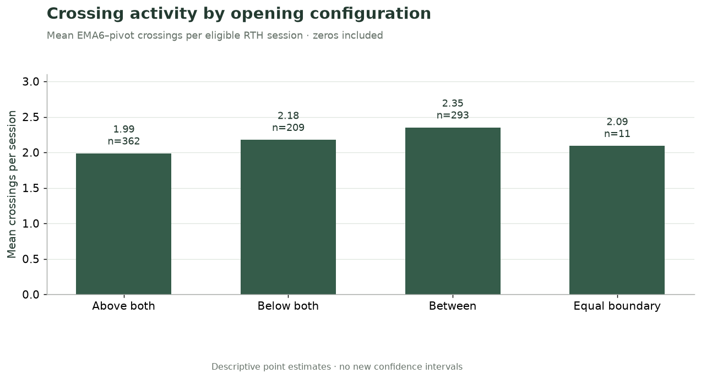
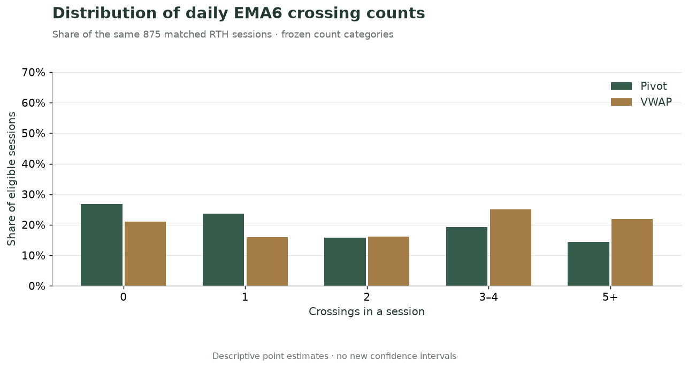
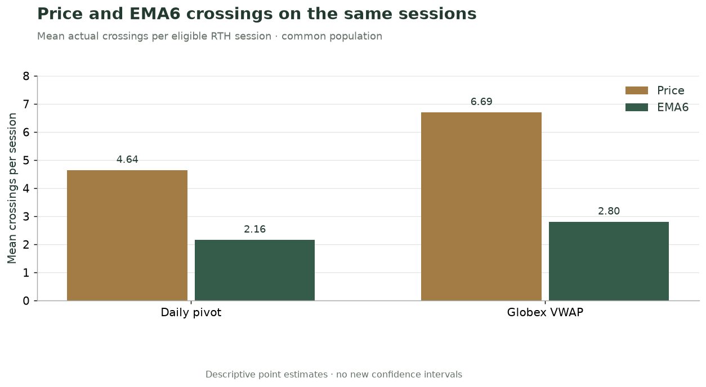
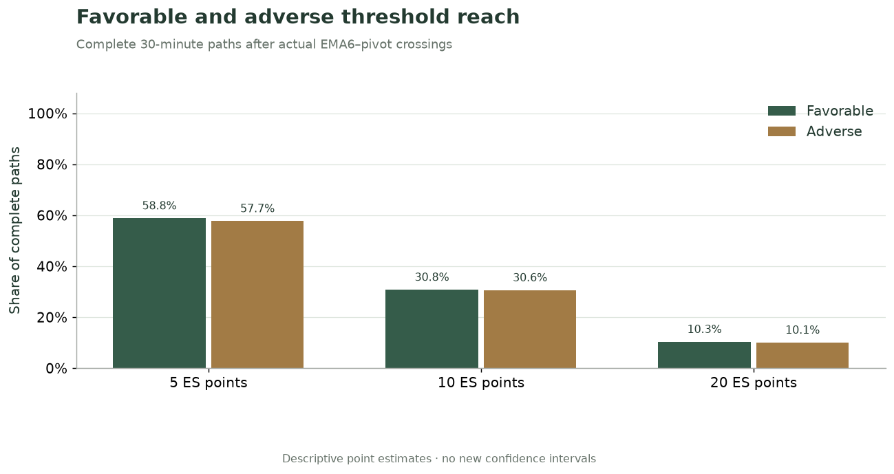
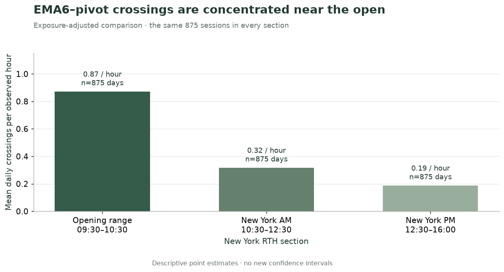
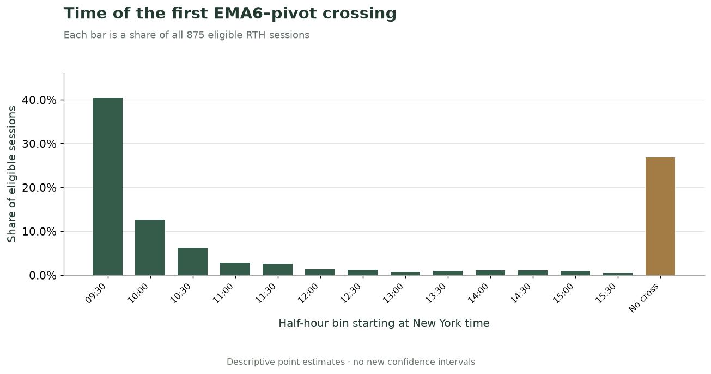
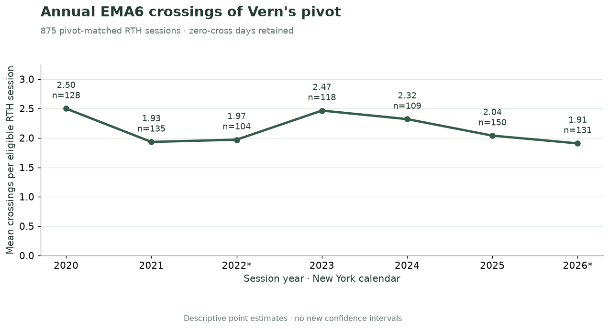

# Vern Pivot Cross Statistics — ES

Source of truth: executed notebook, run `20261108T040901Z_notebook_themes_v2`.

## Opening context

Where does the session begin relative to the pivot, and how far apart are the reference levels?

### How does the opening configuration relate to crossing activity?

Compare the day's EMA6–pivot crossing count across price opening above both pivot and VWAP, below both, between the lines, or on an equal boundary. Opening states use the actual 09:30 snapshot.

All eligible sessions remain in the count, including days without crossings. These are conditional descriptions; source availability and full-day eligibility are retrospective.

**Findings summary.** Mean daily EMA6–pivot counts were 1.99 on 362 above-both days, 2.18 on 209 below-both days, and 2.35 on 293 between-line days. Crossing activity varied with the opening configuration; this does not establish a predictive advantage. The equal-boundary group contains only 11 days and is sparse.

The equal-boundary group is below the 30-day support threshold. Configurations use price, pivot and VWAP at 09:30.

### How far apart are pivot and VWAP at the opening?

Measure the absolute separation of the daily pivot and contemporaneous Globex VWAP at 09:30, once in ES points and once in basis points of the pivot. The two columns are averages of daily measurements, not conversions of an aggregate mean.

The table retains the observed spread of separation without treating it as a selected entry threshold.

**Findings summary.** Across 875 sessions, mean opening separation was 9.48 ES points and 19.80 basis points. The point median was 6.61, below its mean, showing an asymmetric retained distribution. Separation is context, not evidence that a wider gap creates a tradable opportunity.

| Measurement | Unit | Sessions | Mean | Median |
| --- | --- | --- | --- | --- |
| Absolute separation | ES points | 875 | 9.48 | 6.61 |
| Relative separation | Basis points | 875 | 19.80 | 13.18 |

- One 09:30 measurement per eligible day; absolute pivot–VWAP separation. No opening price translation or cross-contract adjustment.

## Crossing activity

How often do price and EMA6 cross the reference levels, including sessions without a crossing?

### How often does EMA6 cross VWAP on pivot-matched days?

Count actual completed three-minute EMA6 transitions through Globex VWAP during RTH on the same 875 pivot-matched sessions used throughout this notebook. Keep zero-cross days in the denominator.

This is a comparison line within the pivot study, with no pooling of the larger VWAP-only populations.

**Findings summary.** EMA6 crossed VWAP 2,450 times across 875 matched sessions: a mean of 2.80 per session, with median 2. A total of 184 sessions had no cross. These are recurrence counts within the pivot-matched cohort.

| Sessions | Crossings | Mean / session | Median | Zero-cross days |
| --- | --- | --- | --- | --- |
| 875 | 2,450 | 2.80 | 2.00 | 184 |

- Actual EMA6–VWAP strict side changes, 09:30–16:00 New York. The opening state and VWAP reset are not crossings.

### How often does EMA6 cross the daily pivot?

Calculate daily EMA6–pivot crossing frequency for the full matched RTH sample and its up/down components. A crossing requires a completed strict-side transition; EMA6 merely being aligned with price is not a new crossing.

All 875 eligible sessions enter every daily mean, including zero-cross days.

**Findings summary.** The sample contained 1,886 EMA6–pivot crossings, a mean of 2.16 per eligible session and median 1. Upward and downward counts were 934 and 952. Daily recurrence differs from the number of independent trading opportunities.

| Crossing direction | Sessions | Crossings | Mean / session | Median |
| --- | --- | --- | --- | --- |
| All directions | 875 | 1,886 | 2.16 | 1.00 |
| Upward | 875 | 934 | 1.07 | 1.00 |
| Downward | 875 | 952 | 1.09 | 1.00 |

- Equality carries the remembered strict side. Session opening initialization is not counted as a crossing.

### How common are zero-cross and repeated-cross days?

Place each day's actual EMA6 crossings into the frozen count categories 0, 1, 2, 3–4 and 5+. Compare pivot and VWAP within the same matched RTH sessions.

The no-cross category remains an observed result, and all categories use the same eligible-day denominator.

**Findings summary.** 235 of 875 sessions (26.9%) had no EMA6–pivot crossing, compared with 184 (21.0%) without an EMA6–VWAP crossing. The distribution shows how frequently these reference lines were crossed repeatedly, without treating multiple crosses within a day as independent days.

Each reference uses all 875 pivot-matched RTH sessions. Zero is an observed count, not missing support.

### How do price and EMA6 crossing counts differ?

Compare actual three-minute closing-price crossings with EMA6 line crossings at pivot and VWAP. Every series uses the same eligible sessions; differences are calculated within the common day/reference population.

These are recurrence counts, not returns from trading the corresponding events.

**Findings summary.** Price averaged 4.64 pivot crossings per session, compared with 2.16 for EMA6 on the same 875 days. The smoothed indicator crossed less often in this sample. That count difference does not demonstrate that either event produces a superior trading result.

All series include zero-cross days. Both price and EMA6 require completed strict-side changes.

## Breaks & confirmation

Does an initially unconfirmed price break return or receive EMA6 confirmation, and what happens before that resolution?

### How often does a price break return before EMA6 confirms it?

Follow price breaks through Vern's pivot that begin with EMA6 opposite, equal with a remembered side, or not yet initialized. Does an actual EMA6 crossing occur before price returns through the pivot?

The percentage uses resolved episodes only. An episode with neither confirmation nor return remains censored. A confirmed episode can have its later return censored without losing its earlier confirmation.

**Findings summary.** Of 2,445 resolved price breaks across 666 days, 1,075 (44.0%) returned through the pivot before EMA6 confirmation. Another 33 episodes remained unresolved and are excluded from that percentage. Almost half of these resolved, initially unconfirmed breaks returned first. This classification becomes known after the break and is not an entry-time signal.

| Observed outcome | Episodes | Share of resolved episodes | Distinct days |
| --- | --- | --- | --- |
| EMA6 confirmed before return | 1,370 | 56.0% | 577 |
| Price returned before confirmation | 1,075 | 44.0% | 494 |
| Unresolved at observation end | 33 | Not available | 33 |

- Resolved denominator: 2,445 episodes; unresolved observations have no resolved-outcome percentage. Distinct-day counts overlap across rows.
- Confirmation status is distinct from censoring of a later return.

### How deep are breaks that return without EMA6 confirmation?

Measure maximum directional penetration beyond the pivot during initially unconfirmed price episodes that return before an actual EMA6 confirmation. The population is selected by the subsequently observed return.

Depth is measured in unadjusted ES points; it is not an assumed loss, stop distance or execution price.

**Findings summary.** The 1,075 returned unconfirmed breaks across 494 days had mean penetration of 3.13 ES points, with median 2.50. The mean exceeds the median in this retained conditional sample. Returned breaks can travel beyond the pivot before reversing; their eventual return is later information.

| Returned episodes | Distinct days | Mean points | Median points |
| --- | --- | --- | --- |
| 1,075 | 494 | 3.13 | 2.50 |

- Conditional on return before confirmation. Unconfirmed unresolved episodes are not treated as returned breaks.

### How much time and movement precede delayed EMA6 confirmation?

Among price episodes with a later actual EMA6 crossing, measure elapsed time from the initial price break and directional price movement to confirmation. Same-close confirmations and already-aligned EMA6 states are distinct.

These measurements condition on eventual confirmation. They do not describe a filter available at the earlier price break.

**Findings summary.** Across 1,370 delayed confirmations on 577 days, the mean lag was 5.07 minutes and mean directional price movement before confirmation was 3.35 ES points. Waiting for confirmation changes the observation time and price reference; it cannot be retrospectively applied as though known at the original break.

| Measurement | Unit | Episodes | Distinct days | Mean | Median |
| --- | --- | --- | --- | --- | --- |
| Confirmation lag | Minutes | 1,370 | 577 | 5.07 | 3.00 |
| Movement before confirmation | ES points | 1,370 | 577 | 3.35 | 2.25 |

- Delayed confirmations only. The new EMA6 crossing must occur while the original price episode remains active.

## After the cross

What do complete subsequent price paths, EMA6 recrosses and pivot retests look like?

### What happens after an actual EMA6–pivot crossing?

Measure directional price displacement after an actual EMA6 crossing at complete 15-, 30- and 60-minute horizons. Positive means movement in the crossing direction; the event-close price is the reference.

Thirty minutes is the protocol's primary horizon. Paths extending beyond RTH or with missing evidence remain unavailable, and earlier extremes of the signal candle are excluded.

**Findings summary.** Across 1,790 complete 30-minute paths on 636 days, mean directional displacement was -0.04 ES points and 48.8% ended strictly positive. Another 96 candidate paths were unavailable. The selected crossing alone did not produce a positive average 30-minute directional displacement in this sample.

| Horizon | Complete paths | Distinct days | Unavailable | Mean ES points | Median ES points | Strictly positive |
| --- | --- | --- | --- | --- | --- | --- |
| 15m | 1,835 | 637 | 51 | 0.12 | 0.25 | 50.0% |
| 30m | 1,790 | 636 | 96 | -0.04 | 0.00 | 48.8% |
| 60m | 1,707 | 629 | 179 | 0.31 | 0.50 | 51.8% |

- Directional displacement starts at event close. Zero is distinct from positive; late/incomplete paths are excluded from each horizon denominator.
- Multiple events on a day are dependent; these are point estimates without newly calculated confidence intervals.

### How far does price travel in either direction after the crossing?

For complete 30-minute paths, calculate favorable and adverse excursions from the crossing close and the share reaching 5, 10 or 20 ES points in each direction.

Both directions can be reached in the same path. Minute-bar extremes do not establish which threshold traded first, a fill price or net profitability.

**Findings summary.** The 1,790 complete paths had mean favorable excursion of 9.04 ES points and mean adverse excursion of 8.65 points. The share reaching 10 favorable points was 30.8%, while 30.6% reached 10 adverse points. Excursion opportunity and adverse exposure coexist; the chart does not encode threshold ordering or a trading result.

A path may reach both favorable and adverse thresholds. No intraminute order or execution is inferred.

### How often does EMA6 avoid recrossing the pivot for 30 minutes?

Track the next reverse actual EMA6 crossing after each EMA6–pivot event. A complete 30-minute RTH window is required to classify absence of a recross.

Incomplete windows remain censored even when a reverse crossing is observed before the boundary. An EMA6 recross is distinct from a price return through the pivot.

**Findings summary.** No reverse EMA6 crossing occurred in 1,110 of 1,790 complete windows (62.0%), on 636 supporting days. Another 96 windows were censored. Remaining on the same pivot side for 30 minutes does not establish a favorable price displacement or profitable trade.

| Window outcome | Windows | Share of complete windows |
| --- | --- | --- |
| No reverse EMA6 crossing | 1,110 | 62.0% |
| Reverse EMA6 crossing | 680 | 38.0% |
| Censored/incomplete window | 96 | Not available |

- Only fully observed 30-minute RTH windows enter the probability denominator. Censored windows have no outcome percentage.

### Does follow-through differ between first and later crossings?

Compare complete 30-minute directional displacement after the first, second and third-or-later actual EMA6–pivot crossings of each RTH session.

Ordinals are known at the event close. Horizon availability remains specific to each event; a late crossing is not assigned a shorter window to complete the table.

**Findings summary.** Mean 30-minute directional displacement was -0.18 ES points after first crossings (636 complete paths), 0.69 after second crossings, and -0.33 after third-or-later crossings. The table retains the different support and unavailable-path counts. These exploratory ordinal groups are not independent replications or a selected trading rule.

| Crossing ordinal | Complete paths | Distinct days | Unavailable | Mean ES points | Median ES points | Strictly positive |
| --- | --- | --- | --- | --- | --- | --- |
| 1 | 636 | 636 | 4 | -0.18 | 0.00 | 48.9% |
| 2 | 419 | 419 | 14 | 0.69 | 0.00 | 49.2% |
| 3+ | 735 | 284 | 78 | -0.33 | -0.25 | 48.4% |

- Ordinals reset by RTH session. Directional movement starts at each event close; 30-minute complete paths only.

### How often does price retest the pivot after an EMA6 crossing?

Look for the first subsequent completed three-minute bar containing the exact pivot within 30 minutes of an actual EMA6–pivot crossing. Complete windows determine retest incidence; observed touches separately support close classifications.

The touch definition uses bar ranges and does not infer an intrabar fill, a limit-order execution or the quality of a retest entry.

**Findings summary.** A retest occurred in 1,134 of 1,790 complete windows (63.4%), supported by 636 days. Another 96 incidence windows were censored. A pivot revisit is a frequent-path description under this bar-based definition; it does not measure whether a retest trade would have filled or made money.

| Observed outcome | Windows | Share of complete windows |
| --- | --- | --- |
| Pivot retest observed | 1,134 | 63.4% |
| No retest in complete window | 656 | 36.6% |
| Censored incidence window | 96 | Not available |

- Retest incidence requires the full declared 30-minute RTH window. An observed touch under a shorter window does not make that incidence window complete.

## VWAP & cloud

How do the other reference line and contemporaneous cloud states relate to pivot-cross paths?

### Does EMA6 reach VWAP before reversing through the pivot?

After an actual EMA6–pivot crossing, observe the next 30 minutes for a strict EMA6 crossing through VWAP before a reverse pivot crossing. The at-risk denominator contains resolved or fully observed sequences starting strictly before the other line.

Simultaneous crossings, already-beyond-VWAP starts and incomplete windows remain separate. A tie at a completed close has no inferred intrabar order.

**Findings summary.** EMA6 reached VWAP before recrossing the pivot in 362 of 705 resolved or fully observed at-risk sequences (51.3%), supported by 429 days. Another 20 sequences were censored. Excluded starting configurations remain visible below, so their large count is not silently absorbed into the conditional probability.

| Sequence disposition | Sequences | Share of at-risk resolved sequences |
| --- | --- | --- |
| Already beyond VWAP at start | 1,013 | Not available |
| Censored: no complete endpoint | 20 | Not available |
| Neither within complete 30 minutes | 86 | 12.2% |
| Pivot recross occurred first | 257 | 36.5% |
| VWAP crossed before pivot recross | 362 | 51.3% |
| Simultaneous reference crossings | 148 | Not available |

- Only reach-before-recross, recross-first and neither-within-complete-window outcomes enter the conditional denominator. Other dispositions are shown with no conditional percentage.
- Origins are pivot crosses; this table does not combine VWAP-origin paths.

### How do cloud states relate to movement after a pivot cross?

Compare complete 30-minute EMA6–pivot paths by contemporaneous cloud support, opposition or mixed state. Support requires directional EMA20/50 ordering and both native five-minute 15-minute slopes in the crossing direction; opposition requires the opposite configuration.

States are recorded at the event close. Conditional outcome groups are exploratory and share days with each other.

**Findings summary.** Mean 30-minute directional displacement was -0.31 ES points with cloud support (645 paths), compared with 0.57 points with opposition (393 paths). Mixed states averaged -0.13 points. The observed ordering does not support assuming that the support label automatically improves this outcome; it is an exploratory conditional comparison.

| Cloud state | Complete paths | Distinct days | Unavailable | Mean ES points | Median ES points | Strictly positive |
| --- | --- | --- | --- | --- | --- | --- |
| support | 645 | 446 | 38 | -0.31 | -0.50 | 47.8% |
| opposition | 393 | 286 | 26 | 0.57 | 0.25 | 50.6% |
| mixed | 752 | 367 | 32 | -0.13 | 0.00 | 48.7% |

- Cloud state is contemporaneous with the EMA6 cross. Distinct-day support overlaps across states; events within a day are dependent.

## Timing & stability

When do crossings occur, which section states persist, and how stable are descriptive averages over time?

### When during RTH are EMA6–pivot crossings most frequent?

Compare the opening range (09:30–10:30), New York AM (10:30–12:30) and New York PM (12:30–16:00). These windows have unequal lengths, so normalize actual crossings by valid observed hours within each day and section, then average those daily rates.

Each section retains all eligible sessions, including zero-cross sessions. Section membership follows bar-open time; a cross becomes known at bar close.

**Findings summary.** The mean daily rate was 0.87 crossings per hour in the opening range, compared with 0.32 in New York AM and 0.19 in New York PM. After accounting for exposure, crossings were most frequent near the RTH open. This describes crossing activity, not trade quality.

Daily section rates are averaged; zero-cross sessions remain included. Window lengths are one, two and three-and-a-half hours.

### When does the first EMA6–pivot crossing occur?

Locate each eligible session's first actual EMA6–pivot crossing by its completed-bar time. Show every half-hour bin chronologically and retain no-cross sessions as a separate category.

The timing mean conditions on days with a crossing; histogram shares use all eligible days. The final 15:30–16:00 bin includes the session-closing endpoint.

**Findings summary.** On 640 days with a crossing, the first cross occurred a mean 57.0 minutes after 09:30, with median 24 minutes. Another 235 sessions had no crossing. The full chronological distribution makes late first events and no-event days visible instead of conditioning them away.

The final half-hour bin includes 16:00. Timing means use crossed days; these bars use all eligible sessions.

### Which cloud states persist from the opening range into later sections?

Compare cloud ordering at the opening-range endpoint with New York AM and PM endpoints. Each probability conditions on the observed opening-range source state and an observed destination.

These are endpoint-to-endpoint descriptions, not states known at the opening or causal forecasts of the next section.

**Findings summary.** Bullish ordering persisted from the opening-range endpoint to the AM endpoint on 75.4% of 468 bullish-source days; bearish ordering persisted on 68.6% of 407 bearish-source days. The PM comparison uses its own destination endpoint. Persistence describes how observed section states relate and cannot be used as opening-time information.

| Opening-range state | Compared with | Observed source days | Persistent days | Persistence share | Unavailable |
| --- | --- | --- | --- | --- | --- |
| bullish | AM endpoint | 468 | 353 | 75.4% | 0 |
| bearish | AM endpoint | 407 | 279 | 68.6% | 0 |
| bullish | PM endpoint | 468 | 302 | 64.5% | 0 |
| bearish | PM endpoint | 407 | 214 | 52.6% | 0 |

- Cloud state at the 10:30 opening-range endpoint is compared with the 12:30 AM and 16:00 PM endpoints. Each row uses its own observed source-state denominator.

### How does recent crossing activity compare with earlier history?

For EMA6–VWAP crossings on pivot-matched RTH days, compare the latest 20, 60 and 120 eligible observed sessions with the disjoint preceding history for each window.

The requested cutoff remains October 30, 2026, but available eligible evidence ends September 18. These are observed-session windows, not fixed calendar intervals; the 20-session estimate is sparse under the study's 30-day rule.

**Findings summary.** EMA6–VWAP crossings averaged 3.25 per session over the last 20 eligible sessions, compared with 2.79 over the disjoint preceding 855. The recent window ended 2026-09-18. The longer windows show how sensitive the comparison is to the chosen observed-session horizon; these exploratory estimates do not establish a new market regime.

| Observed-session window | Recent sessions | Recent mean | Earlier sessions | Earlier mean | Recent start | Recent end |
| --- | --- | --- | --- | --- | --- | --- |
| Last 20 | 20 | 3.25 | 855 | 2.79 | 2026-08-05 | 2026-09-18 |
| Last 60 | 60 | 2.87 | 815 | 2.80 | 2026-05-18 | 2026-09-18 |
| Last 120 | 120 | 2.72 | 755 | 2.81 | 2026-01-23 | 2026-09-18 |

- Means are EMA6–VWAP crossings per pivot-matched RTH session. Earlier history excludes the corresponding recent window.
- The latest usable date is September 18, 2026. The 20-session row is below the 30-day support threshold.

### How does EMA6–pivot crossing frequency vary by year?

Calculate mean actual EMA6–pivot crossings per eligible RTH session in each year, including zero-cross days. The connected points show descriptive annual averages, not a fitted regression.

Coverage differs across years: the 2022 sample begins May 18 and 2026 ends September 18. Each point is labeled with its eligible-session count; the line alone is not a significance test or evidence of a monotonic trend.

**Findings summary.** Annual means ranged from 1.91 to 2.50 EMA6–pivot crossings per eligible session. The highest observed mean was in 2020; the lowest was in 2026. Frequency fluctuated across the retained years. Different source coverage and eligible-session counts limit direct year-to-year comparisons; the line does not establish a persistent trend.

*2022 starts May 18; 2026 ends September 18. Connected annual point estimates have different eligible coverage; no fitted trend or new confidence intervals.

## Scope and interpretation

- Pivot-matched ES regular trading hours, 09:30–16:00 America/New_York: 875 eligible sessions from January 3, 2020 through September 18, 2026. Requested coverage extends through October 30, 2026.
- Historical pivot availability remains unverified. Source/contract and full-day quality eligibility are retrospective.
- These insights reproduce selected descriptive point estimates from retained event, day and section records. No source events or bootstrap confidence intervals are reconstructed in this edition; uncertainty intervals remain in the earlier ranked reports.
- Multiple events within a day are dependent. Conditional and calendar comparisons are exploratory; neither crossing activity nor price-path summaries establish executable profitability.
- Price and actual EMA6 crossings are different events; an already-aligned EMA6 is a separate state. Fixed-horizon outcomes require complete windows and omit earlier signal-bar extremes.
- No trade fills, execution costs or net profitability are modeled. Separate VWAP-only RTH/Globex populations remain companion evidence and are not pooled with the pivot-matched sample.
