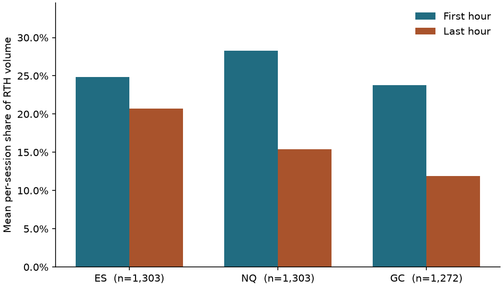

# Daily Facts volume pilot

The notebook pairs the first and last RTH hours within each asset and date. Mean shares use sessions with complete positive RTH volume and weight each session equally. The observation period is June 28, 2021 through September 18, 2026. Estimates describe the retained sample and use each asset's own RTH calendar.

| Asset | Eligible | Hour pairs | Incomplete pairs | Share pairs | First hour higher | Mean first share | Mean last share |
| --- | --- | --- | --- | --- | --- | --- | --- |
| ES | 1303 | 1303 | 0 | 1303 | 76.9% | 24.8% | 20.7% |
| NQ | 1303 | 1303 | 0 | 1303 | 97.2% | 28.3% | 15.4% |
| GC | 1306 | 1272 | 34 | 1272 | 89.5% | 23.8% | 11.9% |

[Executed notebook](daily-facts-volume-pilot.ipynb) · [Coverage](tables/coverage.csv) · [Paired volumes](tables/paired_hours.csv) · [Shares](tables/rth_shares.csv)
