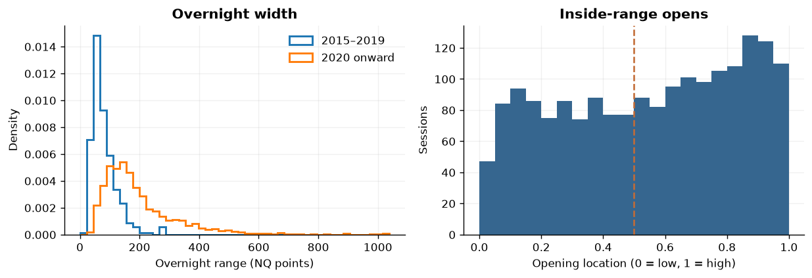
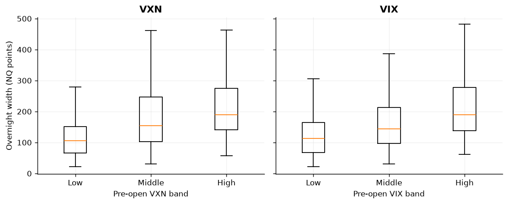
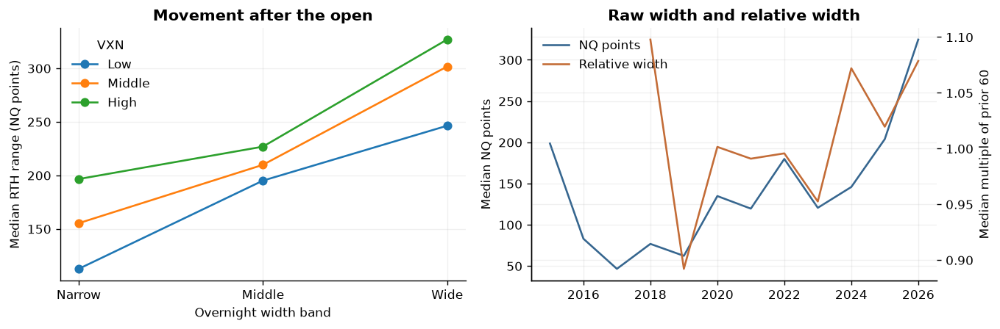
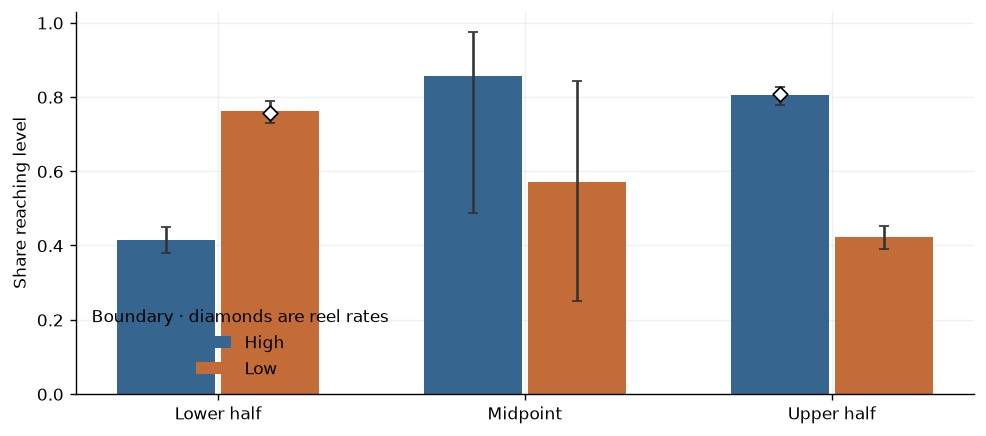
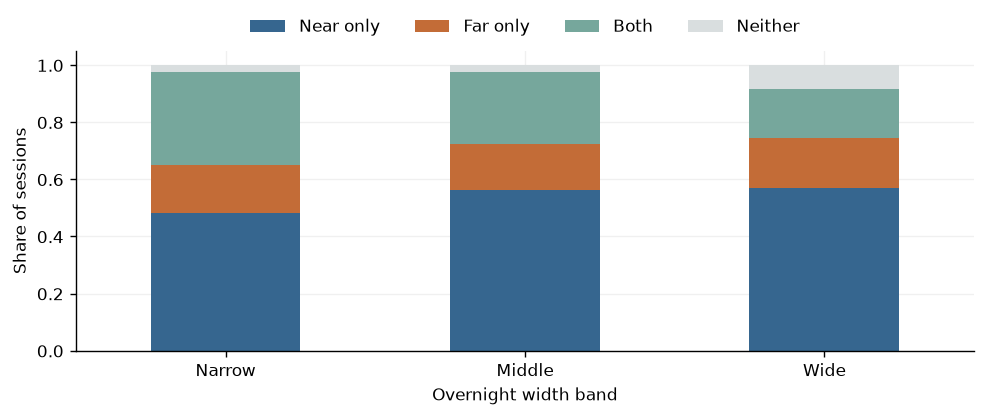
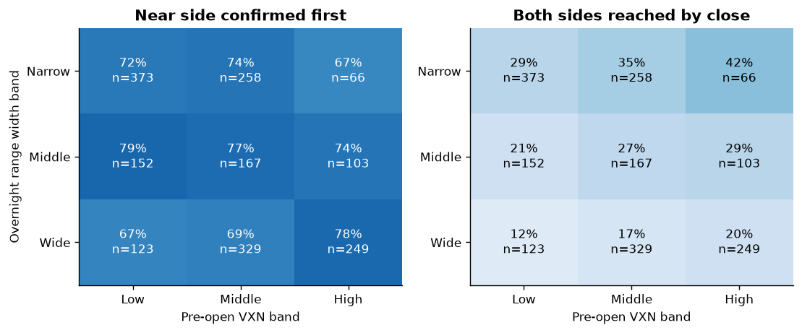
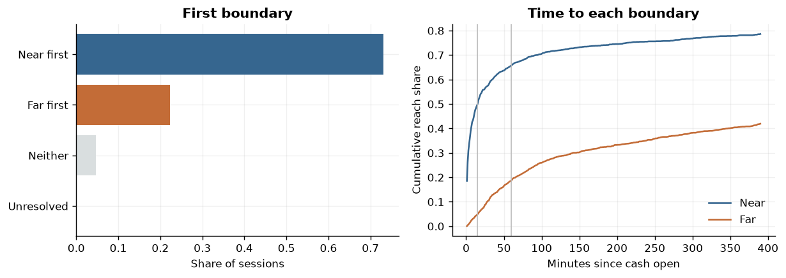
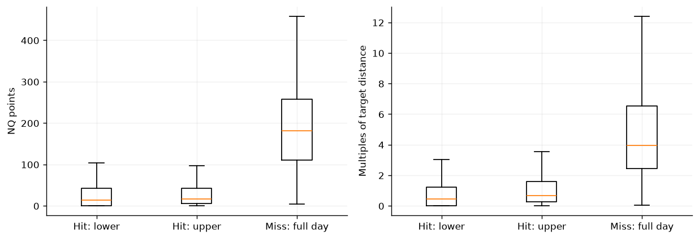
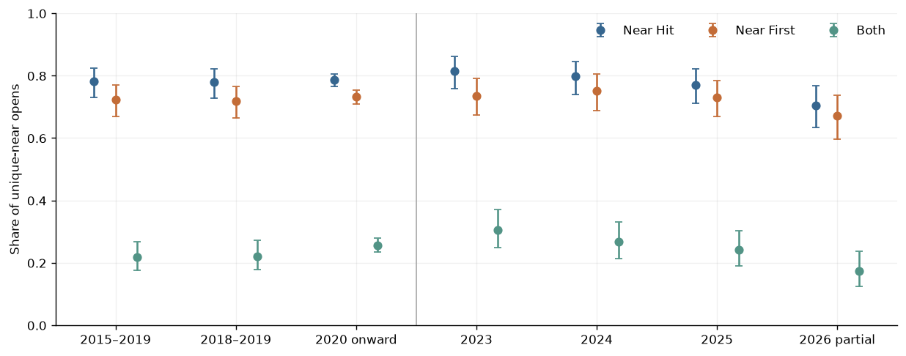
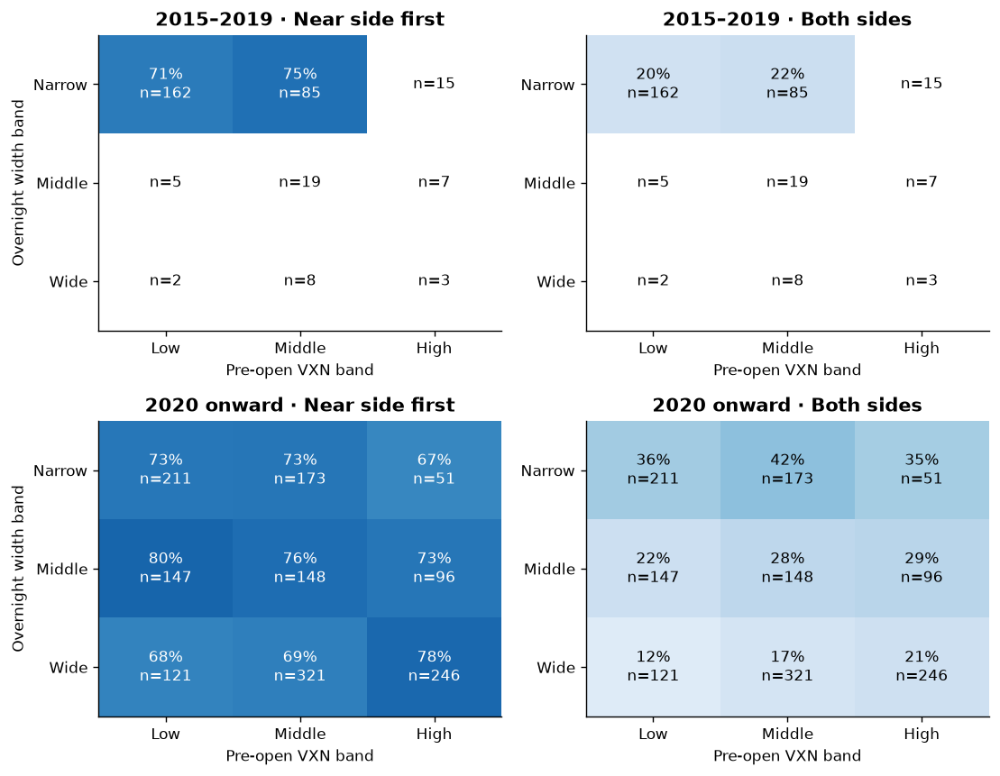

# NQ Overnight Range at the Cash Open

How do the overnight range in points, the opening location and pre-open volatility relate to which boundary NQ reaches? We start with the [reel’s two headline rates](https://www.instagram.com/reel/Dfai3hHvMDn/), then separate eventual touches, first-touch order and the intraday path.

One unadjusted, selected NQ contract per session. Times are New York local. Overnight is 18:00 to 09:30 and regular hours are 09:30 to 16:00, both excluding the end minute. Missing windows, equal-distance opens and unresolved minute order stay visible. Rates describe the retained sample. First-touch order is observed to one minute, and the notebook estimates neither fills nor profitability.

## The overnight range

Start with the coverage, width and location of the cash open.

### Which NQ sessions can answer the question?

Inventory calendar eligibility, overnight and regular-hour completeness, and the final inside-range cohort. A valid open can exist even when a later RTH minute is missing.

The primary sample contains **1,827 inside-range sessions** (307 in 2015–2019 and 1,520 from 2020 onward). The strict early-era cohort has 12 sessions from 2015–2017. The support by year matters when comparing eras.

### How wide is the range, and where does NQ open?

Use complete overnight windows for width and available opening geometry for the location distribution. Points are NQ price points.

Median width was **67.2 NQ points** in 2015–2019 and **160.2 points** from 2020 onward. Of the two-window sessions, 1 opened outside and 1 opened exactly at a boundary.

## Range size & volatility

Separate the observed overnight range from the broader volatility backdrop.

### How wide is the overnight range under low, middle and high volatility?

Compare pre-open VXN and VIX on identical dates. Fixed regime thresholds come from qualified modern development sessions through 2024.

Median overnight width was **105.0 points in low VXN** and **189.1 in high VXN**. On the same 1,829 dates, the corresponding VIX medians were 113.4 and 189.6 points. Frozen cutoffs are 120/170 NQ points, 21/29 VXN and 17/23 VIX.

### How much movement follows a narrow or wide overnight range?

Compare the median first-hour and regular-session range in NQ points. Relative width is the current width divided by the median of the preceding 60 complete eligible overnight windows.

Narrow/high-VXN sessions moved a median **196.5 points** during RTH (n=66). Wide/low-VXN sessions moved **246.2 points** (n=123). Read small groups as descriptive. The width-relative-to-history line separates recent price scale from how unusual the overnight move was at the time.

## Touch rates

Compare the reel’s conditional rates, then inspect how far and near outcomes vary with width and volatility.

### How often does NQ reach the overnight high or low?

A level is reached when a regular-hour minute trades at or beyond it. Each group contains sessions strictly inside the overnight range, with midpoint ties shown separately.

NQ reached the overnight high on **80.4% of upper-half opens** (830/1032) and the overnight low on **76.1% of lower-half opens** (600/788). The reel reported 80.8% and 75.7%, respectively. Its sample and exact event definitions are unknown.

### Do narrow ranges make both sides easier to reach?

Show mutually exclusive near-only, far-only, both and neither outcomes by width. Equal-distance opens are separated from the near-versus-far view.

Both boundaries were reached on **32.6% of narrow sessions** and **17.4% of wide sessions**. The chart keeps both-side movement and directional-only movement separate.

### What happens when range width and volatility disagree?

Separate near-first from both-side reaches. Near-first chart rates keep same-minute cases in the full denominator as unresolved rather than awarding either side. Sparse cells show counts.

Narrow/high VXN had **42.4% both-side reaches (n=66)**. Wide/low VXN had **12.2% both-side reaches (n=123)**. The two panels distinguish which side was first from whether both sides were eventually reached.

## First touch & path

Separate timing, first-touch order and the path before the near target.

### Which boundary goes first, and how fast?

Keep same-minute order unresolved. Timing curves use all unique-near eligible sessions, with misses remaining in the denominator through the full horizon.

The near side went first on **73.1%** of sessions and the far side on **22.3%**. 0 sessions had unresolved order. By the first hour, the near side had been reached on 65.7% of all 1,820 sessions.

### How far does price move away from the near side?

Use the opening price as the reference. For hits, show a lower and upper bound because we cannot tell how much of the touch bar’s adverse extreme occurred before the touch.

On near-side hits, median adverse excursion was bounded by **14.5–16.5 NQ points**. Sessions that missed the near side had a median full-session adverse excursion of **182.0 points** (n=390).

### What remains after the opening minute?

Start the fresh-touch clock with the 09:31 minute. Remove sessions only when the specific boundary being measured was already reached in the opening minute.

The nearer level was reached in the opening minute on **337 sessions**. Of the 1,483 still untouched at 09:31, **73.7%** reached it later.

## Beyond proximity

Compare distances with placebo paths and test whether volatility adds predictive information on later dates.

### Do actual boundaries outperform comparable paths at the same distances?

Replay both distances on prior regular-session paths, matched by opening side, VXN band and era. Use up to 20 dates within two calendar years and require at least five. Each study session receives equal weight.

In the modern era, the near boundary was reached on **78.6%** of matched dates versus **78.5%** on donor paths at the same distances (n=1,477). Prior-path matching can still leave differences in session conditions.

### Does VXN or VIX improve probability estimates on later dates?

Compare distance-only and volatility-augmented models on identical dates from 2025 onward. Lower Brier loss is better. For near-first, omit unresolved ordering; neither remains a negative.

**Neither volatility index showed a clear improvement in held-out Brier loss.** The paired intervals for the index models include zero or are above zero. The conclusion applies to these fixed models and the available later-period sample.

## Era & yearly stability

Compare the pooled eras with recent year-by-year results and a common September cutoff.

### Did the results survive a change in era or year?

Compare 2015–2019, 2018–2019 as a coverage sensitivity, and 2020 onward. The recent annual panel covers 2023–2026. The common-cutoff table uses only January through September 18 each year.

The near side went first on **72.2%** in 2015–2019 (n=306) and **73.3%** from 2020 onward (n=1,514). 2018–2019 contributed 295/307 of the earlier inside-range sessions. 2026 ends September 18. The saved common-cutoff table applies that date to every recent year.

### How did overnight width and pre-open volatility change across recent years?

Compare the annual median range, the median relative to the prior 60 eligible windows, and the pre-open volatility backdrop. The year-to-date columns use the same September 18 cutoff for each year.

Through September 18 in each year, median overnight width was **124.8 points in 2023** and **324.5 points in 2026**. The trailing-width ratio and volatility medians help put the raw point change in context.

### Do width and VXN tell the same story in each era?

Use the same fixed point and VXN bands in both eras. These cells contain different mixes of opening distances, so compare them with the held-out distance-adjusted analysis.

**2 of 9 cells** in the earlier era and **9 of 9** in the modern era have at least 25 sessions. Rates in cells below that threshold are visually muted to counts. The saved distance table groups by near-target distance, and the scenario table groups by relative opening location.

