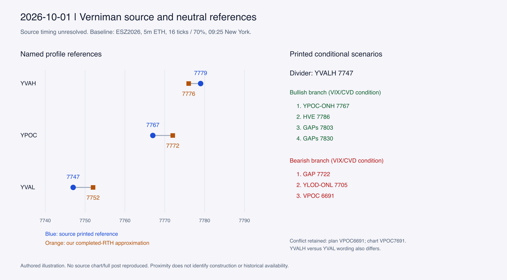

# October 1: below prior value, with conflicting source numbers

This is a qualified structural case, not proof of a causal pre-open target map.
Sources B-20261001, its I01/I02 images and X-2105752800323924362 are pinned in
the [source manifest](../source-manifest.json). The author inspected retained
pixels in Phase 2; these are not fresh visits to the historical X posts.

The figure is our own price comparison, not a copy of Vern's chart. All source
occurrences and uncertain chart readings remain in the
[level inventory](../level-inventory.json); [comparison rows](../baseline-comparison.csv)
retain nearby alternatives rather than a fitted selector.

## Suitability and timing

The canonical plan names ESZ26 and Outlook 10/01. Its chart filenames claim
09:19:45 and 09:20:10, without a printed timezone. The retained blog metadata reuses a 2009 publication
clock, claims a 2026-10-01 09:22:45 New York update, and was captured on October
20. These clocks do not prove the retained version was available by 09:25.
All historical available_at values remain null. Pre-open timing is unresolved.

The dated /ES 3-minute recap shows October 1, 16:09, but no delivery contract.
The separate technical map was posted at 16:12:45 New York according to retained
post metadata and captured October 28. Its visible labels support later presence;
they do not retroactively establish pre-open construction. No new pre-open X
chart or intraday technical revision was retrieved. Selected late MOC records
are order-imbalance commentary, not candidate-level or execution evidence.

## What the sources show

The source describes overnight trade below prior value and uses 7747 as the
conditional divider, with VIX/CVD confirmation. The bullish branch names 7767,
7786, 7803 and 7830; the bearish branch names 7722, 7705 and the anomalous 6691.
These are ordered source scenarios, not trades generated by this study.

The daily image shows two adjacent histograms. Their prior/overnight identities
are inferred from surrounding labels and plan context, without explicit window
endpoints. It labels
YVAL near 7747, YPOC-ONH at an axis badge of 7767.75, YLOD-ONL at 7705, GAP
7722/7803 and VPOC 7691. The upper HVE-YVAH line is around 7779, not the plan's
7786. The weekly image adds an activity histogram and persistent 7830/7856
references, plus lower HVE/GAP levels. Its exact aggregation window is unstated.

The closing map instead prints HVE 7786/7767/7742/7704/7670. This label set
differs from the earlier claimed map. No intermediate revision fixes when those
changes occurred. A visible closing imbalance rectangle describes a later
distribution; it cannot explain the earlier divider through subsequent reactions.

## Construction and selection hypotheses

The neutral 09:25 baseline was freshly captured before target review, using the
verified script and 09:20–09:25 completed bar. All 19 fields matched Phase 1.

| Reference | Source | Neutral baseline | Interpretation limit |
|---|---:|---:|---|
| YVAH | 7779 | Completed RTH VAH 7776 | Three-point profile difference |
| YPOC | 7767 | Completed RTH POC 7772 | Five-point difference; ONH 7767.75 is closer |
| YVAL/divider | 7747 | Completed RTH VAL 7752 | Five-point difference; construction not recovered |
| YLOD-ONL | 7705 | ONL 7705; prior full low 7705.50 | Strong extreme confluence; prior RTH low is 7709.25 |

The exact ONL match and ONH correspondence support the overnight-extreme family.
They do not identify the source POC algorithm. The 7747 divider is explicitly a
value-boundary scenario condition; the source's below-value context could favor
that boundary over the nearer overnight profile center. That is a selection
hypothesis, not a recovered LIS rule. Both the chosen boundary and alternative
baseline references were knowable candidates without using today's actual open.

HVE-YVAH shows confluence of two constructions, not permission to rename VAH as
HVE. Profile shape suggests investigating fuller regions and boundaries, but no
node threshold, edge rule or input profile identity is supplied. The persistent
7830/7856 weekly references support retaining composite context; no causal PBT
anchors or projection formula are visible.

## Contradictions and next evidence

Keep bullish YVALH versus bearish YVAL literal. Preserve plan VPOC 6691 and image
VPOC 7691 as separate observations; the image suggests a transcription/typing
conflict without authorizing a release correction. Also retain HVE 7786 versus
the earlier HVE-YVAH line near 7779. Needed next: a contemporaneous pre-open
revision, exact profile sessions/feed/binning and explicit anchor annotations.
None of the later price path or source-reported trade/P&L markers resolves these
construction questions.
