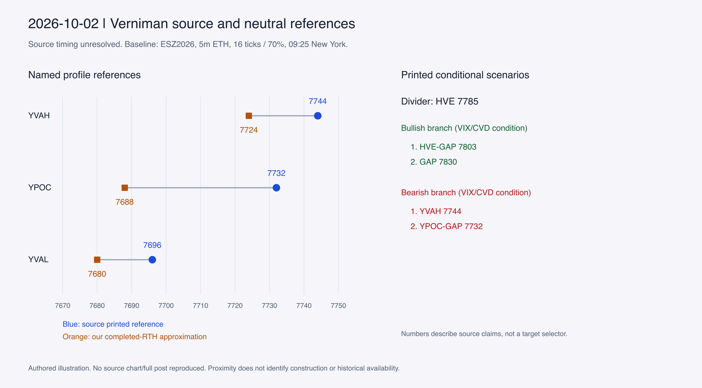

# October 2, 2026: a divider above prior value

The neutral **ESZ2026** map was captured first at 09:25 New York, with all 19
fields ready and the 09:20–09:25 bar last included. Its full-session and RTH
references are from October 1; its previous week starts September 20 at 18:00.
The [protocol](../protocol.md) keeps this information state separate from the
subsequent source review and closing illustration.

This figure is an authored comparison, not a reproduction of Vern's chart.
Exact source identities, private image locators, capture clocks and hashes are
in the [source manifest](../source-manifest.json), [readable-level inventory](../level-inventory.json)
and [baseline comparison](../baseline-comparison.csv).

## Sources and timing

`B-20261002`, the retained [Jobs Report plan](https://verniman.blogspot.com/2009/10/jobs-report.html),
explicitly identifies ESZ26. Its two retained charts, `B-20261002-I01/I02`, show
a daily profile map and a weekly profile map. Their filenames claim October 2
at 09:12, but the retained post has reused 2009 publication metadata, an October
2 update at 11:30 New York and an October 20 capture. **Pre-open availability
remains unresolved; `available_at` stays null.** Filename clocks are not proof
of historical delivery before 09:25.

The retained [closing technical map](https://x.com/kofitrading/status/2106113331052585421),
`X-2106113331052585421`, is timestamped 16:05:22 New York and was captured on
October 28. It supports later presence only. Its visible instrument/session
header is absent, so the actual X-chart contract is unknown. This case includes
a fresh Phase 2 reading of those retained image bytes, not a fresh X visit.

## What the map selects

The daily plan uses **HVE 7785** as its common scenario divider, conditioned on
VIX/CVD confirmation. The upward branch points first to 7803 and then 7830;
the downward branch points to YVAH 7744 and YPOC-GAP 7732. Our baseline contains
no VIX/CVD observation or response criterion, so it cannot reconstruct that
conditional selection.

| Source reference | Independent 09:25 comparison | What this supports |
|---|---|---|
| HVE 7785 | ON range 7723.25–7802.75; ON VAH 7768, POC 7760 | Interior scenario divider; neither ON extreme nor baseline VA boundary |
| GAP / HVE-GAP 7803 | ONH 7802.75 | Close price agreement, not proof that a gap is computed from ONH |
| YVAH 7744 | Completed-RTH VAH 7724; RTH high 7741.25 | Our RTH profile convention does not reproduce the source boundary |
| YPOC-GAP 7732 | Completed-RTH POC 7688; current-week POC 7728 | Weekly modal proximity is a competing reference, not evidence of source identity |
| HVE-YHOD, axis-estimated near 7767 | Previous full high 7767.75; RTH high 7741.25 | Consistent with a full-session extreme; session meaning remains inferred |
| HVE-YLOD, axis-estimated near 7673 | Full and RTH lows both 7672.75 | Agreement cannot distinguish the two session definitions |

The daily chart places 7785 at a profile-shape transition, and the weekly chart
shows a shoulder near that same price. This makes a fuller-region edge a
plausible explanation, distinct from a node center or value boundary. The
histogram's data representation, anchors and binning are unidentified; pixels
do not establish an exact edge detector. The weekly map also labels HVE 7804,
7656, 7634 and GAP 7621, preserving larger-auction alternatives beyond the
plan's ordered destinations. Higher references include HVE 7842, an unpriced
ATH-RTH line and PBT 7856.

## Projections, alternatives and limits

The images print GAP-PBT 7830 and PBT 7856; they do not identify a causal
balance center, bounds or projection width. The previous-week POC 7836 and VAH
7844 are nearby alternatives, not recovered PBT anchors. A center-reflection or
one-range-extension rule therefore remains unidentified without fitting anchors
backward from the answer. Compound GAP/PBT labels preserve confluence.

The closing chart prints 7785 and HVE 7812, alongside a balanced-close
annotation. That later structure cannot establish the pre-open construction or
explain why 7785 was chosen. The fixed 8-tick sensitivity was not executed because
the experimental layout copy was blocked; no day-specific tuning replaced it.
Next evidence needed: a contemporaneously archived pre-open map, exact source
profile/session settings and an explicitly identified pre-cutoff balance for PBT.
