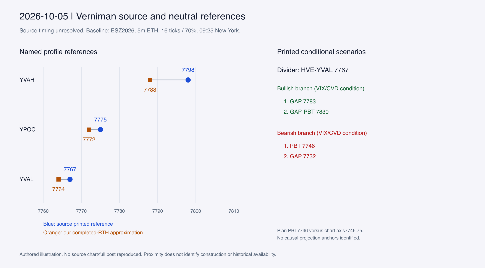

# October 5: a value-edge divider and two projection horizons

The source plan uses **HVE-YVAL 7767** as its conditional divider, with
GAP 7783 then GAP-PBT 7830 above, and PBT 7746 then GAP 7732 below. This
explains the selected levels' stated roles. It does not recover their construction.

## Evidence and timing

Source IDs and private image hashes are in the [source manifest](../source-manifest.json):
daily plan `B-20261005`; intraday/weekly images `B-20261005-I01/I02`;
[closing technical map](https://x.com/kofitrading/status/2107206362547839375)
and [three-minute chart](https://x.com/kofitrading/status/2107205857691971880).
The plan explicitly names ESZ26. The X trade chart says `/ES Today 3m` and
10/5/26; its delivery contract is not printed. The technical map lacks a visible
instrument/session header.

The blog filenames claim 08:55/08:56 and update metadata claims 08:58:47 New York,
but the retained capture is October 20 and the permalink reuses older publication
metadata. Pre-open availability remains **unresolved**, with `available_at=null`.
X timestamps support later presence at 16:26/16:28; their October 28 captures do
not prove that every closing label existed before the open. This is a qualified
structural case, not proof of a historically available 09:25 plan.

The fresh neutral TradingView walkthrough preceded target review. ESZ2026,
5-minute ETH, 16-tick rows/70% VA produced 19/19 references through the confirmed
09:20–09:25 bar. Source full/RTH date was October 2; previous-week start was
September 27 at 18:00. The stage's neutral-baseline record attributes this
walkthrough separately from the retained source-image review.

## What is visible, and what could explain it

The source's YVAH/YPOC/YVAL are 7798/7775/7767; our completed-RTH approximation
gives 7788/7772/7764. The pivot is one point below our overnight POC 7768 and
three above our RTH VAL 7764. Confluence around lower prior value and overnight
acceptance could explain its scenario-divider role. It cannot identify whether
the HVE is a node boundary, the YVAL itself, or a discretionary combination.
Different row allocation, profile/session conventions or feed data compete with
a selection-rule explanation.

The earlier image's axis extrema 7793 and 7760.25 align with the depicted
overnight segment and the later recap's named ONH/ONL lines. Their agreement
with the neutral baseline is a qualified positive control for some price/session
references; the association is read from position, not an explicitly priced
ONH/ONL label in that earlier image. It does not validate the
source's profile method. The smaller pre-open-claimed image shows a fuller
region near the pivot and a red **PBT-ETH** line whose axis price is **7746.75**.
Retain that plotted value separately from the plan's integer 7746; its rounding
convention is unknown.

The weekly image retains a broader distribution, HVE 7812 and lower edges
7704/7656/7634, GAP 7621, and higher GAP-PBT 7830/PBT 7856. This supports a
multi-period reference hypothesis, but its exact member sessions are unknown.
A weekly profile's modal row or VA boundary is insufficient to explain all these
edges. The retained [October 1 map](2026-10-01.md) also shows 7830/7856, supporting
carry-forward references rather than requiring a fresh current-day projection.
The later map labels HVE 7785; the plan's GAP 7783 stays a separate claim.

## Projections, selection and contradictions

Two declared mechanical alternatives fail to identify the bearish PBT uniquely.
The neutral overnight range's one-width downside extension is 7727.50, versus
7746.75 plotted. Reflecting its 7793 high about overnight POC 7768 gives 7743,
3.75 points lower. Nearness does not establish that this was the source's center
or rule. No causal anchor pair or confirmation times were recovered.

The source requires directional VIX/CVD conditions as well as crossing 7767.
Our baseline does not measure those conditions. Nearby alternatives included
RTH low 7754 below and RTH VAH 7788, ONH 7793 and prior high 7810.25 above;
their omission from the plan does not make them invalid. A previous balanced
session and bearish overnight description are source context, not reasons proved
by later reactions. Today's actual RTH open and initial balance were unavailable
at 09:25.

PBT 7878/7890/7917 are visible in the closing map. Earlier crops stop near 7860,
so later-only visibility does not establish intraday creation. Confidence is
high in the readable labels and stated conditional roles, moderate in the
profile-region interpretation, and low in any unique HVE/PBT formula. The next
extension needs explicit region boundaries and a causal anchor ledger before
automatic balance, pivot or target selection.
